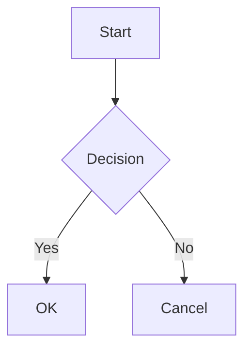

<p align="center">
  <a href="https://yss-tazawa.github.io/plantuml-markdown-preview/">English</a> | <a href="https://yss-tazawa.github.io/plantuml-markdown-preview/#/zh-cn/">简体中文</a> | <a href="https://yss-tazawa.github.io/plantuml-markdown-preview/#/ja/">日本語</a> | <strong>Español</strong> | <a href="https://yss-tazawa.github.io/plantuml-markdown-preview/#/pt-br/">Português</a> | <a href="https://yss-tazawa.github.io/plantuml-markdown-preview/#/ko/">한국어</a> | <a href="https://yss-tazawa.github.io/plantuml-markdown-preview/#/zh-tw/">繁體中文</a>
</p>

<p align="center">
  
</p>

<h1 align="center">PlantUML Markdown Preview</h1>

<p align="center">
  <strong>Diagramas PlantUML, Mermaid y D2 directamente en tu vista previa de Markdown. Fast, Secure o Easy: elige el modo que mejor te encaje.</strong>
</p>

<p align="center">
  <a href="https://marketplace.visualstudio.com/items?itemName=yss-tazawa.plantuml-markdown-preview"></a>
  <a href="https://marketplace.visualstudio.com/items?itemName=yss-tazawa.plantuml-markdown-preview"></a>
  <a href="https://github.com/yss-tazawa/plantuml-markdown-preview/blob/main/LICENSE"></a>
</p>

<p align="center">
  
</p>

Escribe diagramas como código en tu Markdown y míralos renderizados mientras escribes; después, exporta el documento completo a HTML o PDF, con los diagramas incluidos.

## Elige tu modo

| | **Fast** (predeterminado) | **Secure** | **Easy** |
|---|---|---|---|
| | Renderizado rápido | Máxima privacidad | Sin configuración |
| | Un servidor PlantUML local mantiene los diagramas actualizados mientras escribes | Sin red, sin procesos en segundo plano: todo permanece en tu máquina | No requiere Java: funciona de inmediato con un servidor PlantUML en línea |
| **Java** | 11+ requerido | 11+ requerido | No requerido |
| **Red** | Ninguna | Ninguna | Requerida |
| **Privacidad** | Solo local | Solo local | El código del diagrama se envía al servidor PlantUML |
| **Configuración** | [Instalar Java →](#requisitos-previos) | [Instalar Java →](#requisitos-previos) | No requiere configuración |

Cambia entre modos en cualquier momento con un solo ajuste: sin migración, sin reiniciar.

Consulta [Modos de renderizado](#modos-de-renderizado) para más detalles e [Inicio rápido](#inicio-rápido) para la configuración.

## Puntos destacados

- **Diagramas dentro de tu documento** — los diagramas PlantUML, Mermaid y D2 aparecen integrados en tu vista previa de Markdown, no en un panel separado.
- **Seguro al abrir** — los scripts de tu Markdown nunca se ejecutan, ni en la vista previa ni en la exportación a HTML/PDF.
- **Tamaños a tu medida** — ajusta la escala de visualización de los diagramas PlantUML, Mermaid y D2 de forma independiente.
- **Exportación HTML en un solo archivo** — tu documento y tus diagramas en un único archivo HTML, con el ancho y la alineación que elijas.
- **Exportación a PDF con un clic** — imprime a través de Chrome, Edge o Chromium, con los diagramas escalados para ajustarse a la página.
- **Desplazamiento sincronizado en ambos sentidos** — desplázate por el editor o por la vista previa, y el otro te sigue.
- **Navegación sencilla** — salta al inicio o al final, o abre una barra lateral con la tabla de contenidos, directamente desde la vista previa.
- **Visor de diagramas (Diagram Viewer)** — haz clic derecho en cualquier diagrama para desplazarlo y hacer zoom en su propio panel, sincronizado con tus ediciones.
- **Vista de lectura (Reading View)** — lee un archivo Markdown, PlantUML, Mermaid o D2 renderizado en su propia pestaña y vuelve al código fuente en el mismo lugar.
- **Vista previa de diagramas independiente** — abre archivos `.puml`, `.plantuml`, `.mmd`, `.mermaid` y `.d2` directamente, con desplazamiento, zoom y actualizaciones en vivo.
- **Vista previa de revisiones de Git** — mira un archivo Markdown tal como estaba en HEAD o en el área de preparación, renderizado junto a tu vista previa actual, para comparar visualmente los diagramas modificados.
- **Guardar o copiar como PNG / SVG** — haz clic derecho en cualquier diagrama de la vista previa o del Visor de diagramas para guardarlo o copiarlo al portapapeles.
- **17 temas de vista previa** — sigue el tema de color de VS Code o elige uno de los 9 temas claros y 7 oscuros, entre ellos GitHub, Atom, Solarized, Dracula y Monokai.
- **Asistencia en el editor** — autocompletado de palabras clave, un selector de color y fragmentos de código para PlantUML, Mermaid y D2.
- **Disponible en 7 idiomas** — la interfaz está disponible en inglés, chino (simplificado y tradicional), español, portugués de Brasil, japonés y coreano.
- **Soporte para matemáticas** — escribe matemáticas en línea con `$...$` y en bloque con `$$...$$`, renderizadas con [KaTeX](https://katex.org/).

## Tabla de contenidos

- [Elige tu modo](#elige-tu-modo)
- [Puntos destacados](#puntos-destacados)
- [Funcionalidades](#funcionalidades)
- [Inicio rápido](#inicio-rápido)
- [Uso](#uso)
  - [Vista de lectura](#vista-de-lectura)
- [Configuración](#configuración)
- [Fragmentos de código](#fragmentos-de-código)
- [Selector de color](#selector-de-color)
- [Autocompletado de palabras clave](#autocompletado-de-palabras-clave)
- [Atajos de teclado](#atajos-de-teclado)
- [Preguntas frecuentes](#preguntas-frecuentes)
- [Contribuciones](#contribuciones)
- [Licencias de terceros](#licencias-de-terceros)
- [Licencia](#licencia)

## Funcionalidades

### Vista previa de diagramas integrada

Los bloques de código ```` ```plantuml ````, ```` ```mermaid ```` y ```` ```d2 ```` se renderizan como diagramas SVG integrados junto con tu contenido Markdown normal.

- **Actualizaciones en vivo** — la vista previa se actualiza mientras escribes.
- **Actualización al guardar** — al guardar el archivo se actualiza la vista previa.
- **Sigue tus pestañas** — la vista previa cambia junto con la pestaña activa del editor.
- **Indicador de carga** — puedes ver cuándo un diagrama todavía se está renderizando.
- **Mensajes de error claros** — los errores de sintaxis aparecen integrados, con números de línea y el código fuente que los rodea.
- **PlantUML** — se renderiza con Java en tu máquina (modo Fast / Secure) o con un servidor PlantUML (modo Easy); consulta [Modos de renderizado](#modos-de-renderizado).
- **Mermaid** — se renderiza con [mermaid.js](https://mermaid.js.org/), sin tener que instalar Java ni otras herramientas.
- **D2** — se renderiza con el [@terrastruct/d2](https://d2lang.com/) (Wasm) incluido, sin tener que instalar otras herramientas.

### Resaltado del código fuente de diagramas

El código fuente de los diagramas se resalta en el editor, tanto dentro de los bloques
```` ```plantuml ````, ```` ```mermaid ```` y ```` ```d2 ```` en Markdown como en archivos
`.puml`, `.plantuml`, `.mmd`, `.mermaid` y `.d2` independientes. Los colores siguen tu tema actual.

### Soporte para matemáticas

Renderiza expresiones matemáticas usando [KaTeX](https://katex.org/).

- **Matemáticas en línea** — `$E=mc^2$` se renderiza como una fórmula en línea.
- **Matemáticas en bloque** — `$$\int_0^\infty e^{-x}\,dx = 1$$` se renderiza como una fórmula centrada.
- **El mismo aspecto en todas partes** — las fórmulas se ven igual en la vista previa y en la exportación a HTML/PDF.
- **Fácil de desactivar** — establece `enableMath: false` si los signos `$` de tu texto se interpretan como matemáticas.

### Escala de diagramas

Controla el tamaño de visualización de los diagramas PlantUML, Mermaid y D2 de forma independiente.

- **Escala de PlantUML** — elige `auto` (reducir para ajustar) o un porcentaje fijo del 70% al 120% (predeterminado 100%); los diagramas se mantienen nítidos en cualquier escala.
- **Escala de Mermaid** — elige `auto` (reducir para ajustar) o un porcentaje fijo del 50% al 100% (predeterminado 80%).
- **Escala de D2** — elige `auto` (reducir para ajustar) o un porcentaje fijo del 50% al 100% (predeterminado 70%).

### Modos de renderizado

Elige un modo preestablecido que controla cómo se renderizan los diagramas PlantUML:

| | Fast (predeterminado) | Secure | Easy |
|---|---|---|---|
| **Java requerido** | Sí | Sí | No |
| **Red** | Ninguna (solo localhost) | Ninguna | Requerida |
| **Privacidad** | Solo local | Solo local | El código del diagrama se envía al servidor PlantUML |
| **Velocidad** | Instantáneo (servidor local persistente) | Más lento (Java se inicia en cada renderizado) | Depende de la red |

- **Modo Fast** (predeterminado) — mantiene un servidor PlantUML en ejecución en `localhost`, para que los diagramas se actualicen al instante mientras editas. El servidor se inicia con tu primer diagrama PlantUML (puedes cambiarlo; consulta [Modo de inicio](#modo-fast-modo-de-inicio-del-servidor)), y los diagramas nunca salen de tu máquina.
- **Modo Secure** — ejecuta Java y el jar de PlantUML en tu máquina en cada renderizado, sin acceso a la red y sin servidor en segundo plano. Las imágenes locales se bloquean de forma predeterminada para una seguridad máxima.
- **Modo Easy** — envía el código fuente de PlantUML a un servidor PlantUML, así que no hay nada que instalar. Usa el servidor público (`https://www.plantuml.com/plantuml`) de forma predeterminada; apúntalo a tu propio servidor para mayor privacidad.

Si no se encuentra Java al abrir una vista previa, la extensión te ofrece cambiar al modo Easy.

#### Modo Fast: modo de inicio del servidor

De forma predeterminada, el modo Fast inicia y gestiona su propio servidor PlantUML en `127.0.0.1`, sin necesidad de configuración. `plantumlLocalServerStartMode` (Start Mode) controla cuándo ocurre esto, y si ocurre:

| Valor | Efecto |
|---|---|
| `"lazy"` (predeterminado) | Inicia el servidor gestionado en el primer renderizado de un diagrama. Java no se ejecuta hasta que renderices un diagrama PlantUML; el primer renderizado tarda unos segundos más. |
| `"on"` | Inicia el servidor gestionado en cuanto se activa la extensión. El primer renderizado es instantáneo, pero Java sigue ejecutándose en segundo plano desde el arranque. |
| `"off"` | Nunca inicia un servidor. Conéctate a uno que gestiones tú mismo (por ejemplo `java -jar plantuml.jar -picoweb`), incluido uno en otra máquina de tu red local. |

El host y el puerto que se usan para llegar al servidor se controlan con estos ajustes:

| Ajuste | Predeterminado | Efecto |
|---|---|---|
| `plantumlLocalServerHost` | `127.0.0.1` | Host al que conectarse cuando el Start Mode es `"off"` (por ejemplo, un servidor picoweb en otro punto de tu red local). Se ignora para `"on"`/`"lazy"`; un servidor gestionado siempre se vincula a `127.0.0.1`. |
| `plantumlLocalServerPort` | `0` | Start Mode `"on"`/`"lazy"`: puerto en el que iniciar (`0` = asigna automáticamente un puerto libre). Start Mode `"off"`: puerto al que conectarse. |

Conviene saber lo siguiente:

- **Convive con servidores existentes** — con `"on"` o `"lazy"` y un puerto fijo, si ya hay un servidor PlantUML funcionando en ese puerto, se reutiliza en lugar de iniciar uno nuevo.
- **Sin Java local con `"off"`** — la extensión nunca inicia un servidor; solo se conecta al host y al puerto que configures.
- **Tus servidores siguen siendo tuyos** — la extensión solo detiene los servidores que ella misma inició.
- **Se sigue leyendo el ajuste anterior** — si Start Mode no está establecido, se usa el ajuste anterior `plantumlLocalServerAutoStart` (`true` → `"on"`, `false` → `"off"`).

#### Modo Fast: ajustes de memoria (heap) de la JVM

El consumo de memoria del servidor gestionado está limitado por presets de heap (`plantumlLocalServerJvmHeapPreset`):

| Preset | Flags de heap de la JVM | Úsalo cuando |
|---|---|---|
| `small` | `-Xms16m -Xmx256m` | Menor consumo de memoria; solo diagramas pequeños. |
| `medium` (predeterminado) | `-Xms16m -Xmx512m` | Equilibrado; maneja la mayoría de los diagramas sin problemas. |
| `large` | `-Xms64m -Xmx1024m` | Diagramas muy grandes; coincide con la recomendación de las FAQ de PlantUML. |
| `unlimited` | _(ninguno)_ | Sin flags: Java decide (el heap máximo predeterminado es 1/4 de la RAM física). |
| `custom` | tus valores | Usa `plantumlLocalServerJvmInitialHeapMb` (8–32768, predeterminado 16) y `plantumlLocalServerJvmMaxHeapMb` (64–32768, predeterminado 512). |

Todos los presets excepto `unlimited` también fijan `-XX:+UseSerialGC`, `-XX:MaxMetaspaceSize=128m` y `-XX:ReservedCodeCacheSize=64m` para mantener el servidor ligero. Estos ajustes solo se aplican al servidor que la extensión inicia por sí misma (modo Fast, Start Mode `"on"`/`"lazy"`).

### Barra de estado

La barra de estado muestra el modo de renderizado actual (Fast / Secure / Easy) y, en el modo Fast, el estado del servidor local (iniciando, en ejecución, error, detenido).

- **Cambio de modo con un clic** — haz clic en el elemento de la barra de estado para elegir un modo en una selección rápida, sin abrir la Configuración.
- **También en la Paleta de comandos** — el comando **Seleccionar modo de renderizado** hace lo mismo.

Mientras haya una vista previa de Markdown o una vista de lectura visible, la barra de estado también muestra el nivel de zoom de la vista previa. Haz clic en él para elegir otro nivel.

### Exportación HTML

Exporta tu documento Markdown a un único archivo HTML.

- **Diagramas incluidos** — los diagramas PlantUML y D2 se incrustan como SVG integrados; los diagramas Mermaid y las fuentes matemáticas se cargan desde una CDN al abrir el archivo.
- **Estilos incluidos** — los estilos de resaltado de sintaxis van dentro del archivo.
- **Exportar y abrir** — exporta y abre el resultado en tu navegador con un solo comando.
- **Tu diseño** — elige un ancho fijo de 640px a 1440px, centrado o alineado a la izquierda, o **Responsive**, que ocupa toda la ventana del navegador y reduce solo los diagramas que desbordarían. Establece tu ancho y alineación habituales en la Configuración, o elige en cada exportación desde el menú.

### Exportación a PDF

Exporta tu documento Markdown a PDF usando el Chrome, Edge o Chromium que ya tienes en tu equipo.

- **Usa tu navegador** — requiere Chrome, Edge o Chromium instalado en tu sistema.
- **Vertical u horizontal** — elige la orientación al exportar.
- **Escalado uniforme** — el texto y los diagramas se escalan juntos (`pdfScale`, predeterminado 0.625).
- **Páginas limpias** — los márgenes de impresión se aplican automáticamente.

### Exportación masiva de diagramas

Exporta todos los diagramas de un archivo Markdown como archivos PNG o SVG individuales.

- **Todos los diagramas a la vez** — todos los diagramas PlantUML, Mermaid y D2 se exportan en el orden del documento.
- **El nombre de carpeta que quieras** — elige el nombre de la carpeta de salida (predeterminado: `{nombre_archivo}_diagrams`).
- **Requiere la vista previa** — la vista previa debe estar abierta, ya que es ahí donde se renderizan los diagramas.

### Navegación

- **Ir al inicio / Ir al final** — los botones de la esquina superior derecha de la vista previa te llevan allí con un clic.
- **Barra lateral de Tabla de contenidos** — haz clic en el botón TOC para ver todos los encabezados y, luego, haz clic en uno para saltar a él.
- **Zoom** — `Ctrl`+rueda del ratón (`Cmd`+rueda del ratón en Mac) amplía o reduce la vista previa y la vista de lectura del 50% al 200%; un único nivel se aplica a todas ellas y se conserva entre reinicios.

### Visor de diagramas (Diagram Viewer)

Haz clic derecho en cualquier diagrama PlantUML, Mermaid o D2 en la vista previa y selecciona **Abrir en visor de diagramas** para abrirlo en un panel separado con zoom y desplazamiento.

- **Desplazamiento y zoom** — haz zoom con la rueda del ratón alrededor del cursor y arrastra para desplazarte.
- **Barra de herramientas** — Ajustar a la ventana, restablecer 1:1 y zoom por pasos (+/-).
- **Sincronización en vivo** — tus ediciones se reflejan al instante y se conserva tu posición de zoom.
- **Fondo a juego** — el color de fondo sigue el tema actual de la vista previa.
- **Se cierra con su archivo** — el visor se cierra al cambiar a otro archivo fuente.
- **Guardar o copiar como PNG / SVG** — haz clic derecho en un diagrama de la vista previa o del Visor de diagramas para guardarlo como archivo o copiarlo como PNG.
- **Buscar en el visor** — presiona `Cmd+F` / `Ctrl+F` para abrir el widget de búsqueda.
- **Opcional** — desactívalo con `enableDiagramViewer: false`.

### Soporte para `!include` de PlantUML

Usa las directivas `!include` para compartir estilos comunes, macros y definiciones de componentes entre diagramas.

- **Dónde se buscan los archivos** — los archivos incluidos se resuelven desde la raíz del espacio de trabajo o desde la carpeta establecida en `plantumlIncludePath`. En el modo Fast, esto se aplica cuando la extensión ejecuta su propio servidor; consulta las [preguntas frecuentes](#preguntas-frecuentes) para más detalles.
- **Actualización al guardar** — al guardar un archivo incluido se actualiza la vista previa, y el botón **Recargar** (↻) fuerza una actualización en cualquier momento.
- **Ir al archivo include** — haz clic derecho en una línea `!include` de un archivo `.puml` o Markdown para abrir el archivo referenciado.
- **Abrir archivo de origen include** — haz clic derecho en un diagrama PlantUML de la vista previa para abrir directamente sus archivos incluidos.
- **Modos Fast y Secure** — el modo Easy no puede leer tus archivos locales, así que `!include` no está disponible en él.

### Vista previa de diagramas independiente

Abre archivos `.puml`, `.plantuml`, `.mmd`, `.mermaid` o `.d2` directamente, sin necesidad de un envoltorio Markdown.

- **Desplazamiento y zoom** — los mismos controles que el Visor de diagramas.
- **Actualizaciones en vivo** — la vista previa se actualiza mientras escribes.
- **Sigue tus pestañas** — la vista previa cambia contigo cuando pasas de un archivo a otro del mismo tipo.
- **Temas** — elige el tema de vista previa y el tema de diagrama de forma independiente.
- **Guardar o copiar como PNG / SVG** — haz clic derecho en el diagrama.
- **Buscar en la vista previa** — presiona `Cmd+F` / `Ctrl+F` para abrir el widget de búsqueda.
- **PlantUML** — funciona en los tres modos de renderizado (Fast / Secure / Easy).
- **Mermaid** — se renderiza con mermaid.js.
- **D2** — se renderiza con @terrastruct/d2 (Wasm), con el tema y el motor de diseño que elijas.

### Vista previa de revisiones de Git

Renderiza un archivo Markdown tal como estaba en una revisión de Git, en un panel lateral, para comparar un diagrama modificado en paralelo en lugar de leerlo como diferencia de texto.

- **HEAD** — la última versión confirmada.
- **Preparada** — la versión actualmente preparada para confirmar.
- **Lado a lado** — se abre junto a tu vista previa actual, de modo que los diagramas antiguo y nuevo quedan visibles a la vez.
- **Instantánea** — se renderiza una vez y no sigue las ediciones posteriores; un aviso en la parte superior lo indica.
- **Requiere Git** — el archivo debe estar versionado en un repositorio Git.

### Sincronización de desplazamiento bidireccional

El editor y la vista previa se mantienen sincronizados mientras te desplazas por cualquiera de los dos.

- **Posiciones alineadas** — la vista previa se alinea con la parte del código fuente que estás mirando.
- **Estable** — tu posición de desplazamiento se mantiene cuando la vista previa se vuelve a renderizar.

### Temas

Los **temas de vista previa** controlan la apariencia general del documento:

**Tema VS Code:**

| Tema | Estilo |
|-------|-------|
| Follow VS Code Color Theme | Sigue el tema de color actual de VS Code, como la vista previa de Markdown integrada. La exportación a HTML/PDF usa VS Code Light 2026 o Dark 2026 según corresponda |

**Temas claros:**

| Tema | Estilo |
|-------|-------|
| GitHub Light | Fondo blanco (predeterminado) |
| Atom Light | Texto gris suave, inspirado en el editor Atom |
| One Light | Blanco roto, paleta equilibrada |
| Solarized Light | Beige cálido, agradable a la vista |
| Vue | Acentos verdes, inspirado en la documentación de Vue.js |
| Pen Paper Coffee | Papel cálido, estética manuscrita |
| Coy | Casi blanco, diseño limpio |
| VS | Colores clásicos de Visual Studio |
| VS Code Light 2026 | Vista previa de Markdown integrada de VS Code con el tema de color Light 2026 |

**Temas oscuros:**

| Tema | Estilo |
|-------|-------|
| GitHub Dark | Fondo oscuro |
| Atom Dark | Paleta Tomorrow Night |
| One Dark | Oscuro inspirado en Atom |
| Dracula | Oscuro vibrante |
| Solarized Dark | Turquesa profundo, agradable a la vista |
| Monokai | Sintaxis vívida, inspirado en Sublime Text |
| VS Code Dark 2026 | Vista previa de Markdown integrada de VS Code con el tema de color Dark 2026 |

Cambia los temas de vista previa al instante desde el icono de la barra de título, sin que se vuelvan a dibujar los diagramas. Cambiar el tema de PlantUML sí vuelve a dibujar los diagramas.

Los **temas de PlantUML** controlan el estilo del diagrama de forma independiente. La extensión descubre los temas disponibles de tu instalación de PlantUML y los muestra en la misma selección rápida que los temas de vista previa.

Los **temas de Mermaid** controlan el estilo de los diagramas Mermaid: `default`, `dark`, `forest`, `neutral`, `base`. También están en la misma selección rápida.

Los **temas de D2**: 19 temas integrados (ej. `Neutral Default`, `Dark Mauve`, `Terminal`), que puedes elegir en los ajustes o en la misma selección rápida.

### Resaltado de sintaxis

Soporte para más de 190 lenguajes a través de highlight.js. Los bloques de código se estilizan para coincidir con el tema de vista previa seleccionado.

### Seguridad

- **Política de scripts estricta** — la vista previa solo ejecuta los scripts propios de la extensión.
- **Nada de código de tus documentos** — las etiquetas `<script>` y cualquier otro código del Markdown nunca se ejecutan, ni en la vista previa ni en la exportación a HTML/PDF.
- **Imágenes locales según el modo** — de forma predeterminada, las imágenes locales siguen el modo (`allowLocalImages: "mode-default"`); el modo Secure las bloquea para una seguridad máxima.
- **Sin imágenes por HTTP sin cifrar de forma predeterminada** — la carga de imágenes por HTTP sin cifrar está desactivada (`allowHttpImages`); actívala solo en redes de confianza, como una intranet o un servidor de desarrollo local.

### Integración con la vista previa de Markdown integrada de VS Code

Los diagramas PlantUML, Mermaid y D2 también se muestran en la vista previa de Markdown integrada de VS Code (`Markdown: Abrir vista previa en el lateral`), sin configuración adicional. Para los temas de vista previa, la sincronización del desplazamiento y la exportación HTML, abre la vista previa propia de esta extensión (`Cmd+Alt+V` / `Ctrl+Alt+V`). También es la mejor opción para diagramas PlantUML grandes, que pueden congelar brevemente el editor en la vista previa integrada.

### Alertas al estilo GitHub

Renderiza alertas al estilo GitHub (llamadas de atención) a partir de marcadores de cita en bloque, igualando la salida propia de GitHub.

```markdown
> [!NOTE]
> Highlights information that users should take into account.

> [!TIP]
> Optional information to help a user be more successful.

> [!IMPORTANT]
> Crucial information necessary for users to succeed.

> [!WARNING]
> Critical content demanding immediate user attention.

> [!CAUTION]
> Negative potential consequences of an action.
```

- **Cinco tipos** — `NOTE`, `TIP`, `IMPORTANT`, `WARNING` y `CAUTION`, cada uno con su propio icono y color de acento.
- **Las mismas reglas que GitHub** — el marcador debe estar solo en su línea (en mayúsculas o minúsculas: `[!note]` también funciona), y solo una cita en bloque del nivel superior del documento se convierte en alerta. `> [!NOTE] My title` y un marcador dentro de un elemento de lista o de otra cita en bloque se quedan como citas en bloque normales.
- **Se adaptan al tema** — los colores se adaptan al tema de vista previa activo, claro u oscuro.
- **El mismo aspecto en todas partes** — las alertas se ven igual en la vista previa y en la exportación a HTML/PDF.

### Notas al pie y listas de tareas

Renderiza notas al pie y listas de tareas escritas con la sintaxis de GitHub, igualando la salida propia de GitHub.

```markdown
A sentence with a footnote.[^1]

[^1]: The footnote text.

- [x] Finished task
- [ ] Open task
```

- **Notas al pie** — una referencia `[^1]` enlaza con su nota al final del documento, y la nota enlaza de vuelta a la referencia.
- **Listas de tareas** — los elementos `- [ ]` y `- [x]` muestran casillas de verificación. Solo muestran el estado; hacer clic en ellas no cambia el documento.
- **El mismo aspecto en todas partes** — las notas al pie y las listas de tareas se ven igual en la vista previa y en la exportación a HTML/PDF.

## Inicio rápido

### Requisitos previos

**Mermaid** — sin requisitos previos. Funciona de inmediato.

**D2** — sin requisitos previos. Renderizado mediante el Wasm de [D2](https://d2lang.com/) incluido: funciona de inmediato.

**PlantUML (modo Easy)** — sin requisitos previos. El código del diagrama se envía a un servidor PlantUML para su renderizado.

**PlantUML (modo Fast / Secure)** — predeterminado:

| Herramienta | Propósito | Verificar |
|------|---------|--------|
| [Java 11+ (JRE o JDK)](#configuración) | Ejecuta PlantUML (el PlantUML 1.2026.10 incluido requiere Java 11+) | `java -version` |
| [Graphviz](https://graphviz.org/) | Opcional: necesario para diagramas de clase, componentes y otros dependientes del diseño (ver [Soporte de diagramas](#soporte-de-diagramas)) | `dot -V` |

PlantUML viene incluido (LGPL, v1.2026.10): no hay nada que descargar. Java 11 o posterior es el único requisito; Graphviz es opcional.
¿Todavía no tienes Java? La extensión te ofrece cambiar al modo Easy cuando abres una vista previa.

### Soporte de diagramas

Lo que funciona depende de tu configuración:

| Diagrama | LGPL (incluido) | Win: jar GPLv2 | Mac/Linux: + Graphviz |
|---------|:-:|:-:|:-:|
| Secuencia | ✓ | ✓ | ✓ |
| Actividad (nueva sintaxis) | ✓ | ✓ | ✓ |
| Mapa mental | ✓ | ✓ | ✓ |
| WBS | ✓ | ✓ | ✓ |
| Gantt | ✓ | ✓ | ✓ |
| JSON / YAML | ✓ | ✓ | ✓ |
| Salt / Wireframe | ✓ | ✓ | ✓ |
| Tiempo (Timing) | ✓ | ✓ | ✓ |
| Red (nwdiag) | ✓ | ✓ | ✓ |
| Clase | — | ✓ | ✓ |
| Casos de uso | — | ✓ | ✓ |
| Objeto | — | ✓ | ✓ |
| Componente | — | ✓ | ✓ |
| Despliegue | — | ✓ | ✓ |
| Estado | — | ✓ | ✓ |
| ER (Entidad-Relación) | — | ✓ | ✓ |
| Actividad (antigua) | — | ✓ | ✓ |
| DOT (@startdot) | — | ✓ | ✓ |

- **LGPL (incluido)** — funciona de inmediato. No requiere Graphviz.
- **Win: jar GPLv2** — la [versión GPLv2](https://plantuml.com/download) incluye Graphviz (solo Windows, se extrae automáticamente). Configura [`plantumlJarPath`](#configuración) para usarlo. DOT (`@startdot`) requiere PlantUML 1.2026.9 o posterior.
- **Mac/Linux: + Graphviz** — instala [Graphviz](https://graphviz.org/) por separado. Funciona tanto con el jar LGPL como con el GPLv2.

### Instalar

1. Abre VS Code.
2. Busca **PlantUML Markdown Preview** en la vista de Extensiones (`Ctrl+Shift+X` / `Cmd+Shift+X`).
3. Haz clic en **Instalar**.

### Configuración inicial

**Modo Fast** (predeterminado) — no hay nada que configurar. Un servidor PlantUML local se inicia con tu primer diagrama y mantiene las actualizaciones instantáneas. Requiere Java 11+.

**Para usar el modo Secure** — establece `mode` en `"secure"`. Java 11+ se ejecuta en cada renderizado, sin servidor en segundo plano y sin acceso a la red.

**Para usar el modo Easy** (sin configuración) — establece `mode` en `"easy"`. El código del diagrama se envía a un servidor PlantUML para su renderizado.

**Modos Fast y Secure** — el jar LGPL incluido soporta diagramas de secuencia, actividad, mapas mentales y otros sin configuración adicional (ver [Soporte de diagramas](#soporte-de-diagramas)). Para habilitar diagramas de clase, componentes, casos de uso y otros dependientes del diseño, sigue los pasos para tu plataforma a continuación.

#### Windows

1. Instala Java si aún no está instalado (abre PowerShell y ejecuta):
   ```powershell
   winget install Microsoft.OpenJDK.21
   ```
2. Si `java` no está en tu PATH, busca la ruta completa en PowerShell:
   ```powershell
   Get-Command java
   # ej. C:\Program Files\Microsoft\jdk-21.0.6.7-hotspot\bin\java.exe
   ```
   Abre la configuración de VS Code (`Ctrl+,`), busca `plantumlMarkdownPreview.javaPath` e introduce la ruta mostrada arriba.
3. Descarga la [versión GPLv2 de PlantUML](https://plantuml.com/download) (`plantuml-gplv2-*.jar`) en una carpeta de tu elección (incluye Graphviz; no requiere instalación por separado).
4. Abre la configuración de VS Code (`Ctrl+,`), busca `plantumlMarkdownPreview.plantumlJarPath` e introduce la ruta completa al archivo `.jar` descargado (ej. `C:\tools\plantuml-gplv2-1.2026.10.jar`).

#### Mac

1. Instala Java y Graphviz a través de Homebrew:
   ```sh
   brew install openjdk graphviz
   ```
2. Si `dot` no está en tu PATH, busca la ruta completa y establécela en VS Code:
   ```sh
   which dot
   # ej. /opt/homebrew/bin/dot
   ```
   Abre la configuración de VS Code (`Cmd+,`), busca `plantumlMarkdownPreview.dotPath` e introduce la ruta mostrada arriba.

#### Linux

1. Instala Java y Graphviz:
   ```sh
   # Debian / Ubuntu
   sudo apt install default-jdk graphviz

   # Fedora
   sudo dnf install java-21-openjdk graphviz
   ```
2. Si `dot` no está en tu PATH, busca la ruta completa y establécela en VS Code:
   ```sh
   which dot
   # ej. /usr/bin/dot
   ```
   Abre la configuración de VS Code (`Ctrl+,`), busca `plantumlMarkdownPreview.dotPath` e introduce la ruta mostrada arriba.

Rara vez necesitarás configurar estas rutas. De forma predeterminada, la extensión busca Java en `JAVA_HOME/bin/` (`JAVA_HOME\bin\` en Windows) y luego en tu PATH, busca `dot` en tu PATH y usa el jar de PlantUML incluido. Configura `javaPath`, `dotPath` o `plantumlJarPath` solo si un comando no está en tu PATH o si quieres usar un jar diferente.

## Uso

### Abrir vista previa

- **Atajo de teclado** — presiona `Cmd+Alt+V` (Mac) / `Ctrl+Alt+V` (Windows / Linux).
- **Barra de título del editor** — haz clic en el botón de vista previa (una «P» en un cuadrado redondeado) en la parte superior derecha del editor.
- **Botones y atajos estándar de VS Code** — con `useAsDefaultPreview` activado (el valor predeterminado), el botón **Abrir vista previa en el lateral** de VS Code, sus elementos **Abrir vista previa** del menú contextual y `Cmd+K V` (Mac) / `Ctrl+K V` (Windows / Linux) abren esta vista previa; `Cmd+Shift+V` / `Ctrl+Shift+V` cambia a la [Vista de lectura](#vista-de-lectura) en su lugar.
- **Menú contextual** — haz clic derecho en un archivo Markdown en el Explorador o dentro del editor → **PlantUML Markdown Preview** → **Abrir vista previa al lado**.
- **Paleta de comandos** — ejecuta `PlantUML Markdown Preview: Abrir vista previa al lado`.

La vista previa tiene sus propios temas y empieza con un fondo blanco (GitHub Light). Elige `follow-vscode` para que coincida con el tema de color actual de VS Code.

### Vista de lectura

La vista de lectura (Reading View) muestra un archivo renderizado en su propia pestaña, en lugar del editor de texto, sin abrir un segundo panel. Se queda en ese archivo en vez de seguir al editor activo, y puede estar abierta al mismo tiempo que la vista previa.

Funciona con archivos Markdown (`.md`, `.markdown` y las demás extensiones que cubre la vista previa de Markdown de VS Code) y con archivos `.puml` / `.plantuml`, `.mmd` / `.mermaid` y `.d2`. No cambia nada hasta que la uses.

- **Cambiar en el mismo lugar** — haz clic derecho en el editor → **PlantUML Markdown Preview** → **Cambiar a la vista de lectura** (en archivos PlantUML, Mermaid y D2, **Cambiar a la vista de lectura** está directamente en el menú). Para volver, haz clic derecho en la vista de lectura → **Cambiar al código fuente**, o haz clic en **Cambiar al código fuente** en la barra de título del editor. Cambia la propia pestaña; no se abre otra.
- **Abrir una vez** — haz clic derecho en un archivo del Explorador → **Abrir con...** → **PlantUML Markdown Preview (Vista de lectura)**. Para un archivo que ya está abierto, haz clic derecho en su pestaña y usa **Volver a abrir el editor con...** en su lugar.
- **Abrir de forma predeterminada** — en la lista de **Abrir con...**, elige **Configurar el editor predeterminado para '\*.md'...** → **PlantUML Markdown Preview (Vista de lectura)**. A partir de ahí, al hacer clic en un archivo `.md` se abre en la vista de lectura. Hazlo una vez por cada extensión de archivo.
- **Deshacer** — elige **Editor de texto** del mismo modo, o elimina la línea de tu configuración.

Para configurarlo en `settings.json`:

```json
"workbench.editorAssociations": {
  "*.md": "plantumlMarkdownPreviewEditor",
  "*.puml": "plantumlPumlPreviewEditor",
  "*.mmd": "plantumlMermaidPreviewEditor",
  "*.d2": "plantumlD2PreviewEditor"
}
```

| Archivos | Valor |
| -------- | ----- |
| Markdown (`*.md`, `*.markdown`, …) | `plantumlMarkdownPreviewEditor` |
| `*.puml`, `*.plantuml` | `plantumlPumlPreviewEditor` |
| `*.mmd`, `*.mermaid` | `plantumlMermaidPreviewEditor` |
| `*.d2` | `plantumlD2PreviewEditor` |

- **VS Code más antiguo** — antes de VS Code 1.100 no se muestran **Cambiar a la vista de lectura** ni **Cambiar al código fuente**, así que abre la vista de lectura con **Abrir con...** en su lugar.
- **Diferencias de Git** — las diferencias se siguen abriendo como diferencias de texto, incluso para archivos configurados para abrirse en la vista de lectura.
- **Botones estándar** — con `useAsDefaultPreview` activado (el valor predeterminado), el botón **Abrir como vista previa** de VS Code (a partir de VS Code 1.119) y `Ctrl+Shift+V` (a partir de VS Code 1.100) pasan a la vista de lectura; consulta [Configuración](#configuración).

### Abrir vista previa de diagrama

Abre archivos `.puml` / `.plantuml`, `.mmd` / `.mermaid` o `.d2` directamente en una vista previa con zoom y desplazamiento, sin necesidad de un envoltorio Markdown.

- **Atajo de teclado** — el mismo `Cmd+Alt+V` (Mac) / `Ctrl+Alt+V` (Windows / Linux) elige la vista previa adecuada según el tipo de archivo.
- **Barra de título del editor** — haz clic en el botón de vista previa (una «P» en un cuadrado redondeado) en la parte superior derecha del editor.
- **Atajos estándar de vista previa** — con `useAsDefaultPreview` activado (el valor predeterminado), `Cmd+K V` (Mac) / `Ctrl+K V` (Windows / Linux) también abre la vista previa al lado del editor; `Cmd+Shift+V` / `Ctrl+Shift+V` cambia a la [Vista de lectura](#vista-de-lectura) en su lugar.
- **Menú contextual** — haz clic derecho en un archivo `.puml` / `.plantuml`, `.mmd` / `.mermaid` o `.d2` en el Explorador o en el editor → **Vista previa de archivo PlantUML** / **Vista previa de archivo Mermaid** / **Vista previa de archivo D2**.
- **Paleta de comandos** — ejecuta `PlantUML Markdown Preview: Vista previa de archivo PlantUML`, `Vista previa de archivo Mermaid` o `Vista previa de archivo D2`.

### Abrir la vista previa de una revisión de Git

Renderiza un archivo Markdown tal como estaba en una revisión de Git, junto a la vista previa de tu versión actual.

- **Menú contextual** — haz clic derecho en un archivo Markdown en el Explorador o el editor → **PlantUML Markdown Preview** → **Abrir vista previa de la revisión HEAD al lado** / **Abrir vista previa de la revisión preparada al lado**.
- **Paleta de comandos** — ejecuta `PlantUML Markdown Preview: Abrir vista previa de la revisión HEAD al lado` / `Abrir vista previa de la revisión preparada al lado`.

Abre primero tu vista previa normal y luego la de la revisión: los dos paneles quedan uno al lado del otro. El panel de revisión es una instantánea fija y no se actualiza mientras editas.

### Exportar a HTML

- **Menú contextual** — haz clic derecho en un archivo Markdown → **PlantUML Markdown Preview** → **Exportar como HTML** → elige una opción de ancho.
- **Vista previa** — haz clic derecho dentro de la vista previa → **Exportar como HTML** o **Exportar como HTML y abrir**.

El submenú ofrece estas opciones de ancho:

| Opción | Descripción |
| ------ | ----------- |
| Configuración actual | Exportar con la configuración actual (sin CSS responsive) |
| 640px – 1440px | Ancho fijo del cuerpo en píxeles, centrado |
| Responsive (izquierda) | Cuerpo del ancho del viewport alineado a la izquierda; los diagramas se reducen solo si desbordan |
| 640px – 1440px (izquierda) | Ancho fijo, alineado a la izquierda |

El archivo HTML se guarda junto al archivo Markdown fuente.

### Exportar a PDF

- **Menú contextual** — haz clic derecho en un archivo Markdown → **PlantUML Markdown Preview** → **Exportar como PDF** → **Vertical** u **Horizontal**.
- **Vista previa** — haz clic derecho dentro de la vista previa → **Exportar como PDF** o **Exportar como PDF y abrir** → **Vertical** u **Horizontal**.

El archivo PDF se guarda junto al archivo Markdown fuente. Se requiere Chrome, Edge o Chromium. El ajuste `pdfScale` (predeterminado 0.625) controla la escala general del texto y los diagramas.

### Guardar / Copiar diagrama como PNG / SVG

- **Vista previa** — haz clic derecho en un diagrama → **Copiar diagrama como PNG**, **Guardar diagrama como PNG** o **Guardar diagrama como SVG**.
- **Visor de diagramas** — haz clic derecho dentro del visor → **Copiar diagrama como PNG**, **Guardar diagrama como PNG** o **Guardar diagrama como SVG**.
- **Vista previa de diagrama independiente** — haz clic derecho dentro de la vista previa → **Copiar diagrama como PNG**, **Guardar diagrama como PNG** o **Guardar diagrama como SVG**.

### Exportar todos los diagramas

- **Menú contextual** — haz clic derecho en un archivo Markdown → **PlantUML Markdown Preview** → **Exportar todos los diagramas como PNG** o **Exportar todos los diagramas como SVG**.
- **Vista previa** — haz clic derecho dentro de la vista previa → **Exportar todos los diagramas como PNG** o **Exportar todos los diagramas como SVG**.
- **Paleta de comandos** — ejecuta `PlantUML Markdown Preview: Exportar todos los diagramas como PNG` / `Exportar todos los diagramas como SVG`.

Un diálogo de guardado te permite poner nombre a la carpeta de salida (predeterminado: `{nombre_archivo}_diagrams`). Los diagramas se guardan como `diagram-1.png`, `diagram-2.png`, etc., en el orden del documento. Mantén la vista previa abierta mientras se exporta.

### Navegación

- **Ir al inicio / Ir al final** — usa los botones de la esquina superior derecha de la vista previa.
- **Recargar** — haz clic en el botón ↻ para actualizar la vista previa y vaciar sus cachés.
- **Tabla de contenidos** — haz clic en el botón TOC de la esquina superior derecha de la vista previa para ver todos los encabezados y, luego, haz clic en uno para saltar a él.
- **Zoom** — mantén presionada la tecla `Ctrl` (`Cmd` en Mac) y gira la rueda del ratón sobre la vista previa, o haz clic en el nivel de zoom de la barra de estado y elige un nivel; la exportación HTML y PDF no se ven afectadas.

### Cambiar tema

Haz clic en el icono de tema en la barra de título de la vista previa, o usa la Paleta de comandos:

- **Paleta de comandos** — ejecuta `PlantUML Markdown Preview: Cambiar tema de vista previa`.

La selección rápida muestra las cuatro categorías de temas en una sola lista (temas de vista previa, temas de PlantUML, temas de Mermaid y temas de D2), para que puedas cambiar cualquiera de ellos desde un solo lugar.

### Sintaxis de PlantUML

````markdown
```plantuml
Alice -> Bob: Hello
Bob --> Alice: Hi!
```
````

Los envoltorios `@startuml` / `@enduml` se añaden automáticamente si se omiten.

### Sintaxis de Mermaid

````markdown

````

### Sintaxis de D2

````markdown
```d2
server -> db: query
db -> server: result
```
````

Consulta la [documentación de D2](https://d2lang.com/) para detalles sobre la sintaxis.

### Sintaxis de matemáticas

Las matemáticas en línea usan un signo de dólar simple, las de bloque usan dos:

````markdown
La famosa ecuación de Einstein $E=mc^2$ muestra la equivalencia masa-energía.

$$\int_0^\infty e^{-x}\,dx = 1$$
````

¿Escribes precios como `$100`? Establece `enableMath: false` para que `$` se quede como texto normal.

## Fragmentos de código

Escribe un prefijo de fragmento y presiona `Tab` para expandirlo. Hay dos conjuntos de fragmentos disponibles:

- **Fragmentos de Markdown** (fuera de bloques delimitados) — los prefijos que empiezan por `plantuml`, `mermaid` o `d2` expanden un bloque delimitado completo.
- **Fragmentos de plantilla** (dentro de bloques delimitados) — los prefijos que empiezan por `tmpl-` expanden solo el cuerpo del diagrama; escribe `tmpl` para verlos todos.

### Fragmentos de Markdown (fuera de bloques delimitados)

Expanden un bloque `` ```plantuml ... ``` `` completo incluyendo los delimitadores:

| Prefijo | Diagrama |
| --- | --- |
| `plantuml` | Bloque PlantUML vacío |
| `plantuml-sequence` | Diagrama de secuencia |
| `plantuml-class` | Diagrama de clases |
| `plantuml-activity` | Diagrama de actividad |
| `plantuml-usecase` | Diagrama de casos de uso |
| `plantuml-component` | Diagrama de componentes |
| `plantuml-state` | Diagrama de estados |
| `plantuml-er` | Diagrama ER |
| `plantuml-object` | Diagrama de objetos |
| `plantuml-deployment` | Diagrama de despliegue |
| `plantuml-mindmap` | Mapa mental |
| `plantuml-gantt` | Diagrama de Gantt |

### Fragmentos de PlantUML (dentro de bloques delimitados)

Plantillas de diagramas (escribe `tmpl` para ver todas):

| Prefijo | Contenido |
| --- | --- |
| `tmpl-seq` | Diagrama de secuencia |
| `tmpl-cls` | Definición de clase |
| `tmpl-act` | Diagrama de actividad |
| `tmpl-uc` | Diagrama de casos de uso |
| `tmpl-comp` | Diagrama de componentes |
| `tmpl-state` | Diagrama de estados |
| `tmpl-er` | Definición de entidad |
| `tmpl-obj` | Diagrama de objetos |
| `tmpl-deploy` | Diagrama de despliegue |
| `tmpl-mind` | Mapa mental |
| `tmpl-gantt` | Diagrama de Gantt |

Fragmentos cortos:

| Prefijo | Contenido |
| --- | --- |
| `part` | declaración de participante |
| `actor` | declaración de actor |
| `note` | bloque de nota |
| `intf` | definición de interfaz |
| `pkg` | definición de paquete |

### Fragmentos Markdown de Mermaid (fuera de bloques delimitados)

Expanden un bloque `` ```mermaid ... ``` `` completo incluyendo los delimitadores:

| Prefijo | Diagrama |
| --- | --- |
| `mermaid` | Bloque Mermaid vacío |
| `mermaid-flow` | Diagrama de flujo |
| `mermaid-sequence` | Diagrama de secuencia |
| `mermaid-class` | Diagrama de clases |
| `mermaid-state` | Diagrama de estados |
| `mermaid-er` | Diagrama ER |
| `mermaid-gantt` | Diagrama de Gantt |
| `mermaid-pie` | Gráfico circular |
| `mermaid-mindmap` | Mapa mental |
| `mermaid-timeline` | Línea de tiempo |
| `mermaid-git` | Gráfico de Git |

### Fragmentos de Mermaid (dentro de bloques delimitados)

Plantillas de diagramas (escribe `tmpl` para ver todas):

| Prefijo | Contenido |
| --- | --- |
| `tmpl-flow` | Diagrama de flujo |
| `tmpl-seq` | Diagrama de secuencia |
| `tmpl-cls` | Diagrama de clases |
| `tmpl-state` | Diagrama de estados |
| `tmpl-er` | Diagrama ER |
| `tmpl-gantt` | Diagrama de Gantt |
| `tmpl-pie` | Gráfico circular |
| `tmpl-mind` | Mapa mental |
| `tmpl-timeline` | Línea de tiempo |
| `tmpl-git` | Gráfico de Git |

### Fragmentos Markdown de D2 (fuera de bloques delimitados)

Expanden un bloque `` ```d2 ... ``` `` completo incluyendo los delimitadores:

| Prefijo | Diagrama |
| --- | --- |
| `d2` | Bloque D2 vacío |
| `d2-basic` | Conexión básica |
| `d2-sequence` | Diagrama de secuencia |
| `d2-class` | Diagrama de clases |
| `d2-comp` | Diagrama de componentes |
| `d2-grid` | Diseño de cuadrícula |
| `d2-er` | Diagrama ER |
| `d2-flow` | Diagrama de flujo |
| `d2-icon` | Nodo con icono |
| `d2-markdown` | Nodo de texto Markdown |
| `d2-tooltip` | Información sobre herramientas y enlace |
| `d2-style` | Estilo personalizado |

### Fragmentos de D2 (dentro de bloques delimitados)

Plantillas de diagramas (escribe `tmpl` para ver todas):

| Prefijo | Contenido |
| --- | --- |
| `tmpl-seq` | Diagrama de secuencia |
| `tmpl-cls` | Diagrama de clases |
| `tmpl-comp` | Diagrama de componentes |
| `tmpl-er` | Diagrama ER |
| `tmpl-flow` | Diagrama de flujo |
| `tmpl-grid` | Diseño de cuadrícula |

Fragmentos cortos:

| Prefijo | Contenido |
| --- | --- |
| `conn` | Conexión |
| `icon` | Nodo con icono |
| `md` | Nodo Markdown |
| `tooltip` | Información sobre herramientas y enlace |
| `style` | Estilo personalizado |
| `direction` | Dirección del diseño |

## Selector de color

Muestras de color y un selector de color integrado para PlantUML, Mermaid y D2. Funciona en archivos independientes (`.puml`, `.mmd`, `.d2`) y bloques delimitados de Markdown.

- **Hexadecimal de 6 dígitos** — como `#FF0000` y `#1565C0`.
- **Hexadecimal de 3 dígitos** — como `#F00` y `#ABC`.
- **Colores con nombre** (solo PlantUML) — 20 colores, como `#Red`, `#LightBlue` y `#Salmon`.
- **Elige para reemplazar** — al elegir un nuevo color, se escribe en formato `#RRGGBB`.
- **Comentarios omitidos** — las líneas de comentario se ignoran (`'` para PlantUML, `%%` para Mermaid, `#` para D2).

## Autocompletado de palabras clave

Sugerencias de palabras clave sensibles al contexto para PlantUML, Mermaid y D2. Funciona tanto en archivos independientes como en bloques delimitados de Markdown.

### PlantUML

- **Palabras clave al inicio de línea** — como `@startuml`, `participant`, `class`, `skinparam` y `!include`.
- **Parámetros de `skinparam`** — escribe `skinparam` y un espacio para obtener sugerencias como `backgroundColor`, `defaultFontName` y `arrowColor`.
- **Nombres de colores** — escribe `#` para obtener sugerencias de colores como `Red`, `Blue` y `LightGreen`.
- **Caracteres activadores** — `@`, `!` y `#`.

### Mermaid

- **Declaraciones de tipo de diagrama** — `flowchart`, `sequenceDiagram`, `classDiagram`, `gantt` y más en la primera línea.
- **Palabras clave específicas del diagrama** — las sugerencias siguen el tipo de diagrama declarado (por ejemplo, `subgraph` para diagramas de flujo y `participant` para diagramas de secuencia).
- **Valores de dirección** — escribe `direction` y un espacio para obtener `TB`, `LR` y más.

### D2

- **Tipos de formas** — escribe `shape:` para obtener sugerencias como `rectangle`, `cylinder` y `person`.
- **Propiedades de estilo** — escribe `style.` para obtener `fill`, `stroke`, `font-size` y más.
- **Valores de dirección** — escribe `direction:` para obtener `right`, `down`, `left` y `up`.
- **Valores de restricción** — escribe `constraint:` para obtener `primary_key`, `foreign_key` y `unique`.
- **Caracteres activadores** — `:` y `.`.

## Configuración

Todos los ajustes usan el prefijo `plantumlMarkdownPreview.`.

| Ajuste | Predeterminado | Descripción |
|---------|---------|-------------|
| `mode` | `"fast"` | Modo de renderizado. `"fast"` (predeterminado): servidor local, actualizaciones instantáneas. `"secure"`: sin red, máxima seguridad. `"easy"`: sin configuración (el código del diagrama se envía a un servidor PlantUML). |
| `javaPath` | `"java"` | Ruta al ejecutable de Java. Si se establece, se usa tal cual; si no, intenta con `JAVA_HOME/bin/java`, luego con `java` en el PATH. (Modos Fast y Secure). |
| `plantumlJarPath` | `""` | Ruta al archivo `plantuml.jar`. Déjalo vacío para usar el jar incluido (LGPL). (Modos Fast y Secure). |
| `dotPath` | `"dot"` | Ruta al ejecutable `dot` de Graphviz (Modos Fast y Secure). |
| `plantumlIncludePath` | `""` | Directorio base para las directivas `!include` de PlantUML. Los archivos fuera de este directorio, en general, no se pueden leer por ruta absoluta. Déjalo vacío para usar la raíz del espacio de trabajo. No disponible en el modo Easy. |
| `allowLocalImages` | `"mode-default"` | Resuelve rutas de imágenes relativas (ej. ``) en la vista previa. `"mode-default"` usa el preajuste del modo (Fast: activado, Secure: desactivado, Easy: activado). `"on"` / `"off"` para anular. |
| `allowHttpImages` | `false` | Permite cargar imágenes por HTTP (no cifrado) en la vista previa. Útil para intranets o servidores de desarrollo locales. |
| `previewTheme` | `"github-light"` | Tema de vista previa (ver [Temas](#temas)). |
| `previewZoom` | `100` | Zoom (%) de la vista previa de Markdown y de la vista de lectura, un único nivel para todas. De 50 a 200 en pasos de 5. También se puede cambiar con `Ctrl`+rueda del ratón (`Cmd`+rueda del ratón en Mac) o desde la barra de estado. No afecta a la exportación HTML ni PDF. |
| `plantumlTheme` | `"default"` | Tema del diagrama PlantUML. `"default"` no aplica tema. Otros valores (ej. `"cyborg"`, `"mars"`) se pasan como `-theme` a la CLI de PlantUML o se inyectan como directiva `!theme` en el modo Easy. |
| `mermaidTheme` | `"default"` | Tema del diagrama Mermaid: `"default"`, `"dark"`, `"forest"`, `"neutral"` o `"base"`. |
| `plantumlScale` | `"100%"` | Escala del diagrama PlantUML. `"auto"` reduce solo los diagramas más anchos que la vista previa. Un porcentaje (70%–120%) renderiza a esa fracción del tamaño natural. |
| `mermaidScale` | `"80%"` | Escala del diagrama Mermaid. `"auto"` reduce solo los diagramas más anchos que la vista previa. Un porcentaje (50%–100%) renderiza a esa fracción del tamaño natural. |
| `d2Theme` | `"Neutral Default"` | Tema del diagrama D2. 19 temas integrados disponibles (ej. `"Neutral Default"`, `"Dark Mauve"`, `"Terminal"`). |
| `d2Layout` | `"dagre"` | Motor de diseño de D2 para los diagramas que no indican el suyo (`layout-engine` en `d2-config`): `"dagre"` (predeterminado, rápido) o `"elk"` (mejor para gráficos complejos con muchos nodos). |
| `d2Scale` | `"70%"` | Escala del diagrama D2. `"auto"` reduce solo los diagramas más anchos que la vista previa. Un porcentaje (50%–100%) renderiza a esa fracción del tamaño natural. |
| `htmlMaxWidth` | `"960px"` | Ancho máximo del cuerpo del HTML exportado. Opciones: `"640px"` – `"1440px"`, o `"none"` para sin límite. |
| `htmlAlignment` | `"center"` | Alineación del cuerpo del HTML. `"center"` (predeterminado) o `"left"`. |
| `pdfScale` | `0.625` | Factor de escala para exportación PDF. Escala texto y diagramas uniformemente. Rango: 0.1–2.0. |
| `enableMath` | `true` | Habilita el renderizado matemático de KaTeX. Soporta `$...$` (en línea) y `$$...$$` (en bloque). |
| `debounceNoDiagramChangeMs` | _(vacío)_ | Cuánto tiempo (ms) espera la vista previa después de que dejas de escribir antes de actualizarse, cuando no ha cambiado ningún diagrama. Déjalo vacío para usar el valor predeterminado del modo (Fast: 100, Secure: 100, Easy: 100). |
| `debounceDiagramChangeMs` | _(vacío)_ | Cuánto tiempo (ms) espera la vista previa después de que dejas de escribir antes de volver a dibujar un diagrama modificado. Déjalo vacío para usar el valor predeterminado del modo (Fast: 100, Secure: 300, Easy: 300). |
| `plantumlLocalServerStartMode` | `"lazy"` | Cuándo se inicia el servidor PlantUML local (solo modo Fast): `"on"` (al activarse la extensión), `"lazy"` (en el primer renderizado de un diagrama), `"off"` (nunca; se conecta a un servidor existente). Ver [Modo de inicio](#modo-fast-modo-de-inicio-del-servidor). |
| `plantumlLocalServerHost` | `"127.0.0.1"` | Host al que conectarse cuando el Start Mode es `"off"` (solo modo Fast). Se ignora para `"on"`/`"lazy"`. |
| `plantumlLocalServerPort` | `0` | Puerto para el servidor PlantUML local (solo modo Fast). `0` = auto-asignar un puerto libre. Con Start Mode `"off"`, el puerto al que conectarse. |
| `plantumlLocalServerJvmHeapPreset` | `"medium"` | Preset de heap de la JVM para el servidor local gestionado: `"small"`, `"medium"`, `"large"`, `"unlimited"` o `"custom"`. Ver [Ajustes de memoria de la JVM](#modo-fast-ajustes-de-memoria-heap-de-la-jvm). |
| `plantumlLocalServerJvmInitialHeapMb` | `16` | Heap inicial (`-Xms`, MB) para el preset `"custom"`. Se ignora para otros presets. Rango: 8–32768. |
| `plantumlLocalServerJvmMaxHeapMb` | `512` | Heap máximo (`-Xmx`, MB) para el preset `"custom"`. Se ignora para otros presets. Rango: 64–32768. |
| `plantumlServerUrl` | `"https://www.plantuml.com/plantuml"` | URL del servidor PlantUML para el modo Easy. Establécela en una URL de servidor autohospedado por privacidad. |
| `enableDiagramViewer` | `true` | Habilita la opción del menú contextual "Abrir en visor de diagramas" al hacer clic derecho en un diagrama. Requiere volver a abrir la vista previa para que surta efecto. |
| `retainPreviewContext` | `true` | Mantiene el contenido de la vista previa cuando la pestaña está oculta. Evita el re-renderizado al cambiar de pestaña, pero usa más memoria. Para aplicar un cambio, cierra y vuelve a abrir la vista previa. Para la vista de lectura, reinicia VS Code o recarga la ventana. |
| `useAsDefaultPreview` | `true` | Usa esta extensión en lugar de la vista previa de Markdown integrada de VS Code: los botones, los elementos del menú contextual y los atajos estándar de vista previa de VS Code abren esta extensión. `Ctrl+K V` (`Cmd` en Mac) abre la vista previa junto al editor; `Ctrl+Shift+V` alterna entre el código fuente y la [Vista de lectura](#vista-de-lectura) en la misma pestaña, también para archivos PlantUML, Mermaid y D2. Antes de VS Code 1.119 solo se reemplazan los atajos, y antes de la 1.100 ambos abren la vista previa junto al editor. Si Markdown Preview Enhanced también está instalada, tienen efecto los atajos de esta extensión. Desactívalo para conservar los botones y atajos de la vista previa propia de VS Code, o para usar los atajos de Markdown Preview Enhanced. |

`allowLocalImages` y `allowHttpImages` solo se aplican a la vista previa; la exportación HTML siempre conserva tus rutas de imagen originales.

<details>
<summary><strong>Opciones de temas de vista previa</strong></summary>

| Valor | Descripción |
|-------|-------------|
| `follow-vscode` | Follow VS Code Color Theme: sigue el tema de color actual de VS Code (exportación: Light 2026 / Dark 2026 según corresponda) |
| `github-light` | GitHub Light: fondo blanco (predeterminado) |
| `atom-light` | Atom Light: texto gris suave, inspirado en Atom |
| `one-light` | One Light: blanco roto, paleta equilibrada |
| `solarized-light` | Solarized Light: beige cálido, agradable a la vista |
| `vue` | Vue: acentos verdes, inspirado en la documentación de Vue.js |
| `pen-paper-coffee` | Pen Paper Coffee: papel cálido, estética manuscrita |
| `coy` | Coy: casi blanco, diseño limpio |
| `vs` | VS: colores clásicos de Visual Studio |
| `vscode-light-2026` | VS Code Light 2026: colores de la vista previa de Markdown integrada, código en línea bien visible |
| `github-dark` | GitHub Dark: fondo oscuro |
| `atom-dark` | Atom Dark: paleta Tomorrow Night |
| `one-dark` | One Dark: oscuro inspirado en Atom |
| `dracula` | Dracula: paleta oscura vibrante |
| `solarized-dark` | Solarized Dark: turquesa profundo, agradable a la vista |
| `monokai` | Monokai: sintaxis vívida, inspirado en Sublime Text |
| `vscode-dark-2026` | VS Code Dark 2026: colores de la vista previa de Markdown integrada, código en línea bien visible |

</details>

## Atajos de teclado

| Comando | Mac | Windows / Linux |
|---------|-----|-----------------|
| Abrir vista previa al lado (Markdown) | `Cmd+Alt+V` | `Ctrl+Alt+V` |
| Vista previa de archivo PlantUML | `Cmd+Alt+V` | `Ctrl+Alt+V` |
| Vista previa de archivo Mermaid | `Cmd+Alt+V` | `Ctrl+Alt+V` |
| Vista previa de archivo D2 | `Cmd+Alt+V` | `Ctrl+Alt+V` |
| Abrir vista previa en el lateral (con `useAsDefaultPreview` activado, el valor predeterminado; Markdown, PlantUML, Mermaid, D2) | `Cmd+K V` | `Ctrl+K V` |
| Cambiar a la vista de lectura (con `useAsDefaultPreview` activado, el valor predeterminado; Markdown, PlantUML, Mermaid, D2) | `Cmd+Shift+V` | `Ctrl+Shift+V` |
| Cambiar al código fuente (dentro de la vista de lectura, independientemente de `useAsDefaultPreview`) | `Cmd+Shift+V` | `Ctrl+Shift+V` |
| Seleccionar modo de renderizado | — | — |

## Preguntas frecuentes

<details>
<summary><strong>Los diagramas PlantUML no se renderizan</strong></summary>

**Modo Fast / Secure:**
1. Ejecuta `java -version` en tu terminal para confirmar que Java 11 o posterior está instalado.
2. Si usas diagramas de clase, componentes u otros dependientes del diseño, ejecuta `dot -V` para confirmar que Graphviz está instalado (ver [Soporte de diagramas](#soporte-de-diagramas)).
3. Si configuraste un `plantumlJarPath` personalizado, verifica que apunte a un archivo `plantuml.jar` válido. Si la ruta no existe, la extensión vuelve a usar el jar incluido con una advertencia. Si `plantumlJarPath` está vacío (predeterminado), se usa automáticamente el jar LGPL incluido.
4. Revisa el panel de salida (Output) de VS Code para mensajes de error.

**Modo Easy:**
1. Verifica que la URL del servidor sea correcta (predeterminado: `https://www.plantuml.com/plantuml`).
2. Comprueba tu conexión a la red: la extensión necesita llegar al servidor PlantUML.
3. Si usas un servidor autohospedado, asegúrate de que esté funcionando y sea accesible.
4. Las peticiones al servidor caducan tras 15 segundos (los modos Fast y Secure también tienen un tiempo de espera de 15 segundos por diagrama).

</details>

<details>
<summary><strong>Los diagramas D2 no se renderizan</strong></summary>

D2 se renderiza usando un módulo Wasm incluido: no se requiere una CLI externa.

1. Recarga la ventana de VS Code (`Developer: Reload Window`).
2. Revisa el panel de salida (Output) de VS Code para mensajes de error.
3. Asegúrate de que la sintaxis de tu código fuente D2 sea válida.

</details>

<details>
<summary><strong>¿Puedo usar PlantUML sin instalar Java?</strong></summary>

Sí. Establece `mode` en `"easy"` en los ajustes de la extensión. El modo Easy envía tu texto de PlantUML a un servidor PlantUML para su renderizado y no requiere Java. De forma predeterminada se usa el servidor público en `https://www.plantuml.com/plantuml`. Por privacidad, puedes ejecutar tu propio servidor PlantUML y configurar `plantumlServerUrl` con su URL.

</details>

<details>
<summary><strong>El modo Secure es lento con muchos diagramas. ¿Cómo puedo acelerarlo?</strong></summary>

Cambia al **modo Fast** (`mode: "fast"`). Mantiene un servidor PlantUML en ejecución en localhost, así que Java no tiene que iniciarse en cada edición y las actualizaciones son instantáneas.

</details>

<details>
<summary><strong>¿Están seguros mis datos de los diagramas en el modo Easy?</strong></summary>

En el modo Easy, el texto fuente de PlantUML se envía al servidor configurado. El servidor público predeterminado (`https://www.plantuml.com/plantuml`) es operado por el proyecto PlantUML. Si tus diagramas contienen información sensible, considera ejecutar un [servidor PlantUML autohospedado](https://plantuml.com/server) y configurar `plantumlServerUrl` con su URL, o usa el modo Fast o Secure donde los diagramas nunca salen de tu máquina.

</details>

<details>
<summary><strong>Los diagramas se ven mal con un tema oscuro</strong></summary>

Establece un tema de diagrama que coincida con tu tema de vista previa. Abre la selección rápida de temas desde el icono de la barra de título y selecciona un tema oscuro de PlantUML (ej. `cyborg`, `mars`) o establece el tema de Mermaid en `dark`.

</details>

<details>
<summary><strong><code>!include</code> no funciona</strong></summary>

`!include` requiere el modo Fast o Secure: no funciona en el modo Easy porque el servidor remoto no puede acceder a tus archivos locales.

- De forma predeterminada, las rutas se resuelven de forma relativa a la raíz del espacio de trabajo. Configura `plantumlIncludePath` para usar un directorio base diferente.
- Un archivo fuera del directorio base, en general, no se puede incluir por ruta absoluta. Para permitir otras carpetas, agrégalas a la variable de entorno `PLANTUML_ALLOWLIST_PATH` y reinicia VS Code. Lo mismo se aplica a las imágenes, los sprites, los temas y los archivos JSON que lee un diagrama.
- Si no hay ninguna carpeta abierta y `plantumlIncludePath` está vacío, los diagramas no pueden leer archivos locales. Abre una carpeta o configura `plantumlIncludePath`.
- En el modo Fast, el directorio base de los includes solo tiene efecto cuando la extensión inicia su propio servidor local. Si te conectas a un servidor que ya está en ejecución (Start Mode `"off"`, o un servidor existente reutilizado en un puerto fijo), los includes se resuelven en cambio respecto al directorio de trabajo de ese servidor; configura el puerto en `0` (auto) para que la extensión inicie siempre su propio servidor.
- Guardar un archivo incluido actualiza automáticamente la vista previa. También puedes hacer clic en el botón **Recargar** (↻) para forzar una actualización manual.

</details>

<details>
<summary><strong>¿Puedo usar <code>!theme</code> dentro de mi código PlantUML?</strong></summary>

Sí. Una directiva `!theme` dentro del diagrama tiene prioridad sobre el ajuste de la extensión.

</details>

## Contribuciones

Consulta [CONTRIBUTING.md](CONTRIBUTING.md) para la configuración del desarrollo, instrucciones de construcción y directrices para las solicitudes de extracción (pull requests).

## Licencias de terceros

Esta extensión incluye el siguiente software de terceros:

- [PlantUML](https://plantuml.com/) (versión LGPL) — [GNU Lesser General Public License v3.0 or later (LGPL-3.0-or-later)](https://www.gnu.org/licenses/lgpl-3.0.html). Consulta la [página de licencia de PlantUML](https://plantuml.com/license) para más detalles. El proyecto original ofrece el código fuente de la versión incluida: <https://github.com/plantuml/plantuml/archive/refs/tags/v1.2026.10.tar.gz> (el repositorio en la etiqueta v1.2026.10) y <https://github.com/plantuml/plantuml/releases/download/v1.2026.10/plantuml-lgpl-1.2026.10-sources.jar> (el código fuente Java de la compilación LGPL).
- [mermaid.js](https://mermaid.js.org/) — [Licencia MIT](https://github.com/mermaid-js/mermaid/blob/develop/LICENSE).
- [KaTeX](https://katex.org/) — [Licencia MIT](https://github.com/KaTeX/KaTeX/blob/main/LICENSE).
- [@vscode/markdown-it-katex](https://github.com/microsoft/vscode-markdown-it-katex) — [Licencia MIT](https://github.com/microsoft/vscode-markdown-it-katex/blob/main/LICENSE).
- [@terrastruct/d2](https://d2lang.com/) (versión Wasm) — [Mozilla Public License 2.0 (MPL-2.0)](https://github.com/terrastruct/d2/blob/master/LICENSE.txt).
- [@primer/octicons](https://github.com/primer/octicons) — [Licencia MIT](https://github.com/primer/octicons/blob/main/LICENSE).
- [markdown-it](https://github.com/markdown-it/markdown-it) — [Licencia MIT](https://github.com/markdown-it/markdown-it/blob/master/LICENSE).
- [markdown-it-footnote](https://github.com/markdown-it/markdown-it-footnote) — [Licencia MIT](https://github.com/markdown-it/markdown-it-footnote/blob/master/LICENSE).
- [markdown-it-task-lists](https://github.com/revin/markdown-it-task-lists) — [Licencia ISC](https://github.com/revin/markdown-it-task-lists/blob/master/LICENSE).
- [highlight.js](https://github.com/highlightjs/highlight.js) — [Licencia BSD de 3 cláusulas](https://github.com/highlightjs/highlight.js/blob/main/LICENSE).

La lista completa, con el texto de la licencia de cada componente, está en la carpeta `third-party-licenses/`, empezando por [NOTICE.md](third-party-licenses/NOTICE.md); la carpeta también se incluye en la extensión.

Los componentes de terceros incluidos siguen bajo sus propias licencias. Esta extensión no les añade ninguna restricción: puedes usar, copiar y redistribuir cada uno de ellos, también fuera de VS Code, según los términos de su licencia.

## Licencia

[MIT](LICENSE)
