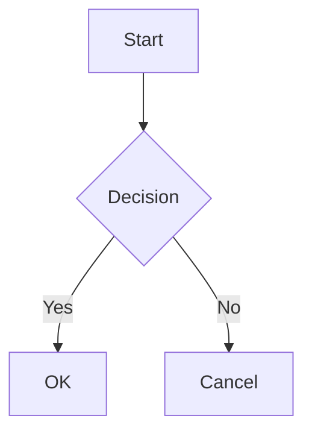

<p align="center">
  <a href="https://yss-tazawa.github.io/plantuml-markdown-preview/">English</a> | <a href="https://yss-tazawa.github.io/plantuml-markdown-preview/#/zh-cn/">简体中文</a> | <strong>日本語</strong> | <a href="https://yss-tazawa.github.io/plantuml-markdown-preview/#/es/">Español</a> | <a href="https://yss-tazawa.github.io/plantuml-markdown-preview/#/pt-br/">Português</a> | <a href="https://yss-tazawa.github.io/plantuml-markdown-preview/#/ko/">한국어</a> | <a href="https://yss-tazawa.github.io/plantuml-markdown-preview/#/zh-tw/">繁體中文</a>
</p>

<p align="center">
  
</p>

<h1 align="center">PlantUML Markdown Preview</h1>

<p align="center">
  <strong>PlantUML・Mermaid・D2 のダイアグラムを、Markdown のプレビューの中に。Fast・Secure・Easy の 3 つのモードから、使い方に合うものを選べます。</strong>
</p>

<p align="center">
  <a href="https://marketplace.visualstudio.com/items?itemName=yss-tazawa.plantuml-markdown-preview"></a>
  <a href="https://marketplace.visualstudio.com/items?itemName=yss-tazawa.plantuml-markdown-preview"></a>
  <a href="https://github.com/yss-tazawa/plantuml-markdown-preview/blob/main/LICENSE"></a>
</p>

<p align="center">
  
</p>

Markdown の中にダイアグラムをコードで書けば、入力に合わせてすぐに描画されます。ダイアグラムも含めて、文書まるごと HTML や PDF にエクスポートできます。

## モードを選ぶ

| | **Fast**（既定） | **Secure** | **Easy** |
|---|---|---|---|
| | 高速な描画 | プライバシー最優先 | セットアップ不要 |
| | ローカルの PlantUML サーバーが、入力に合わせてダイアグラムを更新します | ネットワークもバックグラウンドの処理も使わず、すべて手元で完結します | Java は要りません。オンラインの PlantUML サーバーを使ってすぐに動きます |
| **Java** | 11 以上が必要 | 11 以上が必要 | 不要 |
| **ネットワーク** | なし | なし | 必要 |
| **プライバシー** | ローカルのみ | ローカルのみ | ダイアグラムのソースを PlantUML サーバーに送信 |
| **セットアップ** | [Java をインストール →](#前提条件) | [Java をインストール →](#前提条件) | 不要 |

モードは設定 1 つでいつでも切り替えられます。移行も再起動も要りません。

詳しくは[レンダリングモード](#レンダリングモード)を、セットアップは[クイックスタート](#クイックスタート)をご覧ください。

## ハイライト

- **ダイアグラムが文書の中に** — PlantUML・Mermaid・D2 のダイアグラムが、別のパネルではなく Markdown のプレビューの中に表示されます。
- **安心して開ける** — Markdown に書かれたスクリプトは、プレビューでも HTML/PDF のエクスポートでも実行されません。
- **大きさを自由に** — PlantUML・Mermaid・D2 のダイアグラムの表示倍率を、それぞれ別に設定できます。
- **1 つのファイルで HTML エクスポート** — 文書とダイアグラムを 1 つの HTML ファイルにまとめ、レイアウトの幅と配置も選べます。
- **ワンクリックで PDF エクスポート** — Chrome・Edge・Chromium で印刷し、ダイアグラムはページに収まるように縮めます。
- **双方向のスクロール同期** — エディタとプレビューのどちらをスクロールしても、もう一方が付いてきます。
- **すばやく移動** — プレビューから先頭や末尾へ移動したり、目次のサイドバーを開いたりできます。
- **ダイアグラムビューア** — ダイアグラムを右クリックすると専用のパネルで拡大・移動でき、編集もすぐに反映されます。
- **参照ビュー（Reading View）** — Markdown・PlantUML・Mermaid・D2 のファイルを専用のタブに描画して読み、その場でソースに戻れます。
- **ダイアグラムのファイルを単独でプレビュー** — `.puml`・`.plantuml`・`.mmd`・`.mermaid`・`.d2` のファイルを直接開き、拡大・移動しながら入力に合わせて更新できます。
- **Git リビジョンのプレビュー** — HEAD やステージ済みの時点の Markdown を、今のプレビューの横に描画するので、変わったダイアグラムを絵のまま見比べられます。
- **PNG / SVG で保存・コピー** — プレビューやダイアグラムビューアでダイアグラムを右クリックすると、ファイルに保存したりクリップボードにコピーしたりできます。
- **17 のプレビューテーマ** — VS Code の配色テーマに合わせるほか、GitHub・Atom・Solarized・Dracula・Monokai などライト 9 種とダーク 7 種から選べます。
- **エディタの支援** — PlantUML・Mermaid・D2 のキーワード補完、カラーピッカー、スニペットが使えます。
- **7 つの言語に対応** — UI は英語・中国語（簡体字と繁体字）・スペイン語・ブラジルポルトガル語・日本語・韓国語に対応しています。
- **数式** — `$...$` のインライン数式と `$$...$$` のブロック数式を書くと、[KaTeX](https://katex.org/) で描画されます。

## 目次

- [モードを選ぶ](#モードを選ぶ)
- [ハイライト](#ハイライト)
- [機能](#機能)
- [クイックスタート](#クイックスタート)
- [使い方](#使い方)
  - [参照ビュー](#参照ビュー)
- [設定](#設定)
- [スニペット](#スニペット)
- [カラーピッカー](#カラーピッカー)
- [キーワード補完](#キーワード補完)
- [キーボードショートカット](#キーボードショートカット)
- [FAQ](#faq)
- [コントリビューション](#コントリビューション)
- [サードパーティライセンス](#サードパーティライセンス)
- [ライセンス](#ライセンス)

## 機能

### インラインダイアグラムプレビュー

```` ```plantuml ````、```` ```mermaid ````、```` ```d2 ```` のコードブロックは、ふつうの Markdown の文と並んで SVG のダイアグラムとして描画されます。

- **入力に合わせて更新** — 書いているそばからプレビューが更新されます。
- **保存で更新** — ファイルを保存すると、プレビューも新しくなります。
- **タブに付いてくる** — 前面のエディタのタブを切り替えると、プレビューも切り替わります。
- **読み込み中の表示** — ダイアグラムがまだ描画中かどうかがひと目でわかります。
- **わかりやすいエラー** — 構文の誤りを、行番号と前後のソースを添えてその場に表示します。
- **PlantUML** — 手元の Java（Fast / Secure モード）か PlantUML サーバー（Easy モード）で描画します。詳しくは[レンダリングモード](#レンダリングモード)をご覧ください。
- **Mermaid** — [mermaid.js](https://mermaid.js.org/) で描画するので、Java もほかのツールも要りません。
- **D2** — 同梱の [@terrastruct/d2](https://d2lang.com/)（Wasm）で描画するので、ほかのツールは要りません。

### 図のソースのハイライト

Markdown 内の ```` ```plantuml ````、```` ```mermaid ````、```` ```d2 ```` ブロックと、単独の `.puml`、`.plantuml`、`.mmd`、`.mermaid`、`.d2` ファイルで、ダイアグラムのソースがシンタックスハイライトされます。色は現在のテーマに従います。

### 数式サポート

[KaTeX](https://katex.org/) で数式を描画します。

- **インライン数式** — `$E=mc^2$` は文中の数式として表示されます。
- **ブロック数式** — `$$\int_0^\infty e^{-x}\,dx = 1$$` は中央揃えの数式として表示されます。
- **どこでも同じ見た目** — プレビューでも HTML/PDF のエクスポートでも、数式は同じように表示されます。
- **かんたんにオフ** — 文中の `$` が数式として読まれてしまうときは、`enableMath: false` にしてください。

### ダイアグラムスケール

PlantUML・Mermaid・D2 のダイアグラムの表示の大きさを、それぞれ別に設定できます。

- **PlantUML の倍率** — `auto`（幅に収まらないダイアグラムを縮小）か、70%〜120% の固定の倍率（既定は 100%）を選べます。どの倍率でもダイアグラムはくっきり表示されます。
- **Mermaid の倍率** — `auto`（幅に収まらないダイアグラムを縮小）か、50%〜100% の固定の倍率（既定は 80%）を選べます。
- **D2 の倍率** — `auto`（幅に収まらないダイアグラムを縮小）か、50%〜100% の固定の倍率（既定は 70%）を選べます。

### レンダリングモード

PlantUML のダイアグラムの描画のしかたを、3 つのモードから選べます。

| | Fast（既定） | Secure | Easy |
|---|---|---|---|
| **Java 必須** | はい | はい | いいえ |
| **ネットワーク** | なし（localhost のみ） | なし | 必要 |
| **プライバシー** | ローカルのみ | ローカルのみ | ダイアグラムのソースを PlantUML サーバーに送信 |
| **速度** | すぐ（常駐のローカルサーバー） | 遅め（描画のたびに Java が起動） | ネットワークしだい |

- **Fast モード**（既定） — `localhost` で PlantUML サーバーを動かし続けるので、編集するとすぐにダイアグラムが更新されます。サーバーは最初の PlantUML のダイアグラムを描くときに起動し、ダイアグラムが外部に送られることはありません。起動のタイミングは[起動モード](#fast-モード-サーバーの起動モード)で変えられます。
- **Secure モード** — 描画のたびに手元の Java と PlantUML の jar を動かします。ネットワークも常駐のサーバーも使いません。安全を最優先にするため、ローカルの画像は既定で読み込みません。
- **Easy モード** — PlantUML のソースを PlantUML サーバーに送って描画するので、何もインストールせずに使えます。既定では公開サーバー（`https://www.plantuml.com/plantuml`）を使い、プライバシーが気になるときは自前のサーバーを指定できます。

プレビューを開いたときに Java が見つからなければ、この拡張機能が Easy モードへの切り替えを提案します。

#### Fast モード: サーバーの起動モード

既定では、Fast モードは `127.0.0.1` で動く PlantUML サーバーを自分で起動して管理します。設定は要りません。いつ起動するか、そもそも起動するかどうかは `plantumlLocalServerStartMode`（Start Mode）で決めます。

| 値 | 効果 |
|---|---|
| `"lazy"`（既定） | 最初のダイアグラムを描くときに、管理下のサーバーを起動します。PlantUML のダイアグラムを描くまで Java は動きません。最初の 1 回だけ数秒長くかかります。 |
| `"on"` | この拡張機能が有効になったときに、管理下のサーバーを起動します。最初の描画もすぐに終わりますが、起動直後から Java がバックグラウンドで動き続けます。 |
| `"off"` | サーバーを起動しません。あなたが起動したサーバー（例: `java -jar plantuml.jar -picoweb`）に接続します。LAN 上の別のマシンのサーバーも指定できます。 |

サーバーへの接続に使うホストとポートは、次の設定で決めます。

| 設定 | 既定 | 説明 |
|---|---|---|
| `plantumlLocalServerHost` | `127.0.0.1` | Start Mode が `"off"` のときに接続するホストです（例: LAN 上の別の場所にある picoweb サーバー）。`"on"`/`"lazy"` のときは使われず、管理下のサーバーは常に `127.0.0.1` で動きます。 |
| `plantumlLocalServerPort` | `0` | Start Mode が `"on"`/`"lazy"` のときは起動するポート（`0` は空いているポートを自動で割り当て）、`"off"` のときは接続先のポートです。 |

知っておくと便利なことを挙げます。

- **今あるサーバーと共存** — `"on"` か `"lazy"` で固定のポートを指定していて、そのポートで PlantUML サーバーがすでに正常に動いていれば、2 つ目は起動せずにそれを使います。
- **`"off"` なら手元の Java は不要** — この拡張機能はサーバーを起動せず、設定したホストとポートに接続するだけです。
- **あなたのサーバーには触れない** — この拡張機能が止めるのは、この拡張機能が起動したサーバーだけです。
- **古い設定も読みます** — Start Mode を設定していなければ、以前の `plantumlLocalServerAutoStart` の値を使います（`true` → `"on"`、`false` → `"off"`）。

#### Fast モード: JVM メモリ（ヒープ）設定

管理下のサーバーが使うメモリの上限は、ヒープのプリセット（`plantumlLocalServerJvmHeapPreset`）で決めます。

| プリセット | JVM ヒープフラグ | 使いどころ |
|---|---|---|
| `small` | `-Xms16m -Xmx256m` | メモリの使用が最小です。小さなダイアグラムだけのときに向いています。 |
| `medium`（既定） | `-Xms16m -Xmx512m` | 釣り合いのよい設定で、ほとんどのダイアグラムを問題なく描けます。 |
| `large` | `-Xms64m -Xmx1024m` | とても大きなダイアグラムに向いています。PlantUML の FAQ の推奨値と同じです。 |
| `unlimited` | _（なし）_ | フラグを付けず、Java に任せます（最大ヒープは既定で物理メモリの 1/4）。 |
| `custom` | 任意の値 | `plantumlLocalServerJvmInitialHeapMb`（8〜32768、既定 16）と `plantumlLocalServerJvmMaxHeapMb`（64〜32768、既定 512）を使います。 |

`unlimited` 以外のプリセットでは、サーバーを小さく保つために `-XX:+UseSerialGC`、`-XX:MaxMetaspaceSize=128m`、`-XX:ReservedCodeCacheSize=64m` も付けます。これらの設定が効くのは、この拡張機能が自分で起動するサーバー（Fast モードで Start Mode が `"on"`/`"lazy"`）だけです。

### ステータスバー

ステータスバーには、今のレンダリングモード（Fast / Secure / Easy）と、Fast モードではローカルサーバーの状態（起動中・稼働中・エラー・停止中）が表示されます。

- **ワンクリックでモードを切り替え** — ステータスバーの項目をクリックすると、設定を開かずにクイック ピックからモードを選べます。
- **コマンドパレットからも** — **レンダリングモードを選択** のコマンドでも同じことができます。

Markdown のプレビューまたは参照ビューが表示されている間は、ステータスバーにプレビューのズーム倍率も表示されます。クリックすると別の倍率を選べます。

### HTML エクスポート

Markdown の文書を、1 つの HTML ファイルにエクスポートできます。

- **ダイアグラムもそのまま** — PlantUML と D2 のダイアグラムは SVG として埋め込みます。Mermaid のダイアグラムと数式のフォントは、開いたときに CDN から読み込みます。
- **スタイルも中に** — シンタックスハイライトのスタイルもファイルの中に入ります。
- **エクスポートして開く** — 1 つのコマンドで、エクスポートしてブラウザで開けます。
- **好みのレイアウト** — 640px〜1440px の固定の幅（中央寄せか左寄せ）か、ブラウザのウィンドウいっぱいに広がり、はみ出すダイアグラムだけを縮小する **レスポンシブ** から選べます。ふだんの幅と配置は設定で決めておき、エクスポートのたびにメニューから選ぶこともできます。

### PDF エクスポート

お使いの Chrome・Edge・Chromium を使って、Markdown の文書を PDF にエクスポートできます。

- **お使いのブラウザで** — Chrome・Edge・Chromium のどれかがインストールされている必要があります。
- **縦でも横でも** — エクスポートするときに向きを選べます。
- **文字とダイアグラムを同じ縮尺で** — 文字とダイアグラムを同じ割合で拡大・縮小します（`pdfScale`、既定 0.625）。
- **すっきりしたページ** — 印刷の余白は自動で付きます。

### 一括ダイアグラムエクスポート

Markdown ファイルの中のダイアグラムをすべて、1 つずつ PNG か SVG のファイルにエクスポートできます。

- **全部まとめて** — PlantUML・Mermaid・D2 のダイアグラムを、文書に出てくる順にすべてエクスポートします。
- **フォルダの名前も自由に** — 出力先のフォルダの名前を選べます（既定: `{ファイル名}_diagrams`）。
- **プレビューを開いておく** — ダイアグラムはプレビューで描画するので、プレビューを開いておく必要があります。

### ナビゲーション & 目次

- **先頭に移動 / 末尾に移動** — プレビューの右上のボタンから、ワンクリックで移動できます。
- **目次のサイドバー** — 目次のボタンをクリックすると見出しの一覧が開き、見出しをクリックするとその場所へ移動します。
- **ズーム** — `Ctrl`＋マウスホイール（Mac は `Cmd`＋マウスホイール）で、プレビューと参照ビューを 50% から 200% まで拡大・縮小できます。倍率はすべてのプレビューと参照ビューに共通で、再起動しても保たれます。

### ダイアグラムビューア

プレビューの中の PlantUML・Mermaid・D2 のダイアグラムを右クリックして **ダイアグラムビューアで開く** を選ぶと、拡大・移動のできる専用のパネルが開きます。

- **拡大と移動** — マウスホイールでカーソルの位置を中心に拡大・縮小し、ドラッグで移動できます。
- **ツールバー** — 画面サイズに合わせる、1:1 に戻す、段階的な拡大・縮小（+/−）のボタンがあります。
- **編集にすぐ追従** — エディタでの変更がすぐに反映され、拡大の位置はそのまま保たれます。
- **テーマに合う背景** — 背景の色は今のプレビューテーマに合わせます。
- **ファイルに合わせて閉じる** — 別のソースファイルに切り替えると、ビューアは閉じます。
- **PNG / SVG で保存・コピー** — プレビューやダイアグラムビューアでダイアグラムを右クリックすると、ファイルに保存したり PNG としてコピーしたりできます。
- **ビューア内の検索** — `Cmd+F` / `Ctrl+F` で検索ウィジェットが開きます。
- **オフにもできます** — `enableDiagramViewer: false` で使わないようにできます。

### PlantUML `!include` サポート

`!include` を使うと、共通のスタイル・マクロ・コンポーネントの定義を複数のダイアグラムで使い回せます。

- **探す場所** — インクルードするファイルは、ワークスペースのルートか `plantumlIncludePath` で指定したフォルダから探します。Fast モードでこれが効くのは、この拡張機能が自分のサーバーを動かしているときです。詳しくは [FAQ](#faq) をご覧ください。
- **保存で更新** — インクルードしたファイルを保存するとプレビューが更新され、**再読み込み** ボタン（↻）でいつでも更新し直せます。
- **インクルードファイルに移動** — `.puml` や Markdown のファイルで `!include` の行を右クリックすると、参照先のファイルが開きます。
- **インクルードソースを開く** — プレビューで PlantUML のダイアグラムを右クリックすると、インクルードしているファイルを直接開けます。
- **Fast と Secure モードで** — Easy モードでは手元のファイルを読めないため、`!include` は使えません。

### スタンドアロンダイアグラムプレビュー

`.puml`・`.plantuml`・`.mmd`・`.mermaid`・`.d2` のファイルを、Markdown に包まずにそのまま開けます。

- **拡大と移動** — ダイアグラムビューアと同じ操作で拡大・移動できます。
- **入力に合わせて更新** — 書いているそばからプレビューが更新されます。
- **タブに付いてくる** — 同じ種類のファイルを切り替えると、プレビューも切り替わります。
- **テーマ** — プレビューテーマとダイアグラムのテーマを、それぞれ別に選べます。
- **PNG / SVG で保存・コピー** — ダイアグラムを右クリックするとできます。
- **プレビュー内の検索** — `Cmd+F` / `Ctrl+F` で検索ウィジェットが開きます。
- **PlantUML** — 3 つのレンダリングモード（Fast / Secure / Easy）のどれでも使えます。
- **Mermaid** — mermaid.js で描画します。
- **D2** — @terrastruct/d2（Wasm）で描画し、テーマとレイアウトエンジンを選べます。

### Git リビジョンプレビュー

Markdown ファイルを Git のリビジョンの時点の内容で描画し、横のパネルに表示します。変わったダイアグラムをテキストの差分で読む代わりに、描画したまま並べて見比べられます。

- **HEAD** — 最後にコミットした版です。
- **ステージ済み** — コミットのためにステージしてある版です。
- **並べて表示** — 今のプレビューの横に開くので、新旧のダイアグラムを同時に見られます。
- **スナップショット** — 一度だけ描画し、その後の編集には追従しません。パネルの上部にその旨を表示します。
- **Git が必要** — Git のリポジトリで追跡しているファイルが対象です。

### 双方向スクロール同期

エディタとプレビューは、どちらをスクロールしても揃って動きます。

- **位置が揃う** — エディタで見ているソースの場所に、プレビューの位置が合います。
- **ずれない** — プレビューが再描画されても、スクロールの位置はそのまま保たれます。

### テーマ

**プレビューテーマ**は、文書全体の見た目を決めます。

**VS Code テーマ:**

| テーマ | スタイル |
| ------- | ------- |
| Follow VS Code Color Theme | 今の VS Code の配色テーマに追従（組み込みの Markdown プレビューと同じ）。HTML・PDF のエクスポートは配色に合わせて VS Code Light 2026 か Dark 2026 |

**ライトテーマ:**

| テーマ | スタイル |
| ------- | ------- |
| GitHub Light | 白背景（既定） |
| Atom Light | ソフトグレーテキスト、Atom エディタ風 |
| One Light | オフホワイト、バランスの取れたパレット |
| Solarized Light | 温かいベージュ、目に優しい |
| Vue | グリーンアクセント、Vue.js ドキュメント風 |
| Pen Paper Coffee | 温かい紙の質感、手書き風 |
| Coy | ほぼ白、クリーンなデザイン |
| VS | クラシックな Visual Studio カラー |
| VS Code Light 2026 | VS Code の配色テーマ Light 2026 で表示した組み込みの Markdown プレビュー |

**ダークテーマ:**

| テーマ | スタイル |
| ------- | ------- |
| GitHub Dark | ダーク背景 |
| Atom Dark | Tomorrow Night パレット |
| One Dark | Atom インスパイアのダーク |
| Dracula | 鮮やかなダーク |
| Solarized Dark | 深いティール、目に優しい |
| Monokai | 鮮やかなシンタックス、Sublime Text 風 |
| VS Code Dark 2026 | VS Code の配色テーマ Dark 2026 で表示した組み込みの Markdown プレビュー |

プレビューテーマは、タイトルバーのアイコンからすぐに切り替えられます。ダイアグラムは描き直しません。PlantUML のテーマを変えたときは、ダイアグラムを描き直します。

**PlantUML テーマ**は、ダイアグラムのスタイルを別に決めます。この拡張機能がお使いの PlantUML からテーマを見つけ、プレビューテーマと同じクイック ピックに並べます。

**Mermaid テーマ**は、Mermaid のダイアグラムのスタイルを決めます（`default`、`dark`、`forest`、`neutral`、`base`）。これも同じクイック ピックから選べます。

**D2 テーマ**は、19 種類の組み込みのテーマ（例: `Neutral Default`、`Dark Mauve`、`Terminal`）から、設定か同じクイック ピックで選べます。

### シンタックスハイライト

highlight.js で 190 以上の言語に対応しています。コードブロックは、選んでいるプレビューテーマに合わせた色で表示されます。

### セキュリティ

- **厳しいスクリプトの制限** — プレビューで動くのは、この拡張機能自身のスクリプトだけです。
- **文書のコードは動かない** — Markdown の中の `<script>` タグなどのコードは、プレビューでも HTML/PDF のエクスポートでも実行されません。
- **ローカルの画像はモードに従う** — 既定ではモードに合わせて読み込みを決め（`allowLocalImages: "mode-default"`）、Secure モードでは安全を最優先にして読み込みません。
- **HTTP の画像は既定でオフ** — 暗号化されない HTTP での画像の読み込みはオフです（`allowHttpImages`）。オンにするのは、イントラネットや手元の開発サーバーなど、信頼できるネットワークだけにしてください。

### VS Code 組み込み Markdown プレビューとの統合

PlantUML・Mermaid・D2 のダイアグラムは、VS Code 組み込みの Markdown プレビュー（`Markdown: プレビューを横に表示`）にもそのまま表示されます。設定は要りません。プレビューテーマ・スクロール同期・HTML エクスポートは、この拡張機能のプレビュー（`Cmd+Alt+V` / `Ctrl+Alt+V`）で使えます。大きな PlantUML のダイアグラムは、組み込みプレビューではエディタが一時的に止まることがあるので、こちらで開くのがおすすめです。

### GitHub 形式のアラート

引用ブロックの印から、GitHub と同じ形のアラート（コールアウト）を描画します。

```markdown
> [!NOTE]
> Highlights information that users should take into account.

> [!TIP]
> Optional information to help a user be more successful.

> [!IMPORTANT]
> Crucial information necessary for users to succeed.

> [!WARNING]
> Critical content demanding immediate user attention.

> [!CAUTION]
> Negative potential consequences of an action.
```

- **5 種類** — `NOTE`・`TIP`・`IMPORTANT`・`WARNING`・`CAUTION` に、それぞれ専用のアイコンと色があります。
- **GitHub と同じ決まり** — 印は、その行にほかの文字が無いものだけが有効です（大文字・小文字は問いません。`[!note]` でも有効です）。また、アラートになるのは文書の一番外側にある引用ブロックだけです。`> [!NOTE] My title`、リスト項目や別の引用ブロックの中の印は、ふつうの引用ブロックのままです。
- **テーマに合わせる** — 色は今のプレビューテーマ（ライト / ダーク）に合わせて変わります。
- **どこでも同じ見た目** — プレビューでも HTML/PDF のエクスポートでも、同じように表示されます。

### 脚注とタスクリスト

GitHub の書き方の脚注とタスクリストを、GitHub と同じ形で描画します。

```markdown
A sentence with a footnote.[^1]

[^1]: The footnote text.

- [x] Finished task
- [ ] Open task
```

- **脚注** — `[^1]` の参照から文書の末尾の脚注へ移動でき、脚注から参照へも戻れます。
- **タスクリスト** — `- [ ]` と `- [x]` の項目にチェックボックスが付きます。状態を示すだけで、クリックしても文書は変わりません。
- **どこでも同じ見た目** — プレビューでも HTML/PDF のエクスポートでも、脚注とタスクリストは同じように表示されます。

## クイックスタート

### 前提条件

**Mermaid** — 必要な物はありません。すぐに使えます。

**D2** — 必要な物はありません。同梱の [D2](https://d2lang.com/)（Wasm）を使うので、すぐに使えます。

**PlantUML（Easy モード）** — 必要な物はありません。ダイアグラムのソースを PlantUML サーバーに送って描画します。

**PlantUML（Fast / Secure モード）** — 既定はこちらです。次の物を使います。

| ツール | 用途 | 確認方法 |
| ------ | ---- | -------- |
| [Java 11+（JRE または JDK）](#セットアップ) | PlantUML の実行（同梱の PlantUML 1.2026.10 は Java 11+ が必要） | `java -version` |
| [Graphviz](https://graphviz.org/) | 任意です。クラス図・コンポーネント図など、レイアウトを計算するダイアグラムに必要です（[ダイアグラムサポート](#ダイアグラムサポート)を参照） | `dot -V` |

PlantUML（LGPL、v1.2026.10）は同梱しているので、ダウンロードは要りません。必要なのは Java 11 以降だけで、Graphviz は任意です。
まだ Java がなくても大丈夫です。プレビューを開くと、この拡張機能が Easy モードへの切り替えを提案します。

### ダイアグラムサポート

使えるダイアグラムは、セットアップによって変わります。

| ダイアグラム | LGPL（同梱） | Win: GPLv2 jar | Mac/Linux: + Graphviz |
| ------------ | :-: | :-: | :-: |
| シーケンス | ✓ | ✓ | ✓ |
| アクティビティ（新構文） | ✓ | ✓ | ✓ |
| マインドマップ | ✓ | ✓ | ✓ |
| WBS | ✓ | ✓ | ✓ |
| ガント | ✓ | ✓ | ✓ |
| JSON / YAML | ✓ | ✓ | ✓ |
| Salt / ワイヤーフレーム | ✓ | ✓ | ✓ |
| タイミング | ✓ | ✓ | ✓ |
| ネットワーク（nwdiag） | ✓ | ✓ | ✓ |
| クラス | — | ✓ | ✓ |
| ユースケース | — | ✓ | ✓ |
| オブジェクト | — | ✓ | ✓ |
| コンポーネント | — | ✓ | ✓ |
| デプロイメント | — | ✓ | ✓ |
| ステート | — | ✓ | ✓ |
| ER（エンティティ関係） | — | ✓ | ✓ |
| アクティビティ（旧構文） | — | ✓ | ✓ |
| DOT（@startdot） | — | ✓ | ✓ |

- **LGPL（同梱）** — すぐに使えます。Graphviz は要りません。
- **Win: GPLv2 jar** — [GPLv2 版](https://plantuml.com/download)は Graphviz を内蔵しています（Windows のみ、自動で展開）。`plantumlJarPath`（[設定](#設定)を参照）で指定して使います。DOT（`@startdot`）には PlantUML 1.2026.9 以降が必要です。
- **Mac/Linux: + Graphviz** — [Graphviz](https://graphviz.org/) を別にインストールします。LGPL と GPLv2 のどちらの jar でも動きます。

### インストール

1. VS Code を開きます。
2. 拡張機能ビュー（`Ctrl+Shift+X` / `Cmd+Shift+X`）で **PlantUML Markdown Preview** を検索します。
3. **インストール** をクリックします。

### セットアップ

**Fast モード**（既定） — 設定は要りません。最初のダイアグラムを描くときにローカルの PlantUML サーバーが起動し、その後の更新はすぐに終わります。Java 11+ が必要です。

**Secure モードを使う場合** — `mode` を `"secure"` にします。描画のたびに Java 11+ が動き、常駐のサーバーもネットワークも使いません。

**Easy モードを使う場合**（セットアップ不要） — `mode` を `"easy"` にします。ダイアグラムのソースを PlantUML サーバーに送って描画します。

**Fast / Secure モード** — 同梱の LGPL の jar で、シーケンス図・アクティビティ図・マインドマップなどは追加のセットアップなしで描けます（[ダイアグラムサポート](#ダイアグラムサポート)を参照）。クラス図・コンポーネント図・ユースケース図など、レイアウトを計算するダイアグラムを使うには、下のお使いの OS の手順に沿ってください。

#### Windows

1. Java が入っていなければ、PowerShell を開いて次を実行し、インストールします。

   ```powershell
   winget install Microsoft.OpenJDK.21
   ```

2. `java` が PATH にないときは、PowerShell でフルパスを確かめます。

   ```powershell
   Get-Command java
   # 例: C:\Program Files\Microsoft\jdk-21.0.6.7-hotspot\bin\java.exe
   ```

   VS Code の設定（`Ctrl+,`）で `plantumlMarkdownPreview.javaPath` を検索し、上のパスを入力します。
3. [GPLv2 版 PlantUML](https://plantuml.com/download)（`plantuml-gplv2-*.jar`）を好きなフォルダにダウンロードします（Graphviz を内蔵しているので、別にインストールする必要はありません）。
4. VS Code の設定（`Ctrl+,`）で `plantumlMarkdownPreview.plantumlJarPath` を検索し、ダウンロードした `.jar` のフルパスを入力します（例: `C:\tools\plantuml-gplv2-1.2026.10.jar`）。

#### Mac

1. Homebrew で Java と Graphviz をインストールします。

   ```sh
   brew install openjdk graphviz
   ```

2. `dot` が PATH にないときは、フルパスを確かめて VS Code に設定します。

   ```sh
   which dot
   # 例: /opt/homebrew/bin/dot
   ```

   VS Code の設定（`Cmd+,`）で `plantumlMarkdownPreview.dotPath` を検索し、上のパスを入力します。

#### Linux

1. Java と Graphviz をインストールします。

   ```sh
   # Debian / Ubuntu
   sudo apt install default-jdk graphviz

   # Fedora
   sudo dnf install java-21-openjdk graphviz
   ```

2. `dot` が PATH にないときは、フルパスを確かめて VS Code に設定します。

   ```sh
   which dot
   # 例: /usr/bin/dot
   ```

   VS Code の設定（`Ctrl+,`）で `plantumlMarkdownPreview.dotPath` を検索し、上のパスを入力します。

これらのパスを設定することは、ほとんどありません。既定では、この拡張機能は Java を `JAVA_HOME/bin/`（Windows では `JAVA_HOME\bin\`）から、次に PATH から探し、`dot` を PATH から探し、PlantUML は同梱の jar を使います。`javaPath`・`dotPath`・`plantumlJarPath` を設定するのは、コマンドが PATH にないときや、別の jar を使いたいときだけです。

## 使い方

### プレビューを開く

- **キーボードショートカット** — `Cmd+Alt+V`（Mac）/ `Ctrl+Alt+V`（Windows / Linux）を押します。
- **エディタのタイトルバー** — エディタの右上のプレビューボタン（角の丸い四角に「P」）をクリックします。
- **VS Code 標準のボタンとショートカット** — `useAsDefaultPreview` がオン（既定）のとき、VS Code の **プレビューを横に表示** ボタン・右クリックの **プレビューを開く**・`Cmd+K V`（Mac）/ `Ctrl+K V`（Windows / Linux）で、この拡張機能のプレビューが開きます。`Cmd+Shift+V` / `Ctrl+Shift+V` は[参照ビュー](#参照ビュー)への切り替えになります。
- **コンテキストメニュー** — エクスプローラーかエディタの中で Markdown ファイルを右クリック → **PlantUML Markdown Preview** → **サイドにプレビューを開く** を選びます。
- **コマンドパレット** — `PlantUML Markdown Preview: サイドにプレビューを開く` を実行します。

プレビューには専用のテーマがあり、最初は白背景（GitHub Light）です。`follow-vscode` を選ぶと、今の VS Code の配色テーマに合わせます。

### 参照ビュー

参照ビュー（Reading View）は、ファイルのタブそのものを、テキストエディタの代わりに描画した表示にします。2 つ目のパネルは開きません。前面のエディタには付いていかずにそのファイルを表示し続け、プレビューと同時に開いておけます。

対象は Markdown のファイル（`.md`・`.markdown` など、VS Code の Markdown プレビューと同じ拡張子）と、`.puml` / `.plantuml`・`.mmd` / `.mermaid`・`.d2` のファイルです。使わない限り、何も変わりません。

- **その場で切り替える** — エディタを右クリック → **PlantUML Markdown Preview** → **参照ビューに切り替える** を選びます（PlantUML・Mermaid・D2 のファイルでは **参照ビューに切り替える** がメニューの直下にあります）。戻るときは、参照ビューを右クリック → **ソースに切り替える** を選ぶか、エディタのタイトルバーの **ソースに切り替える** をクリックします。タブそのものが切り替わり、新しいタブは開きません。
- **1 回だけ開く** — エクスプローラーでファイルを右クリック → **ファイルを開くアプリケーションの選択...** → **PlantUML Markdown Preview（参照ビュー）** を選びます。すでに開いているファイルなら、タブを右クリック → **エディターを再度開くアプリケーションの選択...** を使います。
- **既定にする** — **ファイルを開くアプリケーションの選択...** の一覧で **'\*.md' の既定のエディターを構成する...** → **PlantUML Markdown Preview（参照ビュー）** を選びます。以後、`.md` のファイルをクリックすると参照ビューで開きます。拡張子ごとに 1 回ずつ行ってください。
- **元に戻す** — 同じ手順で **テキスト エディター** を選ぶか、設定からその行を消します。

`settings.json` に直接書くときは、次のようにします。

```json
"workbench.editorAssociations": {
  "*.md": "plantumlMarkdownPreviewEditor",
  "*.puml": "plantumlPumlPreviewEditor",
  "*.mmd": "plantumlMermaidPreviewEditor",
  "*.d2": "plantumlD2PreviewEditor"
}
```

| ファイル | 値 |
| -------- | -- |
| Markdown（`*.md`、`*.markdown` など） | `plantumlMarkdownPreviewEditor` |
| `*.puml`、`*.plantuml` | `plantumlPumlPreviewEditor` |
| `*.mmd`、`*.mermaid` | `plantumlMermaidPreviewEditor` |
| `*.d2` | `plantumlD2PreviewEditor` |

- **古い VS Code** — VS Code 1.100 より前では **参照ビューに切り替える**・**ソースに切り替える** は出ないので、**ファイルを開くアプリケーションの選択...** で参照ビューを開いてください。
- **Git の差分** — 参照ビューで開くように設定したファイルでも、差分はテキストの差分で開きます。
- **標準のボタン** — `useAsDefaultPreview` がオン（既定）のとき、VS Code の **プレビューとして開く** ボタン（VS Code 1.119 以降）と `Ctrl+Shift+V`（VS Code 1.100 以降）で参照ビューに切り替わります。詳しくは[設定](#設定)をご覧ください。

### ダイアグラムプレビューを開く

`.puml` / `.plantuml`・`.mmd` / `.mermaid`・`.d2` のファイルを、Markdown に包まずに、拡大・移動のできるプレビューで直接開けます。

- **キーボードショートカット** — 同じ `Cmd+Alt+V`（Mac）/ `Ctrl+Alt+V`（Windows / Linux）で、ファイルの種類に合ったプレビューが開きます。
- **エディタのタイトルバー** — エディタの右上のプレビューボタン（角の丸い四角に「P」）をクリックします。
- **標準のプレビューのショートカット** — `useAsDefaultPreview` がオン（既定）のとき、`Cmd+K V`（Mac）/ `Ctrl+K V`（Windows / Linux）でもプレビューが横に開きます。`Cmd+Shift+V` / `Ctrl+Shift+V` は[参照ビュー](#参照ビュー)への切り替えになります。
- **コンテキストメニュー** — エクスプローラーかエディタで `.puml` / `.plantuml`・`.mmd` / `.mermaid`・`.d2` のファイルを右クリック → **PlantUML ファイルをプレビュー** / **Mermaid ファイルをプレビュー** / **D2 ファイルをプレビュー** を選びます。
- **コマンドパレット** — `PlantUML Markdown Preview: PlantUML ファイルをプレビュー`、`Mermaid ファイルをプレビュー`、`D2 ファイルをプレビュー` のどれかを実行します。

### Git リビジョンのプレビューを開く

今の版のプレビューの横に、Git のリビジョンの時点の内容を描画して表示します。

- **コンテキストメニュー** — エクスプローラーかエディタで Markdown ファイルを右クリック → **PlantUML Markdown Preview** → **HEAD 時点のプレビューをサイドに開く** / **ステージ済みのプレビューをサイドに開く** を選びます。
- **コマンドパレット** — `PlantUML Markdown Preview: HEAD 時点のプレビューをサイドに開く` / `ステージ済みのプレビューをサイドに開く` を実行します。

先にふつうのプレビューを開いてからリビジョンのプレビューを開くと、2 つのパネルが横に並びます。リビジョンのパネルは決まった時点のスナップショットで、編集しても更新されません。

### HTML にエクスポート

- **コンテキストメニュー** — Markdown ファイルを右クリック → **PlantUML Markdown Preview** → **HTML としてエクスポート** → 幅を選びます。
- **プレビュー** — プレビューの中を右クリック → **HTML としてエクスポート** か **HTML としてエクスポートして開く** を選びます。

サブメニューでは、次の幅を選べます。

| オプション | 説明 |
| ------ | ----------- |
| 現在の設定 | 現在の設定でエクスポート（レスポンシブ CSS なし） |
| 640px – 1440px | 本文の幅をピクセルで固定、中央寄せ |
| レスポンシブ (左寄せ) | 本文をブラウザのウィンドウの幅いっぱいに広げて左寄せ、はみ出すダイアグラムだけ縮小 |
| 640px – 1440px (左寄せ) | 固定幅、左寄せ |

HTML ファイルは、元の Markdown ファイルと同じ場所に保存されます。

### PDF にエクスポート

- **コンテキストメニュー** — Markdown ファイルを右クリック → **PlantUML Markdown Preview** → **PDF としてエクスポート** → **縦** か **横** を選びます。
- **プレビュー** — プレビューの中を右クリック → **PDF としてエクスポート** か **PDF としてエクスポートして開く** → **縦** か **横** を選びます。

PDF ファイルは、元の Markdown ファイルと同じ場所に保存されます。Chrome・Edge・Chromium のどれかが必要です。
文字とダイアグラムの全体の縮尺は、`pdfScale` の設定（既定 0.625）で決めます。

### ダイアグラムを PNG / SVG として保存・コピー

- **プレビュー** — ダイアグラムを右クリック → **ダイアグラムを PNG でコピー**、**ダイアグラムを PNG で保存**、**ダイアグラムを SVG で保存** のどれかを選びます。
- **ダイアグラムビューア** — ビューアの中を右クリック → **ダイアグラムを PNG でコピー**、**ダイアグラムを PNG で保存**、**ダイアグラムを SVG で保存** のどれかを選びます。
- **ダイアグラムのファイルを単独でプレビュー** — プレビューの中を右クリック → **ダイアグラムを PNG でコピー**、**ダイアグラムを PNG で保存**、**ダイアグラムを SVG で保存** のどれかを選びます。

### 全ダイアグラムをエクスポート

- **コンテキストメニュー** — Markdown ファイルを右クリック → **PlantUML Markdown Preview** → **全ダイアグラムを PNG でエクスポート** か **全ダイアグラムを SVG でエクスポート** を選びます。
- **プレビュー** — プレビューの中を右クリック → **全ダイアグラムを PNG でエクスポート** か **全ダイアグラムを SVG でエクスポート** を選びます。
- **コマンドパレット** — `PlantUML Markdown Preview: 全ダイアグラムを PNG でエクスポート` / `全ダイアグラムを SVG でエクスポート` を実行します。

保存のダイアログで、出力先のフォルダの名前を決めます（既定: `{ファイル名}_diagrams`）。ダイアグラムは文書に出てくる順に `diagram-1.png`、`diagram-2.png` …… の名前で保存されます。エクスポートのあいだは、プレビューを開いておいてください。

### ナビゲーション

- **先頭に移動 / 末尾に移動** — プレビューの右上のボタンを使います。
- **再読み込み** — ↻ ボタンをクリックすると、プレビューを更新してキャッシュを消します。
- **目次** — プレビューの右上の目次のボタンをクリックすると見出しの一覧が開き、見出しをクリックするとその場所へ移動します。
- **ズーム** — プレビューの上で `Ctrl`（Mac は `Cmd`）を押しながらマウスホイールを回すか、ステータスバーの倍率をクリックして選びます。HTML・PDF のエクスポートには影響しません。

### テーマを変更する

プレビューのタイトルバーのテーマのアイコンをクリックするか、コマンドパレットを使います。

- **コマンドパレット** — `PlantUML Markdown Preview: プレビューテーマを変更` を実行します。

クイック ピックには、プレビューテーマ・PlantUML テーマ・Mermaid テーマ・D2 テーマの 4 種類が 1 つの一覧に並ぶので、どれも 1 か所から切り替えられます。

### PlantUML 構文

````markdown
```plantuml
Alice -> Bob: Hello
Bob --> Alice: Hi!
```
````

`@startuml` / `@enduml` は、省略すると自動で補われます。

### Mermaid 構文

````markdown

````

### D2 構文

````markdown
```d2
server -> db: query
db -> server: result
```
````

構文の詳細は [D2 のドキュメント](https://d2lang.com/)をご覧ください。

### 数式構文

インライン数式は `$` 1 つで、ブロック数式は `$$` で囲みます。

````markdown
アインシュタインの有名な方程式 $E=mc^2$ は質量とエネルギーの等価性を示す。

$$\int_0^\infty e^{-x}\,dx = 1$$
````

`$100` のような金額を書くときは、`enableMath: false` にすると `$` がそのままの文字になります。

## スニペット

スニペットのプレフィックスを入力して `Tab` キーを押すと展開されます。スニペットは 2 種類あります。

- **Markdown スニペット**（フェンスブロックの外） — `plantuml`・`mermaid`・`d2` で始まるプレフィックスで、フェンスブロックまるごとに展開されます。
- **テンプレートスニペット**（フェンスブロックの中） — `tmpl-` で始まるプレフィックスで、ダイアグラムの本体だけに展開されます。`tmpl` と入力すると一覧が出ます。

### Markdown スニペット（フェンスブロック外）

フェンスを含む `` ```plantuml ... ``` `` のブロックまるごとに展開されます。

| プレフィックス | ダイアグラム |
| --- | --- |
| `plantuml` | 空の PlantUML ブロック |
| `plantuml-sequence` | シーケンス図 |
| `plantuml-class` | クラス図 |
| `plantuml-activity` | アクティビティ図 |
| `plantuml-usecase` | ユースケース図 |
| `plantuml-component` | コンポーネント図 |
| `plantuml-state` | ステート図 |
| `plantuml-er` | ER 図 |
| `plantuml-object` | オブジェクト図 |
| `plantuml-deployment` | デプロイメント図 |
| `plantuml-mindmap` | マインドマップ |
| `plantuml-gantt` | ガントチャート |

### PlantUML スニペット（フェンスブロック内）

ダイアグラムのテンプレートです（`tmpl` と入力すると一覧が出ます）。

| プレフィックス | 内容 |
| --- | --- |
| `tmpl-seq` | シーケンス図 |
| `tmpl-cls` | クラス定義 |
| `tmpl-act` | アクティビティ図 |
| `tmpl-uc` | ユースケース図 |
| `tmpl-comp` | コンポーネント図 |
| `tmpl-state` | ステート図 |
| `tmpl-er` | エンティティ定義 |
| `tmpl-obj` | オブジェクト図 |
| `tmpl-deploy` | デプロイメント図 |
| `tmpl-mind` | マインドマップ |
| `tmpl-gantt` | ガントチャート |

短いスニペットもあります。

| プレフィックス | 内容 |
| --- | --- |
| `part` | participant 宣言 |
| `actor` | actor 宣言 |
| `note` | ノートブロック |
| `intf` | interface 定義 |
| `pkg` | package 定義 |

### Mermaid Markdown スニペット（フェンスブロック外）

フェンスを含む `` ```mermaid ... ``` `` のブロックまるごとに展開されます。

| プレフィックス | ダイアグラム |
| --- | --- |
| `mermaid` | 空の Mermaid ブロック |
| `mermaid-flow` | フローチャート |
| `mermaid-sequence` | シーケンス図 |
| `mermaid-class` | クラス図 |
| `mermaid-state` | ステート図 |
| `mermaid-er` | ER 図 |
| `mermaid-gantt` | ガントチャート |
| `mermaid-pie` | 円グラフ |
| `mermaid-mindmap` | マインドマップ |
| `mermaid-timeline` | タイムライン |
| `mermaid-git` | Git グラフ |

### Mermaid スニペット（フェンスブロック内）

ダイアグラムのテンプレートです（`tmpl` と入力すると一覧が出ます）。

| プレフィックス | 内容 |
| --- | --- |
| `tmpl-flow` | フローチャート |
| `tmpl-seq` | シーケンス図 |
| `tmpl-cls` | クラス図 |
| `tmpl-state` | ステート図 |
| `tmpl-er` | ER 図 |
| `tmpl-gantt` | ガントチャート |
| `tmpl-pie` | 円グラフ |
| `tmpl-mind` | マインドマップ |
| `tmpl-timeline` | タイムライン |
| `tmpl-git` | Git グラフ |

### D2 Markdown スニペット（フェンスブロック外）

フェンスを含む `` ```d2 ... ``` `` のブロックまるごとに展開されます。

| プレフィックス | ダイアグラム |
| --- | --- |
| `d2` | 空の D2 ブロック |
| `d2-basic` | 基本接続 |
| `d2-sequence` | シーケンス図 |
| `d2-class` | クラス図 |
| `d2-comp` | コンポーネント図 |
| `d2-grid` | グリッドレイアウト |
| `d2-er` | ER 図 |
| `d2-flow` | フローチャート |
| `d2-icon` | アイコンノード |
| `d2-markdown` | Markdown テキストノード |
| `d2-tooltip` | ツールチップとリンク |
| `d2-style` | カスタムスタイル |

### D2 スニペット（フェンスブロック内）

ダイアグラムのテンプレートです（`tmpl` と入力すると一覧が出ます）。

| プレフィックス | 内容 |
| --- | --- |
| `tmpl-seq` | シーケンス図 |
| `tmpl-cls` | クラス図 |
| `tmpl-comp` | コンポーネント図 |
| `tmpl-er` | ER 図 |
| `tmpl-flow` | フローチャート |
| `tmpl-grid` | グリッドレイアウト |

短いスニペットもあります。

| プレフィックス | 内容 |
| --- | --- |
| `conn` | 接続 |
| `icon` | アイコンノード |
| `md` | Markdown ノード |
| `tooltip` | ツールチップとリンク |
| `style` | カスタムスタイル |
| `direction` | レイアウト方向 |

## カラーピッカー

PlantUML・Mermaid・D2 の色の見本と、その場で使えるカラーピッカーです。単独のファイル（`.puml`・`.mmd`・`.d2`）でも、Markdown のフェンスブロックの中でも使えます。

- **6 桁の hex** — `#FF0000`、`#1565C0` などです。
- **3 桁の hex** — `#F00`、`#ABC` などです。
- **色名**（PlantUML のみ） — `#Red`、`#LightBlue`、`#Salmon` など 20 色です。
- **選んで置き換え** — 新しい色を選ぶと、`#RRGGBB` の形で書き戻します。
- **コメントは対象外** — コメントの行（PlantUML は `'`、Mermaid は `%%`、D2 は `#`）は対象にしません。

## キーワード補完

PlantUML・Mermaid・D2 で、書いている場所に合ったキーワードを補完します。単独のファイルでも、Markdown のフェンスブロックの中でも使えます。

### PlantUML

- **行頭のキーワード** — `@startuml`、`participant`、`class`、`skinparam`、`!include` などです。
- **`skinparam` のパラメータ** — `skinparam` とスペースを入力すると、`backgroundColor`、`defaultFontName`、`arrowColor` などの候補が出ます。
- **色名** — `#` を入力すると、`Red`、`Blue`、`LightGreen` などの色の候補が出ます。
- **トリガー文字** — `@`、`!`、`#` です。

### Mermaid

- **ダイアグラムの種類の宣言** — 1 行目で `flowchart`、`sequenceDiagram`、`classDiagram`、`gantt` などが出ます。
- **ダイアグラムの種類ごとのキーワード** — 宣言したダイアグラムの種類に合わせて候補が変わります（例: フローチャートでは `subgraph`、シーケンス図では `participant`）。
- **方向の値** — `direction` とスペースを入力すると、`TB`、`LR` などが出ます。

### D2

- **シェイプの種類** — `shape:` を入力すると、`rectangle`、`cylinder`、`person` などの候補が出ます。
- **スタイルのプロパティ** — `style.` を入力すると、`fill`、`stroke`、`font-size` などが出ます。
- **方向の値** — `direction:` を入力すると、`right`、`down`、`left`、`up` が出ます。
- **制約の値** — `constraint:` を入力すると、`primary_key`、`foreign_key`、`unique` が出ます。
- **トリガー文字** — `:`、`.` です。

## 設定

設定はすべて `plantumlMarkdownPreview.` で始まります。

| 設定 | 既定 | 説明 |
| ------- | ------- | ----------- |
| `mode` | `"fast"` | レンダリングモードです。`"fast"`（既定）はローカルサーバーですぐに更新、`"secure"` はネットワークなしで安全を最優先、`"easy"` はセットアップ不要（ダイアグラムのソースを PlantUML サーバーに送信）です。 |
| `javaPath` | `"java"` | Java の実行ファイルのパスです。設定するとそのまま使い、設定しなければ `JAVA_HOME/bin/java`、次に PATH 上の `java` を使います（Fast / Secure モード）。 |
| `plantumlJarPath` | `""` | `plantuml.jar` のパスです。空のままなら同梱の jar（LGPL）を使います（Fast / Secure モード）。 |
| `dotPath` | `"dot"` | Graphviz の `dot` の実行ファイルのパスです（Fast / Secure モード）。 |
| `plantumlIncludePath` | `""` | PlantUML の `!include` の基準のフォルダです。このフォルダの外のファイルは、基本的に絶対パスでは読めません。空のままならワークスペースのルートを使います。Easy モードでは使えません。 |
| `allowLocalImages` | `"mode-default"` | プレビューで相対パスの画像（例: ``）を読み込むかどうかです。`"mode-default"` はモードに従い（Fast: オン、Secure: オフ、Easy: オン）、`"on"` / `"off"` で上書きできます。 |
| `allowHttpImages` | `false` | プレビューで、暗号化されない HTTP の画像の読み込みを許します。イントラネットや手元の開発サーバーで役立ちます。 |
| `previewTheme` | `"github-light"` | プレビューテーマです（[テーマ](#テーマ)を参照）。 |
| `previewZoom` | `100` | Markdown のプレビューと参照ビューのズーム（%）で、すべてに共通です。50〜200 を 5 刻みで選べます。`Ctrl`＋マウスホイール（Mac は `Cmd`＋マウスホイール）やステータスバーからも変えられます。HTML・PDF のエクスポートには影響しません。 |
| `plantumlTheme` | `"default"` | PlantUML のダイアグラムのテーマです。`"default"` はテーマなしです。ほかの値（例: `"cyborg"`、`"mars"`）は PlantUML の `-theme` として渡し、Easy モードでは `!theme` としてダイアグラムに加えます。 |
| `mermaidTheme` | `"default"` | Mermaid のダイアグラムのテーマです（`"default"`、`"dark"`、`"forest"`、`"neutral"`、`"base"`）。 |
| `plantumlScale` | `"100%"` | PlantUML のダイアグラムの倍率です。`"auto"` は幅に収まらないダイアグラムを縮小し、70%〜120% はもとの大きさのその割合で表示します。 |
| `mermaidScale` | `"80%"` | Mermaid のダイアグラムの倍率です。`"auto"` は幅に収まらないダイアグラムを縮小し、50%〜100% はもとの大きさのその割合で表示します。 |
| `d2Theme` | `"Neutral Default"` | D2 のダイアグラムのテーマです。19 種類の組み込みのテーマから選べます（例: `"Neutral Default"`、`"Dark Mauve"`、`"Terminal"`）。 |
| `d2Layout` | `"dagre"` | ダイアグラムが自分ではレイアウトエンジンを指定していない（`d2-config` の `layout-engine`）ときの、D2 のレイアウトエンジンです。`"dagre"`（既定、速い）か `"elk"`（ノードの多い複雑なダイアグラムに向く）を選べます。 |
| `d2Scale` | `"70%"` | D2 のダイアグラムの倍率です。`"auto"` は幅に収まらないダイアグラムを縮小し、50%〜100% はもとの大きさのその割合で表示します。 |
| `htmlMaxWidth` | `"960px"` | エクスポートした HTML の本文の最大幅です。`"640px"` 〜 `"1440px"` か、制限なしの `"none"` を選べます。 |
| `htmlAlignment` | `"center"` | HTML の本文の配置です。`"center"`（既定）か `"left"` を選べます。 |
| `pdfScale` | `0.625` | PDF エクスポートの縮尺で、文字とダイアグラムを同じ割合で拡大・縮小します。範囲は 0.1〜2.0 です。 |
| `enableMath` | `true` | KaTeX による数式の描画をオンにします。`$...$`（インライン）と `$$...$$`（ブロック）に対応しています。 |
| `debounceNoDiagramChangeMs` | _（空）_ | ダイアグラムが変わっていないとき、入力が止まってからプレビューを更新するまでの待ち時間（ms）です。空のままならモードの既定値（Fast: 100、Secure: 100、Easy: 100）を使います。 |
| `debounceDiagramChangeMs` | _（空）_ | ダイアグラムが変わったとき、入力が止まってからダイアグラムを描き直すまでの待ち時間（ms）です。空のままならモードの既定値（Fast: 100、Secure: 300、Easy: 300）を使います。 |
| `plantumlLocalServerStartMode` | `"lazy"` | ローカルの PlantUML サーバーを起動するタイミングです（Fast モードのみ）。`"on"`（この拡張機能が有効になったとき）、`"lazy"`（最初のダイアグラムを描くとき）、`"off"`（起動せず、動いているサーバーに接続）から選べます。[起動モード](#fast-モード-サーバーの起動モード)をご覧ください。 |
| `plantumlLocalServerHost` | `"127.0.0.1"` | Start Mode が `"off"` のときに接続するホストです（Fast モードのみ）。`"on"`/`"lazy"` のときは使いません。 |
| `plantumlLocalServerPort` | `0` | ローカルの PlantUML サーバーのポートです（Fast モードのみ）。`0` は空いているポートを自動で割り当てます。Start Mode が `"off"` のときは接続先のポートです。 |
| `plantumlLocalServerJvmHeapPreset` | `"medium"` | 管理下のローカルサーバーの JVM ヒープのプリセットです（`"small"`、`"medium"`、`"large"`、`"unlimited"`、`"custom"`）。[JVM メモリ設定](#fast-モード-jvm-メモリヒープ設定)をご覧ください。 |
| `plantumlLocalServerJvmInitialHeapMb` | `16` | `"custom"` のプリセットで使う初期ヒープ（`-Xms`、MB）です。ほかのプリセットでは使いません。範囲は 8〜32768 です。 |
| `plantumlLocalServerJvmMaxHeapMb` | `512` | `"custom"` のプリセットで使う最大ヒープ（`-Xmx`、MB）です。ほかのプリセットでは使いません。範囲は 64〜32768 です。 |
| `plantumlServerUrl` | `"https://www.plantuml.com/plantuml"` | Easy モードで使う PlantUML サーバーの URL です。プライバシーが気になるときは、自前のサーバーの URL を設定できます。 |
| `enableDiagramViewer` | `true` | ダイアグラムを右クリックしたときの「ダイアグラムビューアで開く」のメニューを出します。変更は、プレビューを開き直すと反映されます。 |
| `retainPreviewContext` | `true` | タブが隠れているあいだもプレビューの内容を保ちます。タブを切り替えたときの描き直しがなくなる代わりに、メモリを多く使います。変更は、プレビューなら閉じて開き直すと、参照ビューなら VS Code を再起動するかウィンドウを再読み込みすると反映されます。 |
| `useAsDefaultPreview` | `true` | VS Code 組み込みの Markdown プレビューの代わりに、この拡張機能を使います。VS Code 標準のプレビューのボタン・右クリックの項目・ショートカットで、この拡張機能が開きます。`Ctrl+K V`（Mac は `Cmd`）はプレビューを横に開き、`Ctrl+Shift+V` は同じタブでソースと[参照ビュー](#参照ビュー)を切り替えます（PlantUML・Mermaid・D2 のファイルでも同じです）。VS Code 1.119 より前ではショートカットだけが置き換わり、1.100 より前ではどちらもプレビューを横に開きます。Markdown Preview Enhanced も入っているときは、この拡張機能のショートカットが有効になります。VS Code 標準のボタンとショートカットや、Markdown Preview Enhanced のショートカットを使いたいときは、オフにしてください。 |

`allowLocalImages` と `allowHttpImages` が効くのはプレビューだけです。HTML のエクスポートでは、元の画像のパスをそのまま残します。

<details>
<summary><strong>プレビューテーマのオプション</strong></summary>

| 値 | 説明 |
| ------- | ----------- |
| `follow-vscode` | Follow VS Code Color Theme — 今の VS Code の配色テーマに合わせる（エクスポートは配色に合わせて Light 2026 / Dark 2026） |
| `github-light` | GitHub Light — 白背景（既定） |
| `atom-light` | Atom Light — ソフトグレーテキスト、Atom インスパイア |
| `one-light` | One Light — オフホワイト、バランスの取れたパレット |
| `solarized-light` | Solarized Light — 温かいベージュ、目に優しい |
| `vue` | Vue — グリーンアクセント、Vue.js ドキュメント風 |
| `pen-paper-coffee` | Pen Paper Coffee — 温かい紙の質感、手書き風 |
| `coy` | Coy — ほぼ白、クリーンなデザイン |
| `vs` | VS — クラシックな Visual Studio カラー |
| `vscode-light-2026` | VS Code Light 2026 — 組み込みの Markdown プレビューの配色、インラインコードがはっきり |
| `github-dark` | GitHub Dark — ダーク背景 |
| `atom-dark` | Atom Dark — Tomorrow Night パレット |
| `one-dark` | One Dark — Atom インスパイアのダーク |
| `dracula` | Dracula — 鮮やかなダークパレット |
| `solarized-dark` | Solarized Dark — 深いティール、目に優しい |
| `monokai` | Monokai — 鮮やかなシンタックス、Sublime Text 風 |
| `vscode-dark-2026` | VS Code Dark 2026 — 組み込みの Markdown プレビューの配色、インラインコードがはっきり |

</details>

## キーボードショートカット

| コマンド | Mac | Windows / Linux |
| ------- | --- | --------------- |
| サイドにプレビューを開く（Markdown） | `Cmd+Alt+V` | `Ctrl+Alt+V` |
| PlantUML ファイルをプレビュー | `Cmd+Alt+V` | `Ctrl+Alt+V` |
| Mermaid ファイルをプレビュー | `Cmd+Alt+V` | `Ctrl+Alt+V` |
| D2 ファイルをプレビュー | `Cmd+Alt+V` | `Ctrl+Alt+V` |
| プレビューを横に表示（`useAsDefaultPreview` がオン（既定）のとき。Markdown・PlantUML・Mermaid・D2） | `Cmd+K V` | `Ctrl+K V` |
| 参照ビューに切り替える（`useAsDefaultPreview` がオン（既定）のとき。Markdown・PlantUML・Mermaid・D2） | `Cmd+Shift+V` | `Ctrl+Shift+V` |
| ソースに切り替える（参照ビューの中で。`useAsDefaultPreview` に関係なく） | `Cmd+Shift+V` | `Ctrl+Shift+V` |
| レンダリングモードを選択 | — | — |

## FAQ

<details>
<summary><strong>PlantUML のダイアグラムが描画されません</strong></summary>

**Fast / Secure モード:**

1. `java -version` を実行して、Java 11 以降が入っているかを確かめてください。
2. クラス図・コンポーネント図など、レイアウトを計算するダイアグラムを使うときは、`dot -V` を実行して Graphviz が入っているかを確かめてください（[ダイアグラムサポート](#ダイアグラムサポート)を参照）。
3. `plantumlJarPath` を設定したときは、正しい `plantuml.jar` を指しているかを確かめてください。パスが存在しなければ、警告を出して同梱の jar を使います。`plantumlJarPath` が空（既定）なら、同梱の LGPL の jar を使います。
4. VS Code の出力パネルでエラーメッセージを確かめてください。

**Easy モード:**

1. サーバーの URL が正しいかを確かめてください（既定: `https://www.plantuml.com/plantuml`）。
2. ネットワークの接続を確かめてください。PlantUML サーバーに届く必要があります。
3. 自前のサーバーを使うときは、サーバーが動いていて接続できるかを確かめてください。
4. サーバーへのリクエストは 15 秒で打ち切られます（Fast / Secure モードも、ダイアグラム 1 つにつき 15 秒で打ち切られます）。

</details>

<details>
<summary><strong>D2 のダイアグラムが描画されません</strong></summary>

D2 は同梱の Wasm で描画するので、外部の CLI は要りません。

1. VS Code のウィンドウを再読み込みしてください（`Developer: Reload Window`）。
2. VS Code の出力パネルでエラーメッセージを確かめてください。
3. D2 のソースの構文が正しいかを確かめてください。

</details>

<details>
<summary><strong>Java をインストールせずに PlantUML を使えますか？</strong></summary>

はい。この拡張機能の設定で `mode` を `"easy"` にしてください。Easy モードは PlantUML のテキストを PlantUML サーバーに送って描画するので、Java は要りません。既定では `https://www.plantuml.com/plantuml` の公開サーバーを使います。プライバシーが気になるときは、自前の PlantUML サーバーを動かして、その URL を `plantumlServerUrl` に設定することもできます。

</details>

<details>
<summary><strong>ダイアグラムが多いと Secure モードが遅くなります。速くできますか？</strong></summary>

**Fast モード**（`mode: "fast"`）に切り替えてください。localhost で PlantUML サーバーを動かし続けるので、編集のたびに Java を起動せずに済み、すぐに更新されます。

</details>

<details>
<summary><strong>Easy モードでダイアグラムのデータは安全ですか？</strong></summary>

Easy モードでは、PlantUML のソースのテキストを設定したサーバーに送ります。既定の公開サーバー（`https://www.plantuml.com/plantuml`）は PlantUML のプロジェクトが運営しています。ダイアグラムに機密の情報が含まれるときは、[自前の PlantUML サーバー](https://plantuml.com/server)を動かして `plantumlServerUrl` にその URL を設定するか、ダイアグラムが手元の外へ出ない Fast か Secure モードを使ってください。

</details>

<details>
<summary><strong>ダークテーマでダイアグラムの見た目がおかしくなります</strong></summary>

プレビューテーマに合わせて、ダイアグラムのテーマを設定してください。タイトルバーのアイコンからテーマのクイック ピックを開き、ダーク系の PlantUML テーマ（例: `cyborg`、`mars`）を選ぶか、Mermaid のテーマを `dark` にしてください。

</details>

<details>
<summary><strong><code>!include</code> が動きません</strong></summary>

`!include` を使うには Fast か Secure モードが必要です。Easy モードでは、リモートのサーバーが手元のファイルを読めないため動きません。

- パスは、既定ではワークスペースのルートからの相対パスとして探します。別の基準のフォルダを使うときは `plantumlIncludePath` を設定してください。
- 基準のフォルダの外にあるファイルは、基本的に絶対パスではインクルードできません。ほかのフォルダを許可するには、環境変数 `PLANTUML_ALLOWLIST_PATH` に追加して、VS Code を再起動してください。ダイアグラムが読む画像・スプライト・テーマ・JSON ファイルも同じです。
- フォルダを開いていなくて `plantumlIncludePath` も空のときは、ダイアグラムは手元のファイルを読めません。フォルダを開くか、`plantumlIncludePath` を設定してください。
- Fast モードでは、インクルードの基準のフォルダが効くのは、この拡張機能が自分でローカルサーバーを起動したときだけです。すでに動いているサーバーに接続するとき（Start Mode が `"off"`、または固定のポートで今あるサーバーを使うとき）は、そのサーバーの作業フォルダが基準になります。ポートを `0`（自動）にすると、この拡張機能が必ず自分でサーバーを起動します。
- インクルードしたファイルを保存すると、プレビューが自動で更新されます。**再読み込み** ボタン（↻）をクリックして更新し直すこともできます。

</details>

<details>
<summary><strong>PlantUML のコードの中で <code>!theme</code> を使えますか？</strong></summary>

はい。ダイアグラムの中に書いた `!theme` は、この拡張機能の設定より優先されます。

</details>

## コントリビューション

開発環境のセットアップ、ビルド手順、プルリクエストのガイドラインは [CONTRIBUTING.md](CONTRIBUTING.md) をご覧ください。

## サードパーティライセンス

この拡張機能には、次のサードパーティのソフトウェアが含まれています。

- [PlantUML](https://plantuml.com/)（LGPL 版）— [GNU Lesser General Public License v3.0 or later (LGPL-3.0-or-later)](https://www.gnu.org/licenses/lgpl-3.0.html)。詳しくは [PlantUML のライセンスのページ](https://plantuml.com/license)をご覧ください。配布元のプロジェクトが、同梱している版のソースを公開しています: <https://github.com/plantuml/plantuml/archive/refs/tags/v1.2026.10.tar.gz>（タグ v1.2026.10 のリポジトリ）と <https://github.com/plantuml/plantuml/releases/download/v1.2026.10/plantuml-lgpl-1.2026.10-sources.jar>（LGPL ビルドの Java ソース）。
- [mermaid.js](https://mermaid.js.org/) — [MIT License](https://github.com/mermaid-js/mermaid/blob/develop/LICENSE)
- [KaTeX](https://katex.org/) — [MIT License](https://github.com/KaTeX/KaTeX/blob/main/LICENSE)
- [@vscode/markdown-it-katex](https://github.com/microsoft/vscode-markdown-it-katex) — [MIT License](https://github.com/microsoft/vscode-markdown-it-katex/blob/main/LICENSE)
- [@terrastruct/d2](https://d2lang.com/)（Wasm ビルド）— [Mozilla Public License 2.0 (MPL-2.0)](https://github.com/terrastruct/d2/blob/master/LICENSE.txt)
- [@primer/octicons](https://github.com/primer/octicons) — [MIT License](https://github.com/primer/octicons/blob/main/LICENSE)
- [markdown-it](https://github.com/markdown-it/markdown-it) — [MIT License](https://github.com/markdown-it/markdown-it/blob/master/LICENSE)
- [markdown-it-footnote](https://github.com/markdown-it/markdown-it-footnote) — [MIT License](https://github.com/markdown-it/markdown-it-footnote/blob/master/LICENSE)
- [markdown-it-task-lists](https://github.com/revin/markdown-it-task-lists) — [ISC License](https://github.com/revin/markdown-it-task-lists/blob/master/LICENSE)
- [highlight.js](https://github.com/highlightjs/highlight.js) — [BSD 3-Clause License](https://github.com/highlightjs/highlight.js/blob/main/LICENSE)

各コンポーネントのライセンス文を含む全体の一覧は `third-party-licenses/` フォルダにあり（まず [NOTICE.md](third-party-licenses/NOTICE.md) をご覧ください）、フォルダごと拡張機能にも同梱しています。

同梱しているサードパーティのコンポーネントは、それぞれのライセンスのままです。この拡張機能は、それらに制限を加えません。どのコンポーネントも、そのライセンスの条件に従って、VS Code の外でも使用・複製・再配布できます。

## ライセンス

[MIT](LICENSE)
