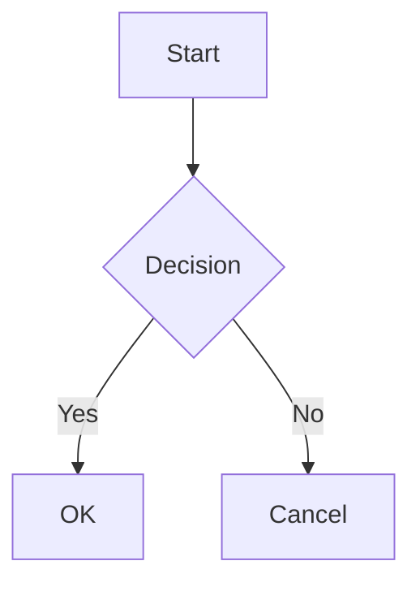

<p align="center">
  <a href="https://yss-tazawa.github.io/plantuml-markdown-preview/">English</a> | <a href="https://yss-tazawa.github.io/plantuml-markdown-preview/#/zh-cn/">简体中文</a> | <a href="https://yss-tazawa.github.io/plantuml-markdown-preview/#/ja/">日本語</a> | <a href="https://yss-tazawa.github.io/plantuml-markdown-preview/#/es/">Español</a> | <a href="https://yss-tazawa.github.io/plantuml-markdown-preview/#/pt-br/">Português</a> | <strong>한국어</strong> | <a href="https://yss-tazawa.github.io/plantuml-markdown-preview/#/zh-tw/">繁體中文</a>
</p>

<p align="center">
  
</p>

<h1 align="center">PlantUML Markdown Preview</h1>

<p align="center">
  <strong>PlantUML, Mermaid, D2 다이어그램을 Markdown 미리보기 안에서 바로 봅니다. Fast, Secure, Easy — 작업에 맞는 모드를 고르세요.</strong>
</p>

<p align="center">
  <a href="https://marketplace.visualstudio.com/items?itemName=yss-tazawa.plantuml-markdown-preview"></a>
  <a href="https://marketplace.visualstudio.com/items?itemName=yss-tazawa.plantuml-markdown-preview"></a>
  <a href="https://github.com/yss-tazawa/plantuml-markdown-preview/blob/main/LICENSE"></a>
</p>

<p align="center">
  
</p>

Markdown 안에 다이어그램을 코드로 쓰면 입력하는 대로 바로 렌더링됩니다. 다이어그램까지 포함해 문서 전체를 HTML이나 PDF로 내보낼 수 있습니다.

## 모드 선택

| | **Fast** (기본값) | **Secure** | **Easy** |
|---|---|---|---|
| | 빠른 렌더링 | 최대의 개인정보 보호 | 설정 필요 없음 |
| | 로컬 PlantUML 서버가 입력하는 대로 다이어그램을 업데이트합니다 | 네트워크도 백그라운드 프로세스도 사용하지 않으며, 모든 것이 내 컴퓨터 안에서 끝납니다 | Java가 필요 없습니다. 온라인 PlantUML 서버를 사용해 바로 작동합니다 |
| **Java** | 11+ 필요 | 11+ 필요 | 필요 없음 |
| **네트워크** | 없음 | 없음 | 필요함 |
| **개인정보** | 로컬 전용 | 로컬 전용 | 다이어그램 소스가 PlantUML 서버로 전송됨 |
| **설정** | [Java 설치 →](#필수-요구-사항) | [Java 설치 →](#필수-요구-사항) | 필요 없음 |

설정 하나로 언제든지 모드를 전환할 수 있습니다. 마이그레이션도 재시작도 필요 없습니다.

자세한 내용은 [렌더링 모드](#렌더링-모드)를, 설정 방법은 [빠른 시작](#빠른-시작)을 참조하세요.

## 주요 특징

- **문서 안에 바로 다이어그램** — PlantUML, Mermaid, D2 다이어그램이 별도의 패널이 아닌 Markdown 미리보기 안에 인라인으로 표시됩니다.
- **안심하고 열 수 있음** — Markdown 안의 스크립트는 미리보기에서 절대 실행되지 않습니다.
- **원하는 크기로** — PlantUML, Mermaid, D2 다이어그램의 표시 배율을 각각 따로 설정할 수 있습니다.
- **단일 파일 HTML 내보내기** — 문서와 다이어그램을 하나의 HTML 파일로 내보내며, 레이아웃 너비와 정렬을 직접 고를 수 있습니다.
- **원클릭 PDF 내보내기** — Chrome, Edge 또는 Chromium으로 인쇄하며, 다이어그램은 페이지에 맞게 조정됩니다.
- **양방향 스크롤 동기화** — 편집기나 미리보기 중 한쪽을 스크롤하면 다른 쪽이 따라옵니다.
- **손쉬운 탐색** — 미리보기에서 바로 맨 위나 맨 아래로 이동하거나 목차 사이드바를 열 수 있습니다.
- **다이어그램 뷰어** — 다이어그램을 우클릭하면 별도의 패널에서 이동 및 확대/축소할 수 있으며, 편집 내용이 바로 반영됩니다.
- **읽기용 보기(Reading View)** — Markdown, PlantUML, Mermaid, D2 파일을 전용 탭에 렌더링해 읽고, 그 자리에서 소스로 다시 전환할 수 있습니다.
- **단독 다이어그램 미리보기** — `.puml`, `.plantuml`, `.mmd`, `.mermaid`, `.d2` 파일을 직접 열어 이동 및 확대/축소와 실시간 업데이트를 사용할 수 있습니다.
- **Git 리비전 미리보기** — Markdown 파일을 HEAD 또는 스테이징 영역 시점의 내용으로 현재 미리보기 옆에 렌더링하므로, 변경된 다이어그램을 눈으로 비교할 수 있습니다.
- **PNG / SVG로 저장 또는 복사** — 미리보기나 다이어그램 뷰어에서 다이어그램을 우클릭하여 파일로 저장하거나 클립보드에 복사할 수 있습니다.
- **17가지 미리보기 테마** — VS Code 색 테마를 따르거나, GitHub, Atom, Solarized, Dracula, Monokai를 비롯한 9가지 밝은 테마와 7가지 어두운 테마 중에서 고를 수 있습니다.
- **편집기 지원** — PlantUML, Mermaid, D2용 키워드 완성, 컬러 피커, 스니펫을 제공합니다.
- **7개 언어 지원** — UI를 영어, 중국어(간체 및 번체), 스페인어, 브라질 포르투갈어, 일본어, 한국어로 사용할 수 있습니다.
- **수학 공식 지원** — `$...$` 인라인 수식과 `$$...$$` 블록 수식을 쓰면 [KaTeX](https://katex.org/)로 렌더링됩니다.

## 목차

- [모드 선택](#모드-선택)
- [주요 특징](#주요-특징)
- [기능](#기능)
- [빠른 시작](#빠른-시작)
- [사용법](#사용법)
  - [읽기용 보기](#읽기용-보기)
- [설정](#설정)
- [스니펫](#스니펫)
- [컬러 피커](#컬러-피커)
- [키워드 완성](#키워드-완성)
- [키보드 단축키](#키보드-단축키)
- [자주 묻는 질문(FAQ)](#자주-묻는-질문faq)
- [기여하기](#기여하기)
- [타사 라이선스](#타사-라이선스)
- [라이선스](#라이선스)

## 기능

### 인라인 다이어그램 미리보기

```` ```plantuml ````, ```` ```mermaid ````, ```` ```d2 ```` 코드 블록은 일반 Markdown 콘텐츠와 함께 인라인 SVG 다이어그램으로 렌더링됩니다.

- **실시간 업데이트** — 입력하는 대로 미리보기가 업데이트됩니다.
- **저장 시 새로고침** — 파일을 저장하면 미리보기가 새로고침됩니다.
- **탭을 따라감** — 활성 편집기 탭을 바꾸면 미리보기도 함께 바뀝니다.
- **로딩 표시기** — 다이어그램이 아직 렌더링 중인지 알 수 있습니다.
- **알기 쉬운 오류 메시지** — 구문 오류가 행 번호, 주변 소스와 함께 인라인으로 표시됩니다.
- **PlantUML** — 내 컴퓨터의 Java(Fast / Secure 모드) 또는 PlantUML 서버(Easy 모드)로 렌더링됩니다. [렌더링 모드](#렌더링-모드)를 참조하세요.
- **Mermaid** — [mermaid.js](https://mermaid.js.org/)로 렌더링되며, Java나 다른 도구를 설치할 필요가 없습니다.
- **D2** — 내장 [@terrastruct/d2](https://d2lang.com/) (Wasm)로 렌더링되며, 다른 도구를 설치할 필요가 없습니다.

### 다이어그램 소스 하이라이팅

Markdown 안의 ```` ```plantuml ````, ```` ```mermaid ````, ```` ```d2 ```` 블록과
단독 `.puml`, `.plantuml`, `.mmd`, `.mermaid`, `.d2` 파일에서 다이어그램 소스가
구문 강조됩니다. 색상은 현재 테마를 따릅니다.

### 수학 공식 지원

[KaTeX](https://katex.org/)를 사용하여 수학 표현식을 렌더링합니다.

- **인라인 수학** — `$E=mc^2$`는 인라인 공식으로 렌더링됩니다.
- **블록 수학** — `$$\int_0^\infty e^{-x}\,dx = 1$$`은 중앙 정렬된 수식으로 렌더링됩니다.
- **어디서나 같은 모양** — 수식은 미리보기와 HTML/PDF 내보내기에서 똑같이 보입니다.
- **간단히 끄기** — 본문의 `$` 기호가 수식으로 읽힌다면 `enableMath: false`로 설정하세요.

### 다이어그램 배율

PlantUML, Mermaid, D2 다이어그램의 표시 크기를 각각 따로 제어합니다.

- **PlantUML 배율** — `auto`(너비에 맞게 축소) 또는 70%~120%의 고정 비율(기본값 100%)을 고를 수 있으며, 다이어그램은 어떤 배율에서도 선명합니다.
- **Mermaid 배율** — `auto`(너비에 맞게 축소) 또는 50%~100%의 고정 비율(기본값 80%)을 고를 수 있습니다.
- **D2 배율** — `auto`(너비에 맞게 축소) 또는 50%~100%의 고정 비율(기본값 70%)을 고를 수 있습니다.

### 렌더링 모드

PlantUML 다이어그램이 렌더링되는 방식을 정하는 프리셋 모드를 선택하세요.

| | Fast (기본값) | Secure | Easy |
|---|---|---|---|
| **Java 필요** | 예 | 예 | 아니요 |
| **네트워크** | 없음 (localhost 전용) | 없음 | 필요함 |
| **개인정보** | 로컬 전용 | 로컬 전용 | 다이어그램 소스가 PlantUML 서버로 전송됨 |
| **속도** | 즉각적 (상주 로컬 서버) | 느림 (렌더링할 때마다 Java 시작) | 네트워크 상태에 따라 다름 |

- **Fast 모드** (기본값) — `localhost`에서 PlantUML 서버를 계속 실행해 두므로, 편집하는 대로 다이어그램이 즉시 업데이트됩니다. 서버는 첫 PlantUML 다이어그램을 렌더링할 때 시작되며(변경 가능, [Start Mode](#fast-모드-서버-시작-모드) 참조), 다이어그램은 내 컴퓨터를 벗어나지 않습니다.
- **Secure 모드** — 렌더링할 때마다 내 컴퓨터의 Java와 PlantUML jar를 실행하며, 네트워크 액세스도 백그라운드 서버도 사용하지 않습니다. 최대 보안을 위해 로컬 이미지는 기본적으로 차단됩니다.
- **Easy 모드** — PlantUML 소스를 PlantUML 서버로 보내므로 설치할 것이 없습니다. 기본적으로 공용 서버(`https://www.plantuml.com/plantuml`)를 사용하며, 개인정보 보호를 위해 직접 운영하는 서버를 지정할 수 있습니다.

미리보기를 열 때 Java를 찾을 수 없으면 Easy 모드로 전환할지 묻습니다.

#### Fast 모드: 서버 시작 모드

기본적으로 Fast 모드는 `127.0.0.1`에서 자체 PlantUML 서버를 시작하고 관리합니다. 별도의 설정이 필요 없습니다. `plantumlLocalServerStartMode`(Start Mode)는 서버를 언제 시작할지, 그리고 시작할지 여부를 정합니다:

| 값 | 효과 |
|---|---|
| `"lazy"` (기본값) | 첫 다이어그램 렌더링 시점에 관리되는 서버를 시작합니다. PlantUML 다이어그램을 렌더링하기 전까지는 Java가 실행되지 않으며, 첫 렌더링에는 몇 초 정도 더 걸립니다. |
| `"on"` | 확장이 활성화되는 즉시 관리되는 서버를 시작합니다. 첫 렌더링은 즉각적이지만, 시작 시점부터 Java가 백그라운드에서 계속 실행됩니다. |
| `"off"` | 서버를 전혀 시작하지 않습니다. 직접 실행하는 서버(예: `java -jar plantuml.jar -picoweb`)에 연결하며, LAN 내 다른 컴퓨터에서 실행 중인 서버도 지정할 수 있습니다. |

서버에 연결할 때 사용하는 호스트와 포트는 다음 설정으로 지정합니다:

| 설정 | 기본값 | 효과 |
|---|---|---|
| `plantumlLocalServerHost` | `127.0.0.1` | Start Mode가 `"off"`일 때 연결할 호스트(예: LAN의 다른 위치에 있는 picoweb 서버). `"on"`/`"lazy"`에서는 무시됩니다 — 관리되는 서버는 항상 `127.0.0.1`에 바인딩됩니다. |
| `plantumlLocalServerPort` | `0` | Start Mode `"on"`/`"lazy"`: 시작할 포트(`0` = 사용 가능한 포트를 자동 할당). Start Mode `"off"`: 연결할 포트. |

알아 두면 좋은 점:

- **기존 서버와 충돌하지 않음** — `"on"` 또는 `"lazy"`에서 고정 포트를 사용할 때, 그 포트에서 정상 동작 중인 PlantUML 서버가 이미 있으면 서버를 새로 시작하지 않고 그 서버를 재사용합니다.
- **`"off"`에서는 로컬 Java 불필요** — 확장은 서버를 시작하지 않고, 설정한 호스트와 포트에 연결만 합니다.
- **직접 실행한 서버는 그대로** — 확장은 자신이 시작한 서버만 중지합니다.
- **이전 설정도 읽음** — Start Mode를 설정하지 않으면 이전의 `plantumlLocalServerAutoStart` 설정을 사용합니다(`true` → `"on"`, `false` → `"off"`).

#### Fast 모드: JVM 메모리(힙) 설정

관리되는 서버의 메모리 사용량은 힙 프리셋(`plantumlLocalServerJvmHeapPreset`)으로 제한됩니다:

| 프리셋 | JVM 힙 플래그 | 적합한 경우 |
|---|---|---|
| `small` | `-Xms16m -Xmx256m` | 메모리 사용량 최소화; 작은 다이어그램 전용. |
| `medium` (기본값) | `-Xms16m -Xmx512m` | 균형 잡힌 설정; 대부분의 다이어그램을 무리 없이 처리합니다. |
| `large` | `-Xms64m -Xmx1024m` | 매우 큰 다이어그램용; PlantUML FAQ 권장값과 일치합니다. |
| `unlimited` | _(없음)_ | 플래그를 전혀 지정하지 않습니다 — Java가 알아서 결정합니다(최대 힙은 기본적으로 물리 메모리의 1/4). |
| `custom` | 사용자 지정 값 | `plantumlLocalServerJvmInitialHeapMb`(8–32768, 기본값 16)와 `plantumlLocalServerJvmMaxHeapMb`(64–32768, 기본값 512)를 읽습니다. |

`unlimited`를 제외한 모든 프리셋은 서버를 가볍게 유지하기 위해 `-XX:+UseSerialGC`, `-XX:MaxMetaspaceSize=128m`, `-XX:ReservedCodeCacheSize=64m`도 함께 고정합니다. 이 설정은 확장이 직접 시작한 서버(Fast 모드, Start Mode `"on"`/`"lazy"`)에만 적용됩니다.

### 상태 표시줄

상태 표시줄에는 현재 렌더링 모드 (Fast / Secure / Easy)가 표시되며, Fast 모드에서는 로컬 서버 상태(시작 중, 실행 중, 오류, 중지됨)가 표시됩니다.

- **클릭 한 번으로 모드 전환** — 상태 표시줄 항목을 클릭하면 설정을 열지 않고 빠른 선택에서 모드를 고를 수 있습니다.
- **명령 팔레트에서도 가능** — **렌더링 모드 선택** 명령도 같은 일을 합니다.

Markdown 미리보기나 읽기용 보기가 표시되어 있는 동안에는 상태 표시줄에 미리보기 확대/축소 수준도 표시됩니다. 클릭하여 다른 수준을 선택할 수 있습니다.

### HTML 내보내기

Markdown 문서를 하나의 HTML 파일로 내보냅니다.

- **다이어그램 포함** — PlantUML과 D2 다이어그램은 인라인 SVG로 포함되며, Mermaid 다이어그램과 수식 글꼴은 파일을 열 때 CDN에서 불러옵니다.
- **스타일 포함** — 구문 강조 스타일이 파일 안에 함께 들어갑니다.
- **내보내고 열기** — 명령 하나로 내보낸 결과를 브라우저에서 엽니다.
- **원하는 레이아웃** — 640px~1440px의 고정 너비를 가운데 또는 왼쪽 정렬로 고르거나, 브라우저 창을 채우고 넘치는 다이어그램만 축소하는 **반응형**을 고를 수 있습니다. 평소 쓰는 너비와 정렬은 설정에서 정하고, 내보낼 때마다 메뉴에서 고를 수도 있습니다.

### PDF 내보내기

내 컴퓨터에 이미 있는 Chrome, Edge 또는 Chromium을 사용하여 Markdown 문서를 PDF로 내보냅니다.

- **내 브라우저 사용** — 시스템에 Chrome, Edge 또는 Chromium이 설치되어 있어야 합니다.
- **세로 또는 가로** — 내보낼 때 방향을 고릅니다.
- **일관된 배율** — 텍스트와 다이어그램이 함께 조정됩니다(`pdfScale`, 기본값 0.625).
- **깔끔한 페이지** — 인쇄 여백이 자동으로 적용됩니다.

### 다이어그램 일괄 내보내기

Markdown 파일의 모든 다이어그램을 개별 PNG 또는 SVG 파일로 내보냅니다.

- **모든 다이어그램을 한 번에** — 모든 PlantUML, Mermaid, D2 다이어그램을 문서 순서대로 내보냅니다.
- **원하는 폴더 이름** — 출력 폴더 이름을 정할 수 있습니다(기본값: `{파일명}_diagrams`).
- **미리보기 필요** — 다이어그램은 미리보기에서 렌더링되므로 미리보기가 열려 있어야 합니다.

### 탐색

- **맨 위로 / 맨 아래로** — 미리보기 오른쪽 위의 버튼을 클릭 한 번으로 이동합니다.
- **목차 사이드바** — TOC 버튼을 클릭하면 모든 제목이 나열되며, 제목을 클릭하면 그 위치로 이동합니다.
- **확대/축소** — `Ctrl`+마우스 휠(Mac에서는 `Cmd`+마우스 휠)로 미리보기와 읽기용 보기를 50%에서 200%까지 확대/축소합니다. 하나의 수준이 모두에 적용되며 재시작 후에도 유지됩니다.

### 다이어그램 뷰어

미리보기에서 PlantUML, Mermaid 또는 D2 다이어그램을 우클릭하고 **다이어그램 뷰어에서 열기**를 선택하면 별도의 이동 및 확대/축소 패널에서 다이어그램을 열 수 있습니다.

- **이동 및 확대/축소** — 마우스 휠로 커서 위치를 중심으로 확대/축소하고, 드래그하여 이동합니다.
- **툴바** — 창에 맞추기, 1:1 초기화, 단계별 확대/축소(+/-)를 제공합니다.
- **실시간 동기화** — 편집 내용이 바로 반영되며, 확대/축소 위치는 그대로 유지됩니다.
- **테마에 맞는 배경** — 배경색이 현재 미리보기 테마를 따릅니다.
- **파일과 함께 닫힘** — 다른 소스 파일로 전환하면 뷰어가 닫힙니다.
- **PNG / SVG로 저장 또는 복사** — 미리보기나 다이어그램 뷰어에서 다이어그램을 우클릭하여 파일로 저장하거나 PNG로 복사할 수 있습니다.
- **뷰어에서 찾기** — `Cmd+F` / `Ctrl+F`를 눌러 찾기 위젯을 엽니다.
- **선택 사항** — `enableDiagramViewer: false`로 끌 수 있습니다.

### PlantUML `!include` 지원

`!include` 지시어를 사용하여 여러 다이어그램에서 공통 스타일, 매크로, 구성 요소 정의를 공유할 수 있습니다.

- **파일을 찾는 위치** — 포함된 파일은 워크스페이스 루트 또는 `plantumlIncludePath`에 설정된 폴더를 기준으로 해석됩니다. Fast 모드에서는 확장이 자체 서버를 실행할 때 적용되며, 자세한 내용은 [FAQ](#자주-묻는-질문faq)를 참조하세요.
- **저장 시 새로고침** — 포함된 파일을 저장하면 미리보기가 새로고침되며, **새로고침** 버튼(↻)으로 언제든지 강제로 새로고침할 수 있습니다.
- **Include 파일로 이동** — `.puml` 또는 Markdown 파일의 `!include` 행을 우클릭하여 참조된 파일을 엽니다.
- **Include 소스 열기** — 미리보기에서 PlantUML 다이어그램을 우클릭하여 포함된 파일을 직접 엽니다.
- **Fast 및 Secure 모드** — Easy 모드는 로컬 파일을 읽을 수 없으므로 `!include`를 사용할 수 없습니다.

### 단독 다이어그램 미리보기

`.puml`, `.plantuml`, `.mmd`, `.mermaid`, `.d2` 파일을 직접 엽니다. Markdown 래퍼가 필요 없습니다.

- **이동 및 확대/축소** — 다이어그램 뷰어와 같은 조작을 사용할 수 있습니다.
- **실시간 업데이트** — 입력하는 대로 미리보기가 업데이트됩니다.
- **탭을 따라감** — 같은 유형의 파일 사이를 이동하면 미리보기도 함께 바뀝니다.
- **테마** — 미리보기 테마와 다이어그램 테마를 각각 따로 고를 수 있습니다.
- **PNG / SVG로 저장 또는 복사** — 다이어그램을 우클릭합니다.
- **미리보기에서 찾기** — `Cmd+F` / `Ctrl+F`를 눌러 찾기 위젯을 엽니다.
- **PlantUML** — 세 가지 렌더링 모드(Fast / Secure / Easy)에서 모두 작동합니다.
- **Mermaid** — mermaid.js로 렌더링됩니다.
- **D2** — @terrastruct/d2 (Wasm)로 렌더링되며, 테마와 레이아웃 엔진을 고를 수 있습니다.

### Git 리비전 미리보기

Markdown 파일을 Git 리비전 시점의 내용으로 렌더링하여 옆 패널에 표시합니다. 변경된 다이어그램을 텍스트 차이로 읽는 대신 렌더링해서 나란히 비교할 수 있습니다.

- **HEAD** — 마지막으로 커밋된 버전입니다.
- **스테이징됨** — 현재 커밋을 위해 스테이징된 버전입니다.
- **나란히 표시** — 현재 미리보기 옆에 열리므로 이전과 이후 다이어그램을 동시에 볼 수 있습니다.
- **스냅샷** — 한 번만 렌더링하며 이후 편집을 따라가지 않습니다. 상단의 배너에 그렇게 표시됩니다.
- **Git 필요** — Git 저장소에서 추적 중인 파일이어야 합니다.

### 양방향 스크롤 동기화

어느 한쪽을 스크롤하면 편집기와 미리보기가 함께 움직입니다.

- **위치 맞춤** — 미리보기가 지금 보고 있는 소스 부분에 맞춰 정렬됩니다.
- **안정적인 위치** — 미리보기가 다시 렌더링되어도 스크롤 위치가 그대로 유지됩니다.

### 테마

**미리보기 테마**는 문서의 전체적인 외관을 제어합니다.

**VS Code 테마:**

| 테마 | 스타일 |
|-------|-------|
| Follow VS Code Color Theme | 내장 Markdown 미리보기처럼 현재 VS Code 색 테마를 따름. HTML/PDF 내보내기는 색 테마에 맞춰 VS Code Light 2026 또는 Dark 2026 사용 |

**밝은 테마:**

| 테마 | 스타일 |
|-------|-------|
| GitHub Light | 흰색 배경 (기본값) |
| Atom Light | 부드러운 회색 텍스트, Atom 편집기 스타일 |
| One Light | 미색(Off-white), 균형 잡힌 팔레트 |
| Solarized Light | 따뜻한 베이지색, 눈이 편안함 |
| Vue | 녹색 강조, Vue.js 문서 스타일 |
| Pen Paper Coffee | 따뜻한 종이, 손글씨 감성 |
| Coy | 흰색에 가까움, 깔끔한 디자인 |
| VS | 클래식 Visual Studio 색상 |
| VS Code Light 2026 | VS Code 색 테마 Light 2026에서 표시한 내장 Markdown 미리보기 |

**어두운 테마:**

| 테마 | 스타일 |
|-------|-------|
| GitHub Dark | 어두운 배경 |
| Atom Dark | Tomorrow Night 팔레트 |
| One Dark | Atom 스타일 다크 |
| Dracula | 활기찬 다크 |
| Solarized Dark | 짙은 청록색, 눈이 편안함 |
| Monokai | 선명한 구문, Sublime Text 스타일 |
| VS Code Dark 2026 | VS Code 색 테마 Dark 2026에서 표시한 내장 Markdown 미리보기 |

제목 표시줄 아이콘에서 미리보기 테마를 즉시 전환할 수 있으며, 다이어그램은 다시 그려지지 않습니다. PlantUML 테마를 바꾸면 다이어그램이 다시 그려집니다.

**PlantUML 테마**는 다이어그램 스타일을 독립적으로 제어합니다. 확장은 설치된 PlantUML에서 사용 가능한 테마를 찾아 미리보기 테마와 같은 빠른 선택에 표시합니다.

**Mermaid 테마**는 Mermaid 다이어그램 스타일을 제어합니다: `default`, `dark`, `forest`, `neutral`, `base`. 이 테마들도 같은 빠른 선택에 있습니다.

**D2 테마** — 19가지 내장 테마(예: `Neutral Default`, `Dark Mauve`, `Terminal`)가 있으며, 설정 또는 같은 빠른 선택에서 고를 수 있습니다.

### 구문 강조

highlight.js를 통해 190개 이상의 언어를 지원합니다. 코드 블록은 선택한 미리보기 테마와 일치하도록 스타일이 지정됩니다.

### 보안

- **엄격한 스크립트 정책** — 미리보기에서는 확장 자체의 스크립트만 실행됩니다.
- **문서의 코드는 실행 안 함** — Markdown 안의 `<script>` 태그나 기타 코드는 절대 실행되지 않습니다.
- **모드에 따른 로컬 이미지** — 로컬 이미지는 기본적으로 모드를 따르며(`allowLocalImages: "mode-default"`), Secure 모드는 최대 보안을 위해 차단합니다.
- **기본적으로 HTTP 이미지 차단** — 암호화되지 않은 HTTP를 통한 이미지 로딩은 꺼져 있습니다(`allowHttpImages`). 인트라넷이나 로컬 개발 서버처럼 신뢰할 수 있는 네트워크에서만 켜세요.

### VS Code 내장 Markdown 미리보기 통합

PlantUML, Mermaid, D2 다이어그램은 VS Code의 내장 Markdown 미리보기(`Markdown: 측면에서 미리 보기 열기`)에서도 표시되며, 추가 설정이 필요 없습니다. 미리보기 테마, 스크롤 동기화, HTML 내보내기를 사용하려면 이 확장의 미리보기(`Cmd+Alt+V` / `Ctrl+Alt+V`)를 여세요. 내장 미리보기에서는 큰 PlantUML 다이어그램이 편집기를 잠시 멈추게 할 수 있으므로, 그런 경우에도 이 확장의 미리보기가 더 좋습니다.

### GitHub 스타일 경고문

인용문 마커로부터 GitHub 스타일 경고문(콜아웃)을 렌더링하며, GitHub 자체 출력과 동일하게 표시합니다.

```markdown
> [!NOTE]
> Highlights information that users should take into account.

> [!TIP]
> Optional information to help a user be more successful.

> [!IMPORTANT]
> Crucial information necessary for users to succeed.

> [!WARNING]
> Critical content demanding immediate user attention.

> [!CAUTION]
> Negative potential consequences of an action.
```

- **5가지 유형** — `NOTE`, `TIP`, `IMPORTANT`, `WARNING`, `CAUTION`이 있으며, 각각 고유한 아이콘과 강조 색상을 가집니다.
- **GitHub와 같은 규칙** — 마커는 대문자만 인식됩니다(`[!note]`는 일반 인용문으로 남습니다).
- **테마에 맞춤** — 색상이 활성 미리보기 테마(밝은 테마 / 어두운 테마)에 맞게 조정됩니다.
- **어디서나 같은 모양** — 경고문은 미리보기와 HTML/PDF 내보내기에서 똑같이 보입니다.

## 빠른 시작

### 필수 요구 사항

**Mermaid** — 요구 사항 없음. 즉시 작동합니다.

**D2** — 요구 사항 없음. 내장 [D2](https://d2lang.com/) Wasm을 사용하여 렌더링되므로 즉시 작동합니다.

**PlantUML (Easy 모드)** — 요구 사항 없음. 다이어그램 소스가 렌더링을 위해 PlantUML 서버로 전송됩니다.

**PlantUML (Fast / Secure 모드)** — 기본값:

| 도구 | 용도 | 확인 |
|------|---------|--------|
| [Java 11+ (JRE 또는 JDK)](#설정) | PlantUML 실행 (내장 PlantUML 1.2026.2는 Java 11+ 필요) | `java -version` |
| [Graphviz](https://graphviz.org/) | 선택 사항 — 클래스, 구성 요소 및 기타 레이아웃 의존적 다이어그램에 필요 ([다이어그램 지원](#다이어그램-지원) 참조) | `dot -V` |

PlantUML(LGPL, v1.2026.2)이 내장되어 있어 따로 다운로드할 필요가 없습니다. 필요한 것은 Java 11 이상뿐이며, Graphviz는 선택 사항입니다.
아직 Java가 없나요? 미리보기를 열 때 Easy 모드로 전환할지 묻습니다.

### 다이어그램 지원

설정에 따라 작동하는 항목이 다릅니다.

| 다이어그램 | LGPL (내장) | Win: GPLv2 jar | Mac/Linux: + Graphviz |
|---------|:-:|:-:|:-:|
| Sequence | ✓ | ✓ | ✓ |
| Activity (새 구문) | ✓ | ✓ | ✓ |
| Mind Map | ✓ | ✓ | ✓ |
| WBS | ✓ | ✓ | ✓ |
| Gantt | ✓ | ✓ | ✓ |
| JSON / YAML | ✓ | ✓ | ✓ |
| Salt / Wireframe | ✓ | ✓ | ✓ |
| Timing | ✓ | ✓ | ✓ |
| Network (nwdiag) | ✓ | ✓ | ✓ |
| Class | — | ✓ | ✓ |
| Use Case | — | ✓ | ✓ |
| Object | — | ✓ | ✓ |
| Component | — | ✓ | ✓ |
| Deployment | — | ✓ | ✓ |
| State | — | ✓ | ✓ |
| ER (Entity Relationship) | — | ✓ | ✓ |
| Activity (레거시) | — | ✓ | ✓ |

- **LGPL (내장)** — 즉시 작동합니다. Graphviz가 필요하지 않습니다.
- **Win: GPLv2 jar** — [GPLv2 버전](https://plantuml.com/download)은 Graphviz를 포함합니다 (Windows 전용, 자동 압축 해제). 이를 사용하려면 [`plantumlJarPath`](#설정)를 설정하세요.
- **Mac/Linux: + Graphviz** — [Graphviz](https://graphviz.org/)를 별도로 설치하세요. LGPL 또는 GPLv2 jar와 함께 작동합니다.

### 설치

1. VS Code를 여세요.
2. 확장 뷰(`Ctrl+Shift+X` / `Cmd+Shift+X`)에서 **PlantUML Markdown Preview**를 검색하세요.
3. **설치**를 클릭하세요.

### 초기 설정

**Fast 모드** (기본값) — 설정할 것이 없습니다. 첫 다이어그램을 렌더링할 때 로컬 PlantUML 서버가 시작되어 즉시 업데이트를 유지합니다. Java 11+이 필요합니다.

**Secure 모드 사용** — `mode`를 `"secure"`로 설정하세요. 렌더링할 때마다 Java 11+이 실행되며, 백그라운드 서버도 네트워크 액세스도 사용하지 않습니다.

**Easy 모드 사용** (설정 불필요) — `mode`를 `"easy"`로 설정하세요. 다이어그램 소스가 렌더링을 위해 PlantUML 서버로 전송됩니다.

**Fast 및 Secure 모드** — 내장 LGPL jar는 추가 설정 없이 시퀀스, 액티비티, 마인드맵 및 기타 다이어그램을 지원합니다 ([다이어그램 지원](#다이어그램-지원) 참조).
클래스, 구성 요소, 유스케이스 및 기타 레이아웃 의존적 다이어그램을 활성화하려면 아래 플랫폼별 단계를 따르세요.

#### Windows

1. Java가 설치되어 있지 않은 경우 설치하세요 (PowerShell을 열고 실행):
   ```powershell
   winget install Microsoft.OpenJDK.21
   ```
2. `java`가 PATH에 없는 경우 PowerShell에서 전체 경로를 찾으세요:
   ```powershell
   Get-Command java
   # 예: C:\Program Files\Microsoft\jdk-21.0.6.7-hotspot\bin\java.exe
   ```
   VS Code 설정(`Ctrl+,`)을 열고 `plantumlMarkdownPreview.javaPath`를 검색한 후 위에서 확인한 경로를 입력하세요.
3. 원하는 폴더에 [GPLv2 버전 PlantUML](https://plantuml.com/download) (`plantuml-gplv2-*.jar`)을 다운로드하세요 (Graphviz 포함 — 별도 설치 불필요).
4. VS Code 설정(`Ctrl+,`)을 열고 `plantumlMarkdownPreview.plantumlJarPath`를 검색한 후 다운로드한 `.jar` 파일의 전체 경로를 입력하세요 (예: `C:\tools\plantuml-gplv2-1.2026.2.jar`).

#### Mac

1. Homebrew를 통해 Java와 Graphviz를 설치하세요:
   ```sh
   brew install openjdk graphviz
   ```
2. `dot`이 PATH에 없는 경우 전체 경로를 찾아 VS Code에서 설정하세요:
   ```sh
   which dot
   # 예: /opt/homebrew/bin/dot
   ```
   VS Code 설정(`Cmd+,`)을 열고 `plantumlMarkdownPreview.dotPath`를 검색한 후 위에서 확인한 경로를 입력하세요.

#### Linux

1. Java와 Graphviz를 설치하세요:
   ```sh
   # Debian / Ubuntu
   sudo apt install default-jdk graphviz

   # Fedora
   sudo dnf install java-21-openjdk graphviz
   ```
2. `dot`이 PATH에 없는 경우 전체 경로를 찾아 VS Code에서 설정하세요:
   ```sh
   which dot
   # 예: /usr/bin/dot
   ```
   VS Code 설정(`Ctrl+,`)을 열고 `plantumlMarkdownPreview.dotPath`를 검색한 후 위에서 확인한 경로를 입력하세요.

이 경로들은 대부분 설정할 필요가 없습니다. 기본적으로 확장은 `JAVA_HOME/bin/`(Windows에서는 `JAVA_HOME\bin\`) 아래에서 Java를 찾은 다음 PATH에서 찾고, `dot`은 PATH에서 찾으며, 내장 PlantUML jar를 사용합니다. 명령이 PATH에 없거나 다른 jar를 사용하려는 경우에만 `javaPath`, `dotPath`, `plantumlJarPath`를 설정하세요.

## 사용법

### 미리보기 열기

- **키보드 단축키** — `Cmd+Alt+V` (Mac) / `Ctrl+Alt+V` (Windows / Linux)를 누릅니다.
- **편집기 제목 표시줄** — 편집기 오른쪽 위의 미리보기 버튼(둥근 사각형 안의 "P")을 클릭합니다.
- **VS Code 표준 버튼과 단축키** — `useAsDefaultPreview`가 켜져 있으면(기본값) VS Code의 **측면에서 미리 보기 열기** 버튼, 우클릭 메뉴의 **미리 보기 열기**, `Cmd+K V` (Mac) / `Ctrl+K V` (Windows / Linux)가 이 확장의 미리보기를 엽니다. `Cmd+Shift+V` / `Ctrl+Shift+V`는 대신 [읽기용 보기](#읽기용-보기)로 전환합니다.
- **우클릭 메뉴** — 탐색기 또는 편집기 안에서 Markdown 파일을 우클릭 → **PlantUML Markdown Preview** → **미리보기를 옆에 열기**를 선택합니다.
- **명령 팔레트** — `PlantUML Markdown Preview: 미리보기를 옆에 열기`를 실행합니다.

미리보기는 자체 테마를 사용하며, 처음에는 흰색 배경(GitHub Light)으로 시작합니다. 현재 VS Code 색 테마에 맞추려면 `follow-vscode`를 선택하세요.

### 읽기용 보기

읽기용 보기(Reading View)는 파일을 텍스트 편집기 대신 그 파일의 탭 자체에 렌더링해서 보여 줍니다. 두 번째 패널은 열리지 않습니다. 활성 편집기를 따라가지 않고 그 파일에 고정되며, 미리보기와 동시에 열어 둘 수 있습니다.

Markdown 파일(`.md`, `.markdown` 등 VS Code의 Markdown 미리보기가 다루는 확장자)과 `.puml` / `.plantuml`, `.mmd` / `.mermaid`, `.d2` 파일에서 사용할 수 있습니다. 사용하기 전에는 아무것도 바뀌지 않습니다.

- **그 자리에서 전환** — 편집기에서 우클릭 → **PlantUML Markdown Preview** → **읽기용 보기로 전환** (PlantUML, Mermaid, D2 파일에서는 **읽기용 보기로 전환**이 메뉴에 바로 표시됩니다). 돌아가려면 읽기용 보기에서 우클릭 → **소스로 전환**, 또는 편집기 제목 표시줄의 **소스로 전환**을 클릭합니다. 탭 자체가 전환되며 새 탭은 열리지 않습니다.
- **한 번만 열기** — 탐색기에서 파일을 우클릭 → **연결 프로그램...** → **PlantUML Markdown Preview (읽기용 보기)**. 이미 열려 있는 파일은 대신 탭을 우클릭하고 **편집기 다시 열기...**를 사용합니다.
- **기본으로 열기** — **연결 프로그램...** 목록에서 **'\*.md'에 대한 기본 편집기 구성...** → **PlantUML Markdown Preview (읽기용 보기)**를 선택합니다. 이후 `.md` 파일을 클릭하면 읽기용 보기로 열립니다. 파일 확장자마다 한 번씩 설정합니다.
- **되돌리기** — 같은 방법으로 **텍스트 편집기**를 선택하거나, 설정에서 그 줄을 지웁니다.

`settings.json`에 직접 설정하려면:

```json
"workbench.editorAssociations": {
  "*.md": "plantumlMarkdownPreviewEditor",
  "*.puml": "plantumlPumlPreviewEditor",
  "*.mmd": "plantumlMermaidPreviewEditor",
  "*.d2": "plantumlD2PreviewEditor"
}
```

| 파일 | 값 |
| ---- | -- |
| Markdown (`*.md`, `*.markdown` 등) | `plantumlMarkdownPreviewEditor` |
| `*.puml`, `*.plantuml` | `plantumlPumlPreviewEditor` |
| `*.mmd`, `*.mermaid` | `plantumlMermaidPreviewEditor` |
| `*.d2` | `plantumlD2PreviewEditor` |

- **이전 VS Code** — VS Code 1.100 이전에는 **읽기용 보기로 전환**과 **소스로 전환**이 표시되지 않으므로, 대신 **연결 프로그램...**으로 읽기용 보기를 여세요.
- **Git diff** — 읽기용 보기로 열도록 설정한 파일이라도 diff는 텍스트 diff로 열립니다.
- **표준 버튼** — `useAsDefaultPreview`가 켜져 있으면(기본값) VS Code의 **미리 보기로 열기** 버튼(VS Code 1.119 이상)과 `Ctrl+Shift+V`(VS Code 1.100 이상)가 읽기용 보기로 전환합니다. [설정](#설정)을 참조하세요.

### 다이어그램 미리보기 열기

Markdown 래퍼 없이 `.puml` / `.plantuml`, `.mmd` / `.mermaid`, 또는 `.d2` 파일을 이동 및 확대/축소 미리보기로 직접 엽니다.

- **키보드 단축키** — 같은 `Cmd+Alt+V` (Mac) / `Ctrl+Alt+V` (Windows / Linux)가 파일 유형에 맞는 미리보기를 엽니다.
- **편집기 제목 표시줄** — 편집기 오른쪽 위의 미리보기 버튼(둥근 사각형 안의 "P")을 클릭합니다.
- **표준 미리보기 단축키** — `useAsDefaultPreview`가 켜져 있으면(기본값) `Cmd+K V` (Mac) / `Ctrl+K V` (Windows / Linux)로도 편집기 옆에 미리보기가 열립니다. `Cmd+Shift+V` / `Ctrl+Shift+V`는 대신 [읽기용 보기](#읽기용-보기)로 전환합니다.
- **우클릭 메뉴** — 탐색기 또는 편집기에서 `.puml` / `.plantuml`, `.mmd` / `.mermaid`, 또는 `.d2` 파일을 우클릭 → **PlantUML 파일 미리보기** / **Mermaid 파일 미리보기** / **D2 파일 미리보기**를 선택합니다.
- **명령 팔레트** — `PlantUML Markdown Preview: PlantUML 파일 미리보기`, `Mermaid 파일 미리보기`, 또는 `D2 파일 미리보기`를 실행합니다.

### Git 리비전 미리보기 열기

현재 버전의 미리보기 옆에 Git 리비전 시점의 내용을 렌더링하여 표시합니다.

- **우클릭 메뉴** — 탐색기 또는 편집기에서 Markdown 파일을 우클릭 → **PlantUML Markdown Preview** → **HEAD 리비전 미리보기를 옆에 열기** / **스테이징된 리비전 미리보기를 옆에 열기**를 선택합니다.
- **명령 팔레트** — `PlantUML Markdown Preview: HEAD 리비전 미리보기를 옆에 열기` / `스테이징된 리비전 미리보기를 옆에 열기`를 실행합니다.

먼저 일반 미리보기를 연 다음 리비전 미리보기를 열면 두 패널이 나란히 배치됩니다. 리비전 패널은 고정된 스냅샷이며 편집해도 업데이트되지 않습니다.

### HTML로 내보내기

- **우클릭 메뉴** — Markdown 파일을 우클릭 → **PlantUML Markdown Preview** → **HTML로 내보내기** → 너비 옵션을 선택합니다.
- **미리보기** — 미리보기 안에서 우클릭 → **HTML로 내보내기** 또는 **HTML로 내보내고 열기**를 선택합니다.

서브메뉴에서 다음 너비 옵션을 선택할 수 있습니다:

| 옵션 | 설명 |
| ------ | ----------- |
| 현재 설정 | 현재 설정으로 내보내기 (반응형 CSS 없음) |
| 640px – 1440px | 픽셀 단위 고정 본문 너비, 가운데 정렬 |
| 반응형 (왼쪽 정렬) | 뷰포트 너비의 본문, 왼쪽 정렬; 다이어그램은 넘칠 때만 축소됨 |
| 640px – 1440px (왼쪽 정렬) | 고정 너비, 왼쪽 정렬 |

HTML 파일은 소스 Markdown 파일과 같은 위치에 저장됩니다.

### PDF로 내보내기

- **우클릭 메뉴** — Markdown 파일을 우클릭 → **PlantUML Markdown Preview** → **PDF로 내보내기** → **세로** 또는 **가로**를 선택합니다.
- **미리보기** — 미리보기 안에서 우클릭 → **PDF로 내보내기** 또는 **PDF로 내보내고 열기** → **세로** 또는 **가로**를 선택합니다.

PDF 파일은 소스 Markdown 파일과 같은 위치에 저장됩니다. Chrome, Edge 또는 Chromium이 필요합니다. `pdfScale` 설정 (기본값 0.625)으로 텍스트와 다이어그램의 전체 배율을 조정할 수 있습니다.

### 다이어그램을 PNG / SVG로 저장 또는 복사

- **미리보기** — 다이어그램을 우클릭 → **다이어그램을 PNG로 복사**, **다이어그램을 PNG로 저장**, 또는 **다이어그램을 SVG로 저장**을 선택합니다.
- **다이어그램 뷰어** — 뷰어 안에서 우클릭 → **다이어그램을 PNG로 복사**, **다이어그램을 PNG로 저장**, 또는 **다이어그램을 SVG로 저장**을 선택합니다.
- **단독 다이어그램 미리보기** — 미리보기 안에서 우클릭 → **다이어그램을 PNG로 복사**, **다이어그램을 PNG로 저장**, 또는 **다이어그램을 SVG로 저장**을 선택합니다.

### 모든 다이어그램 내보내기

- **우클릭 메뉴** — Markdown 파일을 우클릭 → **PlantUML Markdown Preview** → **모든 다이어그램을 PNG로 내보내기** 또는 **모든 다이어그램을 SVG로 내보내기**를 선택합니다.
- **미리보기** — 미리보기 안에서 우클릭 → **모든 다이어그램을 PNG로 내보내기** 또는 **모든 다이어그램을 SVG로 내보내기**를 선택합니다.
- **명령 팔레트** — `PlantUML Markdown Preview: 모든 다이어그램을 PNG로 내보내기` / `모든 다이어그램을 SVG로 내보내기`를 실행합니다.

저장 대화 상자에서 출력 폴더 이름을 정합니다(기본값: `{파일명}_diagrams`). 다이어그램은 문서 순서대로 `diagram-1.png`, `diagram-2.png` 등으로 저장됩니다. 내보내는 동안 미리보기를 열어 두세요.

### 탐색

- **맨 위로 / 맨 아래로** — 미리보기 오른쪽 위의 버튼을 사용합니다.
- **새로고침** — ↻ 버튼을 클릭하여 미리보기를 새로고침하고 캐시를 지웁니다.
- **목차** — 미리보기 오른쪽 위의 TOC 버튼을 클릭하면 모든 제목이 나열되며, 제목을 클릭하면 그 위치로 이동합니다.
- **확대/축소** — 미리보기 위에서 `Ctrl`(Mac에서는 `Cmd`)을 누른 채 마우스 휠을 돌리거나, 상태 표시줄의 확대/축소 수준을 클릭하여 수준을 선택합니다. HTML 및 PDF 내보내기에는 영향을 주지 않습니다.

### 테마 변경

미리보기 제목 표시줄의 테마 아이콘을 클릭하거나 명령 팔레트를 사용하세요.

- **명령 팔레트** — `PlantUML Markdown Preview: 미리보기 테마 변경`을 실행합니다.

빠른 선택에는 미리보기 테마, PlantUML 테마, Mermaid 테마, D2 테마의 네 가지 범주가 모두 하나의 목록에 표시되므로 한곳에서 모든 테마를 전환할 수 있습니다.

### PlantUML 구문

````markdown
```plantuml
Alice -> Bob: Hello
Bob --> Alice: Hi!
```
````

`@startuml` / `@enduml` 래퍼는 생략할 경우 자동으로 추가됩니다.

### Mermaid 구문

````markdown

````

### D2 구문

````markdown
```d2
server -> db: query
db -> server: result
```
````

구문 세부 정보는 [D2 문서](https://d2lang.com/)를 참조하세요.

### 수학 구문

인라인 수학은 단일 달러 기호를 사용하고, 블록 수학은 이중 달러 기호를 사용합니다.

````markdown
아인슈타인의 유명한 방정식 $E=mc^2$은 질량-에너지 등가를 보여줍니다.

$$\int_0^\infty e^{-x}\,dx = 1$$
````

`$100`처럼 가격을 쓰나요? `enableMath: false`로 설정하면 `$`가 일반 텍스트로 유지됩니다.

## 스니펫

스니펫 접두사를 입력하고 `Tab`을 눌러 확장하세요. 두 종류의 스니펫 세트가 제공됩니다.

- **Markdown 스니펫** (코드 블록 밖에서) — `plantuml`, `mermaid`, `d2`로 시작하는 접두사는 전체 코드 블록으로 확장됩니다.
- **템플릿 스니펫** (코드 블록 안에서) — `tmpl-`로 시작하는 접두사는 다이어그램 본문만 확장됩니다. `tmpl`을 입력하면 모두 볼 수 있습니다.

### Markdown 스니펫 (코드 블록 밖에서)

울타리(fence)를 포함한 완전한 `` ```plantuml ... ``` `` 블록을 확장합니다.

| 접두사 | 다이어그램 |
| --- | --- |
| `plantuml` | 빈 PlantUML 블록 |
| `plantuml-sequence` | 시퀀스 다이어그램 |
| `plantuml-class` | 클래스 다이어그램 |
| `plantuml-activity` | 액티비티 다이어그램 |
| `plantuml-usecase` | 유스케이스 다이어그램 |
| `plantuml-component` | 구성 요소 다이어그램 |
| `plantuml-state` | 상태 다이어그램 |
| `plantuml-er` | ER 다이어그램 |
| `plantuml-object` | 객체 다이어그램 |
| `plantuml-deployment` | 배포 다이어그램 |
| `plantuml-mindmap` | 마인드맵 |
| `plantuml-gantt` | 간트 차트 |

### PlantUML 스니펫 (코드 블록 안에서)

다이어그램 템플릿 (`tmpl`을 입력하여 모두 확인):

| 접두사 | 내용 |
| --- | --- |
| `tmpl-seq` | 시퀀스 다이어그램 |
| `tmpl-cls` | 클래스 정의 |
| `tmpl-act` | 액티비티 다이어그램 |
| `tmpl-uc` | 유스케이스 다이어그램 |
| `tmpl-comp` | 구성 요소 다이어그램 |
| `tmpl-state` | 상태 다이어그램 |
| `tmpl-er` | 엔티티 정의 |
| `tmpl-obj` | 객체 다이어그램 |
| `tmpl-deploy` | 배포 다이어그램 |
| `tmpl-mind` | 마인드맵 |
| `tmpl-gantt` | 간트 차트 |

짧은 스니펫:

| 접두사 | 내용 |
| --- | --- |
| `part` | participant 선언 |
| `actor` | actor 선언 |
| `note` | Note 블록 |
| `intf` | interface 정의 |
| `pkg` | package 정의 |

### Mermaid Markdown 스니펫 (코드 블록 밖에서)

울타리를 포함한 완전한 `` ```mermaid ... ``` `` 블록을 확장합니다.

| 접두사 | 다이어그램 |
| --- | --- |
| `mermaid` | 빈 Mermaid 블록 |
| `mermaid-flow` | 플로우차트 |
| `mermaid-sequence` | 시퀀스 다이어그램 |
| `mermaid-class` | 클래스 다이어그램 |
| `mermaid-state` | 상태 다이어그램 |
| `mermaid-er` | ER 다이어그램 |
| `mermaid-gantt` | 간트 차트 |
| `mermaid-pie` | 파이 차트 |
| `mermaid-mindmap` | 마인드맵 |
| `mermaid-timeline` | 타임라인 |
| `mermaid-git` | Git 그래프 |

### Mermaid 스니펫 (코드 블록 안에서)

다이어그램 템플릿 (`tmpl`을 입력하여 모두 확인):

| 접두사 | 내용 |
| --- | --- |
| `tmpl-flow` | 플로우차트 |
| `tmpl-seq` | 시퀀스 다이어그램 |
| `tmpl-cls` | 클래스 다이어그램 |
| `tmpl-state` | 상태 다이어그램 |
| `tmpl-er` | ER 다이어그램 |
| `tmpl-gantt` | 간트 차트 |
| `tmpl-pie` | 파이 차트 |
| `tmpl-mind` | 마인드맵 |
| `tmpl-timeline` | 타임라인 |
| `tmpl-git` | Git 그래프 |

### D2 Markdown 스니펫 (코드 블록 밖에서)

울타리를 포함한 완전한 `` ```d2 ... ``` `` 블록을 확장합니다.

| 접두사 | 다이어그램 |
| --- | --- |
| `d2` | 빈 D2 블록 |
| `d2-basic` | 기본 연결 |
| `d2-sequence` | 시퀀스 다이어그램 |
| `d2-class` | 클래스 다이어그램 |
| `d2-comp` | 구성 요소 다이어그램 |
| `d2-grid` | 그리드 레이아웃 |
| `d2-er` | ER 다이어그램 |
| `d2-flow` | 플로우차트 |
| `d2-icon` | 아이콘 노드 |
| `d2-markdown` | Markdown 텍스트 노드 |
| `d2-tooltip` | 툴팁 및 링크 |
| `d2-style` | 커스텀 스타일 |

### D2 스니펫 (코드 블록 안에서)

다이어그램 템플릿 (`tmpl`을 입력하여 모두 확인):

| 접두사 | 내용 |
| --- | --- |
| `tmpl-seq` | 시퀀스 다이어그램 |
| `tmpl-cls` | 클래스 다이어그램 |
| `tmpl-comp` | 구성 요소 다이어그램 |
| `tmpl-er` | ER 다이어그램 |
| `tmpl-flow` | 플로우차트 |
| `tmpl-grid` | 그리드 레이아웃 |

짧은 스니펫:

| 접두사 | 내용 |
| --- | --- |
| `conn` | 연결 |
| `icon` | 아이콘 노드 |
| `md` | Markdown 노드 |
| `tooltip` | 툴팁 및 링크 |
| `style` | 커스텀 스타일 |
| `direction` | 레이아웃 방향 |

## 컬러 피커

PlantUML, Mermaid, D2를 위한 색상 견본과 인라인 컬러 피커를 제공합니다. 단독 파일(`.puml`, `.mmd`, `.d2`)과 Markdown 코드 블록에서 작동합니다.

- **6자리 hex** — `#FF0000`, `#1565C0` 등을 인식합니다.
- **3자리 hex** — `#F00`, `#ABC` 등을 인식합니다.
- **이름이 지정된 색상** (PlantUML 전용) — `#Red`, `#LightBlue`, `#Salmon` 등 20가지 색상을 인식합니다.
- **선택해서 교체** — 새 색상을 선택하면 `#RRGGBB` 형식으로 바뀌어 기록됩니다.
- **주석은 제외** — 주석 행은 무시됩니다(PlantUML의 `'`, Mermaid의 `%%`, D2의 `#`).

## 키워드 완성

PlantUML, Mermaid, D2를 위한 컨텍스트 인식 키워드 제안을 제공합니다. 단독 파일과 Markdown 코드 블록 모두에서 작동합니다.

### PlantUML

- **행 시작 키워드** — `@startuml`, `participant`, `class`, `skinparam`, `!include` 등을 제안합니다.
- **`skinparam` 매개변수** — `skinparam`과 공백을 입력하면 `backgroundColor`, `defaultFontName`, `arrowColor` 등을 제안합니다.
- **색상 이름** — `#`을 입력하면 `Red`, `Blue`, `LightGreen` 등의 색상을 제안합니다.
- **트리거 문자** — `@`, `!`, `#`입니다.

### Mermaid

- **다이어그램 유형 선언** — 첫 번째 행에서 `flowchart`, `sequenceDiagram`, `classDiagram`, `gantt` 등을 제안합니다.
- **다이어그램 전용 키워드** — 선언된 다이어그램 유형에 맞춰 제안합니다(예: 플로우차트에서는 `subgraph`, 시퀀스 다이어그램에서는 `participant`).
- **방향 값** — `direction`과 공백을 입력하면 `TB`, `LR` 등을 제안합니다.

### D2

- **도형 유형** — `shape:`을 입력하면 `rectangle`, `cylinder`, `person` 등을 제안합니다.
- **스타일 속성** — `style.`을 입력하면 `fill`, `stroke`, `font-size` 등을 제안합니다.
- **방향 값** — `direction:`을 입력하면 `right`, `down`, `left`, `up`을 제안합니다.
- **제약 조건 값** — `constraint:`을 입력하면 `primary_key`, `foreign_key`, `unique`를 제안합니다.
- **트리거 문자** — `:`, `.`입니다.

## 설정

모든 설정은 `plantumlMarkdownPreview.` 접두사를 사용합니다.

| 설정 | 기본값 | 설명 |
|---------|---------|-------------|
| `mode` | `"fast"` | 렌더링 모드. `"fast"` (기본값) — 로컬 서버, 즉각적인 업데이트. `"secure"` — 네트워크 없음, 최고 보안. `"easy"` — 설정 불필요 (다이어그램 소스를 PlantUML 서버로 전송). |
| `javaPath` | `"java"` | Java 실행 파일 경로. 설정된 경우 그대로 사용하며, 그렇지 않으면 `JAVA_HOME/bin/java`를 시도한 후 PATH의 `java`를 시도합니다. (Fast 및 Secure 모드) |
| `plantumlJarPath` | `""` | `plantuml.jar` 경로. 비워두면 내장 jar (LGPL)를 사용합니다. (Fast 및 Secure 모드) |
| `dotPath` | `"dot"` | Graphviz `dot` 실행 파일 경로 (Fast 및 Secure 모드) |
| `plantumlIncludePath` | `""` | PlantUML `!include` 지시어의 기준 디렉토리. 비워두면 워크스페이스 루트를 사용합니다. Easy 모드에서는 사용할 수 없습니다. |
| `allowLocalImages` | `"mode-default"` | 미리보기에서 상대 이미지 경로(예: ``)를 해석합니다. `"mode-default"`는 모드 프리셋을 따릅니다 (Fast: 사용, Secure: 미사용, Easy: 사용). `"on"` / `"off"`로 덮어쓸 수 있습니다. |
| `allowHttpImages` | `false` | 미리보기에서 HTTP(암호화되지 않음)를 통한 이미지 로딩을 허용합니다. 인트라넷이나 로컬 개발 서버에 유용합니다. |
| `previewTheme` | `"github-light"` | 미리보기 테마 ([테마](#테마) 참조) |
| `previewZoom` | `100` | Markdown 미리보기와 읽기용 보기의 확대/축소(%)이며 모두에 공통으로 적용됩니다. 50에서 200까지 5 단위입니다. `Ctrl`+마우스 휠(Mac에서는 `Cmd`+마우스 휠)이나 상태 표시줄에서도 변경할 수 있습니다. HTML 및 PDF 내보내기에는 영향을 주지 않습니다. |
| `plantumlTheme` | `"default"` | PlantUML 다이어그램 테마. `"default"`는 테마를 적용하지 않습니다. 다른 값(예: `"cyborg"`, `"mars"`)은 PlantUML CLI에 `-theme`으로 전달되거나 Easy 모드에서 `!theme` 지시어로 주입됩니다. |
| `mermaidTheme` | `"default"` | Mermaid 다이어그램 테마: `"default"`, `"dark"`, `"forest"`, `"neutral"`, 또는 `"base"`. |
| `plantumlScale` | `"100%"` | PlantUML 다이어그램 배율. `"auto"`는 미리보기보다 넓은 다이어그램만 축소합니다. 백분율(70%–120%)은 원래 크기의 해당 비율로 렌더링합니다. |
| `mermaidScale` | `"80%"` | Mermaid 다이어그램 배율. `"auto"`는 미리보기보다 넓은 다이어그램만 축소합니다. 백분율(50%–100%)은 원래 크기의 해당 비율로 렌더링합니다. |
| `d2Theme` | `"Neutral Default"` | D2 다이어그램 테마. 19가지 내장 테마(예: `"Neutral Default"`, `"Dark Mauve"`, `"Terminal"`)를 사용할 수 있습니다. |
| `d2Layout` | `"dagre"` | D2 레이아웃 엔진: `"dagre"` (기본값, 빠름) 또는 `"elk"` (노드가 많은 복잡한 그래프에 적합). |
| `d2Scale` | `"70%"` | D2 다이어그램 배율. `"auto"`는 미리보기보다 넓은 다이어그램만 축소합니다. 백분율(50%–100%)은 원래 크기의 해당 비율로 렌더링합니다. |
| `htmlMaxWidth` | `"960px"` | 내보낸 HTML 본문의 최대 너비. 옵션: `"640px"` – `"1440px"`, 또는 제한 없음을 위한 `"none"`. |
| `htmlAlignment` | `"center"` | HTML 본문 정렬. `"center"` (기본값) 또는 `"left"`. |
| `pdfScale` | `0.625` | PDF 내보내기 배율. 텍스트와 다이어그램을 균일하게 조절. 범위: 0.1–2.0. |
| `enableMath` | `true` | KaTeX 수학 렌더링을 활성화합니다. `$...$` (인라인) 및 `$$...$$` (블록)을 지원합니다. |
| `debounceNoDiagramChangeMs` | _(비어있음)_ | 다이어그램이 바뀌지 않았을 때, 입력을 멈춘 뒤 미리보기를 업데이트하기까지 기다리는 시간(ms). 비워두면 모드 기본값(Fast: 100, Secure: 100, Easy: 100)을 사용합니다. |
| `debounceDiagramChangeMs` | _(비어있음)_ | 다이어그램이 바뀌었을 때, 입력을 멈춘 뒤 다이어그램을 다시 그리기까지 기다리는 시간(ms). 비워두면 모드 기본값(Fast: 100, Secure: 300, Easy: 300)을 사용합니다. |
| `plantumlLocalServerStartMode` | `"lazy"` | 로컬 PlantUML 서버를 시작하는 시점(Fast 모드 전용): `"on"`(활성화 시), `"lazy"`(첫 다이어그램 렌더링 시), `"off"`(시작하지 않음 — 기존 서버에 연결). [Start Mode](#fast-모드-서버-시작-모드) 참조. |
| `plantumlLocalServerHost` | `"127.0.0.1"` | Start Mode가 `"off"`일 때 연결할 호스트(Fast 모드 전용). `"on"`/`"lazy"`에서는 무시됩니다. |
| `plantumlLocalServerPort` | `0` | 로컬 PlantUML 서버의 포트 (Fast 모드 전용). `0` = 사용 가능한 포트를 자동으로 할당합니다. Start Mode가 `"off"`이면 연결할 포트입니다. |
| `plantumlLocalServerJvmHeapPreset` | `"medium"` | 관리되는 로컬 서버의 JVM 힙 프리셋: `"small"`, `"medium"`, `"large"`, `"unlimited"`, `"custom"` 중 하나. [JVM 메모리 설정](#fast-모드-jvm-메모리힙-설정) 참조. |
| `plantumlLocalServerJvmInitialHeapMb` | `16` | `"custom"` 프리셋의 초기 힙(`-Xms`, MB). 다른 프리셋에서는 무시됩니다. 범위: 8–32768. |
| `plantumlLocalServerJvmMaxHeapMb` | `512` | `"custom"` 프리셋의 최대 힙(`-Xmx`, MB). 다른 프리셋에서는 무시됩니다. 범위: 64–32768. |
| `plantumlServerUrl` | `"https://www.plantuml.com/plantuml"` | Easy 모드용 PlantUML 서버 URL. 개인정보 보호를 위해 직접 호스팅한 서버 URL로 설정하세요. |
| `enableDiagramViewer` | `true` | 다이어그램 우클릭 시 "다이어그램 뷰어에서 열기" 우클릭 메뉴 항목을 활성화합니다. 적용하려면 미리보기를 다시 열어야 합니다. |
| `retainPreviewContext` | `true` | 탭이 숨겨질 때 미리보기 내용을 유지합니다. 탭 전환 시 재렌더링을 방지하지만 메모리를 더 사용합니다. 변경 사항을 적용하려면 미리보기를 닫았다가 다시 여세요. 읽기용 보기의 경우 VS Code를 다시 시작하거나 창을 다시 로드하세요. |
| `useAsDefaultPreview` | `true` | VS Code 내장 Markdown 미리보기 대신 이 확장을 사용합니다. VS Code 표준 미리보기의 버튼, 우클릭 메뉴 항목, 단축키가 이 확장을 엽니다. `Ctrl+K V`(Mac은 `Cmd`)는 편집기 옆에 미리보기를 열고, `Ctrl+Shift+V`는 같은 탭에서 소스와 [읽기용 보기](#읽기용-보기)를 전환합니다(PlantUML, Mermaid, D2 파일도 마찬가지). VS Code 1.119 이전에는 단축키만 대체되며, 1.100 이전에는 두 단축키 모두 편집기 옆에 미리보기를 엽니다. Markdown Preview Enhanced도 설치되어 있으면 이 확장의 단축키가 적용됩니다. VS Code 자체의 미리보기 버튼과 단축키를 그대로 쓰거나 Markdown Preview Enhanced의 단축키를 쓰려면 이 설정을 끄세요. |

`allowLocalImages`와 `allowHttpImages`는 미리보기에만 적용되며, HTML 내보내기는 항상 원본 이미지 경로를 그대로 유지합니다.

<details>
<summary><strong>미리보기 테마 옵션</strong></summary>

| 값 | 설명 |
|-------|-------------|
| `follow-vscode` | Follow VS Code Color Theme — 현재 VS Code 색 테마를 따름 (내보내기: 색 테마에 맞춰 Light 2026 / Dark 2026) |
| `github-light` | GitHub Light — 흰색 배경 (기본값) |
| `atom-light` | Atom Light — 부드러운 회색 텍스트, Atom 편집기 스타일 |
| `one-light` | One Light — 미색, 균형 잡힌 팔레트 |
| `solarized-light` | Solarized Light — 따뜻한 베이지색, 눈이 편안함 |
| `vue` | Vue — 녹색 강조, Vue.js 문서 스타일 |
| `pen-paper-coffee` | Pen Paper Coffee — 따뜻한 종이, 손글씨 감성 |
| `coy` | Coy — 흰색에 가까움, 깔끔한 디자인 |
| `vs` | VS — 클래식 Visual Studio 색상 |
| `vscode-light-2026` | VS Code Light 2026 — 내장 Markdown 미리보기 색상, 인라인 코드와 인용문이 잘 보임 |
| `github-dark` | GitHub Dark — 어두운 배경 |
| `atom-dark` | Atom Dark — Tomorrow Night 팔레트 |
| `one-dark` | One Dark — Atom 스타일 다크 |
| `dracula` | Dracula — 활기찬 다크 팔레트 |
| `solarized-dark` | Solarized Dark — 짙은 청록색, 눈이 편안함 |
| `monokai` | Monokai — 선명한 구문, Sublime Text 스타일 |
| `vscode-dark-2026` | VS Code Dark 2026 — 내장 Markdown 미리보기 색상, 인라인 코드와 인용문이 잘 보임 |

</details>

## 키보드 단축키

| 명령 | Mac | Windows / Linux |
|---------|-----|-----------------|
| 미리보기를 옆에 열기 (Markdown) | `Cmd+Alt+V` | `Ctrl+Alt+V` |
| PlantUML 파일 미리보기 | `Cmd+Alt+V` | `Ctrl+Alt+V` |
| Mermaid 파일 미리보기 | `Cmd+Alt+V` | `Ctrl+Alt+V` |
| D2 파일 미리보기 | `Cmd+Alt+V` | `Ctrl+Alt+V` |
| 측면에서 미리 보기 열기 (`useAsDefaultPreview`가 켜져 있을 때(기본값); Markdown, PlantUML, Mermaid, D2) | `Cmd+K V` | `Ctrl+K V` |
| 읽기용 보기로 전환 (`useAsDefaultPreview`가 켜져 있을 때(기본값); Markdown, PlantUML, Mermaid, D2) | `Cmd+Shift+V` | `Ctrl+Shift+V` |
| 소스로 전환 (읽기용 보기 안에서, `useAsDefaultPreview`와 무관) | `Cmd+Shift+V` | `Ctrl+Shift+V` |
| 렌더링 모드 선택 | — | — |

## 자주 묻는 질문(FAQ)

<details>
<summary><strong>PlantUML 다이어그램이 렌더링되지 않습니다</strong></summary>

**Fast / Secure 모드:**
1. 터미널에서 `java -version`을 실행하여 Java 11 이상이 설치되어 있는지 확인하세요.
2. 클래스, 구성 요소 또는 기타 레이아웃 의존적 다이어그램을 사용하는 경우, `dot -V`를 실행하여 Graphviz가 설치되어 있는지 확인하세요 ([다이어그램 지원](#다이어그램-지원) 참조).
3. 커스텀 `plantumlJarPath`를 설정한 경우, 유효한 `plantuml.jar` 파일을 가리키고 있는지 확인하세요. 경로가 존재하지 않으면 경고와 함께 내장 jar로 대체됩니다. `plantumlJarPath`가 비어있으면(기본값) 내장 LGPL jar가 자동으로 사용됩니다.
4. VS Code의 출력 패널에서 오류 메시지를 확인하세요.

**Easy 모드:**
1. 서버 URL이 올바른지 확인하세요 (기본값: `https://www.plantuml.com/plantuml`).
2. 네트워크 연결을 확인하세요 — 확장이 PlantUML 서버에 도달해야 합니다.
3. 직접 호스팅한 서버를 사용하는 경우, 서버가 실행 중이고 액세스 가능한지 확인하세요.
4. 서버 요청은 15초 후에 타임아웃됩니다 (Fast 및 Secure 모드도 다이어그램당 15초의 타임아웃이 있습니다).

</details>

<details>
<summary><strong>D2 다이어그램이 렌더링되지 않습니다</strong></summary>

D2는 내장 Wasm 모듈을 사용하여 렌더링되므로 외부 CLI가 필요하지 않습니다.

1. VS Code 창을 다시 로드하세요 (`Developer: Reload Window`).
2. VS Code의 출력 패널에서 오류 메시지를 확인하세요.
3. D2 소스 구문이 유효한지 확인하세요.

</details>

<details>
<summary><strong>Java를 설치하지 않고 PlantUML을 사용할 수 있나요?</strong></summary>

예. 확장 설정에서 `mode`를 `"easy"`로 설정하세요. Easy 모드는 PlantUML 텍스트를 렌더링을 위해 PlantUML 서버로 전송하며 Java가 필요하지 않습니다.
기본적으로 `https://www.plantuml.com/plantuml`에 있는 공용 서버를 사용합니다.
개인정보 보호를 위해 직접 PlantUML 서버를 운영하고 `plantumlServerUrl`을 해당 URL로 설정할 수 있습니다.

</details>

<details>
<summary><strong>다이어그램이 많을 때 Secure 모드가 느립니다. 어떻게 빠르게 할 수 있나요?</strong></summary>

**Fast 모드**(`mode: "fast"`)로 전환하세요. localhost에서 PlantUML 서버를 계속 실행해 두므로 편집할 때마다 Java를 시작할 필요가 없어 즉시 업데이트됩니다.

</details>

<details>
<summary><strong>Easy 모드에서 내 다이어그램 데이터는 안전한가요?</strong></summary>

Easy 모드에서는 PlantUML 소스 텍스트가 구성된 서버로 전송됩니다.
기본 공용 서버(`https://www.plantuml.com/plantuml`)는 PlantUML 프로젝트에서 운영합니다. 다이어그램에 민감한 정보가 포함되어 있다면 [직접 호스팅한 PlantUML 서버](https://plantuml.com/server)를 운영하고 `plantumlServerUrl`을 설정하거나, 다이어그램이 컴퓨터를 벗어나지 않는 Fast 또는 Secure 모드를 사용하는 것이 좋습니다.

</details>

<details>
<summary><strong>어두운 테마에서 다이어그램이 이상하게 보입니다</strong></summary>

미리보기 테마와 일치하도록 다이어그램 테마를 설정하세요. 제목 표시줄 아이콘에서 테마 빠른 선택을 열고 어두운 PlantUML 테마(예: `cyborg`, `mars`)를 선택하거나 Mermaid 테마를 `dark`로 설정하세요.

</details>

<details>
<summary><strong><code>!include</code>가 작동하지 않습니다</strong></summary>

`!include`는 Fast 또는 Secure 모드가 필요합니다 — 원격 서버가 로컬 파일에 액세스할 수 없으므로 Easy 모드에서는 작동하지 않습니다.

- 경로는 기본적으로 워크스페이스 루트를 기준으로 해석됩니다. 다른 기준 디렉토리를 사용하려면 `plantumlIncludePath`를 설정하세요.
- Fast 모드에서는 include 기준 디렉토리가 확장이 자체 로컬 서버를 시작한 경우에만 적용됩니다. 이미 실행 중인 서버에 연결하는 경우(Start Mode `"off"`, 또는 고정 포트에서 기존 서버를 재사용하는 경우)에는 대신 그 서버의 작업 디렉토리를 기준으로 include가 해석됩니다 — 확장이 항상 자체 서버를 시작하도록 하려면 포트를 `0`(자동)으로 설정하세요.
- 포함된 파일을 저장하면 미리보기가 자동으로 새로고침됩니다. **새로고침** 버튼(↻)을 클릭하여 수동으로 강제 새로고침할 수도 있습니다.

</details>

<details>
<summary><strong>PlantUML 코드 내에서 <code>!theme</code>을 사용할 수 있나요?</strong></summary>

예. 인라인 `!theme` 지시어는 확장 설정보다 우선순위가 높습니다.

</details>

## 기여하기

개발 설정, 빌드 지침 및 풀 리퀘스트 가이드라인은 [CONTRIBUTING.md](CONTRIBUTING.md)를 참조하세요.

## 타사 라이선스

이 확장은 다음 타사 소프트웨어를 포함하고 있습니다.

- [PlantUML](https://plantuml.com/) (LGPL 버전) — [GNU Lesser General Public License v3 (LGPL-3.0)](https://www.gnu.org/licenses/lgpl-3.0.html). 자세한 내용은 [PlantUML 라이선스 페이지](https://plantuml.com/license)를 참조하세요.
- [mermaid.js](https://mermaid.js.org/) — [MIT License](https://github.com/mermaid-js/mermaid/blob/develop/LICENSE)
- [KaTeX](https://katex.org/) — [MIT License](https://github.com/KaTeX/KaTeX/blob/main/LICENSE)
- [@terrastruct/d2](https://d2lang.com/) (Wasm 빌드) — [Mozilla Public License 2.0 (MPL-2.0)](https://github.com/terrastruct/d2/blob/master/LICENSE.txt)
- [markdown-it-github-alerts](https://github.com/antfu/markdown-it-github-alerts) — [MIT License](https://github.com/antfu/markdown-it-github-alerts/blob/main/LICENSE)

## 라이선스

[MIT](LICENSE)
