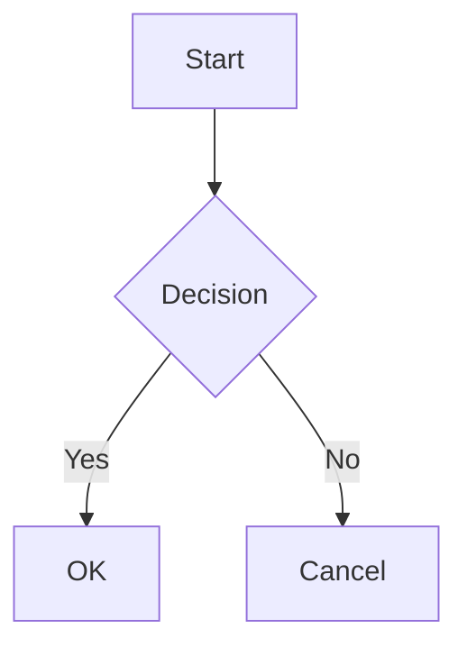

<p align="center">
  <strong>English</strong> | <a href="https://yss-tazawa.github.io/plantuml-markdown-preview/#/zh-cn/">简体中文</a> | <a href="https://yss-tazawa.github.io/plantuml-markdown-preview/#/ja/">日本語</a> | <a href="https://yss-tazawa.github.io/plantuml-markdown-preview/#/es/">Español</a> | <a href="https://yss-tazawa.github.io/plantuml-markdown-preview/#/pt-br/">Português</a> | <a href="https://yss-tazawa.github.io/plantuml-markdown-preview/#/ko/">한국어</a> | <a href="https://yss-tazawa.github.io/plantuml-markdown-preview/#/zh-tw/">繁體中文</a>
</p>

<p align="center">
  
</p>

<h1 align="center">PlantUML Markdown Preview</h1>

<p align="center">
  <strong>PlantUML, Mermaid &amp; D2 diagrams, right inside your Markdown preview. Fast, Secure, or Easy — pick the mode that fits.</strong>
</p>

<p align="center">
  <a href="https://marketplace.visualstudio.com/items?itemName=yss-tazawa.plantuml-markdown-preview"></a>
  <a href="https://marketplace.visualstudio.com/items?itemName=yss-tazawa.plantuml-markdown-preview"></a>
  <a href="https://github.com/yss-tazawa/plantuml-markdown-preview/blob/main/LICENSE"></a>
</p>

<p align="center">
  
</p>

Write diagrams as code in your Markdown and see them rendered as you type — then export the whole document to HTML or PDF, diagrams included.

## Choose Your Mode

| | **Fast** (default) | **Secure** | **Easy** |
|---|---|---|---|
| | Fast rendering | Maximum privacy | Zero setup |
| | A local PlantUML server keeps diagrams updating as you type | No network, no background processes — everything stays on your machine | No Java needed — works out of the box with an online PlantUML server |
| **Java** | 11+ required | 11+ required | Not required |
| **Network** | None | None | Required |
| **Privacy** | Local only | Local only | Diagram source sent to PlantUML server |
| **Setup** | [Install Java →](#prerequisites) | [Install Java →](#prerequisites) | No setup needed |

Switch between modes anytime with a single setting — no migration, no restart.

See [Rendering Modes](#rendering-modes) for details and [Quick Start](#quick-start) for setup.

## Highlights

- **Diagrams right in your document** — PlantUML, Mermaid, and D2 diagrams appear inline in your Markdown preview, not in a separate panel.
- **Safe to open** — scripts in your Markdown never run in the preview or in HTML/PDF export.
- **Sizes you control** — set the display scale of PlantUML, Mermaid, and D2 diagrams independently.
- **Single-file HTML export** — your document and diagrams in one HTML file, with the layout width and alignment you choose.
- **One-click PDF export** — print through Chrome, Edge, or Chromium, with diagrams scaled to fit the page.
- **Two-way scroll sync** — scroll the editor or the preview, and the other follows.
- **Easy navigation** — jump to the top or bottom, or open a table of contents sidebar, right from the preview.
- **Diagram Viewer** — right-click any diagram to pan and zoom it in its own panel, kept in sync with your edits.
- **Reading View** — read a Markdown, PlantUML, Mermaid, or D2 file rendered in its own tab, and switch back to the source in place.
- **Standalone diagram preview** — open `.puml`, `.plantuml`, `.mmd`, `.mermaid`, and `.d2` files directly, with pan & zoom and live updates.
- **Git revision preview** — see a Markdown file as it was at HEAD or in the staging area, rendered next to your current preview, so you can compare changed diagrams visually.
- **Save or copy as PNG / SVG** — right-click any diagram in the preview or Diagram Viewer to save it or copy it to the clipboard.
- **17 preview themes** — follow your VS Code color theme, or pick one of 9 light and 7 dark themes, including GitHub, Atom, Solarized, Dracula, and Monokai.
- **Editor assistance** — keyword completion, a color picker, and snippets for PlantUML, Mermaid, and D2.
- **Available in 7 languages** — the UI is available in English, Chinese (Simplified and Traditional), Spanish, Brazilian Portuguese, Japanese, and Korean.
- **Math support** — write `$...$` inline and `$$...$$` block math, rendered with [KaTeX](https://katex.org/).

## Table of Contents

- [Choose Your Mode](#choose-your-mode)
- [Highlights](#highlights)
- [Features](#features)
- [Quick Start](#quick-start)
- [Usage](#usage)
  - [Reading View](#reading-view)
- [Configuration](#configuration)
- [Snippets](#snippets)
- [Color Picker](#color-picker)
- [Keyword Completion](#keyword-completion)
- [Keyboard Shortcuts](#keyboard-shortcuts)
- [FAQ](#faq)
- [Contributing](#contributing)
- [Third-Party Licenses](#third-party-licenses)
- [License](#license)

## Features

### Inline Diagram Preview

```` ```plantuml ````, ```` ```mermaid ````, and ```` ```d2 ```` code blocks are rendered as inline SVG diagrams alongside your regular Markdown content.

- **Live updates** — the preview updates as you type.
- **Refresh on save** — saving the file refreshes the preview.
- **Follows your tabs** — the preview switches along with the active editor tab.
- **Loading indicator** — you can see when a diagram is still rendering.
- **Clear error messages** — syntax errors appear inline, with line numbers and the surrounding source.
- **PlantUML** — rendered with Java on your machine (Fast / Secure mode) or by a PlantUML server (Easy mode); see [Rendering Modes](#rendering-modes).
- **Mermaid** — rendered with [mermaid.js](https://mermaid.js.org/), with no Java or other tools to install.
- **D2** — rendered with the bundled [@terrastruct/d2](https://d2lang.com/) (Wasm), with no other tools to install.

### Diagram Source Highlighting

Diagram source is syntax highlighted in the editor — both inside ```` ```plantuml ````,
```` ```mermaid ````, and ```` ```d2 ```` blocks in Markdown, and in standalone `.puml`,
`.plantuml`, `.mmd`, `.mermaid`, and `.d2` files. Colors follow your current theme.

### Math Support

Render mathematical expressions using [KaTeX](https://katex.org/).

- **Inline math** — `$E=mc^2$` renders as an inline formula.
- **Block math** — `$$\int_0^\infty e^{-x}\,dx = 1$$` renders as a centered display formula.
- **Same look everywhere** — formulas look the same in the preview and in HTML/PDF export.
- **Easy to turn off** — set `enableMath: false` if `$` signs in your text are read as math.

### Diagram Scale

Control the display size of PlantUML, Mermaid, and D2 diagrams independently.

- **PlantUML scale** — choose `auto` (shrink to fit) or a fixed percentage from 70% to 120% (default 100%); diagrams stay crisp at any scale.
- **Mermaid scale** — choose `auto` (shrink to fit) or a fixed percentage from 50% to 100% (default 80%).
- **D2 scale** — choose `auto` (shrink to fit) or a fixed percentage from 50% to 100% (default 70%).

### Rendering Modes

Choose a preset mode that controls how PlantUML diagrams are rendered:

| | Fast (default) | Secure | Easy |
|---|---|---|---|
| **Java required** | Yes | Yes | No |
| **Network** | None (localhost only) | None | Required |
| **Privacy** | Local only | Local only | Diagram source sent to PlantUML server |
| **Speed** | Instant (persistent local server) | Slower (Java starts for each render) | Depends on network |

- **Fast mode** (default) — keeps a PlantUML server running on `localhost`, so diagrams update instantly as you edit. The server starts with your first PlantUML diagram (you can change this; see [Start Mode](#fast-mode-server-start-mode)), and diagrams never leave your machine.
- **Secure mode** — runs Java and the PlantUML jar on your machine for each render, with no network access and no background server. Local images are blocked by default for maximum security.
- **Easy mode** — sends PlantUML source to a PlantUML server, so there is nothing to install. It uses the public server (`https://www.plantuml.com/plantuml`) by default; point it to your own server for privacy.

If Java is not found when you open a preview, the extension offers to switch to Easy mode.

#### Fast mode: server start mode

By default, Fast mode starts and manages its own PlantUML server on `127.0.0.1` — no configuration needed. `plantumlLocalServerStartMode` (Start Mode) controls when, and whether, that happens:

| Value | Effect |
|---|---|
| `"lazy"` (default) | Start the managed server at the first diagram render. Java does not run until you render a PlantUML diagram; the very first render takes a few seconds longer. |
| `"on"` | Start the managed server as soon as the extension activates. The first render is instant, but Java keeps running in the background from startup. |
| `"off"` | Never start a server. Connect to one you run yourself (for example `java -jar plantuml.jar -picoweb`), including one on another machine in your LAN. |

The host and port used to reach the server are controlled by these settings:

| Setting | Default | Effect |
|---|---|---|
| `plantumlLocalServerHost` | `127.0.0.1` | Host to connect to when Start Mode is `"off"` (e.g. a picoweb server elsewhere on your LAN). Ignored for `"on"`/`"lazy"` — a managed server always binds to `127.0.0.1`. |
| `plantumlLocalServerPort` | `0` | Start Mode `"on"`/`"lazy"`: port to start on (`0` = auto-assign a free port). Start Mode `"off"`: port to connect to. |

A few things worth knowing:

- **Plays well with existing servers** — with `"on"` or `"lazy"` and a fixed port, a working PlantUML server already on that port is reused instead of starting a second one.
- **No local Java with `"off"`** — the extension never starts a server; it only connects to the host and port you configure.
- **Your servers stay yours** — the extension only stops servers it started itself.
- **Older setting still read** — if Start Mode is not set, the older `plantumlLocalServerAutoStart` setting is used (`true` → `"on"`, `false` → `"off"`).

#### Fast mode: JVM memory (heap) settings

The managed server's memory footprint is capped by heap presets (`plantumlLocalServerJvmHeapPreset`):

| Preset | JVM heap flags | Use when |
|---|---|---|
| `small` | `-Xms16m -Xmx256m` | Lowest memory use; small diagrams only. |
| `medium` (default) | `-Xms16m -Xmx512m` | Balanced; handles most diagrams comfortably. |
| `large` | `-Xms64m -Xmx1024m` | Very large diagrams; matches the PlantUML FAQ recommendation. |
| `unlimited` | _(none)_ | No flags at all — Java decides (max heap defaults to 1/4 of physical RAM). |
| `custom` | your values | Reads `plantumlLocalServerJvmInitialHeapMb` (8–32768, default 16) and `plantumlLocalServerJvmMaxHeapMb` (64–32768, default 512). |

Every preset except `unlimited` also pins `-XX:+UseSerialGC`, `-XX:MaxMetaspaceSize=128m`, and `-XX:ReservedCodeCacheSize=64m` to keep the server small. These settings apply only to the server the extension starts itself (Fast mode, Start Mode `"on"`/`"lazy"`).

### Status Bar

The status bar shows the current rendering mode (Fast / Secure / Easy) and, in Fast mode, the local server state (starting, running, error, stopped).

- **One-click mode switch** — click the status bar item to pick a mode from a Quick Pick, without opening Settings.
- **Also in the Command Palette** — the **Select Rendering Mode** command does the same.

While a Markdown preview or Reading View is visible, the status bar also shows the preview zoom level. Click it to pick another level.

### HTML Export

Export your Markdown document to a single HTML file.

- **Diagrams included** — PlantUML and D2 diagrams are embedded as inline SVG; Mermaid diagrams and math fonts load from a CDN when the file is opened.
- **Styles included** — syntax highlighting styles travel inside the file.
- **Export and open** — export and open the result in your browser with one command.
- **Your layout** — pick a fixed width from 640px to 1440px, centered or left-aligned, or **Responsive**, which fills the browser window and shrinks only the diagrams that would overflow. Set your usual width and alignment in Settings, or choose per export from the menu.

### PDF Export

Export your Markdown document to PDF using the Chrome, Edge, or Chromium already on your machine.

- **Uses your browser** — requires Chrome, Edge, or Chromium installed on your system.
- **Portrait or landscape** — choose the orientation when you export.
- **Consistent scaling** — text and diagrams scale together (`pdfScale`, default 0.625).
- **Clean pages** — print margins are applied for you.

### Bulk Diagram Export

Export all diagrams from a Markdown file as individual PNG or SVG files.

- **Every diagram at once** — all PlantUML, Mermaid, and D2 diagrams are exported in document order.
- **Your folder name** — choose the output folder name (default: `{filename}_diagrams`).
- **Preview required** — the preview must be open, since that is where the diagrams are rendered.

### Navigation & TOC

- **Go to top / Go to bottom** — buttons in the top-right corner of the preview take you there in one click.
- **Table of Contents sidebar** — click the TOC button to list all headings, then click one to jump to it.
- **Zoom** — `Ctrl`+mouse wheel (`Cmd`+mouse wheel on Mac) zooms the preview and Reading View from 50% to 200%; one level applies to all of them and is kept across restarts.

### Diagram Viewer

Right-click any PlantUML, Mermaid, or D2 diagram in the preview and select **Open in Diagram Viewer** to open it in a separate pan & zoom panel.

- **Pan & zoom** — zoom with the mouse wheel around the cursor, and drag to pan.
- **Toolbar** — Fit to Window, 1:1 reset, and step zoom (+/-).
- **Live sync** — your edits show up right away, and your zoom position is kept.
- **Matching background** — the background color follows the current preview theme.
- **Closes with its file** — the viewer closes when you switch to a different source file.
- **Save or copy as PNG / SVG** — right-click a diagram in the preview or Diagram Viewer to save it as a file or copy it as PNG.
- **Find in viewer** — press `Cmd+F` / `Ctrl+F` to open the find widget.
- **Optional** — turn it off with `enableDiagramViewer: false`.

### PlantUML `!include` Support

Use `!include` directives to share common styles, macros, and component definitions across diagrams.

- **Where files are found** — included files are resolved from the workspace root, or from the folder set in `plantumlIncludePath`. In Fast mode this applies when the extension runs its own server; see the [FAQ](#faq) for details.
- **Refresh on save** — saving an included file refreshes the preview, and the **Reload** button (↻) forces a refresh at any time.
- **Go to Include File** — right-click a `!include` line in a `.puml` or Markdown file to open the referenced file.
- **Open Include Source** — right-click a PlantUML diagram in the preview to open its included files directly.
- **Fast and Secure modes** — Easy mode cannot read your local files, so `!include` is not available there.

### Standalone Diagram Preview

Open `.puml`, `.plantuml`, `.mmd`, `.mermaid`, or `.d2` files directly — no Markdown wrapper needed.

- **Pan & zoom** — the same controls as the Diagram Viewer.
- **Live updates** — the preview updates as you type.
- **Follows your tabs** — the preview switches along when you move between files of the same type.
- **Themes** — choose the preview theme and the diagram theme independently.
- **Save or copy as PNG / SVG** — right-click the diagram.
- **Find in preview** — press `Cmd+F` / `Ctrl+F` to open the find widget.
- **PlantUML** — works in all three rendering modes (Fast / Secure / Easy).
- **Mermaid** — rendered with mermaid.js.
- **D2** — rendered with @terrastruct/d2 (Wasm), with a theme and layout engine you can choose.

### Git Revision Preview

Preview a Markdown file as it was at a Git revision, rendered, in a side panel — so a changed diagram can be compared side by side instead of read as a text diff.

- **HEAD** — the last committed version.
- **Staged** — the version currently staged for commit.
- **Side by side** — it opens beside your current preview, so old and new diagrams are visible at once.
- **Snapshot** — it renders once and does not follow later edits; a banner at the top says so.
- **Git required** — the file must be tracked in a Git repository.

### Bidirectional Scroll Sync

Editor and preview stay in sync as you scroll either one.

- **Matched positions** — the preview lines up with the part of the source you are looking at.
- **Stable** — your scroll position stays put when the preview re-renders.

### Themes

**Preview themes** control the overall document appearance:

**VS Code theme:**

| Theme | Style |
|-------|-------|
| Follow VS Code Color Theme | Follows your current VS Code color theme, like VS Code's built-in Markdown preview. HTML/PDF export uses VS Code Light 2026 or Dark 2026 to match |

**Light themes:**

| Theme | Style |
|-------|-------|
| GitHub Light | White background (default) |
| Atom Light | Soft gray text, Atom editor inspired |
| One Light | Off-white, balanced palette |
| Solarized Light | Warm beige, eye-friendly |
| Vue | Green accents, Vue.js docs inspired |
| Pen Paper Coffee | Warm paper, handwritten aesthetic |
| Coy | Near-white, clean design |
| VS | Classic Visual Studio colors |
| VS Code Light 2026 | VS Code's built-in Markdown preview under the Light 2026 color theme |

**Dark themes:**

| Theme | Style |
|-------|-------|
| GitHub Dark | Dark background |
| Atom Dark | Tomorrow Night palette |
| One Dark | Atom-inspired dark |
| Dracula | Vibrant dark |
| Solarized Dark | Deep teal, eye-friendly |
| Monokai | Vivid syntax, Sublime Text inspired |
| VS Code Dark 2026 | VS Code's built-in Markdown preview under the Dark 2026 color theme |

Switch preview themes instantly from the title bar icon — diagrams are not redrawn. Changing the PlantUML theme redraws the diagrams.

**PlantUML themes** control diagram styling independently. The extension discovers
available themes from your PlantUML installation and lists them in the same
Quick Pick as the preview themes.

**Mermaid themes** control Mermaid diagram styling: `default`, `dark`, `forest`, `neutral`, `base`. They are in the same Quick Pick too.

**D2 themes** — 19 built-in themes (e.g. `Neutral Default`, `Dark Mauve`, `Terminal`), selectable in the settings or the same Quick Pick.

### Syntax Highlighting

190+ languages supported via highlight.js. Code blocks are styled to match your
selected preview theme.

### Security

- **Strict script policy** — the preview runs only the extension's own scripts.
- **No code from your documents** — `<script>` tags and other code in Markdown never run, in the preview or in HTML/PDF export.
- **Local images by mode** — local images follow the mode by default (`allowLocalImages: "mode-default"`); Secure mode blocks them for maximum security.
- **No plain-HTTP images by default** — loading images over unencrypted HTTP is off (`allowHttpImages`); turn it on only on trusted networks, such as an intranet or a local development server.

### Built-in Markdown Preview Integration

PlantUML, Mermaid, and D2 diagrams also show up in VS Code's built-in Markdown preview (`Markdown: Open Preview to the Side`) — no extra setup. For preview themes, scroll sync, and HTML export, open this extension's own preview (`Cmd+Alt+V` / `Ctrl+Alt+V`). It is also the better choice for large PlantUML diagrams, which can briefly freeze the editor in the built-in preview.

### GitHub-style Alerts

Render GitHub-style alerts (callouts) from blockquote markers, matching GitHub's own output.

```markdown
> [!NOTE]
> Highlights information that users should take into account.

> [!TIP]
> Optional information to help a user be more successful.

> [!IMPORTANT]
> Crucial information necessary for users to succeed.

> [!WARNING]
> Critical content demanding immediate user attention.

> [!CAUTION]
> Negative potential consequences of an action.
```

- **Five types** — `NOTE`, `TIP`, `IMPORTANT`, `WARNING`, and `CAUTION`, each with its own icon and accent color.
- **Same rules as GitHub** — a marker must be alone on its line (in any case: `[!note]` works too), and only a blockquote at the top level of the document becomes an alert. `> [!NOTE] My title` and a marker inside a list item or another blockquote stay plain blockquotes.
- **Theme-aware** — colors adapt to the active preview theme, light or dark.
- **Same look everywhere** — alerts look the same in the preview and in HTML/PDF export.

### Footnotes and Task Lists

Render footnotes and task lists in GitHub's syntax, matching GitHub's own output.

```markdown
A sentence with a footnote.[^1]

[^1]: The footnote text.

- [x] Finished task
- [ ] Open task
```

- **Footnotes** — a `[^1]` reference links to its footnote at the end of the document, and the footnote links back to the reference.
- **Task lists** — `- [ ]` and `- [x]` items show checkboxes. They show the state only; clicking them does not change the document.
- **Same look everywhere** — footnotes and task lists look the same in the preview and in HTML/PDF export.

## Quick Start

### Prerequisites

**Mermaid** — no prerequisites. Works out of the box.

**D2** — no prerequisites. Rendered using the bundled [D2](https://d2lang.com/) Wasm — works out of the box.

**PlantUML (Easy mode)** — no prerequisites. Diagram source is sent to a PlantUML server for rendering.

**PlantUML (Fast / Secure mode)** — default:

| Tool | Purpose | Verify |
|------|---------|--------|
| [Java 11+ (JRE or JDK)](#setup) | Runs PlantUML (bundled PlantUML 1.2026.10 requires Java 11+) | `java -version` |
| [Graphviz](https://graphviz.org/) | Optional — needed for class, component, and other layout-dependent diagrams (see [Diagram Support](#diagram-support)) | `dot -V` |

PlantUML is bundled (LGPL, v1.2026.10) — nothing to download. Java 11 or later is the only requirement; Graphviz is optional.
No Java yet? The extension offers to switch to Easy mode when you open a preview.

### Diagram Support

What works depends on your setup:

| Diagram | LGPL (bundled) | Win: GPLv2 jar | Mac/Linux: + Graphviz |
|---------|:-:|:-:|:-:|
| Sequence | ✓ | ✓ | ✓ |
| Activity (new syntax) | ✓ | ✓ | ✓ |
| Mind Map | ✓ | ✓ | ✓ |
| WBS | ✓ | ✓ | ✓ |
| Gantt | ✓ | ✓ | ✓ |
| JSON / YAML | ✓ | ✓ | ✓ |
| Salt / Wireframe | ✓ | ✓ | ✓ |
| Timing | ✓ | ✓ | ✓ |
| Network (nwdiag) | ✓ | ✓ | ✓ |
| Class | — | ✓ | ✓ |
| Use Case | — | ✓ | ✓ |
| Object | — | ✓ | ✓ |
| Component | — | ✓ | ✓ |
| Deployment | — | ✓ | ✓ |
| State | — | ✓ | ✓ |
| ER (Entity Relationship) | — | ✓ | ✓ |
| Activity (legacy) | — | ✓ | ✓ |
| DOT (@startdot) | — | ✓ | ✓ |

- **LGPL (bundled)** — works out of the box. No Graphviz needed.
- **Win: GPLv2 jar** — the [GPLv2 version](https://plantuml.com/download) bundles Graphviz (Windows only, auto-extracted). Set [`plantumlJarPath`](#configuration) to use it. DOT (`@startdot`) needs PlantUML 1.2026.9 or later.
- **Mac/Linux: + Graphviz** — install [Graphviz](https://graphviz.org/) separately. Works with either LGPL or GPLv2 jar.

### Install

1. Open VS Code
2. Search for **PlantUML Markdown Preview** in the Extensions view (`Ctrl+Shift+X` / `Cmd+Shift+X`)
3. Click **Install**

### Setup

**Fast mode** (default) — nothing to set. A local PlantUML server starts with your first diagram and keeps updates instant. Requires Java 11+.

**To use Secure mode** — set `mode` to `"secure"`. Java 11+ runs for each render, with no background server and no network access.

**To use Easy mode** (no setup required) — set `mode` to `"easy"`. Diagram source is sent to a PlantUML server for rendering.

**Fast and Secure modes** — the bundled LGPL jar supports sequence, activity, mind map, and other diagrams
without extra setup (see [Diagram Support](#diagram-support)).
To enable class, component, use case, and other layout-dependent diagrams,
follow the steps for your platform below.

#### Windows

1. Install Java if not already installed (open PowerShell and run):
   ```powershell
   winget install Microsoft.OpenJDK.21
   ```
2. If `java` is not on your PATH, find the full path in PowerShell:
   ```powershell
   Get-Command java
   # e.g. C:\Program Files\Microsoft\jdk-21.0.6.7-hotspot\bin\java.exe
   ```
   Open VS Code settings (`Ctrl+,`), search for `plantumlMarkdownPreview.javaPath`, and enter the path shown above
3. Download the [GPLv2 version of PlantUML](https://plantuml.com/download) (`plantuml-gplv2-*.jar`) to a folder of your choice (includes Graphviz — no separate install needed)
4. Open VS Code settings (`Ctrl+,`), search for `plantumlMarkdownPreview.plantumlJarPath`, and enter the full path to the downloaded `.jar` file (e.g. `C:\tools\plantuml-gplv2-1.2026.10.jar`)

#### Mac

1. Install Java and Graphviz via Homebrew:
   ```sh
   brew install openjdk graphviz
   ```
2. If `dot` is not on your PATH, find the full path and set it in VS Code:
   ```sh
   which dot
   # e.g. /opt/homebrew/bin/dot
   ```
   Open VS Code settings (`Cmd+,`), search for `plantumlMarkdownPreview.dotPath`, and enter the path shown above

#### Linux

1. Install Java and Graphviz:
   ```sh
   # Debian / Ubuntu
   sudo apt install default-jdk graphviz
   
   # Fedora
   sudo dnf install java-21-openjdk graphviz
   ```
2. If `dot` is not on your PATH, find the full path and set it in VS Code:
   ```sh
   which dot
   # e.g. /usr/bin/dot
   ```
   Open VS Code settings (`Ctrl+,`), search for `plantumlMarkdownPreview.dotPath`, and enter the path shown above

You rarely need to set these paths. By default the extension looks for Java under `JAVA_HOME/bin/` (`JAVA_HOME\bin\` on Windows) and then on your PATH, finds `dot` on your PATH, and uses the bundled PlantUML jar. Set `javaPath`, `dotPath`, or `plantumlJarPath` only if a command is not on your PATH or you want a different jar.

## Usage

### Open Preview

- **Keyboard shortcut** — press `Cmd+Alt+V` (Mac) / `Ctrl+Alt+V` (Windows / Linux).
- **Editor title bar** — click the preview button (a "P" in a rounded square) at the top right of the editor.
- **VS Code's standard buttons and shortcuts** — with `useAsDefaultPreview` on (the default), VS Code's **Open Preview to the Side** button, its **Open Preview** context menu items, and `Cmd+K V` (Mac) / `Ctrl+K V` (Windows / Linux) open this preview; `Cmd+Shift+V` / `Ctrl+Shift+V` switches to [Reading View](#reading-view) instead.
- **Context menu** — right-click a Markdown file in the Explorer or inside the editor → **PlantUML Markdown Preview** → **Open Preview to Side**.
- **Command Palette** — run `PlantUML Markdown Preview: Open Preview to Side`.

The preview has its own themes and starts with a white background (GitHub Light). Choose `follow-vscode` to match your current VS Code color theme instead.

### Reading View

Reading View shows a file rendered in its own tab, in place of the text editor — no second panel. It stays on that file instead of following the active editor, and can be open at the same time as the preview.

It works for Markdown files (`.md`, `.markdown` and the other extensions covered by VS Code's Markdown preview) and for `.puml` / `.plantuml`, `.mmd` / `.mermaid` and `.d2` files. Nothing changes until you use it.

- **Switch in place** — right-click in the editor → **PlantUML Markdown Preview** → **Switch to Reading View** (for PlantUML, Mermaid and D2 files, **Switch to Reading View** is directly in the menu). To go back, right-click in Reading View → **Switch to Source**, or click **Switch to Source** in the editor title bar. The tab itself switches; no new tab opens.
- **Open once** — right-click a file in the Explorer → **Open With...** → **PlantUML Markdown Preview (Reading View)**. For a file that is already open, right-click its tab and use **Reopen Editor With...** instead.
- **Open by default** — in the **Open With...** list, choose **Configure default editor for '\*.md'...** → **PlantUML Markdown Preview (Reading View)**. From then on, clicking a `.md` file opens it in Reading View. Do this once for each file extension.
- **Undo** — choose **Text Editor** the same way, or remove the line from your settings.

To set it in `settings.json` instead:

```json
"workbench.editorAssociations": {
  "*.md": "plantumlMarkdownPreviewEditor",
  "*.puml": "plantumlPumlPreviewEditor",
  "*.mmd": "plantumlMermaidPreviewEditor",
  "*.d2": "plantumlD2PreviewEditor"
}
```

| Files | Value |
| ----- | ----- |
| Markdown (`*.md`, `*.markdown`, …) | `plantumlMarkdownPreviewEditor` |
| `*.puml`, `*.plantuml` | `plantumlPumlPreviewEditor` |
| `*.mmd`, `*.mermaid` | `plantumlMermaidPreviewEditor` |
| `*.d2` | `plantumlD2PreviewEditor` |

- **Older VS Code** — before VS Code 1.100, **Switch to Reading View** and **Switch to Source** are not shown, so open Reading View with **Open With...** instead.
- **Git diffs** — diffs still open as text diffs, even for files set to open in Reading View.
- **Standard buttons** — with `useAsDefaultPreview` on (the default), VS Code's **Open as Preview** button (VS Code 1.119 or later) and `Ctrl+Shift+V` (VS Code 1.100 or later) switch to Reading View; see [Configuration](#configuration).

### Open Diagram Preview

Open `.puml` / `.plantuml`, `.mmd` / `.mermaid`, or `.d2` files directly in a pan & zoom preview — no Markdown wrapper needed.

- **Keyboard shortcut** — the same `Cmd+Alt+V` (Mac) / `Ctrl+Alt+V` (Windows / Linux) picks the right preview for the file type.
- **Editor title bar** — click the preview button (a "P" in a rounded square) at the top right of the editor.
- **Standard preview shortcuts** — with `useAsDefaultPreview` on (the default), `Cmd+K V` (Mac) / `Ctrl+K V` (Windows / Linux) also opens the preview beside the editor; `Cmd+Shift+V` / `Ctrl+Shift+V` switches to [Reading View](#reading-view) instead.
- **Context menu** — right-click a `.puml` / `.plantuml`, `.mmd` / `.mermaid`, or `.d2` file in the Explorer or editor → **Preview PlantUML File** / **Preview Mermaid File** / **Preview D2 File**.
- **Command Palette** — run `PlantUML Markdown Preview: Preview PlantUML File`, `Preview Mermaid File`, or `Preview D2 File`.

### Open Preview of a Git Revision

Render a Markdown file as it was at a Git revision, beside the preview of your current version.

- **Context menu** — right-click a Markdown file in the Explorer or editor → **PlantUML Markdown Preview** → **Open Preview of HEAD Revision to Side** / **Open Preview of Staged Revision to Side**.
- **Command Palette** — run `PlantUML Markdown Preview: Open Preview of HEAD Revision to Side` / `Open Preview of Staged Revision to Side`.

Open your normal preview first, then the revision preview: the two panels sit side by side. The revision panel is a fixed snapshot — it does not update as you edit.

### Export to HTML

- **Context menu** — right-click a Markdown file → **PlantUML Markdown Preview** → **Export as HTML** → choose a width option.
- **Preview** — right-click inside the preview → **Export as HTML** or **Export as HTML & Open**.

The submenu offers these width options:

| Option | Description |
| ------ | ----------- |
| Current Settings | Export with the current configuration (no responsive CSS) |
| 640px – 1440px | Fixed body width in pixels, centered |
| Responsive (Left-Aligned) | Viewport-width body anchored to the left; diagrams shrink only if they overflow |
| 640px – 1440px (Left-Aligned) | Fixed width, left-aligned |

The HTML file is saved alongside the source Markdown file.

### Export to PDF

- **Context menu** — right-click a Markdown file → **PlantUML Markdown Preview** → **Export as PDF** → **Portrait** or **Landscape**.
- **Preview** — right-click inside the preview → **Export as PDF** or **Export as PDF & Open** → **Portrait** or **Landscape**.

The PDF file is saved alongside the source Markdown file. Chrome, Edge, or Chromium is required.
The `pdfScale` setting (default 0.625) controls the overall scale of text and diagrams.

### Save / Copy Diagram as PNG / SVG

- **Preview** — right-click a diagram → **Copy Diagram as PNG**, **Save Diagram as PNG**, or **Save Diagram as SVG**.
- **Diagram Viewer** — right-click inside the viewer → **Copy Diagram as PNG**, **Save Diagram as PNG**, or **Save Diagram as SVG**.
- **Standalone diagram preview** — right-click inside the preview → **Copy Diagram as PNG**, **Save Diagram as PNG**, or **Save Diagram as SVG**.

### Export All Diagrams

- **Context menu** — right-click a Markdown file → **PlantUML Markdown Preview** → **Export All Diagrams as PNG** or **Export All Diagrams as SVG**.
- **Preview** — right-click inside the preview → **Export All Diagrams as PNG** or **Export All Diagrams as SVG**.
- **Command Palette** — run `PlantUML Markdown Preview: Export All Diagrams as PNG` / `Export All Diagrams as SVG`.

A save dialog lets you name the output folder (default: `{filename}_diagrams`). Diagrams are saved as `diagram-1.png`, `diagram-2.png`, and so on, in document order. Keep the preview open while exporting.

### Navigation

- **Go to top / Go to bottom** — use the buttons in the top-right corner of the preview.
- **Reload** — click the ↻ button to refresh the preview and clear its caches.
- **Table of Contents** — click the TOC button in the top-right corner of the preview to list all headings, then click one to jump to it.
- **Zoom** — hold `Ctrl` (`Cmd` on Mac) and turn the mouse wheel over the preview, or click the zoom level in the status bar and pick a level; HTML and PDF export are not affected.

### Change Theme

Click the theme icon in the preview's title bar, or use the Command Palette:

- **Command Palette** — run `PlantUML Markdown Preview: Change Preview Theme`.

The Quick Pick shows all four theme categories in a single list — preview themes, PlantUML themes, Mermaid themes, and D2 themes — so you can switch any of them from one place.

### PlantUML Syntax

````markdown
```plantuml
Alice -> Bob: Hello
Bob --> Alice: Hi!
```
````

`@startuml` / `@enduml` wrappers are added automatically if omitted.

### Mermaid Syntax

````markdown

````

### D2 Syntax

````markdown
```d2
server -> db: query
db -> server: result
```
````

See [D2 documentation](https://d2lang.com/) for syntax details.

### Math Syntax

Inline math uses single dollar signs, block math uses double:

````markdown
Einstein's famous equation $E=mc^2$ shows mass-energy equivalence.

$$\int_0^\infty e^{-x}\,dx = 1$$
````

Writing prices like `$100`? Set `enableMath: false` to keep `$` as plain text.

## Snippets

Type a snippet prefix and press `Tab` to expand. Two sets of snippets are available:

- **Markdown snippets** (outside fenced blocks) — prefixes starting with `plantuml`, `mermaid`, or `d2` expand a complete fenced block.
- **Template snippets** (inside fenced blocks) — prefixes starting with `tmpl-` expand just the diagram body; type `tmpl` to see them all.

### Markdown Snippets (outside fenced blocks)

Expand a complete `` ```plantuml ... ``` `` block including fences:

| Prefix | Diagram |
| --- | --- |
| `plantuml` | Empty PlantUML block |
| `plantuml-sequence` | Sequence diagram |
| `plantuml-class` | Class diagram |
| `plantuml-activity` | Activity diagram |
| `plantuml-usecase` | Use case diagram |
| `plantuml-component` | Component diagram |
| `plantuml-state` | State diagram |
| `plantuml-er` | ER diagram |
| `plantuml-object` | Object diagram |
| `plantuml-deployment` | Deployment diagram |
| `plantuml-mindmap` | Mindmap |
| `plantuml-gantt` | Gantt chart |

### PlantUML Snippets (inside fenced blocks)

Diagram templates (type `tmpl` to see all):

| Prefix | Content |
| --- | --- |
| `tmpl-seq` | Sequence diagram |
| `tmpl-cls` | Class definition |
| `tmpl-act` | Activity diagram |
| `tmpl-uc` | Use case diagram |
| `tmpl-comp` | Component diagram |
| `tmpl-state` | State diagram |
| `tmpl-er` | Entity definition |
| `tmpl-obj` | Object diagram |
| `tmpl-deploy` | Deployment diagram |
| `tmpl-mind` | Mindmap |
| `tmpl-gantt` | Gantt chart |

Short snippets:

| Prefix | Content |
| --- | --- |
| `part` | participant declaration |
| `actor` | actor declaration |
| `note` | Note block |
| `intf` | interface definition |
| `pkg` | package definition |

### Mermaid Markdown Snippets (outside fenced blocks)

Expand a complete `` ```mermaid ... ``` `` block including fences:

| Prefix | Diagram |
| --- | --- |
| `mermaid` | Empty Mermaid block |
| `mermaid-flow` | Flowchart |
| `mermaid-sequence` | Sequence diagram |
| `mermaid-class` | Class diagram |
| `mermaid-state` | State diagram |
| `mermaid-er` | ER diagram |
| `mermaid-gantt` | Gantt chart |
| `mermaid-pie` | Pie chart |
| `mermaid-mindmap` | Mindmap |
| `mermaid-timeline` | Timeline |
| `mermaid-git` | Git graph |

### Mermaid Snippets (inside fenced blocks)

Diagram templates (type `tmpl` to see all):

| Prefix | Content |
| --- | --- |
| `tmpl-flow` | Flowchart |
| `tmpl-seq` | Sequence diagram |
| `tmpl-cls` | Class diagram |
| `tmpl-state` | State diagram |
| `tmpl-er` | ER diagram |
| `tmpl-gantt` | Gantt chart |
| `tmpl-pie` | Pie chart |
| `tmpl-mind` | Mindmap |
| `tmpl-timeline` | Timeline |
| `tmpl-git` | Git graph |

### D2 Markdown Snippets (outside fenced blocks)

Expand a complete `` ```d2 ... ``` `` block including fences:

| Prefix | Diagram |
| --- | --- |
| `d2` | Empty D2 block |
| `d2-basic` | Basic connection |
| `d2-sequence` | Sequence diagram |
| `d2-class` | Class diagram |
| `d2-comp` | Component diagram |
| `d2-grid` | Grid layout |
| `d2-er` | ER diagram |
| `d2-flow` | Flowchart |
| `d2-icon` | Icon node |
| `d2-markdown` | Markdown text node |
| `d2-tooltip` | Tooltip and link |
| `d2-style` | Custom style |

### D2 Snippets (inside fenced blocks)

Diagram templates (type `tmpl` to see all):

| Prefix | Content |
| --- | --- |
| `tmpl-seq` | Sequence diagram |
| `tmpl-cls` | Class diagram |
| `tmpl-comp` | Component diagram |
| `tmpl-er` | ER diagram |
| `tmpl-flow` | Flowchart |
| `tmpl-grid` | Grid layout |

Short snippets:

| Prefix | Content |
| --- | --- |
| `conn` | Connection |
| `icon` | Icon node |
| `md` | Markdown node |
| `tooltip` | Tooltip and link |
| `style` | Custom style |
| `direction` | Layout direction |

## Color Picker

Color swatches and an inline color picker for PlantUML, Mermaid, and D2. Works in standalone files (`.puml`, `.mmd`, `.d2`) and Markdown fenced blocks.

- **6-digit hex** — such as `#FF0000` and `#1565C0`.
- **3-digit hex** — such as `#F00` and `#ABC`.
- **Named colors** (PlantUML only) — 20 colors, such as `#Red`, `#LightBlue`, and `#Salmon`.
- **Pick to replace** — choosing a new color writes it back in `#RRGGBB` format.
- **Comments skipped** — comment lines are ignored (`'` for PlantUML, `%%` for Mermaid, `#` for D2).

## Keyword Completion

Context-aware keyword suggestions for PlantUML, Mermaid, and D2. Works in both standalone files and Markdown fenced blocks.

### PlantUML

- **Line-start keywords** — such as `@startuml`, `participant`, `class`, `skinparam`, and `!include`.
- **`skinparam` parameters** — type `skinparam` and a space to get suggestions such as `backgroundColor`, `defaultFontName`, and `arrowColor`.
- **Color names** — type `#` to get color suggestions such as `Red`, `Blue`, and `LightGreen`.
- **Trigger characters** — `@`, `!`, and `#`.

### Mermaid

- **Diagram type declarations** — `flowchart`, `sequenceDiagram`, `classDiagram`, `gantt`, and more on the first line.
- **Diagram-specific keywords** — suggestions follow the declared diagram type (for example, `subgraph` for flowcharts and `participant` for sequence diagrams).
- **Direction values** — type `direction` and a space to get `TB`, `LR`, and more.

### D2

- **Shape types** — type `shape:` to get suggestions such as `rectangle`, `cylinder`, and `person`.
- **Style properties** — type `style.` to get `fill`, `stroke`, `font-size`, and more.
- **Direction values** — type `direction:` to get `right`, `down`, `left`, and `up`.
- **Constraint values** — type `constraint:` to get `primary_key`, `foreign_key`, and `unique`.
- **Trigger characters** — `:` and `.`.

## Configuration

All settings use the `plantumlMarkdownPreview.` prefix.

| Setting | Default | Description |
|---------|---------|-------------|
| `mode` | `"fast"` | Rendering mode. `"fast"` (default) — local server, instant updates. `"secure"` — no network, highest security. `"easy"` — no setup required (diagram source sent to a PlantUML server). |
| `javaPath` | `"java"` | Path to Java executable. If set, used as-is; otherwise falls back to `JAVA_HOME/bin/java`, then `java` on PATH. (Fast and Secure modes) |
| `plantumlJarPath` | `""` | Path to `plantuml.jar`. Leave empty to use the bundled jar (LGPL). (Fast and Secure modes) |
| `dotPath` | `"dot"` | Path to Graphviz `dot` executable (Fast and Secure modes) |
| `plantumlIncludePath` | `""` | Base directory for PlantUML `!include` directives. Files outside this directory generally cannot be read by an absolute path. Leave empty to use the workspace root. Not available in Easy mode. |
| `allowLocalImages` | `"mode-default"` | Resolve relative image paths (e.g. ``) in the preview. `"mode-default"` uses the mode preset (Fast: on, Secure: off, Easy: on). `"on"` / `"off"` to override. |
| `allowHttpImages` | `false` | Allow loading images over HTTP (unencrypted) in the preview. Useful for intranet or local development servers. |
| `previewTheme` | `"github-light"` | Preview theme (see [Themes](#themes)) |
| `previewZoom` | `100` | Zoom (%) of the Markdown preview and Reading View, one level for all of them. 50 to 200 in steps of 5. Can also be changed with `Ctrl`+mouse wheel (`Cmd`+mouse wheel on Mac) or from the status bar. Does not affect HTML or PDF export. |
| `plantumlTheme` | `"default"` | PlantUML diagram theme. `"default"` applies no theme. Other values (e.g. `"cyborg"`, `"mars"`) are passed as `-theme` to PlantUML CLI or injected as `!theme` directive in Easy mode. |
| `mermaidTheme` | `"default"` | Mermaid diagram theme: `"default"`, `"dark"`, `"forest"`, `"neutral"`, or `"base"`. |
| `plantumlScale` | `"100%"` | PlantUML diagram scale. `"auto"` shrinks diagrams that are wider than the preview. A percentage (70%–120%) renders at that fraction of natural size. |
| `mermaidScale` | `"80%"` | Mermaid diagram scale. `"auto"` shrinks diagrams that are wider than the preview. A percentage (50%–100%) renders at that fraction of natural size. |
| `d2Theme` | `"Neutral Default"` | D2 diagram theme. 19 built-in themes available (e.g. `"Neutral Default"`, `"Dark Mauve"`, `"Terminal"`). |
| `d2Layout` | `"dagre"` | D2 layout engine for diagrams that do not set their own (`layout-engine` in `d2-config`): `"dagre"` (default, fast) or `"elk"` (better for complex graphs with many nodes). |
| `d2Scale` | `"70%"` | D2 diagram scale. `"auto"` shrinks diagrams that are wider than the preview. A percentage (50%–100%) renders at that fraction of natural size. |
| `htmlMaxWidth` | `"960px"` | Maximum width of the exported HTML body. Options: `"640px"` – `"1440px"`, or `"none"` for no limit. |
| `htmlAlignment` | `"center"` | HTML body alignment. `"center"` (default) or `"left"`. |
| `pdfScale` | `0.625` | PDF export scale factor. Scales text and diagrams uniformly. Range: 0.1–2.0. |
| `enableMath` | `true` | Enable KaTeX math rendering. Supports `$...$` (inline) and `$$...$$` (block). |
| `debounceNoDiagramChangeMs` | _(empty)_ | How long (ms) the preview waits after you stop typing before updating, when no diagram changed. Leave empty to use the mode default (Fast: 100, Secure: 100, Easy: 100). |
| `debounceDiagramChangeMs` | _(empty)_ | How long (ms) the preview waits after you stop typing before redrawing a changed diagram. Leave empty to use the mode default (Fast: 100, Secure: 300, Easy: 300). |
| `plantumlLocalServerStartMode` | `"lazy"` | When to start the local PlantUML server (Fast mode only): `"on"` (at activation), `"lazy"` (at the first diagram render), `"off"` (never — connect to an existing server). See [Start Mode](#fast-mode-server-start-mode). |
| `plantumlLocalServerHost` | `"127.0.0.1"` | Host to connect to when Start Mode is `"off"` (Fast mode only). Ignored for `"on"`/`"lazy"`. |
| `plantumlLocalServerPort` | `0` | Port for the local PlantUML server (Fast mode only). `0` = auto-assign a free port. With Start Mode `"off"`, the port to connect to. |
| `plantumlLocalServerJvmHeapPreset` | `"medium"` | JVM heap preset for the managed local server: `"small"`, `"medium"`, `"large"`, `"unlimited"`, or `"custom"`. See [JVM memory settings](#fast-mode-jvm-memory-heap-settings). |
| `plantumlLocalServerJvmInitialHeapMb` | `16` | Initial heap (`-Xms`, MB) for the `"custom"` preset. Ignored for other presets. Range: 8–32768. |
| `plantumlLocalServerJvmMaxHeapMb` | `512` | Max heap (`-Xmx`, MB) for the `"custom"` preset. Ignored for other presets. Range: 64–32768. |
| `plantumlServerUrl` | `"https://www.plantuml.com/plantuml"` | PlantUML server URL for Easy mode. Set to a self-hosted server URL for privacy. |
| `enableDiagramViewer` | `true` | Enable the "Open in Diagram Viewer" context menu item when right-clicking a diagram. Requires reopening the preview to take effect. |
| `retainPreviewContext` | `true` | Retain preview content when the tab is hidden. Prevents re-rendering on tab switch but uses more memory. To apply a change, close and reopen the preview. For Reading View, restart VS Code or reload the window. |
| `useAsDefaultPreview` | `true` | Use this extension in place of VS Code's built-in Markdown preview: VS Code's standard preview buttons, context menu items, and shortcuts open this extension instead. `Ctrl+K V` (`Cmd` on Mac) opens the preview to the side; `Ctrl+Shift+V` switches between the source and [Reading View](#reading-view) in the same tab, also for PlantUML, Mermaid, and D2 files. Before VS Code 1.119 only the shortcuts are replaced, and before 1.100 both open the preview to the side. If Markdown Preview Enhanced is also installed, this extension's shortcuts take effect. Turn it off to keep VS Code's own preview buttons and shortcuts, or to use Markdown Preview Enhanced's shortcuts. |

`allowLocalImages` and `allowHttpImages` apply only to the preview; HTML export always keeps your original image paths.

<details>
<summary><strong>Preview theme options</strong></summary>

| Value | Description |
|-------|-------------|
| `follow-vscode` | Follow VS Code Color Theme — follows the current VS Code color theme (export: Light 2026 / Dark 2026 to match) |
| `github-light` | GitHub Light — white background (default) |
| `atom-light` | Atom Light — soft gray text, Atom inspired |
| `one-light` | One Light — off-white, balanced palette |
| `solarized-light` | Solarized Light — warm beige, eye-friendly |
| `vue` | Vue — green accents, Vue.js docs inspired |
| `pen-paper-coffee` | Pen Paper Coffee — warm paper, handwritten aesthetic |
| `coy` | Coy — near-white, clean design |
| `vs` | VS — classic Visual Studio colors |
| `vscode-light-2026` | VS Code Light 2026 — built-in Markdown preview colors, clear inline code |
| `github-dark` | GitHub Dark — dark background |
| `atom-dark` | Atom Dark — Tomorrow Night palette |
| `one-dark` | One Dark — Atom-inspired dark |
| `dracula` | Dracula — vibrant dark palette |
| `solarized-dark` | Solarized Dark — deep teal, eye-friendly |
| `monokai` | Monokai — vivid syntax, Sublime Text inspired |
| `vscode-dark-2026` | VS Code Dark 2026 — built-in Markdown preview colors, clear inline code |

</details>

## Keyboard Shortcuts

| Command | Mac | Windows / Linux |
|---------|-----|-----------------|
| Open Preview to Side (Markdown) | `Cmd+Alt+V` | `Ctrl+Alt+V` |
| Preview PlantUML File | `Cmd+Alt+V` | `Ctrl+Alt+V` |
| Preview Mermaid File | `Cmd+Alt+V` | `Ctrl+Alt+V` |
| Preview D2 File | `Cmd+Alt+V` | `Ctrl+Alt+V` |
| Open Preview to the Side (with `useAsDefaultPreview` on, the default; Markdown, PlantUML, Mermaid, D2) | `Cmd+K V` | `Ctrl+K V` |
| Switch to Reading View (with `useAsDefaultPreview` on, the default; Markdown, PlantUML, Mermaid, D2) | `Cmd+Shift+V` | `Ctrl+Shift+V` |
| Switch to Source (in Reading View, regardless of `useAsDefaultPreview`) | `Cmd+Shift+V` | `Ctrl+Shift+V` |
| Select Rendering Mode | — | — |

## FAQ

<details>
<summary><strong>PlantUML diagrams are not rendering</strong></summary>

**Fast / Secure mode:**
1. Run `java -version` in your terminal to confirm Java 11 or later is installed
2. If you use class, component, or other layout-dependent diagrams, run `dot -V` to confirm Graphviz is installed (see [Diagram Support](#diagram-support))
3. If you set a custom `plantumlJarPath`, verify it points to a valid `plantuml.jar` file. If the path does not exist, the extension falls back to the bundled jar with a warning. If `plantumlJarPath` is empty (default), the bundled LGPL jar is used automatically
4. Check the VS Code Output panel for error messages

**Easy mode:**
1. Verify the server URL is correct (default: `https://www.plantuml.com/plantuml`)
2. Check your network connection — the extension needs to reach the PlantUML server
3. If using a self-hosted server, ensure it is running and accessible
4. Requests to the server time out after 15 seconds (Fast and Secure modes also have a 15-second timeout per diagram)

</details>

<details>
<summary><strong>D2 diagrams are not rendering</strong></summary>

D2 is rendered using a bundled Wasm module — no external CLI is required.

1. Reload the VS Code window (`Developer: Reload Window`)
2. Check the VS Code Output panel for error messages
3. Ensure your D2 source syntax is valid

</details>

<details>
<summary><strong>Can I use PlantUML without installing Java?</strong></summary>

Yes. Set `mode` to `"easy"` in the extension settings. Easy mode sends your
PlantUML text to a PlantUML server for rendering and does not require Java.
By default the public server at `https://www.plantuml.com/plantuml` is used.
For privacy, you can run your own PlantUML server and set `plantumlServerUrl` to its URL.

</details>

<details>
<summary><strong>Secure mode is slow with many diagrams. How can I speed it up?</strong></summary>

Switch to **Fast mode** (`mode: "fast"`). It keeps a PlantUML server running on
localhost, so Java does not have to start for every edit and updates are instant.

</details>

<details>
<summary><strong>Is my diagram data safe in Easy mode?</strong></summary>

In Easy mode, PlantUML source text is sent to the configured server.
The default public server (`https://www.plantuml.com/plantuml`) is operated by the
PlantUML project. If your diagrams contain sensitive information, consider
running a [self-hosted PlantUML server](https://plantuml.com/server) and setting
`plantumlServerUrl` to its URL, or use Fast or Secure mode where diagrams never leave your machine.

</details>

<details>
<summary><strong>Diagrams look wrong with a dark theme</strong></summary>

Set a diagram theme to match your preview theme. Open the theme Quick Pick from the
title bar icon and select a dark PlantUML theme (e.g. `cyborg`, `mars`) or set the Mermaid theme to `dark`.

</details>

<details>
<summary><strong><code>!include</code> is not working</strong></summary>

`!include` requires Fast or Secure mode — it does not work in Easy mode because
the remote server cannot access your local files.

- Paths are resolved relative to the workspace root by default. Set `plantumlIncludePath` to use a different base directory.
- A file outside the base directory generally cannot be included by an absolute path. To allow other folders, add them to the `PLANTUML_ALLOWLIST_PATH` environment variable and restart VS Code. The same applies to images, sprites, themes, and JSON files that a diagram reads.
- With no folder open and `plantumlIncludePath` empty, diagrams cannot read local files. Open a folder or set `plantumlIncludePath`.
- In Fast mode, the include base directory takes effect only when the extension starts its own local server. If you connect to an already-running server (Start Mode `"off"`, or an existing server reused on a fixed port), includes are resolved against that server's working directory instead — set the port to `0` (auto) so the extension always starts its own server.
- Saving an included file automatically refreshes the preview. You can also click the **Reload** button (↻) to force a manual refresh.

</details>

<details>
<summary><strong>Can I use <code>!theme</code> inside my PlantUML code?</strong></summary>

Yes. An inline `!theme` directive takes precedence over the extension setting.

</details>

## Contributing

See [CONTRIBUTING.md](CONTRIBUTING.md) for development setup, build instructions,
and pull request guidelines.

## Third-Party Licenses

This extension bundles the following third-party software:

- [PlantUML](https://plantuml.com/) (LGPL version) — [GNU Lesser General Public License v3.0 or later (LGPL-3.0-or-later)](https://www.gnu.org/licenses/lgpl-3.0.html). See the [PlantUML license page](https://plantuml.com/license) for details. The upstream project provides the source of the bundled version: <https://github.com/plantuml/plantuml/archive/refs/tags/v1.2026.10.tar.gz> (the repository at the tag v1.2026.10) and <https://github.com/plantuml/plantuml/releases/download/v1.2026.10/plantuml-lgpl-1.2026.10-sources.jar> (the Java sources of the LGPL build).
- [mermaid.js](https://mermaid.js.org/) — [MIT License](https://github.com/mermaid-js/mermaid/blob/develop/LICENSE)
- [KaTeX](https://katex.org/) — [MIT License](https://github.com/KaTeX/KaTeX/blob/main/LICENSE)
- [@vscode/markdown-it-katex](https://github.com/microsoft/vscode-markdown-it-katex) — [MIT License](https://github.com/microsoft/vscode-markdown-it-katex/blob/main/LICENSE)
- [@terrastruct/d2](https://d2lang.com/) (Wasm build) — [Mozilla Public License 2.0 (MPL-2.0)](https://github.com/terrastruct/d2/blob/master/LICENSE.txt)
- [@primer/octicons](https://github.com/primer/octicons) — [MIT License](https://github.com/primer/octicons/blob/main/LICENSE)
- [markdown-it](https://github.com/markdown-it/markdown-it) — [MIT License](https://github.com/markdown-it/markdown-it/blob/master/LICENSE)
- [markdown-it-footnote](https://github.com/markdown-it/markdown-it-footnote) — [MIT License](https://github.com/markdown-it/markdown-it-footnote/blob/master/LICENSE)
- [markdown-it-task-lists](https://github.com/revin/markdown-it-task-lists) — [ISC License](https://github.com/revin/markdown-it-task-lists/blob/master/LICENSE)
- [highlight.js](https://github.com/highlightjs/highlight.js) — [BSD 3-Clause License](https://github.com/highlightjs/highlight.js/blob/main/LICENSE)

The full list, with each component's license text, is in the `third-party-licenses/` folder, starting from [NOTICE.md](third-party-licenses/NOTICE.md); the folder also ships in the extension.

The bundled third-party components remain under their own licenses. This extension places no additional restrictions on them: you may use, copy and redistribute each of them, including outside VS Code, under the terms of its license.

## License

[MIT](LICENSE)
