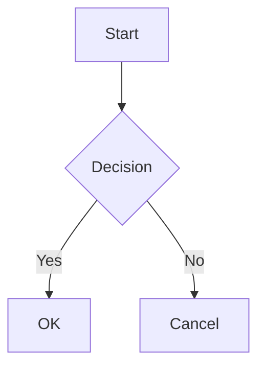

<p align="center">
  <a href="#/">English</a> | <a href="#/zh-cn/">简体中文</a> | <a href="#/ja/">日本語</a> | <a href="#/es/">Español</a> | <strong>Português</strong> | <a href="#/ko/">한국어</a> | <a href="#/zh-tw/">繁體中文</a>
</p>

<p align="center">
  
</p>

<h1 align="center">PlantUML Markdown Preview</h1>

<p align="center">
  <strong>Diagramas PlantUML, Mermaid e D2 direto na sua pré-visualização de Markdown. Fast, Secure ou Easy — escolha o modo que combina com você.</strong>
</p>

<p align="center">
  <a href="https://marketplace.visualstudio.com/items?itemName=yss-tazawa.plantuml-markdown-preview"></a>
  <a href="https://marketplace.visualstudio.com/items?itemName=yss-tazawa.plantuml-markdown-preview"></a>
  <a href="https://github.com/yss-tazawa/plantuml-markdown-preview/blob/main/LICENSE"></a>
</p>

<p align="center">
  
</p>

Escreva diagramas como código no seu Markdown e veja-os renderizados enquanto você digita — depois exporte o documento inteiro para HTML ou PDF, com os diagramas.

## Escolha seu Modo

| | **Fast** (padrão) | **Secure** | **Easy** |
|---|---|---|---|
| | Renderização rápida | Privacidade máxima | Sem configuração |
| | Um servidor PlantUML local atualiza os diagramas enquanto você digita | Sem rede, sem processos em segundo plano — tudo fica na sua máquina | Sem Java — funciona de imediato com um servidor PlantUML online |
| **Java** | 11+ necessário | 11+ necessário | Não necessário |
| **Rede** | Nenhuma | Nenhuma | Necessária |
| **Privacidade** | Apenas local | Apenas local | Código-fonte do diagrama enviado ao servidor PlantUML |
| **Configuração** | [Instalar Java →](#pré-requisitos) | [Instalar Java →](#pré-requisitos) | Não necessária |

Alterne entre os modos a qualquer momento com uma única configuração — sem migração, sem reiniciar.

Veja [Modos de Renderização](#modos-de-renderização) para os detalhes e [Início Rápido](#início-rápido) para a configuração.

## Destaques

- **Diagramas direto no documento** — diagramas PlantUML, Mermaid e D2 aparecem dentro da sua pré-visualização de Markdown, não em um painel separado.
- **Seguro para abrir** — scripts no seu Markdown nunca são executados, nem na pré-visualização nem na exportação para HTML/PDF.
- **Tamanhos sob seu controle** — você define a escala de exibição dos diagramas PlantUML, Mermaid e D2 de forma independente.
- **Exportação para um único arquivo HTML** — seu documento e seus diagramas em um só arquivo HTML, com a largura e o alinhamento de layout que você escolher.
- **Exportação para PDF com um clique** — a impressão é feita pelo Chrome, Edge ou Chromium, com os diagramas ajustados para caber na página.
- **Sincronização de rolagem bidirecional** — quando você rola o editor ou a pré-visualização, o outro acompanha.
- **Navegação fácil** — você vai para o topo ou o final, ou abre uma barra lateral de sumário, direto da pré-visualização.
- **Visualizador de Diagramas** — com um clique com o botão direito em qualquer diagrama, você o amplia e move no seu próprio painel, sincronizado com as suas edições.
- **Modo de leitura (Reading View)** — você lê um arquivo Markdown, PlantUML, Mermaid ou D2 renderizado na própria aba e volta ao código-fonte no mesmo lugar.
- **Pré-visualização de diagrama independente** — você abre arquivos `.puml`, `.plantuml`, `.mmd`, `.mermaid` e `.d2` diretamente, com pan & zoom e atualizações ao vivo.
- **Pré-visualização de revisões do Git** — você vê um arquivo Markdown como ele estava em HEAD ou na área de preparação, renderizado ao lado da sua pré-visualização atual, para comparar visualmente os diagramas alterados.
- **Salvar ou copiar como PNG / SVG** — com um clique com o botão direito em qualquer diagrama na pré-visualização ou no Visualizador de Diagramas, você o salva ou copia para a área de transferência.
- **17 temas de pré-visualização** — a pré-visualização acompanha o tema de cores do VS Code, ou você escolhe um dos 9 temas claros e 7 escuros, incluindo GitHub, Atom, Solarized, Dracula e Monokai.
- **Assistência no editor** — completamento de palavras-chave, seletor de cores e snippets para PlantUML, Mermaid e D2.
- **Disponível em 7 idiomas** — a interface está disponível em inglês, chinês (simplificado e tradicional), espanhol, português brasileiro, japonês e coreano.
- **Suporte a matemática** — fórmulas inline `$...$` e em bloco `$$...$$` são renderizadas com o [KaTeX](https://katex.org/).

## Sumário

- [Escolha seu Modo](#escolha-seu-modo)
- [Destaques](#destaques)
- [Funcionalidades](#funcionalidades)
- [Início Rápido](#início-rápido)
- [Uso](#uso)
  - [Modo de leitura](#modo-de-leitura)
- [Configuração](#configuração)
- [Snippets](#snippets)
- [Seletor de Cores](#seletor-de-cores)
- [Completamento de Palavras-chave](#completamento-de-palavras-chave)
- [Atalhos de Teclado](#atalhos-de-teclado)
- [FAQ](#faq)
- [Contribuição](#contribuição)
- [Licenças de Terceiros](#licenças-de-terceiros)
- [Licença](#licença)

## Funcionalidades

### Prévia de Diagrama Inline

Blocos de código ```` ```plantuml ````, ```` ```mermaid ```` e ```` ```d2 ```` são renderizados como diagramas SVG inline ao lado do seu conteúdo Markdown regular.

- **Atualizações ao vivo** — a pré-visualização é atualizada enquanto você digita.
- **Atualização ao salvar** — salvar o arquivo atualiza a pré-visualização.
- **Acompanha suas abas** — a pré-visualização muda junto com a aba ativa do editor.
- **Indicador de carregamento** — você vê quando um diagrama ainda está sendo renderizado.
- **Mensagens de erro claras** — erros de sintaxe aparecem inline, com números de linha e o código ao redor.
- **PlantUML** — renderizado com Java na sua máquina (modo Fast / Secure) ou por um servidor PlantUML (modo Easy); veja [Modos de Renderização](#modos-de-renderização).
- **Mermaid** — renderizado com o [mermaid.js](https://mermaid.js.org/), sem Java nem outras ferramentas para instalar.
- **D2** — renderizado com o [@terrastruct/d2](https://d2lang.com/) (Wasm) incluído, sem outras ferramentas para instalar.

### Realce do código-fonte de diagramas

O código-fonte dos diagramas é realçado no editor, tanto dentro dos blocos
```` ```plantuml ````, ```` ```mermaid ```` e ```` ```d2 ```` no Markdown quanto em arquivos
`.puml`, `.plantuml`, `.mmd`, `.mermaid` e `.d2` independentes. As cores seguem o seu tema atual.

### Suporte a Matemática

Renderize expressões matemáticas usando [KaTeX](https://katex.org/).

- **Matemática inline** — `$E=mc^2$` é renderizado como uma fórmula inline.
- **Matemática em bloco** — `$$\int_0^\infty e^{-x}\,dx = 1$$` é renderizado como uma fórmula centralizada em destaque.
- **Mesma aparência em todo lugar** — as fórmulas ficam iguais na pré-visualização e na exportação para HTML/PDF.
- **Fácil de desativar** — defina `enableMath: false` se os símbolos `$` do seu texto forem lidos como matemática.

### Escala do Diagrama

Controle o tamanho de exibição dos diagramas PlantUML, Mermaid e D2 independentemente.

- **Escala PlantUML** — escolha `auto` (reduzir para caber) ou uma porcentagem fixa de 70% a 120% (padrão 100%); os diagramas continuam nítidos em qualquer escala.
- **Escala Mermaid** — escolha `auto` (reduzir para caber) ou uma porcentagem fixa de 50% a 100% (padrão 80%).
- **Escala D2** — escolha `auto` (reduzir para caber) ou uma porcentagem fixa de 50% a 100% (padrão 70%).

### Modos de Renderização

Escolha um modo predefinido que controla como os diagramas PlantUML são renderizados:

| | Fast (padrão) | Secure | Easy |
|---|---|---|---|
| **Java necessário** | Sim | Sim | Não |
| **Rede** | Nenhuma (apenas localhost) | Nenhuma | Necessária |
| **Privacidade** | Apenas local | Apenas local | Código-fonte do diagrama enviado ao servidor PlantUML |
| **Velocidade** | Instantânea (servidor local persistente) | Mais lenta (o Java inicia a cada renderização) | Depende da rede |

- **Modo Fast** (padrão) — mantém um servidor PlantUML em execução em `localhost`, para que os diagramas sejam atualizados instantaneamente enquanto você edita. O servidor inicia com o seu primeiro diagrama PlantUML (você pode mudar isso; veja [Modo de início](#modo-fast-modo-de-início-do-servidor)), e os diagramas nunca saem da sua máquina.
- **Modo Secure** — executa o Java e o jar do PlantUML na sua máquina a cada renderização, sem acesso à rede e sem servidor em segundo plano. Imagens locais são bloqueadas por padrão para segurança máxima.
- **Modo Easy** — envia o código-fonte do PlantUML para um servidor PlantUML, então não há nada para instalar. Usa o servidor público (`https://www.plantuml.com/plantuml`) por padrão; aponte-o para o seu próprio servidor para ter privacidade.

Se o Java não for encontrado quando você abrir uma pré-visualização, a extensão oferece a mudança para o modo Easy.

#### Modo Fast: modo de início do servidor

Por padrão, o modo Fast inicia e gerencia seu próprio servidor PlantUML em `127.0.0.1` — nenhuma configuração necessária. `plantumlLocalServerStartMode` (Start Mode) controla quando, e se, isso acontece:

| Valor | Efeito |
|---|---|
| `"lazy"` (padrão) | Inicia o servidor gerenciado na primeira renderização de diagrama. O Java só é executado quando você renderiza um diagrama PlantUML; a primeira renderização demora alguns segundos a mais. |
| `"on"` | Inicia o servidor gerenciado assim que a extensão é ativada. A primeira renderização é instantânea, mas o Java fica em execução em segundo plano desde a inicialização. |
| `"off"` | Nunca inicia um servidor. Conecta-se a um que você mesmo executa (por exemplo `java -jar plantuml.jar -picoweb`), incluindo um em outra máquina da sua rede local. |

O host e a porta usados para alcançar o servidor são controlados por estas configurações:

| Configuração | Padrão | Efeito |
|---|---|---|
| `plantumlLocalServerHost` | `127.0.0.1` | Host ao qual se conectar quando Start Mode é `"off"` (por exemplo, um servidor picoweb em outro ponto da sua rede local). Ignorado para `"on"`/`"lazy"` — um servidor gerenciado sempre se vincula a `127.0.0.1`. |
| `plantumlLocalServerPort` | `0` | Start Mode `"on"`/`"lazy"`: porta na qual iniciar (`0` = atribui automaticamente uma porta livre). Start Mode `"off"`: porta à qual se conectar. |

Algumas coisas que vale a pena saber:

- **Convive com servidores existentes** — com `"on"` ou `"lazy"` e uma porta fixa, um servidor PlantUML que já funciona nessa porta é reutilizado em vez de iniciar um segundo.
- **Sem Java local com `"off"`** — a extensão nunca inicia um servidor; ela apenas se conecta ao host e à porta que você configurar.
- **Seus servidores continuam seus** — a extensão só interrompe os servidores que ela mesma iniciou.
- **A configuração antiga ainda é lida** — se Start Mode não estiver definido, a configuração antiga `plantumlLocalServerAutoStart` é usada (`true` → `"on"`, `false` → `"off"`).

#### Modo Fast: configurações de memória (heap) da JVM

O consumo de memória do servidor gerenciado é limitado por predefinições de heap (`plantumlLocalServerJvmHeapPreset`):

| Predefinição | Flags de heap da JVM | Use quando |
|---|---|---|
| `small` | `-Xms16m -Xmx256m` | Menor uso de memória; apenas diagramas pequenos. |
| `medium` (padrão) | `-Xms16m -Xmx512m` | Equilibrado; lida bem com a maioria dos diagramas. |
| `large` | `-Xms64m -Xmx1024m` | Diagramas muito grandes; corresponde à recomendação do FAQ do PlantUML. |
| `unlimited` | _(nenhuma)_ | Nenhuma flag — o Java decide (o heap máximo padrão é 1/4 da RAM física). |
| `custom` | seus valores | Lê `plantumlLocalServerJvmInitialHeapMb` (8–32768, padrão 16) e `plantumlLocalServerJvmMaxHeapMb` (64–32768, padrão 512). |

Toda predefinição exceto `unlimited` também fixa `-XX:+UseSerialGC`, `-XX:MaxMetaspaceSize=128m` e `-XX:ReservedCodeCacheSize=64m` para manter o servidor enxuto. Essas configurações se aplicam apenas ao servidor que a própria extensão inicia (modo Fast, Start Mode `"on"`/`"lazy"`).

### Barra de Status

A barra de status mostra o modo de renderização atual (Fast / Secure / Easy) e, no modo Fast, o estado do servidor local (iniciando, em execução, erro, parado).

- **Troca de modo com um clique** — clique no item da barra de status para escolher um modo em uma seleção rápida, sem abrir as Configurações.
- **Também na Paleta de Comandos** — o comando **Selecionar modo de renderização** faz o mesmo.

Enquanto uma pré-visualização de Markdown ou o modo de leitura estiver visível, a barra de status também mostra o nível de zoom da pré-visualização. Clique nele para escolher outro nível.

### Exportação para HTML

Exporte seu documento Markdown para um único arquivo HTML.

- **Diagramas incluídos** — diagramas PlantUML e D2 são incorporados como SVG inline; diagramas Mermaid e fontes de matemática são carregados de uma CDN quando o arquivo é aberto.
- **Estilos incluídos** — os estilos de realce de sintaxe vão dentro do arquivo.
- **Exportar e abrir** — exporte e abra o resultado no seu navegador com um único comando.
- **Seu layout** — escolha uma largura fixa de 640px a 1440px, centralizada ou alinhada à esquerda, ou **Responsivo**, que ocupa a janela do navegador, reduz apenas os diagramas que transbordariam e ajusta as tabelas largas à janela. Defina sua largura e seu alinhamento habituais nas Configurações, ou escolha a cada exportação pelo menu.

### Exportação para PDF

Exporte seu documento Markdown para PDF usando o Chrome, Edge ou Chromium que já está na sua máquina.

- **Usa o seu navegador** — requer Chrome, Edge ou Chromium instalado no seu sistema.
- **Retrato ou paisagem** — escolha a orientação ao exportar.
- **Tamanho do papel** — A4 (padrão), Letter, Legal, A3 ou A5 (`pdfPaperSize`).
- **Escala consistente** — texto e diagramas são dimensionados juntos (`pdfScale`, padrão 100%).
- **Páginas limpas** — as margens de impressão são aplicadas para você.

### Exportação em massa de diagramas

Exporte todos os diagramas de um arquivo Markdown como arquivos PNG ou SVG individuais.

- **Todos os diagramas de uma vez** — todos os diagramas PlantUML, Mermaid e D2 são exportados na ordem do documento.
- **O nome da pasta é seu** — escolha o nome da pasta de saída (padrão: `{nome_arquivo}_diagrams`).
- **Pré-visualização necessária** — a pré-visualização precisa estar aberta, já que é nela que os diagramas são renderizados.

### Navegação

- **Ir para o topo / Ir para o final** — botões no canto superior direito da pré-visualização levam você até lá com um clique.
- **Barra lateral de sumário** — clique no botão TOC para listar todos os títulos e depois clique em um deles para ir até ele.
- **Zoom** — `Ctrl`+roda do mouse (`Cmd`+roda do mouse no Mac) aplica zoom na pré-visualização e no modo de leitura de 50% a 200%; um único nível vale para todos e é mantido entre reinicializações.

### Visualizador de Diagramas

Clique com o botão direito em qualquer diagrama PlantUML, Mermaid ou D2 na pré-visualização e selecione **Abrir no visualizador de diagramas** para abri-lo em um painel separado de pan & zoom.

- **Pan & zoom** — aplique zoom com a roda do mouse em torno do cursor e arraste para mover.
- **Barra de ferramentas** — Ajustar à janela, Tamanho real (1:1) e zoom por etapas (+/-).
- **Sincronização ao vivo** — suas edições aparecem na hora, e sua posição de zoom é mantida.
- **Fundo combinando** — a cor de fundo acompanha o tema de pré-visualização atual.
- **Fecha com o arquivo** — o visualizador fecha quando você muda para outro arquivo de origem.
- **Salvar ou copiar como PNG / SVG** — clique com o botão direito em um diagrama na pré-visualização ou no Visualizador de Diagramas para salvá-lo como arquivo ou copiá-lo como PNG.
- **Localizar no visualizador** — pressione `Cmd+F` / `Ctrl+F` para abrir o widget de localização.
- **Opcional** — desative com `enableDiagramViewer: false`.

### Suporte a `!include` no PlantUML

Use diretivas `!include` para compartilhar estilos comuns, macros e definições de componentes entre diagramas.

- **Onde os arquivos são procurados** — os arquivos incluídos são resolvidos a partir da raiz do workspace ou da pasta definida em `plantumlIncludePath`. No modo Fast, isso vale quando a extensão executa o seu próprio servidor; veja o [FAQ](#faq) para os detalhes.
- **Atualização ao salvar** — salvar um arquivo incluído atualiza a pré-visualização, e o botão **Recarregar** (↻) força uma atualização a qualquer momento.
- **Ir para o arquivo include** — clique com o botão direito em uma linha `!include` em um arquivo `.puml` ou Markdown para abrir o arquivo referenciado.
- **Abrir arquivo de origem include** — clique com o botão direito em um diagrama PlantUML na pré-visualização para abrir os arquivos incluídos diretamente.
- **Modos Fast e Secure** — o modo Easy não consegue ler seus arquivos locais, então `!include` não está disponível nele.

### Prévia de Diagrama Independente

Abra arquivos `.puml`, `.plantuml`, `.mmd`, `.mermaid` ou `.d2` diretamente — sem precisar de Markdown.

- **Pan & zoom** — os mesmos controles do Visualizador de Diagramas.
- **Atualizações ao vivo** — a pré-visualização é atualizada enquanto você digita.
- **Acompanha suas abas** — a pré-visualização muda junto quando você alterna entre arquivos do mesmo tipo.
- **Temas** — escolha o tema da pré-visualização e o tema do diagrama de forma independente.
- **Salvar ou copiar como PNG / SVG** — clique com o botão direito no diagrama.
- **Localizar na pré-visualização** — pressione `Cmd+F` / `Ctrl+F` para abrir o widget de localização.
- **PlantUML** — funciona nos três modos de renderização (Fast / Secure / Easy).
- **Mermaid** — renderizado com o mermaid.js.
- **D2** — renderizado com o @terrastruct/d2 (Wasm), com tema e motor de layout que você pode escolher.

### Prévia de Revisões do Git

Pré-visualize um arquivo Markdown como ele estava em uma revisão do Git, renderizado, em um painel lateral — assim um diagrama alterado pode ser comparado lado a lado em vez de lido como diferença de texto.

- **HEAD** — a última versão confirmada.
- **Preparada** — a versão atualmente preparada para commit.
- **Lado a lado** — abre ao lado da sua pré-visualização atual, então os diagramas antigo e novo ficam visíveis ao mesmo tempo.
- **Instantâneo** — renderiza uma vez e não acompanha edições posteriores; um aviso no topo informa isso.
- **Requer Git** — o arquivo precisa estar versionado em um repositório Git.

### Sincronização de Rolagem Bidirecional

O editor e a pré-visualização permanecem sincronizados enquanto você rola qualquer um deles.

- **Posições correspondentes** — a pré-visualização se alinha com a parte do código-fonte que você está olhando.
- **Estável** — sua posição de rolagem se mantém quando a pré-visualização é renderizada novamente.

### Temas

**Temas de pré-visualização** controlam a aparência geral do documento:

**Tema VS Code:**

| Tema | Estilo |
|-------|-------|
| Follow VS Code Color Theme | Acompanha o tema de cores atual do VS Code, como a pré-visualização de Markdown integrada. A exportação para HTML/PDF usa VS Code Light 2026 ou Dark 2026 conforme o tema |

**Temas claros:**

| Tema | Estilo |
|-------|-------|
| GitHub Light | Fundo branco (padrão) |
| Atom Light | Texto cinza suave, inspirado no editor Atom |
| One Light | Branco gelo, paleta equilibrada |
| Solarized Light | Bege quente, amigável aos olhos |
| Vue | Acentos verdes, inspirado na documentação do Vue.js |
| Pen Paper Coffee | Papel quente, estética manuscrita |
| Coy | Quase branco, design limpo |
| VS | Cores clássicas do Visual Studio |
| VS Code Light 2026 | Pré-visualização de Markdown integrada do VS Code com o tema de cores Light 2026 |

**Temas escuros:**

| Tema | Estilo |
|-------|-------|
| GitHub Dark | Fundo escuro |
| Atom Dark | Paleta Tomorrow Night |
| One Dark | Escuro inspirado no Atom |
| Dracula | Escuro vibrante |
| Solarized Dark | Teal profundo, amigável aos olhos |
| Monokai | Sintaxe vívida, inspirado no Sublime Text |
| VS Code Dark 2026 | Pré-visualização de Markdown integrada do VS Code com o tema de cores Dark 2026 |

Alterne os temas de pré-visualização instantaneamente pelo ícone na barra de título — os diagramas não são redesenhados. Mudar o tema do PlantUML redesenha os diagramas.

**Temas PlantUML** controlam o estilo dos diagramas de forma independente. A extensão descobre os temas disponíveis na sua instalação do PlantUML e os lista na mesma seleção rápida dos temas de pré-visualização.

**Temas Mermaid** controlam o estilo dos diagramas Mermaid: `default`, `dark`, `forest`, `neutral`, `base`. Eles também estão na mesma seleção rápida.

**Temas D2** — 19 temas integrados (ex.: `Neutral Default`, `Dark Mauve`, `Terminal`), que você pode escolher nas configurações ou na mesma seleção rápida.

### Realce de Sintaxe

Mais de 190 linguagens suportadas via highlight.js. Blocos de código são estilizados para combinar com o tema de pré-visualização selecionado.

### Segurança

- **Política de scripts rigorosa** — a pré-visualização executa apenas os scripts da própria extensão.
- **Nenhum código dos seus documentos** — tags `<script>` e outros códigos no Markdown nunca são executados, nem na pré-visualização nem na exportação para HTML/PDF.
- **Imagens locais conforme o modo** — por padrão, as imagens locais seguem o modo (`allowLocalImages: "mode-default"`); o modo Secure as bloqueia para segurança máxima.
- **Sem imagens via HTTP simples por padrão** — o carregamento de imagens via HTTP não criptografado está desativado (`allowHttpImages`); ative-o apenas em redes confiáveis, como uma intranet ou um servidor de desenvolvimento local.

### Integração com a Prévia de Markdown Nativa

Diagramas PlantUML, Mermaid e D2 também aparecem na pré-visualização de Markdown integrada do VS Code (`Markdown: Abrir Visualização ao Lado`) — sem configuração extra. Para temas de pré-visualização, sincronização de rolagem e exportação para HTML, abra a pré-visualização desta extensão (`Cmd+Alt+V` / `Ctrl+Alt+V`). Ela também é a melhor escolha para diagramas PlantUML grandes, que podem congelar o editor brevemente na pré-visualização integrada.

### Alertas ao estilo GitHub

Renderiza alertas ao estilo GitHub (caixas de destaque) a partir de marcadores de citação, iguais aos do próprio GitHub.

```markdown
> [!NOTE]
> Highlights information that users should take into account.

> [!TIP]
> Optional information to help a user be more successful.

> [!IMPORTANT]
> Crucial information necessary for users to succeed.

> [!WARNING]
> Critical content demanding immediate user attention.

> [!CAUTION]
> Negative potential consequences of an action.
```

- **Cinco tipos** — `NOTE`, `TIP`, `IMPORTANT`, `WARNING` e `CAUTION`, cada um com ícone e cor de destaque próprios.
- **Mesmas regras do GitHub** — o marcador deve estar sozinho na linha (em maiúsculas ou minúsculas: `[!note]` também funciona), e somente uma citação no nível superior do documento se torna um alerta. `> [!NOTE] My title` e um marcador dentro de um item de lista ou de outra citação permanecem citações comuns.
- **Acompanham o tema** — as cores se adaptam ao tema de pré-visualização ativo, claro ou escuro.
- **Mesma aparência em todo lugar** — os alertas ficam iguais na pré-visualização e na exportação para HTML/PDF.

### Notas de Rodapé e Listas de Tarefas

Renderiza notas de rodapé e listas de tarefas escritas na sintaxe do GitHub, iguais às do próprio GitHub.

```markdown
A sentence with a footnote.[^1]

[^1]: The footnote text.

- [x] Finished task
- [ ] Open task
```

- **Notas de rodapé** — uma referência `[^1]` leva à sua nota no fim do documento, e a nota leva de volta à referência.
- **Listas de tarefas** — os itens `- [ ]` e `- [x]` mostram caixas de seleção. Elas apenas mostram o estado; clicar nelas não altera o documento.
- **Mesma aparência em todo lugar** — as notas de rodapé e as listas de tarefas ficam iguais na pré-visualização e na exportação para HTML/PDF.

## Início Rápido

### Pré-requisitos

**Mermaid** — sem pré-requisitos. Funciona imediatamente.

**D2** — sem pré-requisitos. Renderizado usando o Wasm integrado do [D2](https://d2lang.com/) — funciona imediatamente.

**PlantUML (modo Easy)** — sem pré-requisitos. O código-fonte do diagrama é enviado a um servidor PlantUML para renderização.

**PlantUML (modo Fast / Secure)** — padrão:

| Ferramenta | Propósito | Verificar |
|------|---------|--------|
| [Java 11+ (JRE ou JDK)](#configuração) | Executa o PlantUML (o PlantUML 1.2026.10 incluído requer Java 11+) | `java -version` |
| [Graphviz](https://graphviz.org/) | Opcional — necessário para diagramas de classe, componentes e outros dependentes de layout (veja [Suporte a Diagramas](#suporte-a-diagramas)) | `dot -V` |

O PlantUML vem incluído (LGPL, v1.2026.10) — não há nada para baixar. O Java 11 ou posterior é o único requisito; o Graphviz é opcional.
Ainda não tem Java? A extensão oferece a mudança para o modo Easy quando você abre uma pré-visualização.

### Suporte a Diagramas

O que funciona depende da sua configuração:

| Diagrama | LGPL (incluído) | Win: JAR GPLv2 | Mac/Linux: + Graphviz |
|---------|:-:|:-:|:-:|
| Sequence | ✓ | ✓ | ✓ |
| Activity (nova sintaxe) | ✓ | ✓ | ✓ |
| Mind Map | ✓ | ✓ | ✓ |
| WBS | ✓ | ✓ | ✓ |
| Gantt | ✓ | ✓ | ✓ |
| JSON / YAML | ✓ | ✓ | ✓ |
| Salt / Wireframe | ✓ | ✓ | ✓ |
| Timing | ✓ | ✓ | ✓ |
| Network (nwdiag) | ✓ | ✓ | ✓ |
| Class | — | ✓ | ✓ |
| Use Case | — | ✓ | ✓ |
| Object | — | ✓ | ✓ |
| Component | — | ✓ | ✓ |
| Deployment | — | ✓ | ✓ |
| State | — | ✓ | ✓ |
| ER (Entidade Relacionamento) | — | ✓ | ✓ |
| Activity (legado) | — | ✓ | ✓ |
| DOT (@startdot) | — | ✓ | ✓ |

- **LGPL (incluído)** — funciona imediatamente. Não precisa de Graphviz.
- **Win: JAR GPLv2** — a [versão GPLv2](https://plantuml.com/download) inclui o Graphviz (apenas Windows, extraído automaticamente). Configure [`plantumlJarPath`](#configuração) para usá-lo. DOT (`@startdot`) exige o PlantUML 1.2026.9 ou posterior.
- **Mac/Linux: + Graphviz** — instale o [Graphviz](https://graphviz.org/) separadamente. Funciona tanto com o JAR LGPL quanto com o GPLv2.

### Instalar

1. Abra o VS Code
2. Procure por **PlantUML Markdown Preview** na visualização de Extensões (`Ctrl+Shift+X` / `Cmd+Shift+X`)
3. Clique em **Instalar**

### Configuração inicial

**Modo Fast** (padrão) — nada para configurar. Um servidor PlantUML local inicia com o seu primeiro diagrama e mantém as atualizações instantâneas. Requer Java 11+.

**Para usar o modo Secure** — defina `mode` como `"secure"`. O Java 11+ é executado a cada renderização, sem servidor em segundo plano e sem acesso à rede.

**Para usar o modo Easy** (sem configuração) — defina `mode` como `"easy"`. O código-fonte do diagrama é enviado a um servidor PlantUML para renderização.

**Modos Fast e Secure** — o JAR LGPL incluído suporta diagramas de sequência, atividade, mapa mental e outros sem configuração extra (veja [Suporte a Diagramas](#suporte-a-diagramas)). Para habilitar diagramas de classe, componentes, casos de uso e outros dependentes de layout, siga os passos para sua plataforma abaixo.

#### Windows

1. Instale o Java se ainda não estiver instalado (abra o PowerShell e execute):
   ```powershell
   winget install Microsoft.OpenJDK.21
   ```
2. Se o `java` não estiver no seu PATH, encontre o caminho completo no PowerShell:
   ```powershell
   Get-Command java
   # ex: C:\Program Files\Microsoft\jdk-21.0.6.7-hotspot\bin\java.exe
   ```
   Abra as configurações do VS Code (`Ctrl+,`), procure por `plantumlMarkdownPreview.javaPath` e insira o caminho mostrado acima
3. Baixe a [versão GPLv2 do PlantUML](https://plantuml.com/download) (`plantuml-gplv2-*.jar`) para uma pasta de sua escolha (inclui Graphviz — sem necessidade de instalação separada)
4. Abra as configurações do VS Code (`Ctrl+,`), procure por `plantumlMarkdownPreview.plantumlJarPath` e insira o caminho completo para o arquivo `.jar` baixado (ex.: `C:\tools\plantuml-gplv2-1.2026.10.jar`)

#### Mac

1. Instale o Java e o Graphviz via Homebrew:
   ```sh
   brew install openjdk graphviz
   ```
2. Se o `dot` não estiver no seu PATH, encontre o caminho completo e configure-o no VS Code:
   ```sh
   which dot
   # ex: /opt/homebrew/bin/dot
   ```
   Abra as configurações do VS Code (`Cmd+,`), procure por `plantumlMarkdownPreview.dotPath` e insira o caminho mostrado acima

#### Linux

1. Instale o Java e o Graphviz:
   ```sh
   # Debian / Ubuntu
   sudo apt install default-jdk graphviz

   # Fedora
   sudo dnf install java-21-openjdk graphviz
   ```
2. Se o `dot` não estiver no seu PATH, encontre o caminho completo e configure-o no VS Code:
   ```sh
   which dot
   # ex: /usr/bin/dot
   ```
   Abra as configurações do VS Code (`Ctrl+,`), procure por `plantumlMarkdownPreview.dotPath` e insira o caminho mostrado acima

Raramente você precisa definir esses caminhos. Por padrão, a extensão procura o Java em `JAVA_HOME/bin/` (`JAVA_HOME\bin\` no Windows) e depois no seu PATH, encontra o `dot` no seu PATH e usa o JAR do PlantUML incluído. Defina `javaPath`, `dotPath` ou `plantumlJarPath` apenas se um comando não estiver no seu PATH ou se você quiser outro JAR.

## Uso

### Abrir Prévia

- **Atalho de teclado** — pressione `Cmd+Alt+V` (Mac) / `Ctrl+Alt+V` (Windows / Linux).
- **Barra de título do editor** — clique no botão de pré-visualização (um "P" em um quadrado arredondado) no canto superior direito do editor.
- **Botões e atalhos padrão do VS Code** — com `useAsDefaultPreview` ativado (o padrão), o botão **Abrir Visualização ao Lado** do VS Code, seus itens de menu de contexto **Abrir Visualização** e `Cmd+K V` (Mac) / `Ctrl+K V` (Windows / Linux) abrem esta pré-visualização; `Cmd+Shift+V` / `Ctrl+Shift+V` alterna para o [modo de leitura](#modo-de-leitura) em vez disso.
- **Menu de contexto** — clique com o botão direito em um arquivo Markdown no Explorador ou dentro do editor → **PlantUML Markdown Preview** → **Abrir pré-visualização ao lado**.
- **Paleta de Comandos** — execute `PlantUML Markdown Preview: Abrir pré-visualização ao lado`.

A pré-visualização tem seus próprios temas e começa com fundo branco (GitHub Light). Escolha `follow-vscode` para acompanhar o tema de cores atual do VS Code.

### Modo de leitura

O modo de leitura (Reading View) mostra um arquivo renderizado na própria aba, no lugar do editor de texto, sem abrir um segundo painel. Ele fica fixo nesse arquivo em vez de acompanhar o editor ativo, e pode ficar aberto ao mesmo tempo que a pré-visualização.

Funciona com arquivos Markdown (`.md`, `.markdown` e as demais extensões cobertas pela pré-visualização de Markdown do VS Code) e com arquivos `.puml` / `.plantuml`, `.mmd` / `.mermaid` e `.d2`. Nada muda até você usá-lo.

- **Alternar no mesmo lugar** — clique com o botão direito no editor → **PlantUML Markdown Preview** → **Alternar para o modo de leitura** (em arquivos PlantUML, Mermaid e D2, **Alternar para o modo de leitura** fica diretamente no menu). Para voltar, clique com o botão direito no modo de leitura → **Alternar para o código-fonte**, ou clique em **Alternar para o código-fonte** na barra de título do editor. A própria aba muda; nenhuma aba nova é aberta.
- **Abrir uma vez** — clique com o botão direito em um arquivo no Explorador → **Abrir Com...** → **PlantUML Markdown Preview (Modo de leitura)**. Para um arquivo que já está aberto, clique com o botão direito na aba dele e use **Reabrir o Editor com...** em vez disso.
- **Abrir por padrão** — na lista de **Abrir Com...**, escolha **Configurar editor padrão para '\*.md'...** → **PlantUML Markdown Preview (Modo de leitura)**. A partir daí, clicar em um arquivo `.md` o abre no modo de leitura. Faça isso uma vez para cada extensão de arquivo.
- **Desfazer** — escolha **Editor de Texto** da mesma forma, ou remova a linha das suas configurações.

Para definir em `settings.json`:

```json
"workbench.editorAssociations": {
  "*.md": "plantumlMarkdownPreviewEditor",
  "*.puml": "plantumlPumlPreviewEditor",
  "*.mmd": "plantumlMermaidPreviewEditor",
  "*.d2": "plantumlD2PreviewEditor"
}
```

| Arquivos | Valor |
| -------- | ----- |
| Markdown (`*.md`, `*.markdown`, …) | `plantumlMarkdownPreviewEditor` |
| `*.puml`, `*.plantuml` | `plantumlPumlPreviewEditor` |
| `*.mmd`, `*.mermaid` | `plantumlMermaidPreviewEditor` |
| `*.d2` | `plantumlD2PreviewEditor` |

- **VS Code mais antigo** — antes do VS Code 1.100, **Alternar para o modo de leitura** e **Alternar para o código-fonte** não aparecem; abra o modo de leitura com **Abrir Com...** em vez disso.
- **Diffs do Git** — os diffs continuam abrindo como diffs de texto, mesmo para arquivos configurados para abrir no modo de leitura.
- **Botões padrão** — com `useAsDefaultPreview` ativado (o padrão), o botão **Abrir como Visualização** do VS Code (a partir do VS Code 1.119) e `Ctrl+Shift+V` (a partir do VS Code 1.100) alternam para o modo de leitura; veja [Configuração](#configuração).

### Abrir Prévia de Diagrama

Abra arquivos `.puml` / `.plantuml`, `.mmd` / `.mermaid` ou `.d2` diretamente em uma pré-visualização com pan & zoom — sem precisar de Markdown.

- **Atalho de teclado** — o mesmo `Cmd+Alt+V` (Mac) / `Ctrl+Alt+V` (Windows / Linux) escolhe a pré-visualização certa para o tipo de arquivo.
- **Barra de título do editor** — clique no botão de pré-visualização (um "P" em um quadrado arredondado) no canto superior direito do editor.
- **Atalhos padrão de pré-visualização** — com `useAsDefaultPreview` ativado (o padrão), `Cmd+K V` (Mac) / `Ctrl+K V` (Windows / Linux) também abre a pré-visualização ao lado do editor; `Cmd+Shift+V` / `Ctrl+Shift+V` alterna para o [modo de leitura](#modo-de-leitura) em vez disso.
- **Menu de contexto** — clique com o botão direito em um arquivo `.puml` / `.plantuml`, `.mmd` / `.mermaid` ou `.d2` no Explorador ou no editor → **Pré-visualizar arquivo PlantUML** / **Pré-visualizar arquivo Mermaid** / **Pré-visualizar arquivo D2**.
- **Paleta de Comandos** — execute `PlantUML Markdown Preview: Pré-visualizar arquivo PlantUML`, `Pré-visualizar arquivo Mermaid` ou `Pré-visualizar arquivo D2`.

### Abrir a Prévia de uma Revisão do Git

Renderiza um arquivo Markdown como ele estava em uma revisão do Git, ao lado da pré-visualização da sua versão atual.

- **Menu de contexto** — clique com o botão direito em um arquivo Markdown no Explorador ou no editor → **PlantUML Markdown Preview** → **Abrir pré-visualização da revisão HEAD ao lado** / **Abrir pré-visualização da revisão preparada ao lado**.
- **Paleta de Comandos** — execute `PlantUML Markdown Preview: Abrir pré-visualização da revisão HEAD ao lado` / `Abrir pré-visualização da revisão preparada ao lado`.

Abra primeiro a sua pré-visualização normal e depois a da revisão: os dois painéis ficam lado a lado. O painel da revisão é um instantâneo fixo e não se atualiza enquanto você edita.

### Exportar para HTML

- **Menu de contexto** — clique com o botão direito em um arquivo Markdown → **PlantUML Markdown Preview** → **Exportar como HTML** → escolha uma opção de largura.
- **Pré-visualização** — clique com o botão direito dentro da pré-visualização → **Exportar como HTML** ou **Exportar como HTML e abrir**.

O submenu oferece estas opções de largura:

| Opção | Descrição |
| ----- | --------- |
| Configurações atuais | Exporta com a configuração atual (sem CSS responsivo) |
| 640px – 1440px | Largura fixa do corpo em pixels, centralizado |
| Responsivo (à esquerda) | Corpo com largura do viewport alinhado à esquerda; diagramas reduzidos apenas se transbordarem e tabelas largas ajustadas |
| 640px – 1440px (à esquerda) | Largura fixa, alinhado à esquerda |

O arquivo HTML é salvo ao lado do arquivo Markdown de origem.

### Exportar para PDF

- **Menu de contexto** — clique com o botão direito em um arquivo Markdown → **PlantUML Markdown Preview** → **Exportar como PDF** → **Retrato** ou **Paisagem**.
- **Pré-visualização** — clique com o botão direito dentro da pré-visualização → **Exportar como PDF** ou **Exportar como PDF e abrir** → **Retrato** ou **Paisagem**.

O arquivo PDF é salvo ao lado do arquivo Markdown de origem. É necessário ter Chrome, Edge ou Chromium.
A configuração `pdfScale` (padrão 100%) controla a escala geral de texto e diagramas.
A configuração `pdfPaperSize` (padrão A4) escolhe o papel: A4, Letter, Legal, A3 ou A5.

### Salvar / Copiar Diagrama como PNG / SVG

- **Pré-visualização** — clique com o botão direito em um diagrama → **Copiar diagrama como PNG**, **Salvar diagrama como PNG** ou **Salvar diagrama como SVG**.
- **Visualizador de Diagramas** — clique com o botão direito dentro do visualizador → **Copiar diagrama como PNG**, **Salvar diagrama como PNG** ou **Salvar diagrama como SVG**.
- **Pré-visualização de diagrama independente** — clique com o botão direito dentro da pré-visualização → **Copiar diagrama como PNG**, **Salvar diagrama como PNG** ou **Salvar diagrama como SVG**.

### Exportar todos os diagramas

- **Menu de contexto** — clique com o botão direito em um arquivo Markdown → **PlantUML Markdown Preview** → **Exportar todos os diagramas como PNG** ou **Exportar todos os diagramas como SVG**.
- **Pré-visualização** — clique com o botão direito dentro da pré-visualização → **Exportar todos os diagramas como PNG** ou **Exportar todos os diagramas como SVG**.
- **Paleta de Comandos** — execute `PlantUML Markdown Preview: Exportar todos os diagramas como PNG` / `Exportar todos os diagramas como SVG`.

Uma caixa de diálogo de salvamento permite escolher o nome da pasta de saída (padrão: `{nome_arquivo}_diagrams`). Os diagramas são salvos como `diagram-1.png`, `diagram-2.png` e assim por diante, na ordem do documento. Mantenha a pré-visualização aberta durante a exportação.

### Navegação

- **Ir para o topo / Ir para o final** — use os botões no canto superior direito da pré-visualização.
- **Recarregar** — clique no botão ↻ para atualizar a pré-visualização e limpar os caches.
- **Sumário** — clique no botão TOC no canto superior direito da pré-visualização para listar todos os títulos e depois clique em um deles para ir até ele.
- **Zoom** — segure `Ctrl` (`Cmd` no Mac) e gire a roda do mouse sobre a pré-visualização, ou clique no nível de zoom na barra de status e escolha um nível; a exportação para HTML e PDF não é afetada.

### Mudar Tema

Clique no ícone de tema na barra de título da pré-visualização, ou use a Paleta de Comandos:

- **Paleta de Comandos** — execute `PlantUML Markdown Preview: Alterar tema de pré-visualização`.

A seleção rápida mostra as quatro categorias de temas em uma única lista — temas de pré-visualização, temas PlantUML, temas Mermaid e temas D2 — para que você possa alternar qualquer um deles em um só lugar.

### Sintaxe PlantUML

````markdown
```plantuml
Alice -> Bob: Hello
Bob --> Alice: Hi!
```
````

Os wrappers `@startuml` / `@enduml` são adicionados automaticamente se você os omitir.

### Sintaxe Mermaid

````markdown

````

### Sintaxe D2

````markdown
```d2
server -> db: query
db -> server: result
```
````

Veja a [documentação do D2](https://d2lang.com/) para detalhes de sintaxe.

### Sintaxe Matemática

A matemática inline usa cifrões simples, a matemática em bloco usa cifrões duplos:

````markdown
A famosa equação de Einstein $E=mc^2$ mostra a equivalência massa-energia.

$$\int_0^\infty e^{-x}\,dx = 1$$
````

Você escreve preços como `$100`? Defina `enableMath: false` para manter o `$` como texto simples.

## Snippets

Digite um prefixo de snippet e pressione `Tab` para expandir. Dois conjuntos de snippets estão disponíveis:

- **Snippets Markdown** (fora de blocos demarcados) — prefixos que começam com `plantuml`, `mermaid` ou `d2` expandem um bloco demarcado completo.
- **Snippets de template** (dentro de blocos demarcados) — prefixos que começam com `tmpl-` expandem apenas o corpo do diagrama; digite `tmpl` para ver todos.

### Snippets Markdown (fora de blocos demarcados)

Expande um bloco completo `` ```plantuml ... ``` `` incluindo as demarcações:

| Prefixo | Diagrama |
| --- | --- |
| `plantuml` | Bloco PlantUML vazio |
| `plantuml-sequence` | Diagrama de sequência |
| `plantuml-class` | Diagrama de classe |
| `plantuml-activity` | Diagrama de atividade |
| `plantuml-usecase` | Diagrama de caso de uso |
| `plantuml-component` | Diagrama de componente |
| `plantuml-state` | Diagrama de estado |
| `plantuml-er` | Diagrama ER |
| `plantuml-object` | Diagrama de objeto |
| `plantuml-deployment` | Diagrama de implantação |
| `plantuml-mindmap` | Mapa mental |
| `plantuml-gantt` | Gráfico de Gantt |

### Snippets PlantUML (dentro de blocos demarcados)

Templates de diagrama (digite `tmpl` para ver todos):

| Prefixo | Conteúdo |
| --- | --- |
| `tmpl-seq` | Diagrama de sequência |
| `tmpl-cls` | Definição de classe |
| `tmpl-act` | Diagrama de atividade |
| `tmpl-uc` | Diagrama de caso de uso |
| `tmpl-comp` | Diagrama de componente |
| `tmpl-state` | Diagrama de estado |
| `tmpl-er` | Definição de entidade |
| `tmpl-obj` | Diagrama de objeto |
| `tmpl-deploy` | Diagrama de implantação |
| `tmpl-mind` | Mapa mental |
| `tmpl-gantt` | Gráfico de Gantt |

Snippets curtos:

| Prefixo | Conteúdo |
| --- | --- |
| `part` | declaração de participante |
| `actor` | declaração de ator |
| `note` | bloco de nota |
| `intf` | definição de interface |
| `pkg` | definição de pacote |

### Snippets Markdown Mermaid (fora de blocos demarcados)

Expande um bloco completo `` ```mermaid ... ``` `` incluindo as demarcações:

| Prefixo | Diagrama |
| --- | --- |
| `mermaid` | Bloco Mermaid vazio |
| `mermaid-flow` | Fluxograma |
| `mermaid-sequence` | Diagrama de sequência |
| `mermaid-class` | Diagrama de classe |
| `mermaid-state` | Diagrama de estado |
| `mermaid-er` | Diagrama ER |
| `mermaid-gantt` | Gráfico de Gantt |
| `mermaid-pie` | Gráfico de pizza |
| `mermaid-mindmap` | Mapa mental |
| `mermaid-timeline` | Linha do tempo |
| `mermaid-git` | Gráfico Git |

### Snippets Mermaid (dentro de blocos demarcados)

Templates de diagrama (digite `tmpl` para ver todos):

| Prefixo | Conteúdo |
| --- | --- |
| `tmpl-flow` | Fluxograma |
| `tmpl-seq` | Diagrama de sequência |
| `tmpl-cls` | Diagrama de classe |
| `tmpl-state` | Diagrama de estado |
| `tmpl-er` | Diagrama ER |
| `tmpl-gantt` | Gráfico de Gantt |
| `tmpl-pie` | Gráfico de pizza |
| `tmpl-mind` | Mapa mental |
| `tmpl-timeline` | Linha do tempo |
| `tmpl-git` | Gráfico Git |

### Snippets Markdown D2 (fora de blocos demarcados)

Expande um bloco completo `` ```d2 ... ``` `` incluindo as demarcações:

| Prefixo | Diagrama |
| --- | --- |
| `d2` | Bloco D2 vazio |
| `d2-basic` | Conexão básica |
| `d2-sequence` | Diagrama de sequência |
| `d2-class` | Diagrama de classe |
| `d2-comp` | Diagrama de componente |
| `d2-grid` | Layout de grade |
| `d2-er` | Diagrama ER |
| `d2-flow` | Fluxograma |
| `d2-icon` | Nó de ícone |
| `d2-markdown` | Nó de texto Markdown |
| `d2-tooltip` | Tooltip e link |
| `d2-style` | Estilo personalizado |

### Snippets D2 (dentro de blocos demarcados)

Templates de diagrama (digite `tmpl` para ver todos):

| Prefixo | Conteúdo |
| --- | --- |
| `tmpl-seq` | Diagrama de sequência |
| `tmpl-cls` | Diagrama de classe |
| `tmpl-comp` | Diagrama de componente |
| `tmpl-er` | Diagrama ER |
| `tmpl-flow` | Fluxograma |
| `tmpl-grid` | Layout de grade |

Snippets curtos:

| Prefixo | Conteúdo |
| --- | --- |
| `conn` | Conexão |
| `icon` | Nó de ícone |
| `md` | Nó Markdown |
| `tooltip` | Tooltip e link |
| `style` | Estilo personalizado |
| `direction` | Direção do layout |

## Seletor de Cores

Amostras de cores e um seletor de cores inline para PlantUML, Mermaid e D2. Funciona em arquivos independentes (`.puml`, `.mmd`, `.d2`) e blocos demarcados de Markdown.

- **Hex de 6 dígitos** — como `#FF0000` e `#1565C0`.
- **Hex de 3 dígitos** — como `#F00` e `#ABC`.
- **Cores nomeadas** (apenas PlantUML) — 20 cores, como `#Red`, `#LightBlue` e `#Salmon`.
- **Escolher para substituir** — escolher uma nova cor grava o valor no formato `#RRGGBB`.
- **Comentários ignorados** — linhas de comentário são ignoradas (`'` para PlantUML, `%%` para Mermaid, `#` para D2).

## Completamento de Palavras-chave

Sugestões de palavras-chave sensíveis ao contexto para PlantUML, Mermaid e D2. Funciona tanto em arquivos independentes quanto em blocos demarcados de Markdown.

### PlantUML

- **Palavras-chave de início de linha** — como `@startuml`, `participant`, `class`, `skinparam` e `!include`.
- **Parâmetros de `skinparam`** — digite `skinparam` e um espaço para obter sugestões como `backgroundColor`, `defaultFontName` e `arrowColor`.
- **Nomes de cores** — digite `#` para obter sugestões de cores como `Red`, `Blue` e `LightGreen`.
- **Caracteres de gatilho** — `@`, `!` e `#`.

### Mermaid

- **Declarações de tipo de diagrama** — `flowchart`, `sequenceDiagram`, `classDiagram`, `gantt` e outros na primeira linha.
- **Palavras-chave específicas do diagrama** — as sugestões seguem o tipo de diagrama declarado (por exemplo, `subgraph` para fluxogramas e `participant` para diagramas de sequência).
- **Valores de direção** — digite `direction` e um espaço para obter `TB`, `LR` e outros.

### D2

- **Tipos de forma (shape)** — digite `shape:` para obter sugestões como `rectangle`, `cylinder` e `person`.
- **Propriedades de estilo** — digite `style.` para obter `fill`, `stroke`, `font-size` e outras.
- **Valores de direção** — digite `direction:` para obter `right`, `down`, `left` e `up`.
- **Valores de restrição (constraint)** — digite `constraint:` para obter `primary_key`, `foreign_key` e `unique`.
- **Caracteres de gatilho** — `:` e `.`.

## Configuração

Todas as configurações usam o prefixo `plantumlMarkdownPreview.`.

| Configuração | Padrão | Descrição |
|---------|---------|-------------|
| `mode` | `"fast"` | Modo de renderização. `"fast"` (padrão) — servidor local, atualizações instantâneas. `"secure"` — sem rede, segurança máxima. `"easy"` — sem configuração (o código-fonte do diagrama é enviado a um servidor PlantUML). |
| `javaPath` | `"java"` | Caminho para o executável Java. Se definido, é usado como está; caso contrário, tenta `JAVA_HOME/bin/java`, depois `java` no PATH. (Modos Fast e Secure) |
| `plantumlJarPath` | `""` | Caminho para o `plantuml.jar`. Deixe vazio para usar o JAR incluído (LGPL). (Modos Fast e Secure) |
| `dotPath` | `"dot"` | Caminho para o executável `dot` do Graphviz (Modos Fast e Secure) |
| `plantumlIncludePath` | `""` | Diretório base para diretivas `!include` do PlantUML. Os arquivos fora deste diretório, em geral, não podem ser lidos por caminho absoluto. Deixe vazio para usar a raiz do workspace. Não disponível no modo Easy. |
| `allowLocalImages` | `"mode-default"` | Resolve caminhos de imagem relativos (ex.: ``) na pré-visualização. `"mode-default"` usa a predefinição do modo (Fast: ligado, Secure: desligado, Easy: ligado). `"on"` / `"off"` para sobrescrever. |
| `allowHttpImages` | `false` | Permite carregar imagens via HTTP (não criptografado) na pré-visualização. Útil para intranet ou servidores de desenvolvimento local. |
| `previewTheme` | `"github-light"` | Tema da pré-visualização (veja [Temas](#temas)) |
| `previewZoom` | `100` | Zoom (%) da pré-visualização de Markdown e do modo de leitura, um único nível para todos. De 50 a 200 em passos de 5. Também pode ser alterado com `Ctrl`+roda do mouse (`Cmd`+roda do mouse no Mac) ou pela barra de status. Não afeta a exportação para HTML nem PDF. |
| `plantumlTheme` | `"default"` | Tema do diagrama PlantUML. `"default"` não aplica tema. Outros valores (ex.: `"cyborg"`, `"mars"`) são passados como `-theme` para a CLI do PlantUML ou injetados como diretiva `!theme` no modo Easy. |
| `mermaidTheme` | `"default"` | Tema do diagrama Mermaid: `"default"`, `"dark"`, `"forest"`, `"neutral"` ou `"base"`. |
| `plantumlScale` | `"100%"` | Escala do diagrama PlantUML. `"auto"` reduz os diagramas mais largos que a pré-visualização. Uma porcentagem (70%–120%) renderiza nessa fração do tamanho natural. |
| `mermaidScale` | `"80%"` | Escala do diagrama Mermaid. `"auto"` reduz os diagramas mais largos que a pré-visualização. Uma porcentagem (50%–100%) renderiza nessa fração do tamanho natural. |
| `d2Theme` | `"Neutral Default"` | Tema do diagrama D2. 19 temas integrados disponíveis (ex.: `"Neutral Default"`, `"Dark Mauve"`, `"Terminal"`). |
| `d2Layout` | `"dagre"` | Motor de layout D2 para os diagramas que não definem o seu (`layout-engine` em `d2-config`): `"dagre"` (padrão, rápido) ou `"elk"` (melhor para grafos complexos com muitos nós). |
| `d2Scale` | `"70%"` | Escala do diagrama D2. `"auto"` reduz os diagramas mais largos que a pré-visualização. Uma porcentagem (50%–100%) renderiza nessa fração do tamanho natural. |
| `htmlMaxWidth` | `"960px"` | Largura máxima do corpo do HTML exportado. Opções: `"640px"` – `"1440px"`, ou `"none"` para sem limite. |
| `htmlAlignment` | `"center"` | Alinhamento do corpo do HTML. `"center"` (padrão) ou `"left"`. |
| `htmlTableWrap` | `"words"` | Como as células das tabelas quebram linha no HTML exportado. `"words"` (padrão) quebra nos espaços sem partir palavras em japonês, chinês e coreano, então tabelas largas rolam horizontalmente. `"characters"` quebra também esses idiomas entre caracteres, então tabelas largas cabem na largura do corpo. `"none"` quebra linhas só em `<br>`, e tabelas largas se estendem para a direita até a largura da janela. A exportação Responsiva sempre usa `"characters"`. |
| `tableVerticalAlign` | `"middle"` | Alinhamento vertical do texto nas células das tabelas: `"top"`, `"middle"` (padrão, como no GitHub) ou `"bottom"`. Aplica-se à pré-visualização de Markdown, ao modo de leitura e à exportação para HTML e PDF, tanto às tabelas Markdown quanto às tabelas HTML. Linhas e células com um atributo `valign` mantêm o próprio alinhamento. |
| `pdfScale` | `100` | Escala (%) para exportação PDF. Escala texto e diagramas uniformemente. Faixa: 10–200. |
| `pdfPaperSize` | `"A4"` | Tamanho do papel para exportação PDF, tanto em retrato quanto em paisagem: `"A4"` (210 × 297 mm), `"Letter"` (8.5 × 11 in), `"Legal"` (8.5 × 14 in), `"A3"` (297 × 420 mm) ou `"A5"` (148 × 210 mm). |
| `enableMath` | `true` | Habilita a renderização matemática KaTeX. Suporta `$...$` (inline) e `$$...$$` (bloco). |
| `debounceNoDiagramChangeMs` | _(vazio)_ | Quanto tempo (ms) a pré-visualização espera depois que você para de digitar antes de ser atualizada, quando nenhum diagrama mudou. Deixe vazio para usar o padrão do modo (Fast: 100, Secure: 100, Easy: 100). |
| `debounceDiagramChangeMs` | _(vazio)_ | Quanto tempo (ms) a pré-visualização espera depois que você para de digitar antes de redesenhar um diagrama alterado. Deixe vazio para usar o padrão do modo (Fast: 100, Secure: 300, Easy: 300). |
| `plantumlLocalServerStartMode` | `"lazy"` | Quando iniciar o servidor PlantUML local (apenas modo Fast): `"on"` (na ativação), `"lazy"` (na primeira renderização de diagrama), `"off"` (nunca — conecta-se a um servidor existente). Veja [Modo de início](#modo-fast-modo-de-início-do-servidor). |
| `plantumlLocalServerHost` | `"127.0.0.1"` | Host ao qual se conectar quando Start Mode é `"off"` (apenas modo Fast). Ignorado para `"on"`/`"lazy"`. |
| `plantumlLocalServerPort` | `0` | Porta para o servidor PlantUML local (apenas modo Fast). `0` = atribui automaticamente uma porta livre. Com Start Mode `"off"`, a porta à qual se conectar. |
| `plantumlLocalServerJvmHeapPreset` | `"medium"` | Predefinição de heap da JVM para o servidor local gerenciado: `"small"`, `"medium"`, `"large"`, `"unlimited"` ou `"custom"`. Veja [Configurações de memória da JVM](#modo-fast-configurações-de-memória-heap-da-jvm). |
| `plantumlLocalServerJvmInitialHeapMb` | `16` | Heap inicial (`-Xms`, MB) para a predefinição `"custom"`. Ignorado para outras predefinições. Faixa: 8–32768. |
| `plantumlLocalServerJvmMaxHeapMb` | `512` | Heap máximo (`-Xmx`, MB) para a predefinição `"custom"`. Ignorado para outras predefinições. Faixa: 64–32768. |
| `plantumlServerUrl` | `"https://www.plantuml.com/plantuml"` | URL do servidor PlantUML para o modo Easy. Configure para um URL de servidor auto-hospedado para maior privacidade. |
| `enableDiagramViewer` | `true` | Habilita o item de menu de contexto "Abrir no visualizador de diagramas" ao clicar com o botão direito em um diagrama. Requer reabrir a pré-visualização para ter efeito. |
| `retainPreviewContext` | `true` | Retém o conteúdo da pré-visualização quando a aba está oculta. Evita re-renderização ao trocar de aba, mas usa mais memória. Para aplicar uma alteração, feche e reabra a pré-visualização. Para o modo de leitura, reinicie o VS Code ou recarregue a janela. |
| `useAsDefaultPreview` | `true` | Usa esta extensão no lugar da pré-visualização de Markdown integrada do VS Code: os botões, os itens do menu de contexto e os atalhos padrão de pré-visualização do VS Code abrem esta extensão. `Ctrl+K V` (`Cmd` no Mac) abre a pré-visualização ao lado; `Ctrl+Shift+V` alterna entre o código-fonte e o [modo de leitura](#modo-de-leitura) na mesma aba, também para arquivos PlantUML, Mermaid e D2. Antes do VS Code 1.119, apenas os atalhos são substituídos; antes da 1.100, os dois abrem a pré-visualização ao lado. Se o Markdown Preview Enhanced também estiver instalado, os atalhos desta extensão têm efeito. Desative para manter os botões e atalhos de pré-visualização do próprio VS Code, ou para usar os atalhos do Markdown Preview Enhanced. |

`allowLocalImages` e `allowHttpImages` se aplicam apenas à pré-visualização; a exportação para HTML sempre mantém os caminhos originais das suas imagens.

<details>
<summary><strong>Opções de tema da pré-visualização</strong></summary>

| Valor | Descrição |
|-------|-------------|
| `follow-vscode` | Follow VS Code Color Theme — acompanha o tema de cores atual do VS Code (exportação: Light 2026 / Dark 2026 conforme o tema) |
| `github-light` | GitHub Light — fundo branco (padrão) |
| `atom-light` | Atom Light — texto cinza suave, inspirado no Atom |
| `one-light` | One Light — branco gelo, paleta equilibrada |
| `solarized-light` | Solarized Light — bege quente, amigável aos olhos |
| `vue` | Vue — acentos verdes, inspirado na documentação do Vue.js |
| `pen-paper-coffee` | Pen Paper Coffee — papel quente, estética manuscrita |
| `coy` | Coy — quase branco, design limpo |
| `vs` | VS — cores clássicas do Visual Studio |
| `vscode-light-2026` | VS Code Light 2026 — cores da pré-visualização de Markdown integrada, código inline bem visível |
| `github-dark` | GitHub Dark — fundo escuro |
| `atom-dark` | Atom Dark — paleta Tomorrow Night |
| `one-dark` | One Dark — escuro inspirado no Atom |
| `dracula` | Dracula — paleta escura vibrante |
| `solarized-dark` | Solarized Dark — teal profundo, amigável aos olhos |
| `monokai` | Monokai — sintaxe vívida, inspirado no Sublime Text |
| `vscode-dark-2026` | VS Code Dark 2026 — cores da pré-visualização de Markdown integrada, código inline bem visível |

</details>

## Atalhos de Teclado

| Comando | Mac | Windows / Linux |
|---------|-----|-----------------|
| Abrir pré-visualização ao lado (Markdown) | `Cmd+Alt+V` | `Ctrl+Alt+V` |
| Pré-visualizar arquivo PlantUML | `Cmd+Alt+V` | `Ctrl+Alt+V` |
| Pré-visualizar arquivo Mermaid | `Cmd+Alt+V` | `Ctrl+Alt+V` |
| Pré-visualizar arquivo D2 | `Cmd+Alt+V` | `Ctrl+Alt+V` |
| Abrir Visualização ao Lado (com `useAsDefaultPreview` ativado, o padrão; Markdown, PlantUML, Mermaid, D2) | `Cmd+K V` | `Ctrl+K V` |
| Alternar para o modo de leitura (com `useAsDefaultPreview` ativado, o padrão; Markdown, PlantUML, Mermaid, D2) | `Cmd+Shift+V` | `Ctrl+Shift+V` |
| Alternar para o código-fonte (dentro do modo de leitura, independentemente de `useAsDefaultPreview`) | `Cmd+Shift+V` | `Ctrl+Shift+V` |
| Selecionar modo de renderização | — | — |

## FAQ

<details>
<summary><strong>Diagramas PlantUML não estão renderizando</strong></summary>

**Modo Fast / Secure:**
1. Execute `java -version` no seu terminal para confirmar se o Java 11 ou posterior está instalado
2. Se você usa diagramas de classe, componentes ou outros dependentes de layout, execute `dot -V` para confirmar se o Graphviz está instalado (veja [Suporte a Diagramas](#suporte-a-diagramas))
3. Se você configurou um `plantumlJarPath` personalizado, verifique se ele aponta para um arquivo `plantuml.jar` válido. Se o caminho não existir, a extensão volta para o JAR incluído com um aviso. Se `plantumlJarPath` estiver vazio (padrão), o JAR LGPL incluído é usado automaticamente
4. Verifique se há mensagens de erro no painel de saída do VS Code

**Modo Easy:**
1. Verifique se o URL do servidor está correto (padrão: `https://www.plantuml.com/plantuml`)
2. Verifique sua conexão de rede — a extensão precisa alcançar o servidor PlantUML
3. Se estiver usando um servidor auto-hospedado, certifique-se de que ele está em execução e acessível
4. As requisições para o servidor expiram após 15 segundos (os modos Fast e Secure também têm um tempo limite de 15 segundos por diagrama)

</details>

<details>
<summary><strong>Diagramas D2 não estão renderizando</strong></summary>

O D2 é renderizado usando um módulo Wasm integrado — nenhuma CLI externa é necessária.

1. Recarregue a janela do VS Code (`Developer: Reload Window`)
2. Verifique se há mensagens de erro no painel de saída do VS Code
3. Certifique-se de que a sintaxe do seu código-fonte D2 é válida

</details>

<details>
<summary><strong>Posso usar PlantUML sem instalar Java?</strong></summary>

Sim. Defina o `mode` para `"easy"` nas configurações da extensão. O modo Easy envia o texto do seu PlantUML para um servidor PlantUML para renderização e não requer Java. Por padrão, o servidor público em `https://www.plantuml.com/plantuml` é usado. Para privacidade, você pode executar seu próprio servidor PlantUML e configurar `plantumlServerUrl` para o seu URL.

</details>

<details>
<summary><strong>O modo Secure está lento com muitos diagramas. Como posso acelerar?</strong></summary>

Mude para o **modo Fast** (`mode: "fast"`). Ele mantém um servidor PlantUML em execução no localhost, então o Java não precisa iniciar a cada edição e as atualizações são instantâneas.

</details>

<details>
<summary><strong>Meus dados de diagrama estão seguros no modo Easy?</strong></summary>

No modo Easy, o texto fonte do PlantUML é enviado para o servidor configurado. O servidor público padrão (`https://www.plantuml.com/plantuml`) é operado pelo projeto PlantUML. Se seus diagramas contiverem informações sensíveis, considere executar um [servidor PlantUML auto-hospedado](https://plantuml.com/server) e configurar o `plantumlServerUrl` para o seu URL, ou use o modo Fast ou Secure onde os diagramas nunca saem da sua máquina.

</details>

<details>
<summary><strong>Diagramas ficam estranhos com um tema escuro</strong></summary>

Defina um tema de diagrama que combine com o seu tema de pré-visualização. Abra a seleção rápida de temas pelo ícone na barra de título e selecione um tema escuro do PlantUML (ex.: `cyborg`, `mars`) ou defina o tema Mermaid para `dark`.

</details>

<details>
<summary><strong>O <code>!include</code> não está funcionando</strong></summary>

O `!include` requer o modo Fast ou Secure — ele não funciona no modo Easy porque o servidor remoto não pode acessar seus arquivos locais.

- Por padrão, os caminhos são resolvidos em relação à raiz do workspace. Configure `plantumlIncludePath` para usar um diretório base diferente.
- Um arquivo fora do diretório base, em geral, não pode ser incluído por caminho absoluto. Para permitir outras pastas, adicione-as à variável de ambiente `PLANTUML_ALLOWLIST_PATH` e reinicie o VS Code. O mesmo vale para imagens, sprites, temas e arquivos JSON que um diagrama lê.
- Sem nenhuma pasta aberta e com `plantumlIncludePath` vazio, os diagramas não conseguem ler arquivos locais. Abra uma pasta ou configure `plantumlIncludePath`.
- No modo Fast, o diretório base dos includes só tem efeito quando a extensão inicia seu próprio servidor local. Se você se conectar a um servidor que já está em execução (Start Mode `"off"`, ou um servidor existente reutilizado em uma porta fixa), os includes são resolvidos em relação ao diretório de trabalho desse servidor — defina a porta como `0` (automático) para que a extensão sempre inicie seu próprio servidor.
- Salvar um arquivo incluído atualiza automaticamente a pré-visualização. Você também pode clicar no botão **Recarregar** (↻) para forçar uma atualização manual.

</details>

<details>
<summary><strong>Posso usar <code>!theme</code> dentro do meu código PlantUML?</strong></summary>

Sim. Uma diretiva `!theme` inline tem precedência sobre a configuração da extensão.

</details>

## Contribuição

Veja [CONTRIBUTING.md](https://github.com/yss-tazawa/plantuml-markdown-preview/blob/main/CONTRIBUTING.md) para configuração de desenvolvimento, instruções de build e diretrizes para pull requests.

## Licenças de Terceiros

Esta extensão inclui os seguintes softwares de terceiros:

- [PlantUML](https://plantuml.com/) (versão LGPL) — [GNU Lesser General Public License v3.0 or later (LGPL-3.0-or-later)](https://www.gnu.org/licenses/lgpl-3.0.html). Veja a [página de licença do PlantUML](https://plantuml.com/license) para detalhes. O projeto original fornece o código-fonte da versão incluída: <https://github.com/plantuml/plantuml/archive/refs/tags/v1.2026.10.tar.gz> (o repositório na tag v1.2026.10) e <https://github.com/plantuml/plantuml/releases/download/v1.2026.10/plantuml-lgpl-1.2026.10-sources.jar> (o código-fonte Java do build LGPL).
- [mermaid.js](https://mermaid.js.org/) — [Licença MIT](https://github.com/mermaid-js/mermaid/blob/develop/LICENSE)
- [KaTeX](https://katex.org/) — [Licença MIT](https://github.com/KaTeX/KaTeX/blob/main/LICENSE)
- [@vscode/markdown-it-katex](https://github.com/microsoft/vscode-markdown-it-katex) — [Licença MIT](https://github.com/microsoft/vscode-markdown-it-katex/blob/main/LICENSE)
- [@terrastruct/d2](https://d2lang.com/) (build Wasm) — [Mozilla Public License 2.0 (MPL-2.0)](https://github.com/terrastruct/d2/blob/master/LICENSE.txt)
- [@primer/octicons](https://github.com/primer/octicons) — [Licença MIT](https://github.com/primer/octicons/blob/main/LICENSE)
- [markdown-it](https://github.com/markdown-it/markdown-it) — [Licença MIT](https://github.com/markdown-it/markdown-it/blob/master/LICENSE)
- [markdown-it-footnote](https://github.com/markdown-it/markdown-it-footnote) — [Licença MIT](https://github.com/markdown-it/markdown-it-footnote/blob/master/LICENSE)
- [markdown-it-task-lists](https://github.com/revin/markdown-it-task-lists) — [Licença ISC](https://github.com/revin/markdown-it-task-lists/blob/master/LICENSE)
- [highlight.js](https://github.com/highlightjs/highlight.js) — [Licença BSD de 3 cláusulas](https://github.com/highlightjs/highlight.js/blob/main/LICENSE)

A lista completa, com o texto da licença de cada componente, está na pasta `third-party-licenses/`, começando por [NOTICE.md](https://github.com/yss-tazawa/plantuml-markdown-preview/blob/main/third-party-licenses/NOTICE.md); a pasta também acompanha a extensão.

Os componentes de terceiros incluídos continuam sob suas próprias licenças. Esta extensão não acrescenta nenhuma restrição a eles: você pode usar, copiar e redistribuir cada um deles, inclusive fora do VS Code, nos termos de sua licença.

## Licença

[MIT](https://github.com/yss-tazawa/plantuml-markdown-preview/blob/main/LICENSE)
