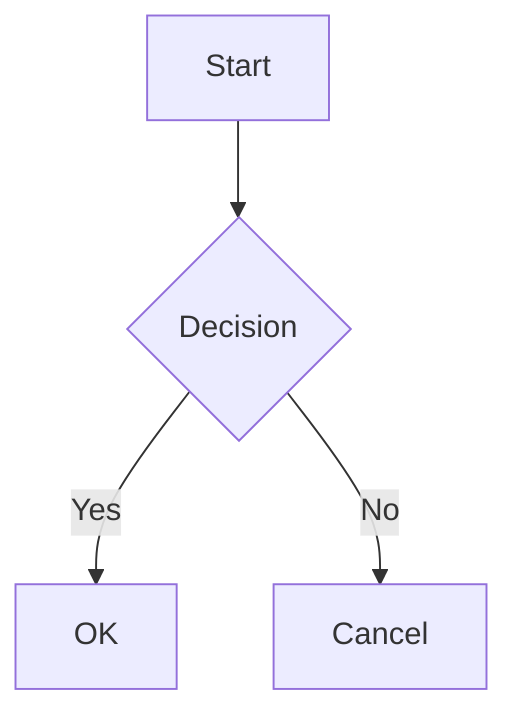

<p align="center">
  <a href="#/">English</a> | <strong>简体中文</strong> | <a href="#/ja/">日本語</a> | <a href="#/es/">Español</a> | <a href="#/pt-br/">Português</a> | <a href="#/ko/">한국어</a> | <a href="#/zh-tw/">繁體中文</a>
</p>

<p align="center">
  
</p>

<h1 align="center">PlantUML Markdown Preview</h1>

<p align="center">
  <strong>PlantUML、Mermaid 和 D2 图表，直接显示在 Markdown 预览中。Fast、Secure 或 Easy — 选择适合你的模式。</strong>
</p>

<p align="center">
  <a href="https://marketplace.visualstudio.com/items?itemName=yss-tazawa.plantuml-markdown-preview"></a>
  <a href="https://marketplace.visualstudio.com/items?itemName=yss-tazawa.plantuml-markdown-preview"></a>
  <a href="https://github.com/yss-tazawa/plantuml-markdown-preview/blob/main/LICENSE"></a>
</p>

<p align="center">
  
</p>

在 Markdown 中以代码编写图表，输入时即可看到渲染结果 — 还能将整篇文档连同图表一起导出为 HTML 或 PDF。

## 选择模式

| | **Fast**（默认） | **Secure** | **Easy** |
| --- | --- | --- | --- |
| | 快速渲染 | 最高隐私保护 | 零配置 |
| | 本地 PlantUML 服务器让图表随输入实时更新 | 无网络、无后台进程 — 一切在本机完成 | 无需 Java — 使用在线 PlantUML 服务器开箱即用 |
| **Java** | 需要 11+ | 需要 11+ | 不需要 |
| **网络** | 无 | 无 | 需要 |
| **隐私** | 仅本地 | 仅本地 | 图表源码发送至 PlantUML 服务器 |
| **配置** | [安装 Java →](#前提条件) | [安装 Java →](#前提条件) | 无需配置 |

随时通过一个设置切换模式 — 无需迁移，无需重启。

详情请参阅[渲染模式](#渲染模式)，配置方法请参阅[快速开始](#快速开始)。

## 亮点

- **图表就在文档中** — PlantUML、Mermaid 和 D2 图表内联显示在 Markdown 预览中，而不是另开一个面板。
- **放心打开** — Markdown 中的脚本永远不会在预览和 HTML/PDF 导出中运行。
- **大小由你掌控** — 可分别设置 PlantUML、Mermaid 和 D2 图表的显示缩放。
- **单文件 HTML 导出** — 文档和图表保存在同一个 HTML 文件中，布局宽度和对齐方式由你选择。
- **一键 PDF 导出** — 通过 Chrome、Edge 或 Chromium 打印，图表会缩放以适合页面。
- **双向滚动同步** — 滚动编辑器或预览，另一侧会随之滚动。
- **轻松导航** — 直接在预览中跳到顶部或末尾，或打开目录侧边栏。
- **图表查看器** — 右键任意图表，即可在单独的面板中平移和缩放，并与你的编辑保持同步。
- **阅读视图（Reading View）** — 在独立的标签页中阅读渲染后的 Markdown、PlantUML、Mermaid 或 D2 文件，并可就地切换回源代码。
- **独立图表预览** — 直接打开 `.puml`、`.plantuml`、`.mmd`、`.mermaid` 和 `.d2` 文件，支持平移缩放和实时更新。
- **Git 版本预览** — 查看 Markdown 文件在 HEAD 或暂存区中的内容，渲染后显示在当前预览旁边，方便直观比较改动过的图表。
- **保存或复制为 PNG / SVG** — 在预览或图表查看器中右键任意图表，即可保存或复制到剪贴板。
- **17 种预览主题** — 跟随 VS Code 颜色主题，或从 9 种浅色和 7 种深色主题中选择，包括 GitHub、Atom、Solarized、Dracula 和 Monokai。
- **编辑器辅助** — 为 PlantUML、Mermaid 和 D2 提供关键字补全、颜色选择器和代码片段。
- **支持 7 种语言** — 界面支持英语、中文（简体和繁体）、西班牙语、巴西葡萄牙语、日语和韩语。
- **数学公式支持** — 编写 `$...$` 行内公式和 `$$...$$` 块级公式，由 [KaTeX](https://katex.org/) 渲染。

## 目录

- [选择模式](#选择模式)
- [亮点](#亮点)
- [功能](#功能)
- [快速开始](#快速开始)
- [使用方法](#使用方法)
  - [阅读视图](#阅读视图)
- [配置](#配置)
- [代码片段](#代码片段)
- [颜色选择器](#颜色选择器)
- [关键字补全](#关键字补全)
- [键盘快捷键](#键盘快捷键)
- [常见问题](#常见问题)
- [贡献](#贡献)
- [第三方许可证](#第三方许可证)
- [许可证](#许可证)

## 功能

### 内联图表预览

```` ```plantuml ````、```` ```mermaid ````、```` ```d2 ```` 代码块与普通 Markdown 内容一起渲染为内联 SVG 图表。

- **实时更新** — 输入时预览随之更新。
- **保存即刷新** — 保存文件会刷新预览。
- **跟随标签页** — 预览随当前活动的编辑器标签页切换。
- **加载指示器** — 可以看到图表是否仍在渲染。
- **清晰的错误信息** — 语法错误内联显示，并附带行号和周围的源码。
- **PlantUML** — 在本机通过 Java 渲染（Fast / Secure 模式），或由 PlantUML 服务器渲染（Easy 模式）；参见[渲染模式](#渲染模式)。
- **Mermaid** — 使用 [mermaid.js](https://mermaid.js.org/) 渲染，无需安装 Java 或其他工具。
- **D2** — 使用内置的 [@terrastruct/d2](https://d2lang.com/)（Wasm）渲染，无需安装其他工具。

### 图表源码高亮

Markdown 中的 ```` ```plantuml ````、```` ```mermaid ````、```` ```d2 ```` 代码块，
以及独立的 `.puml`、`.plantuml`、`.mmd`、`.mermaid`、`.d2` 文件，图表源码都会进行
语法高亮。颜色遵循当前主题。

### 数学公式支持

使用 [KaTeX](https://katex.org/) 渲染数学公式。

- **行内公式** — `$E=mc^2$` 渲染为行内公式。
- **块级公式** — `$$\int_0^\infty e^{-x}\,dx = 1$$` 渲染为居中显示的公式。
- **处处一致** — 公式在预览和 HTML/PDF 导出中的外观相同。
- **随时可关闭** — 如果正文中的 `$` 被当作公式解析，请设置 `enableMath: false`。

### 图表缩放

独立控制 PlantUML、Mermaid 和 D2 的图表显示大小。

- **PlantUML 缩放** — 选择 `auto`（缩小以适应宽度）或 70% 至 120% 的固定百分比（默认 100%）；图表在任何缩放下都保持清晰。
- **Mermaid 缩放** — 选择 `auto`（缩小以适应宽度）或 50% 至 100% 的固定百分比（默认 80%）。
- **D2 缩放** — 选择 `auto`（缩小以适应宽度）或 50% 至 100% 的固定百分比（默认 70%）。

### 渲染模式

控制 PlantUML 图表渲染方式的预设模式：

| | Fast（默认） | Secure | Easy |
| --- | --- | --- | --- |
| **需要 Java** | 是 | 是 | 否 |
| **网络** | 无（仅 localhost） | 无 | 需要 |
| **隐私** | 仅本地 | 仅本地 | 图表源码发送至 PlantUML 服务器 |
| **速度** | 即时（常驻本地服务器） | 较慢（每次渲染都要启动 Java） | 取决于网络 |

- **Fast 模式**（默认）— 在 `localhost` 上持续运行 PlantUML 服务器，编辑时图表即时更新。服务器在你渲染第一个 PlantUML 图表时启动（可以更改，参见[Start Mode](#fast-模式服务器启动模式)），图表不会离开你的机器。
- **Secure 模式** — 每次渲染都在本机运行 Java 和 PlantUML jar，无网络访问，也没有后台服务器。为最高安全性，默认阻止本地图片。
- **Easy 模式** — 将 PlantUML 源码发送至 PlantUML 服务器，无需安装任何东西。默认使用公共服务器（`https://www.plantuml.com/plantuml`）；为保护隐私，可以改为指向你自己的服务器。

打开预览时如果找不到 Java，扩展会提示切换到 Easy 模式。

#### Fast 模式：服务器启动模式

默认情况下，Fast 模式会在 `127.0.0.1` 上自行启动并管理 PlantUML 服务器 — 无需任何配置。`plantumlLocalServerStartMode`（Start Mode）控制何时启动、以及是否启动该服务器：

| 值 | 效果 |
|---|---|
| `"lazy"`（默认） | 在首次渲染图表时启动受管服务器。在你渲染 PlantUML 图表之前，Java 不会运行；仅首次渲染会多花几秒钟。 |
| `"on"` | 扩展一激活就启动受管服务器。首次渲染是即时的，但 Java 从启动起就一直在后台运行。 |
| `"off"` | 从不启动服务器。连接到你自己运行的服务器（例如 `java -jar plantuml.jar -picoweb`），包括局域网内其他机器上的服务器。 |

连接服务器时使用的主机和端口由以下设置控制：

| 设置 | 默认值 | 效果 |
|---|---|---|
| `plantumlLocalServerHost` | `127.0.0.1` | Start Mode 为 `"off"` 时要连接的主机（例如局域网中其他位置的 picoweb 服务器）。`"on"`/`"lazy"` 时会被忽略 — 受管服务器始终绑定到 `127.0.0.1`。 |
| `plantumlLocalServerPort` | `0` | Start Mode 为 `"on"`/`"lazy"` 时：要启动的端口（`0` 表示自动分配空闲端口）。Start Mode 为 `"off"` 时：要连接的端口。 |

需要了解的几点：

- **与已有服务器和平共处** — 使用 `"on"` 或 `"lazy"` 并指定固定端口时，如果该端口上已有正常工作的 PlantUML 服务器，扩展会复用它，而不是再启动一个。
- **`"off"` 无需本地 Java** — 扩展不会启动任何服务器，只会连接到你配置的主机和端口。
- **你的服务器归你管** — 扩展只会停止它自己启动的服务器。
- **仍会读取旧设置** — 如果未设置 Start Mode，则使用旧的 `plantumlLocalServerAutoStart` 设置（`true` → `"on"`，`false` → `"off"`）。

#### Fast 模式：JVM 内存（堆）设置

受管服务器的内存占用由堆预设（`plantumlLocalServerJvmHeapPreset`）限制：

| 预设 | JVM 堆参数 | 适用场景 |
|---|---|---|
| `small` | `-Xms16m -Xmx256m` | 内存占用最低；仅适合小型图表。 |
| `medium`（默认） | `-Xms16m -Xmx512m` | 均衡配置；可轻松处理大多数图表。 |
| `large` | `-Xms64m -Xmx1024m` | 适合非常大的图表；符合 PlantUML FAQ 的推荐配置。 |
| `unlimited` | _（无）_ | 不附加任何参数 — 由 Java 自行决定（最大堆默认值为物理内存的 1/4）。 |
| `custom` | 自定义值 | 读取 `plantumlLocalServerJvmInitialHeapMb`（8–32768，默认 16）和 `plantumlLocalServerJvmMaxHeapMb`（64–32768，默认 512）。 |

除 `unlimited` 外，其余预设都会固定附加 `-XX:+UseSerialGC`、`-XX:MaxMetaspaceSize=128m` 和 `-XX:ReservedCodeCacheSize=64m`，以保持服务器占用较小。这些设置仅适用于扩展自行启动的服务器（Fast 模式，Start Mode 为 `"on"`/`"lazy"`）。

### 状态栏

状态栏显示当前渲染模式（Fast / Secure / Easy），在 Fast 模式下还会显示本地服务器的状态（启动中、运行中、错误、已停止）。

- **一键切换模式** — 点击状态栏项，即可从快速选取中选择模式，无需打开设置。
- **命令面板中也可使用** — **选择渲染模式** 命令的作用相同。

显示 Markdown 预览或阅读视图时，状态栏还会显示预览的缩放级别。点击即可选择其他级别。

### HTML 导出

将 Markdown 文档导出为单个 HTML 文件。

- **包含图表** — PlantUML 和 D2 图表以内联 SVG 嵌入；Mermaid 图表和数学公式字体在打开文件时从 CDN 加载。
- **包含样式** — 语法高亮样式随文件一起保存。
- **导出并打开** — 一条命令即可导出并在浏览器中打开结果。
- **你的布局** — 可选择 640px 至 1440px 的固定宽度（居中或左对齐），或选择 **响应式**：填满浏览器窗口，只缩小会溢出的图表。在设置中设定常用的宽度和对齐方式，也可以每次导出时从菜单中选择。

### PDF 导出

使用你机器上已有的 Chrome、Edge 或 Chromium 将 Markdown 文档导出为 PDF。

- **使用你的浏览器** — 需要系统中安装 Chrome、Edge 或 Chromium。
- **纵向或横向** — 导出时选择方向。
- **统一缩放** — 文本和图表一起缩放（`pdfScale`，默认 0.625）。
- **整洁的页面** — 自动应用打印边距。

### 批量图表导出

将 Markdown 文件中的所有图表导出为单独的 PNG 或 SVG 文件。

- **一次导出所有图表** — 按文档顺序导出所有 PlantUML、Mermaid 和 D2 图表。
- **自定文件夹名称** — 可以选择输出文件夹的名称（默认：`{文件名}_diagrams`）。
- **需要打开预览** — 预览必须处于打开状态，因为图表是在预览中渲染的。

### 导航与目录

- **跳到顶部 / 跳到末尾** — 点击预览右上角的按钮即可一步到位。
- **目录侧边栏** — 点击 TOC 按钮列出所有标题，再点击标题即可跳转。
- **缩放** — `Ctrl`+鼠标滚轮（Mac 为 `Cmd`+鼠标滚轮）可将预览和阅读视图在 50% 至 200% 之间缩放；所有预览和阅读视图共用同一级别，重启后仍会保留。

### 图表查看器

右键预览中的任意 PlantUML/Mermaid/D2 图表，选择**在图表查看器中打开**，打开平移和缩放专用面板。

- **平移和缩放** — 用鼠标滚轮以光标为中心缩放，拖拽即可平移。
- **工具栏** — 适应窗口、1:1 重置和步进缩放（+/-）。
- **实时同步** — 你的编辑会立即反映出来，缩放位置保持不变。
- **匹配的背景** — 背景色跟随当前预览主题。
- **随文件关闭** — 切换到其他源文件时，查看器会关闭。
- **保存或复制为 PNG / SVG** — 在预览或图表查看器中右键图表，即可保存为文件或复制为 PNG。
- **查看器内搜索** — 按 `Cmd+F` / `Ctrl+F` 打开搜索控件。
- **可选** — 设置 `enableDiagramViewer: false` 即可关闭。

### PlantUML `!include` 支持

使用 `!include` 指令在图表间共享公共样式、宏和组件定义。

- **文件的查找位置** — 包含文件从工作区根目录解析，或从 `plantumlIncludePath` 设置的文件夹解析。在 Fast 模式下，仅当扩展运行自己的服务器时才适用；详情请参阅[常见问题](#常见问题)。
- **保存即刷新** — 保存包含文件会刷新预览，也可以随时点击 **重新加载**按钮（↻）强制刷新。
- **跳转到包含文件** — 在 `.puml` 或 Markdown 文件中右键 `!include` 行，即可打开引用的文件。
- **打开包含源文件** — 在预览中右键 PlantUML 图表，即可直接打开其包含的文件。
- **Fast 和 Secure 模式** — Easy 模式无法读取你的本地文件，因此不能使用 `!include`。

### 独立图表预览

直接打开 `.puml`、`.plantuml`、`.mmd`、`.mermaid`、`.d2` 文件 — 无需 Markdown 包装。

- **平移和缩放** — 与图表查看器相同的操作方式。
- **实时更新** — 输入时预览随之更新。
- **跟随标签页** — 在同类型文件之间切换时，预览随之切换。
- **主题** — 可分别选择预览主题和图表主题。
- **保存或复制为 PNG / SVG** — 右键图表即可。
- **预览内搜索** — 按 `Cmd+F` / `Ctrl+F` 打开搜索控件。
- **PlantUML** — 支持全部三种渲染模式（Fast / Secure / Easy）。
- **Mermaid** — 使用 mermaid.js 渲染。
- **D2** — 使用 @terrastruct/d2（Wasm）渲染，主题和布局引擎可以选择。

### Git 版本预览

将 Markdown 文件按 Git 某个版本时的内容渲染到侧边面板，让你并排比较改动过的图表，而不是阅读文本差异。

- **HEAD** — 最后一次提交的版本。
- **暂存** — 当前已暂存待提交的版本。
- **并排显示** — 在当前预览旁边打开，新旧图表可以同时查看。
- **快照** — 只渲染一次，不会跟随后续编辑；顶部的提示栏会说明这一点。
- **需要 Git** — 文件必须在 Git 仓库中被跟踪。

### 双向滚动同步

编辑器与预览在任意一侧滚动时保持同步。

- **位置对应** — 预览会对齐到你正在查看的源码部分。
- **稳定** — 预览重新渲染时，滚动位置保持不变。

### 主题

**预览主题**控制文档整体外观：

**VS Code 主题：**

| 主题 | 风格 |
| --- | --- |
| Follow VS Code Color Theme | 与内置 Markdown 预览一样跟随当前 VS Code 颜色主题。HTML/PDF 导出时按颜色主题使用 VS Code Light 2026 或 Dark 2026 |

**浅色主题：**

| 主题 | 风格 |
| --- | --- |
| GitHub Light | 白色背景（默认） |
| Atom Light | 柔和灰色文字，Atom 编辑器风格 |
| One Light | 米白色，均衡配色 |
| Solarized Light | 暖米色，护眼 |
| Vue | 绿色点缀，Vue.js 文档风格 |
| Pen Paper Coffee | 温暖纸张感，手写风格 |
| Coy | 近白色，简洁设计 |
| VS | 经典 Visual Studio 配色 |
| VS Code Light 2026 | VS Code 颜色主题 Light 2026 下的内置 Markdown 预览 |

**深色主题：**

| 主题 | 风格 |
| --- | --- |
| GitHub Dark | 深色背景 |
| Atom Dark | Tomorrow Night 配色 |
| One Dark | Atom 风格深色 |
| Dracula | 鲜艳深色 |
| Solarized Dark | 深青色，护眼 |
| Monokai | 鲜艳语法，Sublime Text 风格 |
| VS Code Dark 2026 | VS Code 颜色主题 Dark 2026 下的内置 Markdown 预览 |

通过标题栏图标即时切换预览主题 — 图表不会重新绘制。更改 PlantUML 主题时会重新绘制图表。

**PlantUML 主题**独立控制图表样式。扩展从你安装的 PlantUML 中查找可用主题，并将它们与预览主题列在同一个快速选取中。

**Mermaid 主题**控制 Mermaid 图表样式：`default`、`dark`、`forest`、`neutral`、`base`。它们也在同一个快速选取中。

**D2 主题** — 19 种内置主题（如 `Neutral Default`、`Dark Mauve`、`Terminal`），可在设置或同一个快速选取中选择。

### 语法高亮

通过 highlight.js 支持 190+ 种语言。代码块样式与所选预览主题匹配。

### 安全

- **严格的脚本策略** — 预览只运行扩展自身的脚本。
- **不运行文档中的代码** — Markdown 中的 `<script>` 标签和其他代码永远不会在预览和 HTML/PDF 导出中运行。
- **本地图片按模式处理** — 本地图片默认遵循模式设置（`allowLocalImages: "mode-default"`）；Secure 模式为最高安全性会阻止它们。
- **默认不加载明文 HTTP 图片** — 通过未加密的 HTTP 加载图片默认关闭（`allowHttpImages`）；仅在可信网络（如内网或本地开发服务器）中开启。

### 与 VS Code 内置 Markdown 预览集成

PlantUML、Mermaid 和 D2 图表也会显示在 VS Code 内置的 Markdown 预览（`Markdown: 打开侧边预览`）中 — 无需额外配置。如需预览主题、滚动同步和 HTML 导出，请打开本扩展自己的预览（`Cmd+Alt+V` / `Ctrl+Alt+V`）。对于大型 PlantUML 图表，它也是更好的选择，因为这类图表在内置预览中可能导致编辑器短暂卡顿。

### GitHub 风格提示

从块引用标记渲染 GitHub 风格的提示（标注框），与 GitHub 官方输出保持一致。

```markdown
> [!NOTE]
> Highlights information that users should take into account.

> [!TIP]
> Optional information to help a user be more successful.

> [!IMPORTANT]
> Crucial information necessary for users to succeed.

> [!WARNING]
> Critical content demanding immediate user attention.

> [!CAUTION]
> Negative potential consequences of an action.
```

- **五种类型** — `NOTE`、`TIP`、`IMPORTANT`、`WARNING` 和 `CAUTION`，每种都有独立的图标和强调色。
- **与 GitHub 规则相同** — 标记必须独占一行（大小写均可，`[!note]` 同样有效）；只有文档顶层的块引用才会变成提示。`> [!NOTE] My title`，以及列表项或其他块引用中的标记，仍为普通块引用。
- **适配主题** — 颜色随当前预览主题（浅色或深色）变化。
- **处处一致** — 提示在预览和 HTML/PDF 导出中的外观相同。

### 脚注和任务列表

渲染以 GitHub 语法书写的脚注和任务列表，与 GitHub 官方输出保持一致。

```markdown
A sentence with a footnote.[^1]

[^1]: The footnote text.

- [x] Finished task
- [ ] Open task
```

- **脚注** — `[^1]` 引用链接到文档末尾的脚注，脚注也可链接回引用处。
- **任务列表** — `- [ ]` 和 `- [x]` 项会显示复选框。复选框仅显示状态，点击不会更改文档。
- **处处一致** — 脚注和任务列表在预览和 HTML/PDF 导出中的外观相同。

## 快速开始

### 前提条件

**Mermaid** — 无前提条件，开箱即用。

**D2** — 无前提条件。使用内置 [D2](https://d2lang.com/) Wasm — 开箱即用。

**PlantUML（Easy 模式）** — 无前提条件。图表源码发送至 PlantUML 服务器渲染。

**PlantUML（Fast/Secure 模式）** — 默认：

| 工具 | 用途 | 验证 |
| --- | --- | --- |
| [Java 11+（JRE 或 JDK）](#设置) | 运行 PlantUML（内置 PlantUML 1.2026.10 需要 Java 11+） | `java -version` |
| [Graphviz](https://graphviz.org/) | 可选 — 类图、组件图等布局相关图表需要（参见[图表支持](#图表支持)） | `dot -V` |

PlantUML 已内置（LGPL，v1.2026.10）— 无需下载。唯一的要求是 Java 11 或更高版本；Graphviz 是可选的。
还没有 Java？打开预览时，扩展会提示切换到 Easy 模式。

### 图表支持

可用图表取决于你的配置：

| 图表 | LGPL（内置） | Win: GPLv2 jar | Mac/Linux: + Graphviz |
| --- | :-: | :-: | :-: |
| 序列图 | ✓ | ✓ | ✓ |
| 活动图（新语法） | ✓ | ✓ | ✓ |
| 思维导图 | ✓ | ✓ | ✓ |
| WBS | ✓ | ✓ | ✓ |
| 甘特图 | ✓ | ✓ | ✓ |
| JSON / YAML | ✓ | ✓ | ✓ |
| Salt / 线框图 | ✓ | ✓ | ✓ |
| 时序图 | ✓ | ✓ | ✓ |
| 网络图（nwdiag） | ✓ | ✓ | ✓ |
| 类图 | — | ✓ | ✓ |
| 用例图 | — | ✓ | ✓ |
| 对象图 | — | ✓ | ✓ |
| 组件图 | — | ✓ | ✓ |
| 部署图 | — | ✓ | ✓ |
| 状态图 | — | ✓ | ✓ |
| ER 图 | — | ✓ | ✓ |
| 活动图（旧语法） | — | ✓ | ✓ |
| DOT（@startdot） | — | ✓ | ✓ |

- **LGPL（内置）** — 开箱即用，无需 Graphviz。
- **Win: GPLv2 jar** — [GPLv2 版本](https://plantuml.com/download)内置 Graphviz（仅 Windows，自动解压）。设置 [`plantumlJarPath`](#配置) 即可使用。DOT（`@startdot`）需要 PlantUML 1.2026.9 或更高版本。
- **Mac/Linux: + Graphviz** — 单独安装 [Graphviz](https://graphviz.org/)。LGPL 或 GPLv2 jar 均可使用。

### 安装

1. 打开 VS Code
2. 在扩展视图（`Ctrl+Shift+X` / `Cmd+Shift+X`）中搜索 **PlantUML Markdown Preview**
3. 点击**安装**

### 设置

**Fast 模式**（默认）— 无需任何设置。本地 PlantUML 服务器在你渲染第一个图表时启动，并让更新保持即时。需要 Java 11+。

**使用 Secure 模式** — 将 `mode` 设为 `"secure"`。每次渲染都运行 Java 11+，没有后台服务器，也不访问网络。

**使用 Easy 模式**（无需配置）— 将 `mode` 设为 `"easy"`。图表源码发送至 PlantUML 服务器渲染。

**Fast 和 Secure 模式** — 内置 LGPL jar 无需额外配置即可支持序列图、活动图、思维导图等（参见[图表支持](#图表支持)）。要启用类图、组件图、用例图等布局相关图表，请按以下平台步骤操作。

#### Windows

1. 如未安装 Java，请安装（打开 PowerShell 运行）：

   ```powershell
   winget install Microsoft.OpenJDK.21
   ```

2. 如 `java` 不在 PATH 中，在 PowerShell 中查找完整路径：

   ```powershell
   Get-Command java
   # 例：C:\Program Files\Microsoft\jdk-21.0.6.7-hotspot\bin\java.exe
   ```

   打开 VS Code 设置（`Ctrl+,`），搜索 `plantumlMarkdownPreview.javaPath`，输入上述路径

3. 将 [GPLv2 版 PlantUML](https://plantuml.com/download)（`plantuml-gplv2-*.jar`）下载到任意文件夹（内置 Graphviz — 无需单独安装）
4. 打开 VS Code 设置（`Ctrl+,`），搜索 `plantumlMarkdownPreview.plantumlJarPath`，输入下载的 `.jar` 完整路径（如 `C:\tools\plantuml-gplv2-1.2026.10.jar`）

#### Mac

1. 通过 Homebrew 安装 Java 和 Graphviz：

   ```sh
   brew install openjdk graphviz
   ```

2. 如 `dot` 不在 PATH 中，查找完整路径并在 VS Code 中设置：

   ```sh
   which dot
   # 例：/opt/homebrew/bin/dot
   ```

   打开 VS Code 设置（`Cmd+,`），搜索 `plantumlMarkdownPreview.dotPath`，输入上述路径

#### Linux

1. 安装 Java 和 Graphviz：

   ```sh
   # Debian / Ubuntu
   sudo apt install default-jdk graphviz

   # Fedora
   sudo dnf install java-21-openjdk graphviz
   ```

2. 如 `dot` 不在 PATH 中，查找完整路径并在 VS Code 中设置：

   ```sh
   which dot
   # 例：/usr/bin/dot
   ```

   打开 VS Code 设置（`Ctrl+,`），搜索 `plantumlMarkdownPreview.dotPath`，输入上述路径

这些路径很少需要设置。默认情况下，扩展会先在 `JAVA_HOME/bin/`（Windows 上为 `JAVA_HOME\bin\`）下查找 Java，再在 PATH 中查找；在 PATH 中查找 `dot`；并使用内置的 PlantUML jar。仅当某个命令不在 PATH 中，或想使用其他 jar 时，才需要设置 `javaPath`、`dotPath` 或 `plantumlJarPath`。

## 使用方法

### 打开预览

- **键盘快捷键** — 按 `Cmd+Alt+V`（Mac）/ `Ctrl+Alt+V`（Windows / Linux）。
- **编辑器标题栏** — 点击编辑器右上角的预览按钮（圆角方框中的“P”）。
- **VS Code 标准按钮和快捷键** — `useAsDefaultPreview` 开启（默认）时，VS Code 的 **打开侧边预览** 按钮、右键菜单中的 **打开预览** 以及 `Cmd+K V`（Mac）/ `Ctrl+K V`（Windows / Linux）会打开本扩展的预览；`Cmd+Shift+V` / `Ctrl+Shift+V` 则切换到[阅读视图](#阅读视图)。
- **右键菜单** — 在资源管理器或编辑器中右键 Markdown 文件 → **PlantUML Markdown Preview** → **在侧边打开预览**。
- **命令面板** — 运行 `PlantUML Markdown Preview: 在侧边打开预览`。

预览有自己的主题，默认为白色背景（GitHub Light）。如果想与当前 VS Code 颜色主题一致，请选择 `follow-vscode`。

### 阅读视图

阅读视图（Reading View）在文件自己的标签页中显示渲染后的内容，代替文本编辑器，不会再打开第二个面板。它固定在该文件上，不会跟随当前活动的编辑器，并且可以与预览同时打开。

适用于 Markdown 文件（`.md`、`.markdown` 以及 VS Code 的 Markdown 预览涵盖的其他扩展名）以及 `.puml` / `.plantuml`、`.mmd` / `.mermaid` 和 `.d2` 文件。在你使用之前，不会有任何变化。

- **就地切换** — 在编辑器中右键 → **PlantUML Markdown Preview** → **切换到阅读视图**（PlantUML、Mermaid 和 D2 文件中，**切换到阅读视图** 直接显示在菜单中）。要返回，在阅读视图中右键 → **切换到源代码**，或点击编辑器标题栏中的 **切换到源代码**。切换的是标签页本身，不会打开新标签页。
- **打开一次** — 在资源管理器中右键文件 → **打开方式...** → **PlantUML Markdown Preview（阅读视图）**。对于已经打开的文件，改为右键点击其标签页，使用 **重新打开编辑器的方式...**。
- **默认打开** — 在 **打开方式...** 列表中，选择 **为 "\*.md" 配置默认编辑器...** → **PlantUML Markdown Preview（阅读视图）**。此后，点击 `.md` 文件就会以阅读视图打开。每种文件扩展名需要设置一次。
- **撤销** — 以同样的方式选择 **文本编辑器**，或从设置中删除该行。

直接在 `settings.json` 中设置：

```json
"workbench.editorAssociations": {
  "*.md": "plantumlMarkdownPreviewEditor",
  "*.puml": "plantumlPumlPreviewEditor",
  "*.mmd": "plantumlMermaidPreviewEditor",
  "*.d2": "plantumlD2PreviewEditor"
}
```

| 文件 | 值 |
| ---- | -- |
| Markdown（`*.md`、`*.markdown` 等） | `plantumlMarkdownPreviewEditor` |
| `*.puml`、`*.plantuml` | `plantumlPumlPreviewEditor` |
| `*.mmd`、`*.mermaid` | `plantumlMermaidPreviewEditor` |
| `*.d2` | `plantumlD2PreviewEditor` |

- **较旧的 VS Code** — 在 VS Code 1.100 之前，不会显示 **切换到阅读视图** 和 **切换到源代码**，请改用 **打开方式...** 打开阅读视图。
- **Git 差异** — 即使文件已设置为以阅读视图打开，差异仍以文本差异打开。
- **标准按钮** — `useAsDefaultPreview` 开启（默认）时，VS Code 的 **以预览方式打开** 按钮（VS Code 1.119 及以上）和 `Ctrl+Shift+V`（VS Code 1.100 及以上）会切换到阅读视图；详见[配置](#配置)。

### 打开图表预览

直接在平移缩放预览中打开 `.puml`/`.plantuml`、`.mmd`/`.mermaid`、`.d2` 文件 — 无需 Markdown 包装。

- **键盘快捷键** — 同样的 `Cmd+Alt+V`（Mac）/ `Ctrl+Alt+V`（Windows / Linux）会根据文件类型打开对应的预览。
- **编辑器标题栏** — 点击编辑器右上角的预览按钮（圆角方框中的“P”）。
- **标准预览快捷键** — `useAsDefaultPreview` 开启（默认）时，`Cmd+K V`（Mac）/ `Ctrl+K V`（Windows / Linux）也会在编辑器旁打开预览；`Cmd+Shift+V` / `Ctrl+Shift+V` 则切换到[阅读视图](#阅读视图)。
- **右键菜单** — 在资源管理器或编辑器中右键 `.puml` / `.plantuml`、`.mmd` / `.mermaid` 或 `.d2` 文件 → **预览 PlantUML 文件** / **预览 Mermaid 文件** / **预览 D2 文件**。
- **命令面板** — 运行 `PlantUML Markdown Preview: 预览 PlantUML 文件`、`预览 Mermaid 文件` 或 `预览 D2 文件`。

### 打开 Git 版本预览

在当前版本预览的旁边，渲染并显示 Markdown 文件在某个 Git 版本时的内容。

- **右键菜单** — 在资源管理器或编辑器中右键 Markdown 文件 → **PlantUML Markdown Preview** → **在侧边打开 HEAD 版本预览** / **在侧边打开暂存版本预览**。
- **命令面板** — 运行 `PlantUML Markdown Preview: 在侧边打开 HEAD 版本预览` / `在侧边打开暂存版本预览`。

先打开普通预览，再打开版本预览，两个面板会并排显示。版本面板是固定快照，编辑时不会更新。

### 导出为 HTML

- **右键菜单** — 右键 Markdown 文件 → **PlantUML Markdown Preview** → **导出为 HTML** → 选择宽度选项。
- **预览** — 在预览内右键 → **导出为 HTML** 或 **导出为 HTML 并打开**。

子菜单提供以下宽度选项：

| 选项 | 说明 |
| ---- | ---- |
| 当前设置 | 使用当前配置导出（无响应式 CSS） |
| 640px – 1440px | 固定像素宽度，居中 |
| 响应式 (左对齐) | 正文宽度等于视口，靠左对齐；溢出的图表才会缩小 |
| 640px – 1440px (左对齐) | 固定宽度，靠左对齐 |

HTML 文件保存在源 Markdown 文件旁边。

### 导出为 PDF

- **右键菜单** — 右键 Markdown 文件 → **PlantUML Markdown Preview** → **导出为 PDF** → **纵向** 或 **横向**。
- **预览** — 在预览内右键 → **导出为 PDF** 或 **导出为 PDF 并打开** → **纵向** 或 **横向**。

PDF 文件保存在源 Markdown 文件旁边。需要 Chrome、Edge 或 Chromium。
`pdfScale` 设置（默认 0.625）控制文本和图表的整体缩放。

### 将图表保存/复制为 PNG/SVG

- **预览** — 右键图表 → **将图表复制为 PNG**、**将图表保存为 PNG** 或 **将图表保存为 SVG**。
- **图表查看器** — 在查看器内右键 → **将图表复制为 PNG**、**将图表保存为 PNG** 或 **将图表保存为 SVG**。
- **独立图表预览** — 在预览内右键 → **将图表复制为 PNG**、**将图表保存为 PNG** 或 **将图表保存为 SVG**。

### 导出所有图表

- **右键菜单** — 右键 Markdown 文件 → **PlantUML Markdown Preview** → **将所有图表导出为 PNG** 或 **将所有图表导出为 SVG**。
- **预览** — 在预览内右键 → **将所有图表导出为 PNG** 或 **将所有图表导出为 SVG**。
- **命令面板** — 运行 `PlantUML Markdown Preview: 将所有图表导出为 PNG` / `将所有图表导出为 SVG`。

在保存对话框中可以为输出文件夹命名（默认：`{文件名}_diagrams`）。图表按文档顺序保存为 `diagram-1.png`、`diagram-2.png` 等。导出期间请保持预览打开。

### 导航

- **跳到顶部 / 跳到末尾** — 使用预览右上角的按钮。
- **重新加载** — 点击 ↻ 按钮刷新预览并清除其缓存。
- **目录** — 点击预览右上角的 TOC 按钮列出所有标题，再点击标题即可跳转。
- **缩放** — 在预览上按住 `Ctrl`（Mac 为 `Cmd`）并滚动鼠标滚轮，或点击状态栏中的缩放级别并选择级别；HTML 和 PDF 导出不受影响。

### 更改主题

点击预览标题栏中的主题图标，或使用命令面板：

- **命令面板** — 运行 `PlantUML Markdown Preview: 更改预览主题`。

快速选取在一个列表中显示全部四类主题 — 预览主题、PlantUML 主题、Mermaid 主题和 D2 主题 — 因此可以在同一个地方切换其中任何一种。

### PlantUML 语法

````markdown
```plantuml
Alice -> Bob: Hello
Bob --> Alice: Hi!
```
````

省略 `@startuml` / `@enduml` 时自动添加。

### Mermaid 语法

````markdown

````

### D2 语法

````markdown
```d2
server -> db: query
db -> server: result
```
````

语法详情请参阅 [D2 文档](https://d2lang.com/)。

### 数学语法

行内公式使用单个美元符号，块级公式使用双美元符号：

````markdown
爱因斯坦的著名公式 $E=mc^2$ 展示了质能等价。

$$\int_0^\infty e^{-x}\,dx = 1$$
````

要写 `$100` 这样的价格？设置 `enableMath: false`，`$` 就会保持为普通文本。

## 代码片段

输入代码片段前缀并按 `Tab` 展开。提供两种代码片段：

- **Markdown 代码片段**（围栏块外）— 以 `plantuml`、`mermaid` 或 `d2` 开头的前缀会展开为完整的围栏块。
- **模板代码片段**（围栏块内）— 以 `tmpl-` 开头的前缀只展开图表主体；输入 `tmpl` 即可查看全部。

### Markdown 代码片段（围栏块外）

展开为包含围栏的完整 `` ```plantuml ... ``` `` 块：

| 前缀 | 图表 |
| --- | --- |
| `plantuml` | 空 PlantUML 块 |
| `plantuml-sequence` | 序列图 |
| `plantuml-class` | 类图 |
| `plantuml-activity` | 活动图 |
| `plantuml-usecase` | 用例图 |
| `plantuml-component` | 组件图 |
| `plantuml-state` | 状态图 |
| `plantuml-er` | ER 图 |
| `plantuml-object` | 对象图 |
| `plantuml-deployment` | 部署图 |
| `plantuml-mindmap` | 思维导图 |
| `plantuml-gantt` | 甘特图 |

### PlantUML 代码片段（围栏块内）

图表模板（输入 `tmpl` 查看全部）：

| 前缀 | 内容 |
| --- | --- |
| `tmpl-seq` | 序列图 |
| `tmpl-cls` | 类定义 |
| `tmpl-act` | 活动图 |
| `tmpl-uc` | 用例图 |
| `tmpl-comp` | 组件图 |
| `tmpl-state` | 状态图 |
| `tmpl-er` | 实体定义 |
| `tmpl-obj` | 对象图 |
| `tmpl-deploy` | 部署图 |
| `tmpl-mind` | 思维导图 |
| `tmpl-gantt` | 甘特图 |

短代码片段：

| 前缀 | 内容 |
| --- | --- |
| `part` | participant 声明 |
| `actor` | actor 声明 |
| `note` | 备注块 |
| `intf` | interface 定义 |
| `pkg` | package 定义 |

### Mermaid Markdown 代码片段

展开为包含围栏的完整 `` ```mermaid ... ``` `` 块：

| 前缀 | 图表 |
| --- | --- |
| `mermaid` | 空 Mermaid 块 |
| `mermaid-flow` | 流程图 |
| `mermaid-sequence` | 序列图 |
| `mermaid-class` | 类图 |
| `mermaid-state` | 状态图 |
| `mermaid-er` | ER 图 |
| `mermaid-gantt` | 甘特图 |
| `mermaid-pie` | 饼图 |
| `mermaid-mindmap` | 思维导图 |
| `mermaid-timeline` | 时间线 |
| `mermaid-git` | Git 图 |

### Mermaid 代码片段（围栏块内）

图表模板（输入 `tmpl` 查看全部）：

| 前缀 | 内容 |
| --- | --- |
| `tmpl-flow` | 流程图 |
| `tmpl-seq` | 序列图 |
| `tmpl-cls` | 类图 |
| `tmpl-state` | 状态图 |
| `tmpl-er` | ER 图 |
| `tmpl-gantt` | 甘特图 |
| `tmpl-pie` | 饼图 |
| `tmpl-mind` | 思维导图 |
| `tmpl-timeline` | 时间线 |
| `tmpl-git` | Git 图 |

### D2 Markdown 代码片段

展开为包含围栏的完整 `` ```d2 ... ``` `` 块：

| 前缀 | 图表 |
| --- | --- |
| `d2` | 空 D2 块 |
| `d2-basic` | 基本连接 |
| `d2-sequence` | 序列图 |
| `d2-class` | 类图 |
| `d2-comp` | 组件图 |
| `d2-grid` | 网格布局 |
| `d2-er` | ER 图 |
| `d2-flow` | 流程图 |
| `d2-icon` | 图标节点 |
| `d2-markdown` | Markdown 文本节点 |
| `d2-tooltip` | 工具提示和链接 |
| `d2-style` | 自定义样式 |

### D2 代码片段（围栏块内）

图表模板（输入 `tmpl` 查看全部）：

| 前缀 | 内容 |
| --- | --- |
| `tmpl-seq` | 序列图 |
| `tmpl-cls` | 类图 |
| `tmpl-comp` | 组件图 |
| `tmpl-er` | ER 图 |
| `tmpl-flow` | 流程图 |
| `tmpl-grid` | 网格布局 |

短代码片段：

| 前缀 | 内容 |
| --- | --- |
| `conn` | 连接 |
| `icon` | 图标节点 |
| `md` | Markdown 节点 |
| `tooltip` | 工具提示和链接 |
| `style` | 自定义样式 |
| `direction` | 布局方向 |

## 颜色选择器

PlantUML、Mermaid 和 D2 的颜色色板和内联颜色选择器。适用于独立文件（`.puml`、`.mmd`、`.d2`）和 Markdown 围栏块。

- **6 位十六进制** — 例如 `#FF0000` 和 `#1565C0`。
- **3 位十六进制** — 例如 `#F00` 和 `#ABC`。
- **颜色名称**（仅 PlantUML）— 20 种颜色，例如 `#Red`、`#LightBlue` 和 `#Salmon`。
- **选择即替换** — 选择新颜色后，会以 `#RRGGBB` 格式写回。
- **跳过注释** — 注释行会被忽略（PlantUML 用 `'`、Mermaid 用 `%%`、D2 用 `#`）。

## 关键字补全

PlantUML、Mermaid 和 D2 的上下文感知关键字建议。适用于独立文件和 Markdown 围栏块。

### PlantUML

- **行首关键字** — 例如 `@startuml`、`participant`、`class`、`skinparam` 和 `!include`。
- **`skinparam` 参数** — 输入 `skinparam` 和一个空格，即可获得 `backgroundColor`、`defaultFontName`、`arrowColor` 等建议。
- **颜色名称** — 输入 `#` 即可获得颜色建议，例如 `Red`、`Blue` 和 `LightGreen`。
- **触发字符** — `@`、`!` 和 `#`。

### Mermaid

- **图表类型声明** — 在第一行提供 `flowchart`、`sequenceDiagram`、`classDiagram`、`gantt` 等建议。
- **图表特定关键字** — 建议随声明的图表类型变化（例如流程图的 `subgraph`、序列图的 `participant`）。
- **方向值** — 输入 `direction` 和一个空格，即可获得 `TB`、`LR` 等。

### D2

- **形状类型** — 输入 `shape:` 即可获得建议，例如 `rectangle`、`cylinder` 和 `person`。
- **样式属性** — 输入 `style.` 即可获得 `fill`、`stroke`、`font-size` 等。
- **方向值** — 输入 `direction:` 即可获得 `right`、`down`、`left` 和 `up`。
- **约束值** — 输入 `constraint:` 即可获得 `primary_key`、`foreign_key` 和 `unique`。
- **触发字符** — `:` 和 `.`。

## 配置

所有设置使用 `plantumlMarkdownPreview.` 前缀。

| 设置 | 默认值 | 描述 |
| --- | --- | --- |
| `mode` | `"fast"` | 渲染模式。`"fast"`（默认）— 本地服务器，即时更新。`"secure"` — 无网络，最高安全性。`"easy"` — 无需配置（图表源码发送至 PlantUML 服务器）。 |
| `javaPath` | `"java"` | Java 可执行文件路径。设置后直接使用；否则回退到 `JAVA_HOME/bin/java`，再到 PATH 中的 `java`。（Fast 和 Secure 模式） |
| `plantumlJarPath` | `""` | `plantuml.jar` 路径。留空使用内置 jar（LGPL）。（Fast 和 Secure 模式） |
| `dotPath` | `"dot"` | Graphviz `dot` 可执行文件路径（Fast 和 Secure 模式） |
| `plantumlIncludePath` | `""` | PlantUML `!include` 指令的基础目录。此目录之外的文件，一般无法通过绝对路径读取。留空使用工作区根目录。Easy 模式不可用。 |
| `allowLocalImages` | `"mode-default"` | 在预览中解析相对图片路径（例如 ``）。`"mode-default"` 使用模式预设（Fast: 开，Secure: 关，Easy: 开）。设为 `"on"` / `"off"` 可覆盖。 |
| `allowHttpImages` | `false` | 允许在预览中通过 HTTP（未加密）加载图片。适用于内网或本地开发服务器。 |
| `previewTheme` | `"github-light"` | 预览主题（参见[主题](#主题)） |
| `previewZoom` | `100` | Markdown 预览和阅读视图的缩放（%），所有预览共用。50 到 200，以 5 为步长。也可以通过 `Ctrl`+鼠标滚轮（Mac 为 `Cmd`+鼠标滚轮）或状态栏更改。不影响 HTML 或 PDF 导出。 |
| `plantumlTheme` | `"default"` | PlantUML 图表主题。`"default"` 不应用任何主题。其他值（例如 `"cyborg"`、`"mars"`）会作为 `-theme` 传给 PlantUML CLI，在 Easy 模式下则以 `!theme` 指令注入。 |
| `mermaidTheme` | `"default"` | Mermaid 图表主题：`"default"`、`"dark"`、`"forest"`、`"neutral"` 或 `"base"`。 |
| `plantumlScale` | `"100%"` | PlantUML 图表缩放。`"auto"` 只缩小比预览宽的图表。百分比（70%–120%）按原始大小的指定比例渲染。 |
| `mermaidScale` | `"80%"` | Mermaid 图表缩放。`"auto"` 只缩小比预览宽的图表。百分比（50%–100%）按原始大小的指定比例渲染。 |
| `d2Theme` | `"Neutral Default"` | D2 图表主题。提供 19 种内置主题（例如 `"Neutral Default"`、`"Dark Mauve"`、`"Terminal"`）。 |
| `d2Layout` | `"dagre"` | 图表未自行指定（`d2-config` 中的 `layout-engine`）时使用的 D2 布局引擎：`"dagre"`（默认，快速）或 `"elk"`（更适合节点众多的复杂图）。 |
| `d2Scale` | `"70%"` | D2 图表缩放。`"auto"` 只缩小比预览宽的图表。百分比（50%–100%）按原始大小的指定比例渲染。 |
| `htmlMaxWidth` | `"960px"` | 导出 HTML 正文的最大宽度。可选：`"640px"` – `"1440px"`，或 `"none"` 表示不限制。 |
| `htmlAlignment` | `"center"` | HTML 正文的对齐方式。`"center"`（默认）或 `"left"`。 |
| `pdfScale` | `0.625` | PDF 导出缩放比例。均匀缩放文本和图表。范围: 0.1–2.0。 |
| `enableMath` | `true` | 启用 KaTeX 数学渲染。支持 `$...$`（行内）和 `$$...$$`（块级）。 |
| `debounceNoDiagramChangeMs` | _(空)_ | 没有图表变化时，停止输入后预览等待多久（毫秒）再更新。留空使用模式默认值（Fast: 100, Secure: 100, Easy: 100）。 |
| `debounceDiagramChangeMs` | _(空)_ | 停止输入后预览等待多久（毫秒）再重新绘制有变化的图表。留空使用模式默认值（Fast: 100, Secure: 300, Easy: 300）。 |
| `plantumlLocalServerStartMode` | `"lazy"` | 本地 PlantUML 服务器的启动时机（仅 Fast 模式）：`"on"`（激活时）、`"lazy"`（首次渲染图表时）、`"off"`（从不启动 — 连接到已有服务器）。参见[Start Mode](#fast-模式服务器启动模式)。 |
| `plantumlLocalServerHost` | `"127.0.0.1"` | Start Mode 为 `"off"` 时要连接的主机（仅 Fast 模式）。`"on"`/`"lazy"` 时会被忽略。 |
| `plantumlLocalServerPort` | `0` | 本地 PlantUML 服务器端口（仅 Fast 模式）。`0` = 自动分配空闲端口。Start Mode 为 `"off"` 时，为要连接的端口。 |
| `plantumlLocalServerJvmHeapPreset` | `"medium"` | 受管本地服务器的 JVM 堆预设：`"small"`、`"medium"`、`"large"`、`"unlimited"` 或 `"custom"`。参见[JVM 内存设置](#fast-模式jvm-内存堆设置)。 |
| `plantumlLocalServerJvmInitialHeapMb` | `16` | `"custom"` 预设的初始堆大小（`-Xms`，MB）。其他预设下会被忽略。范围: 8–32768。 |
| `plantumlLocalServerJvmMaxHeapMb` | `512` | `"custom"` 预设的最大堆大小（`-Xmx`，MB）。其他预设下会被忽略。范围: 64–32768。 |
| `plantumlServerUrl` | `"https://www.plantuml.com/plantuml"` | Easy 模式的 PlantUML 服务器 URL。为保护隐私，可设为自托管服务器的 URL。 |
| `enableDiagramViewer` | `true` | 右键图表时，在菜单中显示“在图表查看器中打开”。需要重新打开预览才会生效。 |
| `retainPreviewContext` | `true` | 标签页隐藏时保留预览内容。防止切换标签页时重新渲染，但会占用更多内存。要应用更改，请关闭并重新打开预览。对于阅读视图，请重新启动 VS Code 或重新加载窗口。 |
| `useAsDefaultPreview` | `true` | 使用本扩展代替 VS Code 内置的 Markdown 预览：VS Code 标准的预览按钮、右键菜单项和快捷键会改为打开本扩展。`Ctrl+K V`（Mac 为 `Cmd`）在编辑器旁打开预览；`Ctrl+Shift+V` 在同一标签页中切换源代码和[阅读视图](#阅读视图)，PlantUML、Mermaid 和 D2 文件也一样。在 VS Code 1.119 之前只替换快捷键，在 1.100 之前两者都会在编辑器旁打开预览。如果同时安装了 Markdown Preview Enhanced，本扩展的快捷键生效。如果想保留 VS Code 自带的预览按钮和快捷键，或想使用 Markdown Preview Enhanced 的快捷键，请将其关闭。 |

`allowLocalImages` 和 `allowHttpImages` 仅适用于预览；HTML 导出始终保留原始图片路径。

<details>
<summary><strong>预览主题选项</strong></summary>

| 值 | 描述 |
| --- | --- |
| `follow-vscode` | Follow VS Code Color Theme — 跟随当前 VS Code 颜色主题（导出时按颜色主题使用 Light 2026 / Dark 2026） |
| `github-light` | GitHub Light — 白色背景（默认） |
| `atom-light` | Atom Light — 柔和灰色文字，Atom 风格 |
| `one-light` | One Light — 淡白色，均衡色调 |
| `solarized-light` | Solarized Light — 暖米色，护眼 |
| `vue` | Vue — 绿色点缀，Vue.js 文档风格 |
| `pen-paper-coffee` | Pen Paper Coffee — 暖纸色，手写风格 |
| `coy` | Coy — 近白色，简洁设计 |
| `vs` | VS — 经典 Visual Studio 配色 |
| `vscode-light-2026` | VS Code Light 2026 — 内置 Markdown 预览配色，行内代码清晰 |
| `github-dark` | GitHub Dark — 深色背景 |
| `atom-dark` | Atom Dark — Tomorrow Night 色调 |
| `one-dark` | One Dark — Atom 风格深色 |
| `dracula` | Dracula — 鲜艳深色 |
| `solarized-dark` | Solarized Dark — 深青色，护眼 |
| `monokai` | Monokai — 鲜明语法，Sublime Text 风格 |
| `vscode-dark-2026` | VS Code Dark 2026 — 内置 Markdown 预览配色，行内代码清晰 |

</details>

## 键盘快捷键

| 命令 | Mac | Windows / Linux |
| --- | --- | --- |
| 在侧边打开预览（Markdown） | `Cmd+Alt+V` | `Ctrl+Alt+V` |
| 预览 PlantUML 文件 | `Cmd+Alt+V` | `Ctrl+Alt+V` |
| 预览 Mermaid 文件 | `Cmd+Alt+V` | `Ctrl+Alt+V` |
| 预览 D2 文件 | `Cmd+Alt+V` | `Ctrl+Alt+V` |
| 打开侧边预览（`useAsDefaultPreview` 开启（默认）时；Markdown、PlantUML、Mermaid、D2） | `Cmd+K V` | `Ctrl+K V` |
| 切换到阅读视图（`useAsDefaultPreview` 开启（默认）时；Markdown、PlantUML、Mermaid、D2） | `Cmd+Shift+V` | `Ctrl+Shift+V` |
| 切换到源代码（在阅读视图中，与 `useAsDefaultPreview` 无关） | `Cmd+Shift+V` | `Ctrl+Shift+V` |
| 选择渲染模式 | — | — |

## 常见问题

<details>
<summary><strong>PlantUML 图表无法渲染</strong></summary>

**Fast/Secure 模式：**

1. 运行 `java -version` 确认已安装 Java 11 或更高版本
2. 如使用类图、组件图等，运行 `dot -V` 确认已安装 Graphviz（参见[图表支持](#图表支持)）
3. 如设置了自定义 `plantumlJarPath`，确认路径指向有效的 `plantuml.jar` 文件。路径不存在时会发出警告并回退到内置 jar。`plantumlJarPath` 为空（默认）时自动使用内置 LGPL jar
4. 检查 VS Code 输出面板中的错误信息

**Easy 模式：**

1. 确认服务器 URL 正确（默认：`https://www.plantuml.com/plantuml`）
2. 检查网络连接 — 需要能访问 PlantUML 服务器
3. 如使用自托管服务器，确认服务器正在运行且可访问
4. 服务器请求超时时间为 15 秒（Fast 和 Secure 模式每个图表也有 15 秒超时）

</details>

<details>
<summary><strong>D2 图表无法渲染</strong></summary>

D2 使用内置 Wasm 模块渲染 — 无需外部 CLI。

1. 重新加载 VS Code 窗口（`Developer: Reload Window`）
2. 检查 VS Code 输出面板中的错误信息
3. 确认 D2 源代码语法正确

</details>

<details>
<summary><strong>可以不安装 Java 使用 PlantUML 吗？</strong></summary>

可以。在扩展设置中将 `mode` 设为 `"easy"`。Easy 模式将 PlantUML 文本发送至 PlantUML 服务器渲染，无需 Java。默认使用公共服务器 `https://www.plantuml.com/plantuml`。为保护隐私，可运行自己的 PlantUML 服务器并设置 `plantumlServerUrl`。

</details>

<details>
<summary><strong>Secure 模式在多图表时很慢。如何加速？</strong></summary>

切换到 **Fast 模式**（`mode: "fast"`）。它会在 localhost 上持续运行 PlantUML 服务器，因此不必每次编辑都启动 Java，更新即时完成。

</details>

<details>
<summary><strong>Easy 模式下图表数据安全吗？</strong></summary>

Easy 模式下，PlantUML 源文本会发送至配置的服务器。默认的公共服务器（`https://www.plantuml.com/plantuml`）由 PlantUML 项目运营。如图表包含敏感信息，建议运行[自托管 PlantUML 服务器](https://plantuml.com/server)并设置 `plantumlServerUrl`，或使用图表不会离开本机的 Fast 或 Secure 模式。

</details>

<details>
<summary><strong>深色主题下图表显示异常</strong></summary>

设置与预览主题匹配的图表主题。从标题栏图标打开主题快速选取，选择深色 PlantUML 主题（如 `cyborg`、`mars`）或将 Mermaid 主题设为 `dark`。

</details>

<details>
<summary><strong><code>!include</code> 不起作用</strong></summary>

`!include` 需要 Fast 或 Secure 模式 — Easy 模式不可用，因为远程服务器无法访问本地文件。

- 路径默认相对于工作区根目录解析。设置 `plantumlIncludePath` 可使用不同的基础目录。
- 基础目录之外的文件，一般无法通过绝对路径包含。若要允许其他文件夹，请将它们添加到环境变量 `PLANTUML_ALLOWLIST_PATH`，然后重启 VS Code。图表读取的图片、精灵图、主题和 JSON 文件也是如此。
- 未打开文件夹且 `plantumlIncludePath` 为空时，图表无法读取本地文件。请打开一个文件夹，或设置 `plantumlIncludePath`。
- 在 Fast 模式下，`!include` 指令的基础目录仅在扩展启动了自己的本地服务器时才生效。如果你连接到一个已在运行的服务器（Start Mode 为 `"off"`，或在固定端口上复用现有服务器），包含文件则会改为相对于该服务器的工作目录解析 — 将端口设置为 `0`（自动），扩展就会始终启动自己的服务器。
- 保存包含文件会自动刷新预览。也可点击**重新加载**按钮（↻）手动刷新。

</details>

<details>
<summary><strong>可以在 PlantUML 代码中使用 <code>!theme</code> 吗？</strong></summary>

可以。内联的 `!theme` 指令优先于扩展设置。

</details>

## 贡献

开发环境配置、构建说明和 PR 指南请参阅 [CONTRIBUTING.md](https://github.com/yss-tazawa/plantuml-markdown-preview/blob/main/CONTRIBUTING.md)。

## 第三方许可证

此扩展包含以下第三方软件：

- [PlantUML](https://plantuml.com/)（LGPL 版本）— [GNU Lesser General Public License v3.0 or later (LGPL-3.0-or-later)](https://www.gnu.org/licenses/lgpl-3.0.html)。详情请参阅 [PlantUML 许可证页面](https://plantuml.com/license)。上游项目提供内置版本的源代码：<https://github.com/plantuml/plantuml/archive/refs/tags/v1.2026.10.tar.gz>（标签 v1.2026.10 处的仓库）和 <https://github.com/plantuml/plantuml/releases/download/v1.2026.10/plantuml-lgpl-1.2026.10-sources.jar>（LGPL 构建的 Java 源代码）。
- [mermaid.js](https://mermaid.js.org/) — [MIT License](https://github.com/mermaid-js/mermaid/blob/develop/LICENSE)
- [KaTeX](https://katex.org/) — [MIT License](https://github.com/KaTeX/KaTeX/blob/main/LICENSE)
- [@vscode/markdown-it-katex](https://github.com/microsoft/vscode-markdown-it-katex) — [MIT License](https://github.com/microsoft/vscode-markdown-it-katex/blob/main/LICENSE)
- [@terrastruct/d2](https://d2lang.com/)（Wasm 构建）— [Mozilla Public License 2.0 (MPL-2.0)](https://github.com/terrastruct/d2/blob/master/LICENSE.txt)
- [@primer/octicons](https://github.com/primer/octicons) — [MIT License](https://github.com/primer/octicons/blob/main/LICENSE)
- [markdown-it](https://github.com/markdown-it/markdown-it) — [MIT License](https://github.com/markdown-it/markdown-it/blob/master/LICENSE)
- [markdown-it-footnote](https://github.com/markdown-it/markdown-it-footnote) — [MIT License](https://github.com/markdown-it/markdown-it-footnote/blob/master/LICENSE)
- [markdown-it-task-lists](https://github.com/revin/markdown-it-task-lists) — [ISC License](https://github.com/revin/markdown-it-task-lists/blob/master/LICENSE)
- [highlight.js](https://github.com/highlightjs/highlight.js) — [BSD 3-Clause License](https://github.com/highlightjs/highlight.js/blob/main/LICENSE)

包含各组件许可证全文的完整列表见 `third-party-licenses/` 文件夹（从 [NOTICE.md](https://github.com/yss-tazawa/plantuml-markdown-preview/blob/main/third-party-licenses/NOTICE.md) 开始），该文件夹也随扩展一同提供。

内置的第三方组件仍遵循各自的许可证。本扩展未对它们添加任何限制：可按各自许可证的条款使用、复制和再分发其中每一个组件，在 VS Code 之外也可以。

## 许可证

[MIT](https://github.com/yss-tazawa/plantuml-markdown-preview/blob/main/LICENSE)
