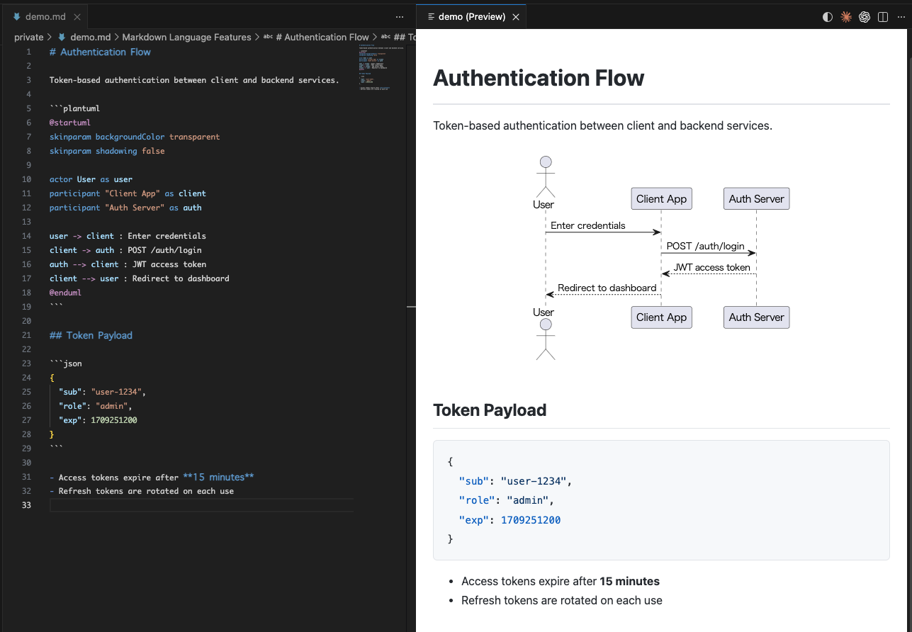
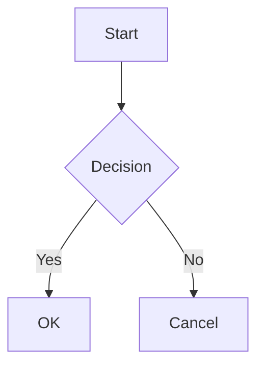

<p align="center">
  <a href="#/">English</a> | <a href="#/zh-cn/">简体中文</a> | <a href="#/ja/">日本語</a> | <a href="#/es/">Español</a> | <a href="#/pt-br/">Português</a> | <a href="#/ko/">한국어</a> | <strong>繁體中文</strong>
</p>

<p align="center">
  
</p>

<h1 align="center">PlantUML Markdown Preview</h1>

<p align="center">
  <strong>直接在 Markdown 預覽中顯示 PlantUML、Mermaid 和 D2 圖表。Fast、Secure、Easy — 選擇適合你的模式。</strong>
</p>

<p align="center">
  <a href="https://marketplace.visualstudio.com/items?itemName=yss-tazawa.plantuml-markdown-preview"></a>
  <a href="https://marketplace.visualstudio.com/items?itemName=yss-tazawa.plantuml-markdown-preview"></a>
  <a href="https://github.com/yss-tazawa/plantuml-markdown-preview/blob/main/LICENSE"></a>
</p>

<p align="center">
  
</p>

在 Markdown 中以程式碼撰寫圖表，輸入的同時就能看到渲染結果 — 還能將整份文件連同圖表匯出為 HTML 或 PDF。

## 選擇模式

| | **Fast**（預設） | **Secure** | **Easy** |
| --- | --- | --- | --- |
| | 快速渲染 | 最高隱私保護 | 零設定 |
| | 本機的 PlantUML 伺服器讓圖表隨輸入即時更新 | 無網路、無背景程序 — 一切都留在你的電腦上 | 無需 Java — 使用線上 PlantUML 伺服器，開箱即用 |
| **Java** | 需要 11+ | 需要 11+ | 不需要 |
| **網路** | 無 | 無 | 需要 |
| **隱私** | 僅限本機 | 僅限本機 | 圖表原始碼傳送至 PlantUML 伺服器 |
| **設定** | [安裝 Java →](#前置條件) | [安裝 Java →](#前置條件) | 無需設定 |

只要變更一個設定，就能隨時切換模式 — 無需遷移，也無需重新啟動。

詳情請參閱[渲染模式](#渲染模式)，設定方式請參閱[快速開始](#快速開始)。

## 亮點

- **圖表直接顯示在文件中** — PlantUML、Mermaid 和 D2 圖表內嵌顯示在 Markdown 預覽中，而不是另外的面板。
- **安心開啟** — Markdown 中的指令碼絕不會在預覽和 HTML/PDF 匯出中執行。
- **大小由你決定** — 可分別設定 PlantUML、Mermaid 和 D2 圖表的顯示比例。
- **單一檔案 HTML 匯出** — 文件和圖表收在一個 HTML 檔案中，版面寬度和對齊方式由你選擇。
- **一鍵 PDF 匯出** — 透過 Chrome、Edge 或 Chromium 列印，圖表會縮放以符合頁面。
- **雙向捲動同步** — 捲動編輯器或預覽，另一側會跟著捲動。
- **輕鬆導覽** — 直接在預覽中跳到頂端或末端，或開啟目錄側邊欄。
- **圖表檢視器** — 在任一圖表上按右鍵，即可在專屬面板中平移和縮放，並與你的編輯保持同步。
- **閱讀檢視** — 在專屬索引標籤中閱讀渲染後的 Markdown、PlantUML、Mermaid 或 D2 檔案，並可就地切換回原始碼。
- **獨立圖表預覽** — 直接開啟 `.puml`、`.plantuml`、`.mmd`、`.mermaid` 和 `.d2` 檔案，支援平移縮放和即時更新。
- **Git 版本預覽** — 在目前預覽旁邊，顯示 Markdown 檔案在 HEAD 或暫存區時的渲染結果，讓你以視覺方式比較變更過的圖表。
- **儲存或複製為 PNG / SVG** — 在預覽或圖表檢視器中的任一圖表上按右鍵，即可儲存或複製到剪貼簿。
- **17 種預覽主題** — 跟隨 VS Code 的色彩佈景主題，或從 9 種淺色和 7 種深色主題中選擇，包括 GitHub、Atom、Solarized、Dracula 和 Monokai。
- **編輯器輔助** — 為 PlantUML、Mermaid 和 D2 提供關鍵字補全、顏色選擇器和程式碼片段。
- **支援 7 種語言** — 介面提供英語、中文（簡體和繁體）、西班牙語、巴西葡萄牙語、日語和韓語。
- **數學公式支援** — 撰寫 `$...$` 行內公式和 `$$...$$` 區塊公式，以 [KaTeX](https://katex.org/) 渲染。

## 目錄

- [選擇模式](#選擇模式)
- [亮點](#亮點)
- [功能](#功能)
- [快速開始](#快速開始)
- [使用方式](#使用方式)
  - [閱讀檢視](#閱讀檢視)
- [設定](#設定)
- [程式碼片段](#程式碼片段)
- [顏色選擇器](#顏色選擇器)
- [關鍵字補全](#關鍵字補全)
- [鍵盤快捷鍵](#鍵盤快捷鍵)
- [常見問題](#常見問題)
- [貢獻](#貢獻)
- [第三方授權](#第三方授權)
- [授權](#授權)

## 功能

### 內嵌圖表預覽

```` ```plantuml ````、```` ```mermaid ```` 和 ```` ```d2 ```` 程式碼區塊會與一般 Markdown 內容一起渲染為內嵌 SVG 圖表。

- **即時更新** — 預覽會隨著輸入更新。
- **儲存時重新整理** — 儲存檔案時會重新整理預覽。
- **跟隨索引標籤** — 預覽會隨作用中的編輯器索引標籤切換。
- **載入指示器** — 可以看出哪個圖表仍在渲染中。
- **清楚的錯誤訊息** — 語法錯誤會內嵌顯示，並附上行號和周圍的原始碼。
- **PlantUML** — 在你的電腦上以 Java 渲染（Fast / Secure 模式），或由 PlantUML 伺服器渲染（Easy 模式）；請參閱[渲染模式](#渲染模式)。
- **Mermaid** — 以 [mermaid.js](https://mermaid.js.org/) 渲染，無需安裝 Java 或其他工具。
- **D2** — 以內建的 [@terrastruct/d2](https://d2lang.com/)（Wasm）渲染，無需安裝其他工具。

### 圖表原始碼高亮

編輯器中的圖表原始碼會有語法高亮 — 無論是 Markdown 中的 ```` ```plantuml ````、
```` ```mermaid ```` 和 ```` ```d2 ```` 區塊，還是獨立的 `.puml`、
`.plantuml`、`.mmd`、`.mermaid` 和 `.d2` 檔案。顏色會跟隨目前的主題。

### 數學公式支援

使用 [KaTeX](https://katex.org/) 渲染數學公式。

- **行內公式** — `$E=mc^2$` 會渲染為行內公式。
- **區塊公式** — `$$\int_0^\infty e^{-x}\,dx = 1$$` 會渲染為置中顯示的公式。
- **到處都一樣** — 公式在預覽和 HTML/PDF 匯出中看起來都相同。
- **輕鬆停用** — 如果文字中的 `$` 符號被當成公式，請設定 `enableMath: false`。

### 圖表縮放

分別控制 PlantUML、Mermaid 和 D2 圖表的顯示大小。

- **PlantUML 縮放** — 選擇 `auto`（縮小以符合寬度）或 70% 至 120% 的固定百分比（預設 100%）；圖表在任何比例下都保持清晰。
- **Mermaid 縮放** — 選擇 `auto`（縮小以符合寬度）或 50% 至 100% 的固定百分比（預設 80%）。
- **D2 縮放** — 選擇 `auto`（縮小以符合寬度）或 50% 至 100% 的固定百分比（預設 70%）。

### 渲染模式

選擇一種預設模式，決定 PlantUML 圖表的渲染方式：

| | Fast（預設） | Secure | Easy |
| --- | --- | --- | --- |
| **需要 Java** | 是 | 是 | 否 |
| **網路** | 無（僅 localhost） | 無 | 需要 |
| **隱私** | 僅限本機 | 僅限本機 | 圖表原始碼傳送至 PlantUML 伺服器 |
| **速度** | 即時（常駐本機伺服器） | 較慢（每次渲染都啟動 Java） | 取決於網路 |

- **Fast 模式**（預設）— 在 `localhost` 上持續執行 PlantUML 伺服器，讓圖表在編輯時即時更新。伺服器會在第一個 PlantUML 圖表出現時啟動（可以變更；請參閱[Start Mode](#fast-模式伺服器啟動模式)），圖表絕不會離開你的電腦。
- **Secure 模式** — 每次渲染時都在你的電腦上執行 Java 和 PlantUML jar，不使用網路，也沒有背景伺服器。為了最高安全性，預設會封鎖本機圖片。
- **Easy 模式** — 將 PlantUML 原始碼傳送到 PlantUML 伺服器，因此不需要安裝任何東西。預設使用公共伺服器（`https://www.plantuml.com/plantuml`）；若重視隱私，可改用你自己的伺服器。

如果開啟預覽時找不到 Java，擴充功能會提議切換到 Easy 模式。

#### Fast 模式：伺服器啟動模式

預設情況下，Fast 模式會在 `127.0.0.1` 上自行啟動並管理 PlantUML 伺服器 — 無需任何設定。`plantumlLocalServerStartMode`（Start Mode）控制何時啟動，以及是否啟動：

| 值 | 效果 |
|---|---|
| `"lazy"`（預設） | 在第一次渲染圖表時啟動受管理的伺服器。在你渲染 PlantUML 圖表之前，Java 不會執行；第一次渲染會多花幾秒鐘。 |
| `"on"` | 擴充功能一啟用就啟動受管理的伺服器。第一次渲染會立即完成，但 Java 從啟動起就會在背景持續執行。 |
| `"off"` | 永不啟動伺服器。連線到你自己執行的伺服器（例如 `java -jar plantuml.jar -picoweb`），包括區域網路中其他電腦上的伺服器。 |

連線伺服器時使用的主機和連接埠由以下設定控制：

| 設定 | 預設值 | 效果 |
|---|---|---|
| `plantumlLocalServerHost` | `127.0.0.1` | Start Mode 為 `"off"` 時要連線的主機（例如區域網路中其他位置的 picoweb 伺服器）。`"on"`/`"lazy"` 時會被忽略 — 受管理的伺服器一律繫結至 `127.0.0.1`。 |
| `plantumlLocalServerPort` | `0` | Start Mode 為 `"on"`/`"lazy"` 時：要啟動的連接埠（`0` = 自動分配空閒連接埠）。Start Mode 為 `"off"` 時：要連線的連接埠。 |

值得了解的幾點：

- **與現有伺服器和平共處** — 使用 `"on"` 或 `"lazy"` 並指定固定連接埠時，若該連接埠上已有正常運作的 PlantUML 伺服器，會直接重複使用它，而不會再啟動第二個。
- **`"off"` 時不需要本機 Java** — 擴充功能絕不會啟動伺服器，只會連線到你設定的主機和連接埠。
- **你的伺服器由你掌控** — 擴充功能只會停止它自己啟動的伺服器。
- **仍會讀取舊設定** — 如果未設定 Start Mode，會改用舊的 `plantumlLocalServerAutoStart` 設定（`true` → `"on"`，`false` → `"off"`）。

#### Fast 模式：JVM 記憶體（堆積）設定

受管理伺服器的記憶體用量由堆積預設值（`plantumlLocalServerJvmHeapPreset`）限制：

| 預設值 | JVM 堆積旗標 | 適用情境 |
|---|---|---|
| `small` | `-Xms16m -Xmx256m` | 記憶體用量最低；僅適合小型圖表。 |
| `medium`（預設） | `-Xms16m -Xmx512m` | 平衡型；能輕鬆處理大多數圖表。 |
| `large` | `-Xms64m -Xmx1024m` | 非常大的圖表；符合 PlantUML FAQ 建議值。 |
| `unlimited` | _（無）_ | 完全不套用旗標 — 由 Java 自行決定（最大堆積預設為實體記憶體的 1/4）。 |
| `custom` | 你自訂的值 | 讀取 `plantumlLocalServerJvmInitialHeapMb`（8–32768，預設 16）與 `plantumlLocalServerJvmMaxHeapMb`（64–32768，預設 512）。 |

除 `unlimited` 外，每個預設值都會固定套用 `-XX:+UseSerialGC`、`-XX:MaxMetaspaceSize=128m` 與 `-XX:ReservedCodeCacheSize=64m`，以維持伺服器的精簡體積。這些設定僅套用於擴充功能自行啟動的伺服器（Fast 模式，Start Mode 為 `"on"`/`"lazy"`）。

### 狀態列

狀態列會顯示目前的渲染模式（Fast / Secure / Easy），在 Fast 模式下還會顯示本機伺服器的狀態（啟動中、執行中、錯誤、已停止）。

- **一鍵切換模式** — 按一下狀態列項目，即可從快速挑選中選擇模式，不必開啟設定。
- **也可從命令選擇區執行** — **選擇渲染模式**命令的效果相同。

顯示 Markdown 預覽或閱讀檢視時，狀態列還會顯示預覽的縮放比例。按一下即可選擇其他比例。

### HTML 匯出

將 Markdown 文件匯出為單一 HTML 檔案。

- **包含圖表** — PlantUML 和 D2 圖表以內嵌 SVG 嵌入；Mermaid 圖表和數學公式字型會在開啟檔案時從 CDN 載入。
- **包含樣式** — 語法高亮的樣式會一併收在檔案中。
- **匯出並開啟** — 一個命令即可匯出，並在瀏覽器中開啟結果。
- **版面由你決定** — 選擇 640px 至 1440px 的固定寬度（置中或靠左），或選擇**響應式**，填滿瀏覽器視窗，只縮小會超出的圖表，並將較寬的表格收進視窗。可在設定中指定常用的寬度和對齊方式，也可以每次匯出時從選單中選擇。

### PDF 匯出

使用你電腦上已安裝的 Chrome、Edge 或 Chromium，將 Markdown 文件匯出為 PDF。

- **使用你的瀏覽器** — 系統中需要安裝 Chrome、Edge 或 Chromium。
- **直向或橫向** — 匯出時選擇方向。
- **一致的縮放** — 文字和圖表一起縮放（`pdfScale`，預設 0.625）。
- **整潔的頁面** — 會自動套用列印邊界。

### 批次圖表匯出

將 Markdown 檔案中的所有圖表匯出為個別的 PNG 或 SVG 檔案。

- **一次匯出所有圖表** — 所有 PlantUML、Mermaid 和 D2 圖表依文件順序匯出。
- **自訂資料夾名稱** — 選擇輸出資料夾的名稱（預設：`{檔名}_diagrams`）。
- **需要開啟預覽** — 圖表是在預覽中渲染的，因此預覽必須保持開啟。

### 導覽與目錄

- **跳到頂端 / 跳到末端** — 按一下預覽右上角的按鈕即可前往。
- **目錄側邊欄** — 按一下 TOC 按鈕列出所有標題，再按一下標題即可跳到該處。
- **縮放** — `Ctrl`+滑鼠滾輪（Mac 為 `Cmd`+滑鼠滾輪）可將預覽和閱讀檢視在 50% 至 200% 之間縮放；所有預覽共用同一比例，重新啟動後仍會保留。

### 圖表檢視器

在預覽中的任一 PlantUML、Mermaid 或 D2 圖表上按右鍵，選擇**在圖表檢視器中開啟**，即可在另外的平移縮放面板中開啟。

- **平移和縮放** — 以滑鼠滾輪縮放（以游標為中心），拖曳即可平移。
- **工具列** — 符合視窗、1:1 重設，以及逐步縮放（+/-）。
- **即時同步** — 你的編輯會立即反映，縮放位置也會保留。
- **相同的背景** — 背景色會跟隨目前的預覽主題。
- **隨檔案關閉** — 切換到其他來源檔案時，檢視器會關閉。
- **儲存或複製為 PNG / SVG** — 在預覽或圖表檢視器中的圖表上按右鍵，即可儲存為檔案或複製為 PNG。
- **在檢視器中尋找** — 按 `Cmd+F` / `Ctrl+F` 開啟尋找工具。
- **可選用** — 以 `enableDiagramViewer: false` 停用。

### PlantUML `!include` 支援

使用 `!include` 指令，在多個圖表之間共用通用的樣式、巨集和元件定義。

- **檔案的尋找位置** — include 的檔案會從工作區根目錄，或 `plantumlIncludePath` 設定的資料夾解析。在 Fast 模式下，這只在擴充功能執行自己的伺服器時適用；詳情請參閱[常見問題](#常見問題)。
- **儲存時重新整理** — 儲存 include 的檔案時會重新整理預覽，也可以隨時按**重新載入**按鈕（↻）強制重新整理。
- **前往 Include 檔案** — 在 `.puml` 或 Markdown 檔案中的 `!include` 行上按右鍵，即可開啟參照的檔案。
- **開啟 Include 來源檔案** — 在預覽中的 PlantUML 圖表上按右鍵，即可直接開啟它 include 的檔案。
- **Fast 和 Secure 模式** — Easy 模式無法讀取你的本機檔案，因此無法使用 `!include`。

### 獨立圖表預覽

直接開啟 `.puml`、`.plantuml`、`.mmd`、`.mermaid` 或 `.d2` 檔案 — 不需要包在 Markdown 中。

- **平移和縮放** — 與圖表檢視器相同的操作方式。
- **即時更新** — 預覽會隨著輸入更新。
- **跟隨索引標籤** — 在相同類型的檔案之間切換時，預覽會跟著切換。
- **主題** — 可分別選擇預覽主題和圖表主題。
- **儲存或複製為 PNG / SVG** — 在圖表上按右鍵。
- **在預覽中尋找** — 按 `Cmd+F` / `Ctrl+F` 開啟尋找工具。
- **PlantUML** — 三種渲染模式（Fast / Secure / Easy）都可使用。
- **Mermaid** — 以 mermaid.js 渲染。
- **D2** — 以 @terrastruct/d2（Wasm）渲染，可選擇主題和版面配置引擎。

### Git 版本預覽

在側邊面板中預覽 Markdown 檔案在某個 Git 版本時的渲染結果 — 讓你並排比較變更過的圖表，而不必閱讀文字差異。

- **HEAD** — 最後一次提交的版本。
- **暫存** — 目前已暫存、準備提交的版本。
- **並排顯示** — 會在目前預覽的旁邊開啟，新舊圖表可以同時檢視。
- **快照** — 只渲染一次，不會跟隨之後的編輯；頂端的橫幅會提示這一點。
- **需要 Git** — 檔案必須在 Git 儲存庫中受到追蹤。

### 雙向捲動同步

捲動編輯器或預覽的任一側，兩者都會保持同步。

- **位置對應** — 預覽會對齊你正在看的原始碼部分。
- **位置穩定** — 預覽重新渲染時，捲動位置會保持不變。

### 主題

**預覽主題**控制文件整體外觀：

**VS Code 主題：**

| 主題 | 風格 |
| --- | --- |
| Follow VS Code Color Theme | 與內建 Markdown 預覽一樣跟隨目前的 VS Code 色彩佈景主題。HTML/PDF 匯出時依色彩佈景主題使用 VS Code Light 2026 或 Dark 2026 |

**淺色主題：**

| 主題 | 風格 |
| --- | --- |
| GitHub Light | 白色背景（預設） |
| Atom Light | 柔和灰色文字，Atom 編輯器風格 |
| One Light | 米白色，均衡配色 |
| Solarized Light | 暖米色，護眼 |
| Vue | 綠色點綴，Vue.js 文件風格 |
| Pen Paper Coffee | 溫暖紙張感，手寫風格 |
| Coy | 近白色，簡潔設計 |
| VS | 經典 Visual Studio 配色 |
| VS Code Light 2026 | VS Code 色彩佈景主題 Light 2026 下的內建 Markdown 預覽 |

**深色主題：**

| 主題 | 風格 |
| --- | --- |
| GitHub Dark | 深色背景 |
| Atom Dark | Tomorrow Night 配色 |
| One Dark | Atom 風格暗色 |
| Dracula | 鮮豔暗色 |
| Solarized Dark | 深青色，護眼 |
| Monokai | 鮮豔語法，Sublime Text 風格 |
| VS Code Dark 2026 | VS Code 色彩佈景主題 Dark 2026 下的內建 Markdown 預覽 |

從標題列圖示即可立即切換預覽主題 — 圖表不會重新繪製。變更 PlantUML 主題時，圖表會重新繪製。

**PlantUML 主題**可獨立控制圖表樣式。擴充功能會從你的 PlantUML 安裝中找出可用的主題，
並與預覽主題列在同一個快速挑選中。

**Mermaid 主題**控制 Mermaid 圖表樣式：`default`、`dark`、`forest`、`neutral`、`base`。它們也在同一個快速挑選中。

**D2 主題** — 19 種內建主題（例如 `Neutral Default`、`Dark Mauve`、`Terminal`），可在設定或同一個快速挑選中選擇。

### 語法高亮

透過 highlight.js 支援 190 種以上的語言。程式碼區塊的樣式會配合
所選的預覽主題。

### 安全性

- **嚴格的指令碼原則** — 預覽只會執行擴充功能自己的指令碼。
- **不執行文件中的程式碼** — Markdown 中的 `<script>` 標籤和其他程式碼絕不會在預覽和 HTML/PDF 匯出中執行。
- **本機圖片依模式而定** — 本機圖片預設依照模式處理（`allowLocalImages: "mode-default"`）；Secure 模式為了最高安全性會封鎖本機圖片。
- **預設不載入純 HTTP 圖片** — 透過未加密 HTTP 載入圖片的功能預設關閉（`allowHttpImages`）；只在內部網路或本機開發伺服器等可信任的網路中開啟。

### 與 VS Code 內建 Markdown 預覽整合

PlantUML、Mermaid 和 D2 圖表也會顯示在 VS Code 內建的 Markdown 預覽（`Markdown: 在一側開啟預覽`）中 — 無需額外設定。若要使用預覽主題、捲動同步和 HTML 匯出，請開啟本擴充功能自己的預覽（`Cmd+Alt+V` / `Ctrl+Alt+V`）。對於大型 PlantUML 圖表，它也是較好的選擇，因為這類圖表在內建預覽中可能會讓編輯器短暫卡住。

### GitHub 風格提示

從區塊引用標記渲染 GitHub 風格的提示（標註框），與 GitHub 本身的輸出一致。

```markdown
> [!NOTE]
> Highlights information that users should take into account.

> [!TIP]
> Optional information to help a user be more successful.

> [!IMPORTANT]
> Crucial information necessary for users to succeed.

> [!WARNING]
> Critical content demanding immediate user attention.

> [!CAUTION]
> Negative potential consequences of an action.
```

- **五種類型** — `NOTE`、`TIP`、`IMPORTANT`、`WARNING` 和 `CAUTION`，每種都有專屬的圖示和強調色。
- **與 GitHub 相同的規則** — 標記必須獨占一行（大小寫皆可，`[!note]` 同樣有效）；只有文件最上層的區塊引用才會變成提示。`> [!NOTE] My title`，以及清單項目或其他區塊引用中的標記，仍是一般的區塊引用。
- **配合主題** — 顏色會依作用中的預覽主題（淺色或深色）調整。
- **到處都一樣** — 提示在預覽和 HTML/PDF 匯出中看起來都相同。

### 註腳和任務清單

渲染以 GitHub 語法撰寫的註腳和任務清單，與 GitHub 本身的輸出一致。

```markdown
A sentence with a footnote.[^1]

[^1]: The footnote text.

- [x] Finished task
- [ ] Open task
```

- **註腳** — `[^1]` 參照會連結到文件末尾的註腳，註腳也能連結回參照處。
- **任務清單** — `- [ ]` 和 `- [x]` 項目會顯示核取方塊。核取方塊只顯示狀態，按一下也不會變更文件。
- **到處都一樣** — 註腳和任務清單在預覽和 HTML/PDF 匯出中看起來都相同。

## 快速開始

### 前置條件

**Mermaid** — 無前置條件，開箱即用。

**D2** — 無前置條件。以內建的 [D2](https://d2lang.com/) Wasm 渲染 — 開箱即用。

**PlantUML（Easy 模式）** — 無前置條件。圖表原始碼會傳送到 PlantUML 伺服器渲染。

**PlantUML（Fast / Secure 模式）** — 預設：

| 工具 | 用途 | 驗證 |
| --- | --- | --- |
| [Java 11+（JRE 或 JDK）](#設置) | 執行 PlantUML（內建的 PlantUML 1.2026.10 需要 Java 11+） | `java -version` |
| [Graphviz](https://graphviz.org/) | 選用 — 類別圖、元件圖和其他依賴版面配置的圖表需要（請參閱[圖表支援](#圖表支援)） | `dot -V` |

PlantUML 已內建（LGPL，v1.2026.10）— 不需要另外下載。唯一的需求是 Java 11 或更新版本；Graphviz 為選用。
還沒有 Java？開啟預覽時，擴充功能會提議切換到 Easy 模式。

### 圖表支援

可用的圖表取決於你的環境：

| 圖表 | LGPL（內建） | Win: GPLv2 jar | Mac/Linux: + Graphviz |
| --- | :-: | :-: | :-: |
| 循序圖 | ✓ | ✓ | ✓ |
| 活動圖（新語法） | ✓ | ✓ | ✓ |
| 心智圖 | ✓ | ✓ | ✓ |
| WBS | ✓ | ✓ | ✓ |
| 甘特圖 | ✓ | ✓ | ✓ |
| JSON / YAML | ✓ | ✓ | ✓ |
| Salt / 線框圖 | ✓ | ✓ | ✓ |
| 時序圖 | ✓ | ✓ | ✓ |
| 網路圖（nwdiag） | ✓ | ✓ | ✓ |
| 類別圖 | — | ✓ | ✓ |
| 使用案例圖 | — | ✓ | ✓ |
| 物件圖 | — | ✓ | ✓ |
| 元件圖 | — | ✓ | ✓ |
| 部署圖 | — | ✓ | ✓ |
| 狀態圖 | — | ✓ | ✓ |
| ER 圖 | — | ✓ | ✓ |
| 活動圖（舊語法） | — | ✓ | ✓ |
| DOT（@startdot） | — | ✓ | ✓ |

- **LGPL（內建）** — 開箱即用，無需 Graphviz。
- **Win: GPLv2 jar** — [GPLv2 版本](https://plantuml.com/download)內建 Graphviz（僅 Windows，自動解壓縮）。設定 [`plantumlJarPath`](#設定) 即可使用。DOT（`@startdot`）需要 PlantUML 1.2026.9 或更新版本。
- **Mac/Linux: + Graphviz** — 另外安裝 [Graphviz](https://graphviz.org/)。LGPL 或 GPLv2 jar 均可使用。

### 安裝

1. 開啟 VS Code
2. 在擴充功能檢視（`Ctrl+Shift+X` / `Cmd+Shift+X`）中搜尋 **PlantUML Markdown Preview**
3. 按一下**安裝**

### 設置

**Fast 模式**（預設）— 不需要任何設定。本機 PlantUML 伺服器會在第一個圖表出現時啟動，讓更新保持即時。需要 Java 11+。

**使用 Secure 模式** — 將 `mode` 設為 `"secure"`。每次渲染時執行 Java 11+，沒有背景伺服器，也不存取網路。

**使用 Easy 模式**（無需設定）— 將 `mode` 設為 `"easy"`。圖表原始碼會傳送到 PlantUML 伺服器渲染。

**Fast 和 Secure 模式** — 內建的 LGPL jar 無需額外設定，即可支援循序圖、活動圖、心智圖等圖表（請參閱[圖表支援](#圖表支援)）。若要啟用類別圖、元件圖、使用案例圖和其他依賴版面配置的圖表，請依照下方你的平台的步驟操作。

#### Windows

1. 如未安裝 Java，請安裝（開啟 PowerShell 執行）：

   ```powershell
   winget install Microsoft.OpenJDK.21
   ```

2. 如 `java` 不在 PATH 中，在 PowerShell 中查詢完整路徑：

   ```powershell
   Get-Command java
   # 例：C:\Program Files\Microsoft\jdk-21.0.6.7-hotspot\bin\java.exe
   ```

   開啟 VS Code 設定（`Ctrl+,`），搜尋 `plantumlMarkdownPreview.javaPath`，輸入上述路徑

3. 將 [GPLv2 版 PlantUML](https://plantuml.com/download)（`plantuml-gplv2-*.jar`）下載到任意資料夾（內建 Graphviz — 無需另外安裝）
4. 開啟 VS Code 設定（`Ctrl+,`），搜尋 `plantumlMarkdownPreview.plantumlJarPath`，輸入下載的 `.jar` 完整路徑（如 `C:\tools\plantuml-gplv2-1.2026.10.jar`）

#### Mac

1. 透過 Homebrew 安裝 Java 和 Graphviz：

   ```sh
   brew install openjdk graphviz
   ```

2. 如 `dot` 不在 PATH 中，查詢完整路徑並在 VS Code 中設定：

   ```sh
   which dot
   # 例：/opt/homebrew/bin/dot
   ```

   開啟 VS Code 設定（`Cmd+,`），搜尋 `plantumlMarkdownPreview.dotPath`，輸入上述路徑

#### Linux

1. 安裝 Java 和 Graphviz：

   ```sh
   # Debian / Ubuntu
   sudo apt install default-jdk graphviz

   # Fedora
   sudo dnf install java-21-openjdk graphviz
   ```

2. 如 `dot` 不在 PATH 中，查詢完整路徑並在 VS Code 中設定：

   ```sh
   which dot
   # 例：/usr/bin/dot
   ```

   開啟 VS Code 設定（`Ctrl+,`），搜尋 `plantumlMarkdownPreview.dotPath`，輸入上述路徑

這些路徑很少需要設定。預設情況下，擴充功能會先在 `JAVA_HOME/bin/`（Windows 上為 `JAVA_HOME\bin\`）下尋找 Java，再到 PATH 中尋找；`dot` 會從 PATH 中尋找，並使用內建的 PlantUML jar。只有在命令不在 PATH 中，或想使用其他 jar 時，才需要設定 `javaPath`、`dotPath` 或 `plantumlJarPath`。

## 使用方式

### 開啟預覽

- **鍵盤快速鍵** — 按 `Cmd+Alt+V`（Mac）/ `Ctrl+Alt+V`（Windows / Linux）。
- **編輯器標題列** — 按一下編輯器右上角的預覽按鈕（圓角方框中的「P」）。
- **VS Code 標準按鈕和快速鍵** — `useAsDefaultPreview` 開啟（預設）時，VS Code 的**在一側開啟預覽**按鈕、右鍵選單中的**開啟預覽**項目，以及 `Cmd+K V`（Mac）/ `Ctrl+K V`（Windows / Linux）會開啟本擴充功能的預覽；`Cmd+Shift+V` / `Ctrl+Shift+V` 則會改為切換到[閱讀檢視](#閱讀檢視)。
- **右鍵選單** — 在檔案總管或編輯器中的 Markdown 檔案上按右鍵 → **PlantUML Markdown Preview** → **在側邊開啟預覽**。
- **命令選擇區** — 執行 `PlantUML Markdown Preview: 在側邊開啟預覽`。

預覽有自己的主題，一開始是白色背景（GitHub Light）。若要配合目前的 VS Code 色彩佈景主題，請選擇 `follow-vscode`。

### 閱讀檢視

閱讀檢視會在檔案自己的索引標籤中顯示渲染後的內容，取代文字編輯器 — 不會開啟第二個面板。它會固定在該檔案上，不會跟隨作用中的編輯器，也可以與預覽同時開啟。

適用於 Markdown 檔案（`.md`、`.markdown` 以及 VS Code 的 Markdown 預覽涵蓋的其他副檔名），以及 `.puml` / `.plantuml`、`.mmd` / `.mermaid` 和 `.d2` 檔案。在你使用之前，不會有任何變化。

- **就地切換** — 在編輯器中按右鍵 → **PlantUML Markdown Preview** → **切換到閱讀檢視**（PlantUML、Mermaid 和 D2 檔案的**切換到閱讀檢視**直接位於選單中）。若要返回，在閱讀檢視中按右鍵 → **切換到原始碼**，或按一下編輯器標題列中的**切換到原始碼**。切換的是索引標籤本身，不會開啟新索引標籤。
- **開啟一次** — 在檔案總管中的檔案上按右鍵 → **開啟方式...** → **PlantUML Markdown Preview（閱讀檢視）**。若檔案已經開啟，請改在它的索引標籤上按右鍵，使用**重新開啟編輯器，使用...**。
- **預設開啟** — 在**開啟方式...**清單中，選擇**設定 '\*.md' 的預設編輯器...** → **PlantUML Markdown Preview（閱讀檢視）**。此後，按一下 `.md` 檔案就會以閱讀檢視開啟。每種副檔名需要設定一次。
- **復原** — 以同樣的方式選擇**文字編輯器**，或從設定中刪除該行。

若要改在 `settings.json` 中設定：

```json
"workbench.editorAssociations": {
  "*.md": "plantumlMarkdownPreviewEditor",
  "*.puml": "plantumlPumlPreviewEditor",
  "*.mmd": "plantumlMermaidPreviewEditor",
  "*.d2": "plantumlD2PreviewEditor"
}
```

| 檔案 | 值 |
| ---- | -- |
| Markdown（`*.md`、`*.markdown` 等） | `plantumlMarkdownPreviewEditor` |
| `*.puml`、`*.plantuml` | `plantumlPumlPreviewEditor` |
| `*.mmd`、`*.mermaid` | `plantumlMermaidPreviewEditor` |
| `*.d2` | `plantumlD2PreviewEditor` |

- **較舊的 VS Code** — 在 VS Code 1.100 之前，不會顯示**切換到閱讀檢視**和**切換到原始碼**，因此請改用**開啟方式...**開啟閱讀檢視。
- **Git 差異** — 即使檔案已設定為以閱讀檢視開啟，差異仍會以文字差異開啟。
- **標準按鈕** — `useAsDefaultPreview` 開啟（預設）時，VS Code 的**以預覽模式開啟**按鈕（VS Code 1.119 或更新版本）和 `Ctrl+Shift+V`（VS Code 1.100 或更新版本）會切換到閱讀檢視；請參閱[設定](#設定)。

### 開啟圖表預覽

直接在平移縮放預覽中開啟 `.puml` / `.plantuml`、`.mmd` / `.mermaid` 或 `.d2` 檔案 — 不需要包在 Markdown 中。

- **鍵盤快速鍵** — 同樣的 `Cmd+Alt+V`（Mac）/ `Ctrl+Alt+V`（Windows / Linux）會依檔案類型開啟對應的預覽。
- **編輯器標題列** — 按一下編輯器右上角的預覽按鈕（圓角方框中的「P」）。
- **標準預覽快速鍵** — `useAsDefaultPreview` 開啟（預設）時，`Cmd+K V`（Mac）/ `Ctrl+K V`（Windows / Linux）也會在編輯器旁開啟預覽；`Cmd+Shift+V` / `Ctrl+Shift+V` 則會改為切換到[閱讀檢視](#閱讀檢視)。
- **右鍵選單** — 在檔案總管或編輯器中的 `.puml` / `.plantuml`、`.mmd` / `.mermaid` 或 `.d2` 檔案上按右鍵 → **預覽 PlantUML 檔案** / **預覽 Mermaid 檔案** / **預覽 D2 檔案**。
- **命令選擇區** — 執行 `PlantUML Markdown Preview: 預覽 PlantUML 檔案`、`預覽 Mermaid 檔案` 或 `預覽 D2 檔案`。

### 開啟 Git 版本預覽

在目前版本的預覽旁邊，渲染 Markdown 檔案在某個 Git 版本時的內容。

- **右鍵選單** — 在檔案總管或編輯器中的 Markdown 檔案上按右鍵 → **PlantUML Markdown Preview** → **在側邊開啟 HEAD 版本預覽** / **在側邊開啟暫存版本預覽**。
- **命令選擇區** — 執行 `PlantUML Markdown Preview: 在側邊開啟 HEAD 版本預覽` / `在側邊開啟暫存版本預覽`。

先開啟一般預覽，再開啟版本預覽：兩個面板會並排顯示。版本面板是固定的快照 — 編輯時不會更新。

### 匯出為 HTML

- **右鍵選單** — 在 Markdown 檔案上按右鍵 → **PlantUML Markdown Preview** → **匯出為 HTML** → 選擇寬度選項。
- **預覽** — 在預覽中按右鍵 → **匯出為 HTML** 或 **匯出為 HTML 並開啟**。

子選單提供以下寬度選項：

| 選項 | 說明 |
| ---- | ---- |
| 目前設定 | 使用目前設定匯出（無響應式 CSS） |
| 640px – 1440px | 固定像素寬度，置中 |
| 響應式 (靠左) | 本文寬度等於檢視區，靠左對齊；超出的圖表才會縮小，較寬的表格換行收進 |
| 640px – 1440px (靠左) | 固定寬度，靠左對齊 |

HTML 檔案儲存在來源 Markdown 檔案旁邊。

### 匯出為 PDF

- **右鍵選單** — 在 Markdown 檔案上按右鍵 → **PlantUML Markdown Preview** → **匯出為 PDF** → **直向** 或 **橫向**。
- **預覽** — 在預覽中按右鍵 → **匯出為 PDF** 或 **匯出為 PDF 並開啟** → **直向** 或 **橫向**。

PDF 檔案會儲存在來源 Markdown 檔案旁邊。需要 Chrome、Edge 或 Chromium。
`pdfScale` 設定（預設 0.625）控制文字和圖表的整體縮放。

### 儲存/複製圖表為 PNG/SVG

- **預覽** — 在圖表上按右鍵 → **將圖表複製為 PNG**、**將圖表儲存為 PNG** 或 **將圖表儲存為 SVG**。
- **圖表檢視器** — 在檢視器中按右鍵 → **將圖表複製為 PNG**、**將圖表儲存為 PNG** 或 **將圖表儲存為 SVG**。
- **獨立圖表預覽** — 在預覽中按右鍵 → **將圖表複製為 PNG**、**將圖表儲存為 PNG** 或 **將圖表儲存為 SVG**。

### 匯出所有圖表

- **右鍵選單** — 在 Markdown 檔案上按右鍵 → **PlantUML Markdown Preview** → **將所有圖表匯出為 PNG** 或 **將所有圖表匯出為 SVG**。
- **預覽** — 在預覽中按右鍵 → **將所有圖表匯出為 PNG** 或 **將所有圖表匯出為 SVG**。
- **命令選擇區** — 執行 `PlantUML Markdown Preview: 將所有圖表匯出為 PNG` / `將所有圖表匯出為 SVG`。

儲存對話方塊可讓你為輸出資料夾命名（預設：`{檔名}_diagrams`）。圖表會依文件順序儲存為 `diagram-1.png`、`diagram-2.png` 等。匯出期間請保持預覽開啟。

### 導覽

- **跳到頂端 / 跳到末端** — 使用預覽右上角的按鈕。
- **重新載入** — 按一下 ↻ 按鈕，重新整理預覽並清除快取。
- **目錄** — 按一下預覽右上角的 TOC 按鈕列出所有標題，再按一下標題即可跳到該處。
- **縮放** — 在預覽上按住 `Ctrl`（Mac 為 `Cmd`）並轉動滑鼠滾輪，或按一下狀態列中的縮放比例並選擇比例；HTML 和 PDF 匯出不受影響。

### 更改主題

按一下預覽標題列中的主題圖示，或使用命令選擇區：

- **命令選擇區** — 執行 `PlantUML Markdown Preview: 變更預覽主題`。

快速挑選會在單一清單中顯示全部四種主題類別 — 預覽主題、PlantUML 主題、Mermaid 主題和 D2 主題 — 讓你從同一處切換任何一種。

### PlantUML 語法

````markdown
```plantuml
Alice -> Bob: Hello
Bob --> Alice: Hi!
```
````

省略 `@startuml` / `@enduml` 時自動加入。

### Mermaid 語法

````markdown

````

### D2 語法

````markdown
```d2
server -> db: query
db -> server: result
```
````

語法詳情請參閱 [D2 文件](https://d2lang.com/)。

### 數學語法

行內公式使用單個美元符號，區塊公式使用雙美元符號：

````markdown
愛因斯坦的著名公式 $E=mc^2$ 展示了質能等價。

$$\int_0^\infty e^{-x}\,dx = 1$$
````

要寫 `$100` 這樣的價格嗎？設定 `enableMath: false`，`$` 就會保持為一般文字。

## 程式碼片段

輸入程式碼片段的前置詞並按 `Tab` 即可展開。提供兩組程式碼片段：

- **Markdown 程式碼片段**（圍欄區塊外）— 以 `plantuml`、`mermaid` 或 `d2` 開頭的前置詞會展開為完整的圍欄區塊。
- **模板程式碼片段**（圍欄區塊內）— 以 `tmpl-` 開頭的前置詞只展開圖表主體；輸入 `tmpl` 即可查看全部。

### Markdown 程式碼片段（圍欄區塊外）

展開為包含圍欄的完整 `` ```plantuml ... ``` `` 區塊：

| 前置詞 | 圖表 |
| --- | --- |
| `plantuml` | 空 PlantUML 區塊 |
| `plantuml-sequence` | 循序圖 |
| `plantuml-class` | 類別圖 |
| `plantuml-activity` | 活動圖 |
| `plantuml-usecase` | 使用案例圖 |
| `plantuml-component` | 元件圖 |
| `plantuml-state` | 狀態圖 |
| `plantuml-er` | ER 圖 |
| `plantuml-object` | 物件圖 |
| `plantuml-deployment` | 部署圖 |
| `plantuml-mindmap` | 心智圖 |
| `plantuml-gantt` | 甘特圖 |

### PlantUML 程式碼片段（圍欄區塊內）

圖表模板（輸入 `tmpl` 查看全部）：

| 前置詞 | 內容 |
| --- | --- |
| `tmpl-seq` | 循序圖 |
| `tmpl-cls` | 類別定義 |
| `tmpl-act` | 活動圖 |
| `tmpl-uc` | 使用案例圖 |
| `tmpl-comp` | 元件圖 |
| `tmpl-state` | 狀態圖 |
| `tmpl-er` | 實體定義 |
| `tmpl-obj` | 物件圖 |
| `tmpl-deploy` | 部署圖 |
| `tmpl-mind` | 心智圖 |
| `tmpl-gantt` | 甘特圖 |

短程式碼片段：

| 前置詞 | 內容 |
| --- | --- |
| `part` | participant 宣告 |
| `actor` | actor 宣告 |
| `note` | 備註區塊 |
| `intf` | interface 定義 |
| `pkg` | package 定義 |

### Mermaid Markdown 程式碼片段

展開為包含圍欄的完整 `` ```mermaid ... ``` `` 區塊：

| 前置詞 | 圖表 |
| --- | --- |
| `mermaid` | 空 Mermaid 區塊 |
| `mermaid-flow` | 流程圖 |
| `mermaid-sequence` | 循序圖 |
| `mermaid-class` | 類別圖 |
| `mermaid-state` | 狀態圖 |
| `mermaid-er` | ER 圖 |
| `mermaid-gantt` | 甘特圖 |
| `mermaid-pie` | 圓餅圖 |
| `mermaid-mindmap` | 心智圖 |
| `mermaid-timeline` | 時間線 |
| `mermaid-git` | Git 圖 |

### Mermaid 程式碼片段（圍欄區塊內）

圖表模板（輸入 `tmpl` 查看全部）：

| 前置詞 | 內容 |
| --- | --- |
| `tmpl-flow` | 流程圖 |
| `tmpl-seq` | 循序圖 |
| `tmpl-cls` | 類別圖 |
| `tmpl-state` | 狀態圖 |
| `tmpl-er` | ER 圖 |
| `tmpl-gantt` | 甘特圖 |
| `tmpl-pie` | 圓餅圖 |
| `tmpl-mind` | 心智圖 |
| `tmpl-timeline` | 時間線 |
| `tmpl-git` | Git 圖 |

### D2 Markdown 程式碼片段

展開為包含圍欄的完整 `` ```d2 ... ``` `` 區塊：

| 前置詞 | 圖表 |
| --- | --- |
| `d2` | 空 D2 區塊 |
| `d2-basic` | 基本連線 |
| `d2-sequence` | 循序圖 |
| `d2-class` | 類別圖 |
| `d2-comp` | 元件圖 |
| `d2-grid` | 格狀版面 |
| `d2-er` | ER 圖 |
| `d2-flow` | 流程圖 |
| `d2-icon` | 圖示節點 |
| `d2-markdown` | Markdown 文字節點 |
| `d2-tooltip` | 工具提示和連結 |
| `d2-style` | 自訂樣式 |

### D2 程式碼片段（圍欄區塊內）

圖表模板（輸入 `tmpl` 查看全部）：

| 前置詞 | 內容 |
| --- | --- |
| `tmpl-seq` | 循序圖 |
| `tmpl-cls` | 類別圖 |
| `tmpl-comp` | 元件圖 |
| `tmpl-er` | ER 圖 |
| `tmpl-flow` | 流程圖 |
| `tmpl-grid` | 格狀版面 |

短程式碼片段：

| 前置詞 | 內容 |
| --- | --- |
| `conn` | 連線 |
| `icon` | 圖示節點 |
| `md` | Markdown 節點 |
| `tooltip` | 工具提示和連結 |
| `style` | 自訂樣式 |
| `direction` | 版面方向 |

## 顏色選擇器

為 PlantUML、Mermaid 和 D2 提供顏色色塊和行內顏色選擇器。適用於獨立檔案（`.puml`、`.mmd`、`.d2`）和 Markdown 圍欄區塊。

- **6 位數十六進位** — 例如 `#FF0000` 和 `#1565C0`。
- **3 位數十六進位** — 例如 `#F00` 和 `#ABC`。
- **顏色名稱**（僅 PlantUML）— 20 種顏色，例如 `#Red`、`#LightBlue` 和 `#Salmon`。
- **選擇即取代** — 選擇新顏色後，會以 `#RRGGBB` 格式寫回。
- **略過註解** — 註解行會被忽略（PlantUML 為 `'`、Mermaid 為 `%%`、D2 為 `#`）。

## 關鍵字補全

為 PlantUML、Mermaid 和 D2 提供依內容而定的關鍵字建議。適用於獨立檔案和 Markdown 圍欄區塊。

### PlantUML

- **行首關鍵字** — 例如 `@startuml`、`participant`、`class`、`skinparam` 和 `!include`。
- **`skinparam` 參數** — 輸入 `skinparam` 和一個空格，即可取得 `backgroundColor`、`defaultFontName`、`arrowColor` 等建議。
- **顏色名稱** — 輸入 `#` 即可取得 `Red`、`Blue`、`LightGreen` 等顏色建議。
- **觸發字元** — `@`、`!` 和 `#`。

### Mermaid

- **圖表類型宣告** — 第一行的 `flowchart`、`sequenceDiagram`、`classDiagram`、`gantt` 等。
- **圖表專屬關鍵字** — 建議會依宣告的圖表類型而定（例如流程圖的 `subgraph`、循序圖的 `participant`）。
- **方向值** — 輸入 `direction` 和一個空格，即可取得 `TB`、`LR` 等。

### D2

- **形狀類型** — 輸入 `shape:` 即可取得 `rectangle`、`cylinder`、`person` 等建議。
- **樣式屬性** — 輸入 `style.` 即可取得 `fill`、`stroke`、`font-size` 等。
- **方向值** — 輸入 `direction:` 即可取得 `right`、`down`、`left` 和 `up`。
- **約束值** — 輸入 `constraint:` 即可取得 `primary_key`、`foreign_key` 和 `unique`。
- **觸發字元** — `:` 和 `.`。

## 設定

所有設定使用 `plantumlMarkdownPreview.` 前置詞。

| 設定 | 預設值 | 說明 |
| --- | --- | --- |
| `mode` | `"fast"` | 渲染模式。`"fast"`（預設）— 本機伺服器，即時更新。`"secure"` — 無網路，最高安全性。`"easy"` — 無需設定（圖表原始碼傳送至 PlantUML 伺服器）。 |
| `javaPath` | `"java"` | Java 執行檔的路徑。設定後直接使用；否則依序改用 `JAVA_HOME/bin/java`、PATH 中的 `java`。（Fast 和 Secure 模式） |
| `plantumlJarPath` | `""` | `plantuml.jar` 的路徑。留空則使用內建 jar（LGPL）。（Fast 和 Secure 模式） |
| `dotPath` | `"dot"` | Graphviz `dot` 執行檔的路徑（Fast 和 Secure 模式） |
| `plantumlIncludePath` | `""` | PlantUML `!include` 指令的基準目錄。此目錄之外的檔案，一般無法透過絕對路徑讀取。留空則使用工作區根目錄。Easy 模式下不可用。 |
| `allowLocalImages` | `"mode-default"` | 在預覽中解析相對圖片路徑（例如 ``）。`"mode-default"` 使用模式的預設值（Fast: 開，Secure: 關，Easy: 開）。以 `"on"` / `"off"` 覆寫。 |
| `allowHttpImages` | `false` | 允許在預覽中透過 HTTP（非加密）載入圖片。適用於內部網路或本機開發伺服器。 |
| `previewTheme` | `"github-light"` | 預覽主題（請參閱[主題](#主題)） |
| `previewZoom` | `100` | Markdown 預覽和閱讀檢視的縮放比例（%），所有預覽共用。50 到 200，以 5 為間隔。也可以透過 `Ctrl`+滑鼠滾輪（Mac 為 `Cmd`+滑鼠滾輪）或狀態列變更。不影響 HTML 或 PDF 匯出。 |
| `plantumlTheme` | `"default"` | PlantUML 圖表主題。`"default"` 表示不套用主題。其他值（例如 `"cyborg"`、`"mars"`）會以 `-theme` 傳給 PlantUML CLI，在 Easy 模式下則以 `!theme` 指令插入。 |
| `mermaidTheme` | `"default"` | Mermaid 圖表主題：`"default"`、`"dark"`、`"forest"`、`"neutral"` 或 `"base"`。 |
| `plantumlScale` | `"100%"` | PlantUML 圖表縮放比例。`"auto"` 只縮小比預覽寬的圖表。百分比（70%–120%）會以原始大小的該比例顯示。 |
| `mermaidScale` | `"80%"` | Mermaid 圖表縮放比例。`"auto"` 只縮小比預覽寬的圖表。百分比（50%–100%）會以原始大小的該比例顯示。 |
| `d2Theme` | `"Neutral Default"` | D2 圖表主題。提供 19 種內建主題（例如 `"Neutral Default"`、`"Dark Mauve"`、`"Terminal"`）。 |
| `d2Layout` | `"dagre"` | 圖表未自行指定（`d2-config` 中的 `layout-engine`）時使用的 D2 版面配置引擎：`"dagre"`（預設，快速）或 `"elk"`（較適合節點眾多的複雜圖表）。 |
| `d2Scale` | `"70%"` | D2 圖表縮放比例。`"auto"` 只縮小比預覽寬的圖表。百分比（50%–100%）會以原始大小的該比例顯示。 |
| `htmlMaxWidth` | `"960px"` | 匯出 HTML 本文的最大寬度。選項：`"640px"` – `"1440px"`，或 `"none"` 表示無限制。 |
| `htmlAlignment` | `"center"` | HTML 本文的對齊方式。`"center"`（預設）或 `"left"`。 |
| `htmlTableWrap` | `"words"` | HTML 匯出中表格儲存格的換行方式。`"words"`（預設）在空格處換行，日文、中文和韓文不在詞中間換行，較寬的表格可橫向捲動。`"characters"` 讓這些語言也可在字與字之間換行，使較寬的表格收進本文寬度。`"none"` 只在 `<br>` 處換行，較寬的表格向右擴展到視窗寬度。響應式匯出一律使用 `"characters"`。 |
| `pdfScale` | `0.625` | PDF 匯出縮放比例。均勻縮放文字和圖表。範圍: 0.1–2.0。 |
| `enableMath` | `true` | 啟用 KaTeX 數學公式渲染。支援 `$...$`（行內）和 `$$...$$`（區塊）。 |
| `debounceNoDiagramChangeMs` | _(空)_ | 沒有圖表變更時，停止輸入後預覽要等待多久（毫秒）才更新。留空則使用模式預設值（Fast: 100, Secure: 100, Easy: 100）。 |
| `debounceDiagramChangeMs` | _(空)_ | 停止輸入後要等待多久（毫秒）才重新繪製變更過的圖表。留空則使用模式預設值（Fast: 100, Secure: 300, Easy: 300）。 |
| `plantumlLocalServerStartMode` | `"lazy"` | 本機 PlantUML 伺服器的啟動時機（僅 Fast 模式）：`"on"`（擴充功能啟用時）、`"lazy"`（第一次渲染圖表時）、`"off"`（永不啟動 — 連線到現有伺服器）。請參閱[Start Mode](#fast-模式伺服器啟動模式)。 |
| `plantumlLocalServerHost` | `"127.0.0.1"` | Start Mode 為 `"off"` 時要連線的主機（僅 Fast 模式）。`"on"`/`"lazy"` 時會被忽略。 |
| `plantumlLocalServerPort` | `0` | 本機 PlantUML 伺服器的連接埠（僅 Fast 模式）。`0` = 自動分配空閒連接埠。Start Mode 為 `"off"` 時，為要連線的連接埠。 |
| `plantumlLocalServerJvmHeapPreset` | `"medium"` | 受管理的本機伺服器的 JVM 堆積預設值：`"small"`、`"medium"`、`"large"`、`"unlimited"` 或 `"custom"`。請參閱 [JVM 記憶體設定](#fast-模式jvm-記憶體堆積設定)。 |
| `plantumlLocalServerJvmInitialHeapMb` | `16` | `"custom"` 預設值的初始堆積大小（`-Xms`，MB）。其他預設值會忽略此設定。範圍: 8–32768。 |
| `plantumlLocalServerJvmMaxHeapMb` | `512` | `"custom"` 預設值的最大堆積大小（`-Xmx`，MB）。其他預設值會忽略此設定。範圍: 64–32768。 |
| `plantumlServerUrl` | `"https://www.plantuml.com/plantuml"` | Easy 模式使用的 PlantUML 伺服器 URL。若重視隱私，可設定為自架伺服器的 URL。 |
| `enableDiagramViewer` | `true` | 在圖表上按右鍵時，啟用「在圖表檢視器中開啟」選單項目。需要重新開啟預覽才會生效。 |
| `retainPreviewContext` | `true` | 索引標籤隱藏時保留預覽內容。防止切換索引標籤時重新渲染，但會使用更多記憶體。若要套用變更，請關閉並重新開啟預覽。若為閱讀檢視，請重新啟動 VS Code 或重新載入視窗。 |
| `useAsDefaultPreview` | `true` | 使用本擴充功能取代 VS Code 內建的 Markdown 預覽：VS Code 標準的預覽按鈕、右鍵選單項目和快速鍵會改為開啟本擴充功能。`Ctrl+K V`（Mac 為 `Cmd`）在一側開啟預覽；`Ctrl+Shift+V` 在同一個索引標籤中切換原始碼和[閱讀檢視](#閱讀檢視)，PlantUML、Mermaid 和 D2 檔案也一樣。在 VS Code 1.119 之前只會取代快速鍵；在 1.100 之前，兩者都會在一側開啟預覽。如果也安裝了 Markdown Preview Enhanced，會以本擴充功能的快速鍵為準。若想保留 VS Code 本身的預覽按鈕和快速鍵，或想使用 Markdown Preview Enhanced 的快速鍵，請將其關閉。 |

`allowLocalImages` 和 `allowHttpImages` 只適用於預覽；HTML 匯出一律保留原始的圖片路徑。

<details>
<summary><strong>預覽主題選項</strong></summary>

| 值 | 說明 |
| --- | --- |
| `follow-vscode` | Follow VS Code Color Theme — 跟隨目前的 VS Code 色彩佈景主題（匯出時依佈景主題使用 Light 2026 / Dark 2026） |
| `github-light` | GitHub Light — 白色背景（預設） |
| `atom-light` | Atom Light — 柔和灰色文字，Atom 風格 |
| `one-light` | One Light — 淡白色，均衡色調 |
| `solarized-light` | Solarized Light — 暖米色，護眼 |
| `vue` | Vue — 綠色點綴，Vue.js 文件風格 |
| `pen-paper-coffee` | Pen Paper Coffee — 暖紙色，手寫風格 |
| `coy` | Coy — 近白色，簡潔設計 |
| `vs` | VS — 經典 Visual Studio 配色 |
| `vscode-light-2026` | VS Code Light 2026 — 內建 Markdown 預覽配色，行內程式碼清晰 |
| `github-dark` | GitHub Dark — 深色背景 |
| `atom-dark` | Atom Dark — Tomorrow Night 色調 |
| `one-dark` | One Dark — Atom 風格深色 |
| `dracula` | Dracula — 鮮豔深色 |
| `solarized-dark` | Solarized Dark — 深青色，護眼 |
| `monokai` | Monokai — 鮮明語法，Sublime Text 風格 |
| `vscode-dark-2026` | VS Code Dark 2026 — 內建 Markdown 預覽配色，行內程式碼清晰 |

</details>

## 鍵盤快捷鍵

| 命令 | Mac | Windows / Linux |
| --- | --- | --- |
| 在側邊開啟預覽（Markdown） | `Cmd+Alt+V` | `Ctrl+Alt+V` |
| 預覽 PlantUML 檔案 | `Cmd+Alt+V` | `Ctrl+Alt+V` |
| 預覽 Mermaid 檔案 | `Cmd+Alt+V` | `Ctrl+Alt+V` |
| 預覽 D2 檔案 | `Cmd+Alt+V` | `Ctrl+Alt+V` |
| 在一側開啟預覽（`useAsDefaultPreview` 開啟（預設）時；Markdown、PlantUML、Mermaid、D2） | `Cmd+K V` | `Ctrl+K V` |
| 切換到閱讀檢視（`useAsDefaultPreview` 開啟（預設）時；Markdown、PlantUML、Mermaid、D2） | `Cmd+Shift+V` | `Ctrl+Shift+V` |
| 切換到原始碼（在閱讀檢視中，與 `useAsDefaultPreview` 無關） | `Cmd+Shift+V` | `Ctrl+Shift+V` |
| 選擇渲染模式 | — | — |

## 常見問題

<details>
<summary><strong>PlantUML 圖表無法渲染</strong></summary>

**Fast/Secure 模式：**

1. 在終端機執行 `java -version`，確認已安裝 Java 11 或更新版本
2. 如果使用類別圖、元件圖或其他依賴版面配置的圖表，執行 `dot -V` 確認已安裝 Graphviz（請參閱[圖表支援](#圖表支援)）
3. 如果設定了自訂的 `plantumlJarPath`，確認它指向有效的 `plantuml.jar` 檔案。若路徑不存在，擴充功能會顯示警告並改用內建 jar。若 `plantumlJarPath` 為空（預設），會自動使用內建的 LGPL jar
4. 查看 VS Code 輸出面板中的錯誤訊息

**Easy 模式：**

1. 確認伺服器 URL 正確（預設：`https://www.plantuml.com/plantuml`）
2. 檢查網路連線 — 擴充功能需要連線到 PlantUML 伺服器
3. 如果使用自架伺服器，確認它正在執行且可以連線
4. 對伺服器的請求會在 15 秒後逾時（Fast 和 Secure 模式也有每個圖表 15 秒的逾時限制）

</details>

<details>
<summary><strong>D2 圖表無法渲染</strong></summary>

D2 使用內建的 Wasm 模組渲染 — 不需要外部 CLI。

1. 重新載入 VS Code 視窗（`Developer: Reload Window`）
2. 查看 VS Code 輸出面板中的錯誤訊息
3. 確認 D2 原始碼語法正確

</details>

<details>
<summary><strong>可以不安裝 Java 使用 PlantUML 嗎？</strong></summary>

可以。在擴充功能設定中將 `mode` 設為 `"easy"`。Easy 模式會將 PlantUML 文字傳送到 PlantUML 伺服器渲染，不需要 Java。預設使用公共伺服器 `https://www.plantuml.com/plantuml`。若重視隱私，可以執行自己的 PlantUML 伺服器，並將 `plantumlServerUrl` 設為它的 URL。

</details>

<details>
<summary><strong>Secure 模式在多圖表時很慢。如何加速？</strong></summary>

切換到 **Fast 模式**（`mode: "fast"`）。它會在 localhost 上持續執行 PlantUML 伺服器，因此不必每次編輯都啟動 Java，更新也會立即完成。

</details>

<details>
<summary><strong>Easy 模式下我的圖表資料安全嗎？</strong></summary>

在 Easy 模式下，PlantUML 原始碼會傳送到設定的伺服器。
預設的公共伺服器（`https://www.plantuml.com/plantuml`）由 PlantUML 專案營運。如果你的圖表包含敏感資訊，請考慮執行[自架 PlantUML 伺服器](https://plantuml.com/server)並將 `plantumlServerUrl` 設為它的 URL，或使用圖表絕不會離開你電腦的 Fast 或 Secure 模式。

</details>

<details>
<summary><strong>深色主題下圖表顯示異常</strong></summary>

設定與預覽主題相配的圖表主題。從標題列圖示開啟主題的快速挑選，選擇深色的 PlantUML 主題（例如 `cyborg`、`mars`），或將 Mermaid 主題設為 `dark`。

</details>

<details>
<summary><strong><code>!include</code> 無法運作</strong></summary>

`!include` 需要 Fast 或 Secure 模式 — 在 Easy 模式下無法使用，因為遠端伺服器無法存取你的本機檔案。

- 路徑預設相對於工作區根目錄解析。設定 `plantumlIncludePath` 即可使用其他基準目錄。
- 基準目錄之外的檔案，一般無法透過絕對路徑 include。若要允許其他資料夾，請將它們加入環境變數 `PLANTUML_ALLOWLIST_PATH`，然後重新啟動 VS Code。圖表讀取的圖片、精靈圖、主題和 JSON 檔案也是如此。
- 沒有開啟資料夾，且 `plantumlIncludePath` 為空時，圖表無法讀取本機檔案。請開啟資料夾，或設定 `plantumlIncludePath`。
- 在 Fast 模式下，include 的基準目錄只在擴充功能啟動自己的本機伺服器時生效。如果你連線到已在執行的伺服器（Start Mode 為 `"off"`，或在固定連接埠上重複使用現有伺服器），include 的檔案會改為相對於該伺服器的工作目錄解析 — 將連接埠設為 `0`（自動），擴充功能就一律會啟動自己的伺服器。
- 儲存 include 的檔案會自動重新整理預覽。也可以按一下**重新載入**按鈕（↻）手動重新整理。

</details>

<details>
<summary><strong>可以在 PlantUML 程式碼中使用 <code>!theme</code> 嗎？</strong></summary>

可以。行內的 `!theme` 指令優先於擴充功能設定。

</details>

## 貢獻

開發環境設定、建置說明和 PR 指南請參閱 [CONTRIBUTING.md](https://github.com/yss-tazawa/plantuml-markdown-preview/blob/main/CONTRIBUTING.md)。

## 第三方授權

此擴充功能包含以下第三方軟體：

- [PlantUML](https://plantuml.com/)（LGPL 版本）— [GNU Lesser General Public License v3.0 or later (LGPL-3.0-or-later)](https://www.gnu.org/licenses/lgpl-3.0.html)。詳情請參閱 [PlantUML 授權頁面](https://plantuml.com/license)。上游專案提供內建版本的原始碼：<https://github.com/plantuml/plantuml/archive/refs/tags/v1.2026.10.tar.gz>（標籤 v1.2026.10 的儲存庫）與 <https://github.com/plantuml/plantuml/releases/download/v1.2026.10/plantuml-lgpl-1.2026.10-sources.jar>（LGPL 建置的 Java 原始碼）。
- [mermaid.js](https://mermaid.js.org/) — [MIT License](https://github.com/mermaid-js/mermaid/blob/develop/LICENSE)
- [KaTeX](https://katex.org/) — [MIT License](https://github.com/KaTeX/KaTeX/blob/main/LICENSE)
- [@vscode/markdown-it-katex](https://github.com/microsoft/vscode-markdown-it-katex) — [MIT License](https://github.com/microsoft/vscode-markdown-it-katex/blob/main/LICENSE)
- [@terrastruct/d2](https://d2lang.com/)（Wasm 建置）— [Mozilla Public License 2.0 (MPL-2.0)](https://github.com/terrastruct/d2/blob/master/LICENSE.txt)
- [@primer/octicons](https://github.com/primer/octicons) — [MIT License](https://github.com/primer/octicons/blob/main/LICENSE)
- [markdown-it](https://github.com/markdown-it/markdown-it) — [MIT License](https://github.com/markdown-it/markdown-it/blob/master/LICENSE)
- [markdown-it-footnote](https://github.com/markdown-it/markdown-it-footnote) — [MIT License](https://github.com/markdown-it/markdown-it-footnote/blob/master/LICENSE)
- [markdown-it-task-lists](https://github.com/revin/markdown-it-task-lists) — [ISC License](https://github.com/revin/markdown-it-task-lists/blob/master/LICENSE)
- [highlight.js](https://github.com/highlightjs/highlight.js) — [BSD 3-Clause License](https://github.com/highlightjs/highlight.js/blob/main/LICENSE)

包含各元件授權全文的完整清單請見 `third-party-licenses/` 資料夾（從 [NOTICE.md](https://github.com/yss-tazawa/plantuml-markdown-preview/blob/main/third-party-licenses/NOTICE.md) 開始），該資料夾也隨擴充功能一併提供。

內建的第三方元件仍適用各自的授權。本擴充功能未對它們增加任何限制：你可以依各自授權的條款使用、複製及再散布其中每一個元件，在 VS Code 之外亦然。

## 授權

[MIT](https://github.com/yss-tazawa/plantuml-markdown-preview/blob/main/LICENSE)
